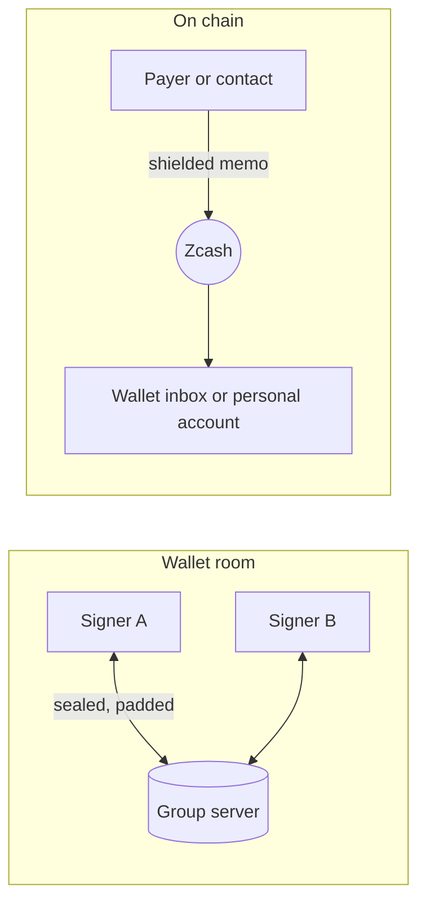

# Messages in Zigs: design

Status: design, not built. The web app comes first and the iPhone app follows. This document
records the decisions taken on 12 October 2026 and the order of the work.

Zigs is a shared wallet, so its messages exist to explain, request and approve money. A
messenger such as Signal does none of that. Messages here are tied to wallets, payments
and payment requests.

## 1. Decisions

| Question | Decision |
|---|---|
| Personal account for messages on chain | Yes. Each person can have a small single-signer Zcash account that pays message fees. |
| Platform | Web app first. No push notifications. |
| Direct messages between Zigs users through the group server | Accepted for the demo. The group server then learns who talks to whom (section 6). |

## 2. Three kinds of conversation

| Conversation | Who is in it | Transport | Speed and cost |
|---|---|---|---|
| **Wallet room** | The signers of one wallet | Group server | Instant, free |
| **Wallet inbox** | Senders who pay the wallet, and its signers | Zcash memos | One block, fee paid by the sender |
| **Direct chat** | Two people | Group server (Zigs users), later Zcash memos (anyone) | Instant and free, or one block with a fee and a proof |

Each message shows how it travels: "Instant · group server" or "On chain · fee 0.0001 ZEC".

### 2.1 Wallet room

- One room for each wallet, and one thread for each payment proposal.
- Payment events appear in the timeline: proposed, approved, signed, sent, cancelled.
- From a payment thread, a signer can open the payment and approve it.

### 2.2 Wallet inbox

- A memo that arrives with a payment to the wallet address shows as a message on that payment.
- The Send form takes an optional memo for each recipient. Approvers see the memo, because it is
  part of the transaction they approve.
- Every signer holds the wallet's viewing key, so every signer can read every memo. The app calls
  this a shared inbox and never a private message.

### 2.3 Direct chat

- **Between Zigs users (demo path).** A chat is a new store namespace with its own random id and
  secret. One person shares a contact link, like an invite link: `#c.<chat id>.<secret>`. The
  other person opens it, and both write sealed messages there.
- **To any Zcash user (later).** Messages go as memos from the personal account to the
  contact's shielded address. No server is involved, and the recipient can be offline.
- **Payment requests.** A contact sends a request (ZIP 321 URI, one or more recipients). The user
  clicks **Propose this**, and the request becomes a wallet proposal for the signers to approve.
  The existing batch recipient list (`web/payees.js`) takes a request with several lines.

## 3. Storage on the group server

- **Separate namespace.** The group server sends every document of a namespace when a device
  connects, and caps a namespace at 10 MB (`MAX_TOTAL`). Messages in the wallet namespace would
  make every join slower and fill the wallet. So each wallet room is a namespace of its own,
  with a random id and secret. The wallet document stores both as sealed fields.
- **Layout.** `groups/<room id>/messages/<message id>`, one document per message. Fields are
  sealed with the room secret and padded, as wallet fields are.
- **Growth.** A short message takes 1 to 2 KB once sealed and padded, so a room holds 5,000 to
  10,000 messages.
  `ponytail:` the first version downloads the whole room on connect. Upgrade path: a server
  operation that returns documents after a given time, and one document per day of messages.
- **No change to the server** is needed for the first version: a room is one more namespace.

## 4. Who sent a message

Anyone who has a wallet's invite link holds its secret and can write any document. A name field
therefore proves nothing.

- Each seat gets an Ed25519 signing key when it takes its seat (Web Crypto, no new dependency).
  The private key stays in the seat's secrets. The public key goes into the seat document.
- Each message carries a signature over its room id, message id, thread, time and text.
- Each device pins the first signing key it sees for a seat. A later change shows a warning on
  that seat, and its messages show as unverified.
- In a direct chat, each person signs with a personal key and shares its public key in the
  contact link exchange.
- Seats created before this change get a signing key the next time their device opens the
  wallet.

## 5. The personal account (on-chain messages)

- A single-signer Ironwood account in the browser, separate from every wallet. It never holds
  a wallet's key share or viewing key.
- Its spending key is sealed like the key shares: with the passkey lock when it is on.
- It pays fees for memos. The app shows its balance, warns when it is low, and suggests a
  maximum balance, because whoever controls the device can spend it.
- Engine work: create the account, build, sign and prove a single-signer transaction with
  memos, and split a long message over several memos (512 bytes each).

## 6. What each party learns

| Party | Wallet room | Direct chat, group server | On-chain message |
|---|---|---|---|
| Group server | Room id, timing, message count, sizes after padding, IP addresses | The same, and that two ids talk to each other | Nothing |
| Light-wallet server | Nothing | Nothing | Which full transactions a device fetches, and your IP address |
| Zcash chain | Nothing | Nothing | One shielded transaction with ordinary fee and action count |
| Other signers | All room messages | Nothing | All memos to the wallet address |
| A signer removed by "Change signers" | The old room only | Nothing | The old wallet's memos, through its viewing key |

PRIVACY.md gets these rows when each phase ships.

## 7. Notifications (web)

- No push service. Messages arrive while the page is open.
- Unread counts on wallets and in the page title.
- Optional browser notifications while a tab is open, with no message text: "New message in
  Treasury".

## 8. Phases

| Phase | Scope | Main work |
|---|---|---|
| 1 | Wallet room and payment threads | Room namespace, signing keys, Messages tab, payment events in the timeline |
| 2 | Direct chat between Zigs users | Contact links, chat namespace, personal signing key |
| 3 | Memos on payments, wallet inbox | Engine writes memos, full transaction fetch, reorg handling (`wasm/src/chain.rs:75`) |
| 4 | Payment requests | ZIP 321 parsing, **Propose this** |
| 5 | Personal account, on-chain direct messages | New key type, fee funding, multi-memo messages |
| 6 | Extra encryption layer | Post-quantum handshake and ratchet, released only after an outside cryptography review |

Until phase 6 ships, on-chain messages rely on Zcash's own memo encryption, and the app says so.
The iPhone app follows the web app phase by phase.

## 9. Limits

- Messages on the group server are as private as wallet data: the server reads no content, but
  sees timing. They are not forward secret. Whoever gets a room secret later can read the room.
- On-chain messages are permanent. Deleting a chat removes it from the device only.
- Tor Browser and private windows delete local data when they close, and room history then
  downloads again from the group server. Direct chats on chain need the personal account backup.
- A device that holds a seat can sign messages as that seat. A stolen device is a stolen seat.
