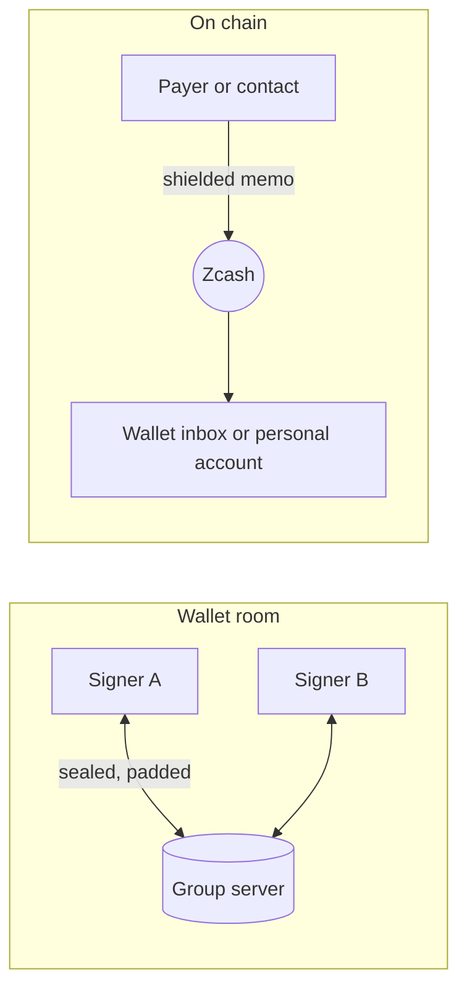

# Messages in Zigs: design

Status: the web app has phases 1 to 5. Phase 1 is the wallet room and the payment threads.
Phase 2 is direct chats between Zigs users. Phase 3 is memos on payments, the wallet inbox and
reorganisations. Phase 4 is payment requests. Phase 5 is the personal account and messages on
chain. The iPhone and Mac apps have phases 1 and 2. They also show and check the memo of a payment
that they approve. The other screens of phase 3, and phases 4 and 5, are not built there. New
features go to the web app first, because it is the fastest to change. The iPhone and Mac apps
follow when demand justifies it. Phase 6 is design only. This document records the decisions taken
on 12 October 2026 and the order of the work.

Zigs is a shared wallet, so its messages exist to explain, request and approve money. A
messenger such as Signal does none of that. Messages here are tied to wallets, payments
and payment requests.

## 1. Decisions

| Question | Decision |
|---|---|
| Personal account for messages on chain | Yes. Each person can have a small single-signer Zcash account that pays message fees. |
| Platform | Web app first. No push notifications. |
| Direct messages between Zigs users through the group server | Accepted for the demo. The group server then learns who talks to whom (section 6). |

## 2. Three kinds of conversation

| Conversation | Who is in it | Transport | Speed and cost |
|---|---|---|---|
| **Wallet room** | The signers of one wallet | Group server | Instant, free |
| **Wallet inbox** | Senders who pay the wallet, and its signers | Zcash memos | One block, fee paid by the sender |
| **Direct chat** | Two people | Group server (Zigs users), Zcash memos (anyone, from the personal account) | Instant and free, or one block with a fee and a proof |

Each message shows how it travels: "Instant · group server" or "On chain · fee 0.0001 ZEC". The fee
of an on-chain message grows with its number of parts (section 5.3).

### 2.1 Wallet room

- One room for each wallet, and one thread for each payment proposal.
- Payment events appear in the timeline: proposed, sent and cancelled. Approved and signed events
  are later work, because the wallet view reads the approvals of the open payment only.
- From a payment thread, a signer can open the payment and approve it.

### 2.2 Wallet inbox

- A memo that arrives with a payment to the wallet address shows on the Activity row of that
  payment and in the Messages tab.
- The Send form takes an optional memo for each recipient. Approvers see the memo, because it is
  part of the transaction they approve.
- Every signer holds the wallet's viewing key, so every signer can read every memo. The app calls
  this a shared inbox and never a private message.

Built in phase 3 (web):

- **Sending.** A memo is ZIP 302 text of at most 512 UTF-8 bytes. The form shows the byte count
  near the limit and refuses more. "Paste a list" takes the memo as a third column. A memo for a
  transparent address is refused. The memo is part of the signed `payees` field of the proposal.
  Proposals without memos stay valid.
- **Approving.** The engine reads the memo of each output from the transaction itself, with the
  wallet's outgoing viewing key. The recipient check compares address, amount and memo of every
  payee. Any difference, and any memo that the engine cannot read, disables Approve. The web,
  iPhone and Mac apps apply the same rules.
- **Receiving.** The wallet finds a note in a compact block, which holds only part of the note
  ciphertext. It then asks the light-wallet server for the full transaction (`GetTransaction`).
  It decrypts the memo with the incoming viewing key and saves it with the note. The wallet
  tries again after a failure, and never makes the sync wait.
- **Opt in.** Each fetch tells the light-wallet server which transactions pay the wallet. So
  reading memos is off until a signer turns it on, for one wallet in one browser. The setting
  names the leak. It is not a field of the wallet, because every signer would read it.
- **Unreadable notes.** The transaction id covers every ciphertext. A note can fail to decrypt in
  full in a transaction with the right id. It shows "Memo is not text", and the wallet does not
  ask for it again. An answer with another id, a bad size or a bad format changes nothing. A
  transaction that fails is listed after the others, so it cannot hold them up.
- **Showing.** A memo shows with the label "On chain · shared with all signers". It has no sender
  and no signature, because anyone who pays the address can write any text. The app never marks it
  as verified, and a notification never carries its text. Change and empty memos show nothing. A
  memo that is not text shows "Memo is not text".

### 2.3 Direct chat

- **Between Zigs users (demo path, built).** A chat is a new store namespace with its own random
  id and secret. One person shares a contact link, like an invite link: `#c.<chat id>.<secret>`.
  The other person opens it, enters a name and clicks "Join chat". Opening the link alone joins
  nothing, so a link scanner cannot take the second place. Both then write sealed messages there.
  A chat holds two members. The chat is saved in the browser only, and it has no wallet document,
  so it never lists as a wallet.
- **To any Zcash user (built in phase 5, web).** Messages go as memos from the personal account to
  the contact's shielded address. The light-wallet server relays the transaction. No Zigs server is
  involved, and the recipient can be offline. Section 5 gives the rules.
- **Payment requests.** A contact sends a request (ZIP 321 URI, one or more recipients). The user
  clicks **Propose this**, and the Send form opens with the request. Section 2.4 gives the rules.

### 2.4 Payment requests

A payment request is a normal signed message. It can be in a wallet room, in a payment thread or in
a direct chat. Its whole text, trimmed, is one ZIP 321 URI that starts with `zcash:`. Any other text
is a plain message, also a text that holds a URI between other words. A memo that arrives with a
payment follows the same rule. A message shows as a request card, whether or not the URI is valid.

Built in phase 4 (web):

- **Reading.** The engine reads the URI (`parseRequest`, built on the `zip321` crate). It refuses a
  malformed URI and a request that Zigs cannot use. An error names the payee. A card for a refused
  request shows the reason. A wallet reads a request for its own network. A direct chat has no
  wallet, so it tries both networks. PROTOCOL.md lists the refusals.
- **Sending.** **Request a payment** sits next to the message box in the wallet room and in a
  direct chat. The form asks for an amount and a memo, and both are optional. Without an amount,
  the payer chooses. In a room, the request pays the open wallet. In a direct chat, the person
  picks one of the wallets where this browser holds a key share. The address comes from the check
  that the person's own seat made, never from the group server. The form holds the id of the
  chosen wallet, not its place in a list. The engine makes the URI (`makeRequest`), and the app
  sends it as the text of a message.
- **Card.** The card shows the total and each payee. A payee has a short address, the amount or
  "The payer chooses the amount", and the memo. The name and the message of a payee are text from
  the sender. The card cuts them to 3 lines and 120 characters, and marks them "From the request,
  not checked". The card also shows the sender and the check of the sender. A sender that is not
  verified gets a warning. A memo has no sender, so it always gets one. A card in a direct chat
  names the network. The card also has **Copy request**.
- **Propose this.** It sends nothing. It opens the Send form with the payees of the request and a
  note. The note is "Request from <sender>" for a verified sender and "Request from a memo" for a
  memo. For any other sender, it is "Request from an unverified sender". A sender that is not
  verified can write any name, and every approver reads the note. In a direct chat, a verified
  name is the name that the contact chose. A request from this browser gives "Request from the
  proposer", because each approver reads "You" as themselves. A proposal from another wallet adds
  the name of the room's wallet, because the seat numbers differ between wallets. The proposer
  reads the note in the Send form and can change it. The checks and the approvals of a normal
  payment apply.
- **Which wallet proposes.** In a room, the open wallet proposes. In a direct chat, the person
  picks a wallet of the right network where this browser holds a key share. A wallet cannot pay
  itself, so the card never offers a wallet that the request pays. If a room request pays the
  open wallet, the card offers the other wallets where this browser holds a key share. If no
  wallet is left, the card says so and **Propose this** is off. **Copy request** still serves a
  payer outside Zigs.
- **Send form.** A request pasted in a recipient field, or in **Paste a list**, fills the rows
  with its payees. A payee without an amount gets an empty field. A memo fills a row as one line of
  text, because the field cannot show a line break.

Not built: the iPhone and Mac screens, and requests in the Activity list. The Activity row of a
payment still shows the text of its memo.

## 3. Storage on the group server

- **Separate namespace.** The group server sends every document of a namespace when a device
  connects, and caps a namespace at 10 MB (`MAX_TOTAL`). Messages in the wallet namespace would
  make every join slower and fill the wallet. So each wallet room is a namespace of its own,
  with a random id and secret. The wallet document stores both as sealed fields.
- **Layout.** `groups/<room id>/messages/<message id>`, one document per message. Fields are
  sealed with the room secret and padded, as wallet fields are.
- **Growth.** A short message takes 1 to 2 KB once sealed and padded, so a room holds 5,000 to
  10,000 messages.
  `ponytail:` the first version downloads the whole room on connect. Upgrade path: a server
  operation that returns documents after a given time, and one document per day of messages.
- **No change to the server** is needed for the first version: a room is one more namespace.

## 4. Who sent a message

Anyone who has a wallet's invite link holds its secret and can write any document. A name field
therefore proves nothing.

- Each seat gets an Ed25519 signing key when it takes its seat (Web Crypto, no new dependency).
  The private key stays in the seat's secrets. The public key goes into the seat document.
- Each message carries a signature over its room id, message id, thread, time and text.
- Each device pins the first signing key it sees for a seat. A later change shows a warning on
  that seat, and its messages show as unverified.
- In a direct chat, each person signs with one personal key per browser. The public key is a
  field of the member document. Each device pins its own member and the first key of that
  member. It pins the other member only when that member is the only new one in the documents
  that it reads. Two new members that arrive together cannot be told apart, so the device pins
  neither and shows the "third person" warning. The time in a member document proves nothing,
  because the writer sets it.
- Seats created before this change get a signing key the next time their device opens the
  wallet.

## 5. The personal account (on-chain messages)

Phase 5 design, 13 October 2026. Built in the web app (section 5.5). Web app only.

### 5.1 The account

- A single-signer Ironwood account in the browser, separate from every wallet. It never holds a
  wallet's key share or viewing key. A browser has at most one personal account. The person picks
  its network when they create it.
- **Key.** A random 32-byte seed. The spending key comes from the seed by ZIP 32
  (`SpendingKey::from_zip32_seed`, coin type 133 on mainnet and 1 on testnet, account 0). There is
  no BIP 39 phrase, because that needs a new dependency. The browser seals the seed like a key
  share: with the passkey lock when it is on. With the lock off, local storage never holds the
  seed (section 5.5).
- **Birthday.** The chain tip when the account is created. The sync starts there.
- **Sync.** The account syncs with `ChainWallet`, by its viewing key, like a wallet. It always
  reads memos (`memo_needs`, `attachTransaction`), because messages are memos.
- **Balance.** The account card shows the balance and the public address (diversifier index 0).
  It warns when the balance pays fewer than 3 one-part messages. It warns above 0.01 ZEC, because
  whoever controls the device can spend the account. Mainnet uses the cap of the wallets.
- **Funding.** The card makes a ZIP 321 request to the account address (phase 4 `makeRequest`).
  **Fund from a wallet** opens the Send form of a wallet where this browser holds a key share, as
  **Propose this** does. **Copy request** serves a wallet outside Zigs. The request splits the
  amount over 3 payees, so the account gets 3 notes and can send after each block (section 5.4).
- **Backup.** The encrypted backup format of key shares (`wasm/src/backup.rs`, Argon2id and
  XChaCha20-Poly1305) holds the seed, the network, the birthday and the contacts. It holds no
  messages. **Restore** reads the file and syncs from the birthday.

### 5.2 Contacts and who wrote a message

A memo has no sender. The recipient can trust one fact only: the address that received the note.
So each contact gets its own receiving address of the account.

- An on-chain contact is a name, the contact's shielded address, and an index. The index is the
  diversifier index of the account address that this contact writes to. Contact 1 gets index 1,
  and so on. Index 0 is the public address of the account. Orchard addresses of one account
  cannot be linked without its viewing key.
- **Add a contact.** The person enters a name and the contact's address. The app takes only a
  unified address with an Orchard receiver (`normalizeAddress`). The app then shows **Your address
  for <name>**, to copy or show as a QR code. The person gives this address to the contact.
- **Who wrote it.** A message to index `j` shows in the chat of contact `j`, marked "On chain ·
  sent to the address you gave <name>". Anyone who knows that address can write there. A message
  to index 0, or to an index of no contact, shows under **Other messages** on the account card,
  marked "Not verified".
- Contacts are saved sealed in the browser and in the backup. A contact is never written to the
  group server.

### 5.3 A message on chain

- **Outputs.** A message is one transaction from the account to the contact's address. Each part
  of the text is one zero-value output with a ZIP 302 text memo. The engine builds these outputs
  itself from the text (`createMessage`). The payee list and the request rules of phases 3 and 4
  still refuse a zero amount.
- **Parts.** A memo holds 512 bytes. The engine splits the text by UTF-8 bytes, only between
  characters. A message has at most 5 parts and at most 2,000 characters. A one-part message has
  no marker. Each part of a longer message starts with a marker, `(1/3) `, so other wallets show
  readable text. The outputs of a transaction come in a random order. So the reader joins the
  parts of one transaction by their markers. If the markers are not exactly 1 to N for N memos,
  the reader shows each memo as it is.
- **Fee.** ZIP 317: 0.00005 ZEC for each action, at least 2. A message with N parts has N outputs
  and one change output. The composer shows the fee before sending, for example "On chain · fee
  0.0001 ZEC" for one part and "fee 0.0002 ZEC" for three parts.
- **Signing.** The account signs each spend of the PCZT with its spend authorizing key, through the
  `pczt` crate's `Signer::sign_ironwood`. That call checks the key against `rk`. Then the normal
  proof and finalize path runs (`finalize`), and the account broadcasts. There is no FROST.
- **Sent messages.** The browser keeps the text of each sent message, sealed, with its txid. The
  chat shows it as "Sending", then "On chain" when its block arrives. Section 5.5 lists the other
  states.
- **Requests.** A received message whose whole text is a ZIP 321 URI shows as a request card, with
  the verdict "memo" (phase 4).

### 5.4 Engine and web work

Engine (`wasm/src`), each call in the wasm exports and in the ffi table:

- `accountNew(network)`: a new seed, its unified viewing key and its public address.
- `accountKeys(seed, network)`: the viewing key and the public address for a seed.
- `addressAt(ufvk, index)`: the account address at a diversifier index.
- `splitMessage(text)` and `joinMessage(memos)`: the part rules of section 5.3.
- `ChainWallet.createMessage(to, text)`: the PCZT, the fee and the number of parts.
- `accountSign(pczt, seed, network)`: the signed PCZT, each signature checked under `rk`.
- `received()` adds the diversifier index that received each memo. It also adds `indexes`: the
  index of every note of a transaction, also a note with an empty memo or a memo not read yet.
- `isNodeRefusal(message)`: true when a node answered a broadcast and refused the transaction.

Web (`web/app.js`, `web/chat.js`):

- The **Personal account** card on the home page: create, balance, address, warnings, funding,
  backup, restore.
- **On-chain contacts** under the chats, each with a chat view. The composer shows "On chain ·
  fee …" and **Send on chain**. Sending takes about a minute, because the browser builds a proof.
- **One message at a time.** The engine does not know about unmined spends. So the composer is off
  while a message waits for its block. After the block, the account spends its other confirmed
  notes. Change needs 3 confirmations, so an account with one note waits about 4 minutes.

Checks:

- Rust tests for the key derivation and the single-signer signing.
- Rust tests for the split and join rules, also a 4-byte character on a part boundary.
- A full build, sign and prove with 3 parts.
- The index of every received note, also a note with an empty memo or a memo not read yet.
- The words of a node refusal, which a transport error cannot forge.

The first test runs before any web work: a zero-value output with a memo must show in the
recipient's `received()` and `memo_needs`. If it does not, each part pays the smallest amount that
the builder accepts. Node tests cover the contact rules and the chat view states.

### 5.5 Built in the web app

The rules are in `web/personal.js`, and the pages and engine calls are in `web/app.js`. The
checks are `web/test/personal.mjs` and `web/test/app.mjs`.

- **Where the seed lives.** With the passkey lock on, the account is a field of the sealed record,
  like a key share. With the lock off, local storage never holds the seed. The account is then
  sealed with an AES key that the browser cannot export, and both sit in IndexedDB. Code on the
  same site can still use that key, so the passkey lock is the safer way. The saved sync state
  has its own random key, which is a field of the account record. A restore makes a new one.
- **Sync.** The account syncs by its viewing key from its birthday, which is the chain tip at the
  moment of creation. It always reads memos. It starts when the page loads and never uses the
  group server. The page does not wait for the saved account: it opens at once, and the account
  loads beside it.
- **Contacts.** A name has at most 40 characters. An address must be a shielded address of the
  network of the account, and not an address of the account itself. A browser keeps at most 200
  contacts. A contact cannot be renamed or removed in this version.
- **Indexes.** A new contact gets an index above every index in use. The page counts the contacts
  and every note that the chain shows for the account (`indexes` of `received()`). So an old
  backup file does not give an address out twice, if that address got a payment. An index is at
  most 2,147,483,648, and a file with a higher index is refused. The first sync must be done
  before the page adds a contact, because the chain answers which addresses got a payment. An
  address that got no payment cannot be known. Make a new backup after each contact.
- **Funding.** The amount is split over 3 payees that differ by at most one zatoshi. The least
  amount is 0.0003 ZEC, so that each note pays one message. **Fund from a wallet** opens the Send
  form of a wallet where this browser holds a key share. The note is "Fund the proposer's
  personal account". Nothing is sent before the approvals of that wallet. On mainnet, the address
  and the request are off while the balance is unknown or at the cap of the wallets. While the
  person types, the form warns when the amount and the balance together pass 0.01 ZEC.
- **Sending.** Only the button sends a message, because it is permanent and costs a fee. The page
  builds the message, signs it with the seed on the main thread, and builds the proof in the
  worker. It saves the record of the message, sealed, and only then broadcasts it. The record has
  one of these states:
  - **Sending:** a server took the message, or this page sends it now.
  - **On chain:** a block holds it.
  - **Not sent:** every server answered with a refusal. The notes are free at once.
  - **May not be sent:** no server answered, or the page closed before it saved the answer. The
    network may hold the message, so its notes stay held.
  - **Not on chain:** no block held it 44 blocks after the height it was built at. The notes are
    free again.

  The notes of a message that is sending or that may not be sent stay held. The composer is off
  until a block holds the message or it expires. One message is built at a time. A browser with
  Web Locks keeps this rule in all tabs, and other browsers keep it in one tab. A tab reads the
  saved account again before it builds.
- **Receiving.** The memos of one transaction that went to one address of the account are one
  message when `joinMessage` joins them. A memo that is not text keeps the other memos apart.
  All text goes through the display filters of memos. The page shows the 50 newest of the other
  messages.
- **Backup.** The payload is `{kind: "personal", version: 1, network, seed, birthday, contacts}`
  in the encrypted file of key shares. A browser keeps one account. **Restore** refuses a file
  that is not encrypted and a browser that has an account. Before **Create account** and
  **Restore**, the page reads the saved account again, and the store refuses a second record. So a
  second tab cannot replace an account. **Remove from this browser** deletes the seed, and only a
  backup file brings the account back. The warning before a removal says that no file exists, or
  that the last file lacks the newest contacts.
- **A record that does not read.** The record stays as it is. The card shows the reason with
  **Back up account**, which saves the seed and the contacts that read, and **Remove from this
  browser**. The restore message says that a contact added after the file was made is not in it.
- **Not built.** Unread counts and notifications for on-chain messages, removal of a contact, and
  the iPhone and Mac screens. The home page waits for the group server, like the rest of the app,
  although the account does not use it.

## 6. What each party learns

| Party | Wallet room | Direct chat, group server | On-chain message |
|---|---|---|---|
| Group server | Room id, timing, message count, sizes after padding, IP addresses | The same, and that two ids talk to each other | Nothing |
| Light-wallet server | Nothing | Nothing | Which full transactions a device fetches (always for the personal account, and for a wallet only where reading memos is on), and your IP address |
| Zcash chain | Nothing | Nothing | One shielded transaction with ordinary fee and action count |
| Other signers | All room messages | Nothing | All memos to the wallet address |
| A signer removed by "Change signers" | The old room only | Nothing | The old wallet's memos, through its viewing key |

PRIVACY.md gets these rows when each phase ships.

A payment request adds one fact to a message. Its readers learn the wallet address that it names,
and the amount and the memo if it has them. In a direct chat, the readers are the contact and
anyone who has the contact link.

## 7. Notifications (web)

- No push service. Messages arrive while the page is open.
- Unread counts on wallets, on chats and in the page title.
- Optional browser notifications while a tab is open, with no message text: "New message in
  Treasury" for a wallet. For a chat the title is "New message from <name>" only when every new
  message comes from the pinned contact. Otherwise it is "New message in a chat". The check of the
  signature is asynchronous, so a notification claims no more than the pin.

## 8. Phases

| Phase | Status | Scope | Main work |
|---|---|---|---|
| 1 | Built (web, iPhone, Mac) | Wallet room and payment threads | Room namespace, signing keys, Messages tab, payment events in the timeline |
| 2 | Built (web, iPhone, Mac) | Direct chat between Zigs users | Contact links, chat namespace, personal signing key |
| 3 | Built (web). iPhone and Mac: memo check on approval | Memos on payments, wallet inbox | Engine writes and reads memos, full transaction fetch, reorganisation handling (`wasm/src/chain.rs`). The other iPhone screens follow. |
| 4 | Built (web) | Payment requests | ZIP 321 parsing and writing in the engine, request cards, **Propose this** |
| 5 | Built (web). Engine calls are in the native table | Personal account, on-chain direct messages | Single-signer account, contacts with their own addresses, messages of up to 5 memos, funding request |
| 6 | Design | Extra encryption layer | Post-quantum handshake and ratchet, released only after an outside cryptography review |

Until phase 6 ships, on-chain messages rely on Zcash's own memo encryption, and the app says so.
The iPhone and Mac apps follow the web app when demand justifies it. They have phases 1 and 2. The
document formats, keys and signatures are the same as in the web app. So a browser and an iPhone
talk in one room and in one direct chat. The apps keep the room secrets with the seat secrets. They
keep the chats in the Keychain, or in the sealed record when the Face ID lock is on. They show
unread counts and send no notifications. `ios/check-backup.sh` checks that each side verifies the
messages of the other. The apps show a payment request as plain text.

## 9. Limits

- Messages on the group server are as private as wallet data: the server reads no content, but
  sees timing. They are not forward secret. Whoever gets a room secret later can read the room.
- On-chain messages are permanent. Deleting a chat removes it from the device only.
- Tor Browser and private windows delete local data when they close, and room history then
  downloads again from the group server. Direct chats on chain need the personal account backup.
- A device that holds a seat can sign messages as that seat. A stolen device is a stolen seat.
- A payment request tells its readers a wallet address. A request in a direct chat tells the
  contact, and anyone who has the contact link, the address, the amount and the memo. Send a
  request only to a person who may know that the wallet exists.
- A memo on chain comes from the payer. The app cannot check who wrote it. Every signer, and a
  signer removed by "Change signers" who kept the viewing key, can read it for good.
- An on-chain message to a contact's address can come from anyone who knows that address. The
  app shows who received it, not who wrote it.
- The text of a sent on-chain message stays in the browser that sent it. A restore from the backup
  brings back the received messages only.
- A backup file lacks the contacts that you added after you made it. A message to the address of
  such a contact shows under Other messages. A new contact does not take an index that got a
  payment. An address that you gave out but that got no payment is not known after a restore.
- A message part is a zero-value note. A wallet that hides such notes does not show the message.
- The contact link is the chat secret. Anyone who has it can read the chat and write in it, also
  after both people joined. A third writer shows as "Unknown sender", but a silent reader is not
  seen. Share the link through a private channel only.
- A direct chat lives in one browser. A browser that forgets it cannot join again, because a chat
  holds two people. "Leave chat" removes it from the browser only; the sealed messages stay on the
  group server.
