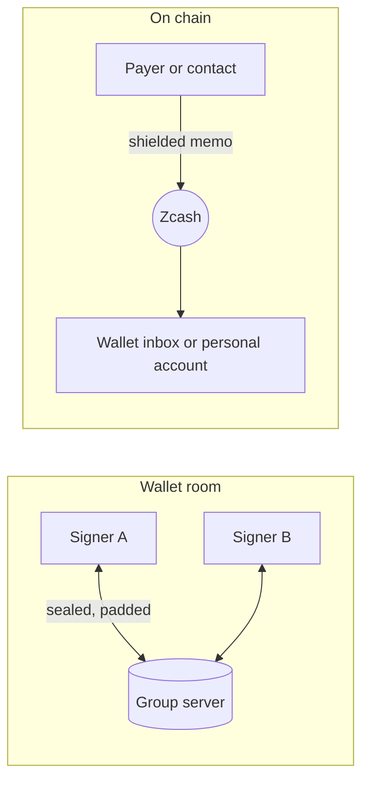

# Messages in Zigs: design

Status: the web app has phases 1 to 4. Phase 1 is the wallet room and the payment threads.
Phase 2 is direct chats between Zigs users. Phase 3 is memos on payments, the wallet inbox and
reorganisations. Phase 4 is payment requests. The iPhone and Mac apps have phases 1 and 2. They
also show and check the memo of a payment that they approve. The other screens of phase 3, and
phase 4, are not built there. New features go to the web app first, because it is the fastest to
change. The iPhone and Mac apps follow when demand justifies it. Phases 5 and 6 are design only.
This document records the decisions taken on 12 October 2026 and the order of the work.

Zigs is a shared wallet, so its messages exist to explain, request and approve money. A
messenger such as Signal does none of that. Messages here are tied to wallets, payments
and payment requests.

## 1. Decisions

| Question | Decision |
|---|---|
| Personal account for messages on chain | Yes. Each person can have a small single-signer Zcash account that pays message fees. |
| Platform | Web app first. No push notifications. |
| Direct messages between Zigs users through the group server | Accepted for the demo. The group server then learns who talks to whom (section 6). |

## 2. Three kinds of conversation

| Conversation | Who is in it | Transport | Speed and cost |
|---|---|---|---|
| **Wallet room** | The signers of one wallet | Group server | Instant, free |
| **Wallet inbox** | Senders who pay the wallet, and its signers | Zcash memos | One block, fee paid by the sender |
| **Direct chat** | Two people | Group server (Zigs users), later Zcash memos (anyone) | Instant and free, or one block with a fee and a proof |

Each message shows how it travels: "Instant · group server" or "On chain · fee 0.0001 ZEC".

### 2.1 Wallet room

- One room for each wallet, and one thread for each payment proposal.
- Payment events appear in the timeline: proposed, sent and cancelled. Approved and signed events
  are later work, because the wallet view reads the approvals of the open payment only.
- From a payment thread, a signer can open the payment and approve it.

### 2.2 Wallet inbox

- A memo that arrives with a payment to the wallet address shows on the Activity row of that
  payment and in the Messages tab.
- The Send form takes an optional memo for each recipient. Approvers see the memo, because it is
  part of the transaction they approve.
- Every signer holds the wallet's viewing key, so every signer can read every memo. The app calls
  this a shared inbox and never a private message.

Built in phase 3 (web):

- **Sending.** A memo is ZIP 302 text of at most 512 UTF-8 bytes. The form shows the byte count
  near the limit and refuses more. "Paste a list" takes the memo as a third column. A memo for a
  transparent address is refused. The memo is part of the signed `payees` field of the proposal.
  Proposals without memos stay valid.
- **Approving.** The engine reads the memo of each output from the transaction itself, with the
  wallet's outgoing viewing key. The recipient check compares address, amount and memo of every
  payee. Any difference, and any memo that the engine cannot read, disables Approve. The web,
  iPhone and Mac apps apply the same rules.
- **Receiving.** The wallet finds a note in a compact block, which holds only part of the note
  ciphertext. It then asks the light-wallet server for the full transaction (`GetTransaction`).
  It decrypts the memo with the incoming viewing key and saves it with the note. The wallet
  tries again after a failure, and never makes the sync wait.
- **Opt in.** Each fetch tells the light-wallet server which transactions pay the wallet. So
  reading memos is off until a signer turns it on, for one wallet in one browser. The setting
  names the leak. It is not a field of the wallet, because every signer would read it.
- **Unreadable notes.** The transaction id covers every ciphertext. A note can fail to decrypt in
  full in a transaction with the right id. It shows "Memo is not text", and the wallet does not
  ask for it again. An answer with another id, a bad size or a bad format changes nothing. A
  transaction that fails is listed after the others, so it cannot hold them up.
- **Showing.** A memo shows with the label "On chain · shared with all signers". It has no sender
  and no signature, because anyone who pays the address can write any text. The app never marks it
  as verified, and a notification never carries its text. Change and empty memos show nothing. A
  memo that is not text shows "Memo is not text".

### 2.3 Direct chat

- **Between Zigs users (demo path, built).** A chat is a new store namespace with its own random
  id and secret. One person shares a contact link, like an invite link: `#c.<chat id>.<secret>`.
  The other person opens it, enters a name and clicks "Join chat". Opening the link alone joins
  nothing, so a link scanner cannot take the second place. Both then write sealed messages there.
  A chat holds two members. The chat is saved in the browser only, and it has no wallet document,
  so it never lists as a wallet.
- **To any Zcash user (later).** Messages go as memos from the personal account to the
  contact's shielded address. No server is involved, and the recipient can be offline.
- **Payment requests.** A contact sends a request (ZIP 321 URI, one or more recipients). The user
  clicks **Propose this**, and the Send form opens with the request. Section 2.4 gives the rules.

### 2.4 Payment requests

A payment request is a normal signed message. It can be in a wallet room, in a payment thread or in
a direct chat. Its whole text, trimmed, is one ZIP 321 URI that starts with `zcash:`. Any other text
is a plain message, also a text that holds a URI between other words. A memo that arrives with a
payment follows the same rule. A message shows as a request card, whether or not the URI is valid.

Built in phase 4 (web):

- **Reading.** The engine reads the URI (`parseRequest`, built on the `zip321` crate). It refuses a
  malformed URI and a request that Zigs cannot use. An error names the payee. A card for a refused
  request shows the reason. A wallet reads a request for its own network. A direct chat has no
  wallet, so it tries both networks. PROTOCOL.md lists the refusals.
- **Sending.** **Request a payment** sits next to the message box in the wallet room and in a
  direct chat. The form asks for an amount and a memo, and both are optional. Without an amount,
  the payer chooses. In a room, the request pays the open wallet. In a direct chat, the person
  picks one of the wallets where this browser holds a key share. The address comes from the check
  that the person's own seat made, never from the group server. The form holds the id of the
  chosen wallet, not its place in a list. The engine makes the URI (`makeRequest`), and the app
  sends it as the text of a message.
- **Card.** The card shows the total and each payee. A payee has a short address, the amount or
  "The payer chooses the amount", and the memo. The name and the message of a payee are text from
  the sender. The card cuts them to 3 lines and 120 characters, and marks them "From the request,
  not checked". The card also shows the sender and the check of the sender. A sender that is not
  verified gets a warning. A memo has no sender, so it always gets one. A card in a direct chat
  names the network. The card also has **Copy request**.
- **Propose this.** It sends nothing. It opens the Send form with the payees of the request and a
  note. The note is "Request from <sender>" for a verified sender and "Request from a memo" for a
  memo. For any other sender, it is "Request from an unverified sender". A sender that is not
  verified can write any name, and every approver reads the note. In a direct chat, a verified
  name is the name that the contact chose. A request from this browser gives "Request from the
  proposer", because each approver reads "You" as themselves. A proposal from another wallet adds
  the name of the room's wallet, because the seat numbers differ between wallets. The proposer
  reads the note in the Send form and can change it. The checks and the approvals of a normal
  payment apply.
- **Which wallet proposes.** In a room, the open wallet proposes. In a direct chat, the person
  picks a wallet of the right network where this browser holds a key share. A wallet cannot pay
  itself, so the card never offers a wallet that the request pays. If a room request pays the
  open wallet, the card offers the other wallets where this browser holds a key share. If no
  wallet is left, the card says so and **Propose this** is off. **Copy request** still serves a
  payer outside Zigs.
- **Send form.** A request pasted in a recipient field, or in **Paste a list**, fills the rows
  with its payees. A payee without an amount gets an empty field. A memo fills a row as one line of
  text, because the field cannot show a line break.

Not built: the iPhone and Mac screens, and requests in the Activity list. The Activity row of a
payment still shows the text of its memo.

## 3. Storage on the group server

- **Separate namespace.** The group server sends every document of a namespace when a device
  connects, and caps a namespace at 10 MB (`MAX_TOTAL`). Messages in the wallet namespace would
  make every join slower and fill the wallet. So each wallet room is a namespace of its own,
  with a random id and secret. The wallet document stores both as sealed fields.
- **Layout.** `groups/<room id>/messages/<message id>`, one document per message. Fields are
  sealed with the room secret and padded, as wallet fields are.
- **Growth.** A short message takes 1 to 2 KB once sealed and padded, so a room holds 5,000 to
  10,000 messages.
  `ponytail:` the first version downloads the whole room on connect. Upgrade path: a server
  operation that returns documents after a given time, and one document per day of messages.
- **No change to the server** is needed for the first version: a room is one more namespace.

## 4. Who sent a message

Anyone who has a wallet's invite link holds its secret and can write any document. A name field
therefore proves nothing.

- Each seat gets an Ed25519 signing key when it takes its seat (Web Crypto, no new dependency).
  The private key stays in the seat's secrets. The public key goes into the seat document.
- Each message carries a signature over its room id, message id, thread, time and text.
- Each device pins the first signing key it sees for a seat. A later change shows a warning on
  that seat, and its messages show as unverified.
- In a direct chat, each person signs with one personal key per browser. The public key is a
  field of the member document. Each device pins its own member and the first key of that
  member. It pins the other member only when that member is the only new one in the documents
  that it reads. Two new members that arrive together cannot be told apart, so the device pins
  neither and shows the "third person" warning. The time in a member document proves nothing,
  because the writer sets it.
- Seats created before this change get a signing key the next time their device opens the
  wallet.

## 5. The personal account (on-chain messages)

- A single-signer Ironwood account in the browser, separate from every wallet. It never holds
  a wallet's key share or viewing key.
- Its spending key is sealed like the key shares: with the passkey lock when it is on.
- It pays fees for memos. The app shows its balance, warns when it is low, and suggests a
  maximum balance, because whoever controls the device can spend it.
- Engine work: create the account, build, sign and prove a single-signer transaction with
  memos, and split a long message over several memos (512 bytes each).

## 6. What each party learns

| Party | Wallet room | Direct chat, group server | On-chain message |
|---|---|---|---|
| Group server | Room id, timing, message count, sizes after padding, IP addresses | The same, and that two ids talk to each other | Nothing |
| Light-wallet server | Nothing | Nothing | Which full transactions a device fetches (only where reading memos is on), and your IP address |
| Zcash chain | Nothing | Nothing | One shielded transaction with ordinary fee and action count |
| Other signers | All room messages | Nothing | All memos to the wallet address |
| A signer removed by "Change signers" | The old room only | Nothing | The old wallet's memos, through its viewing key |

PRIVACY.md gets these rows when each phase ships.

A payment request adds one fact to a message. Its readers learn the wallet address that it names,
and the amount and the memo if it has them. In a direct chat, the readers are the contact and
anyone who has the contact link.

## 7. Notifications (web)

- No push service. Messages arrive while the page is open.
- Unread counts on wallets, on chats and in the page title.
- Optional browser notifications while a tab is open, with no message text: "New message in
  Treasury" for a wallet. For a chat the title is "New message from <name>" only when every new
  message comes from the pinned contact. Otherwise it is "New message in a chat". The check of the
  signature is asynchronous, so a notification claims no more than the pin.

## 8. Phases

| Phase | Status | Scope | Main work |
|---|---|---|---|
| 1 | Built (web, iPhone, Mac) | Wallet room and payment threads | Room namespace, signing keys, Messages tab, payment events in the timeline |
| 2 | Built (web, iPhone, Mac) | Direct chat between Zigs users | Contact links, chat namespace, personal signing key |
| 3 | Built (web). iPhone and Mac: memo check on approval | Memos on payments, wallet inbox | Engine writes and reads memos, full transaction fetch, reorganisation handling (`wasm/src/chain.rs`). The other iPhone screens follow. |
| 4 | Built (web) | Payment requests | ZIP 321 parsing and writing in the engine, request cards, **Propose this** |
| 5 | Design | Personal account, on-chain direct messages | New key type, fee funding, multi-memo messages |
| 6 | Design | Extra encryption layer | Post-quantum handshake and ratchet, released only after an outside cryptography review |

Until phase 6 ships, on-chain messages rely on Zcash's own memo encryption, and the app says so.
The iPhone and Mac apps follow the web app when demand justifies it. They have phases 1 and 2. The
document formats, keys and signatures are the same as in the web app. So a browser and an iPhone
talk in one room and in one direct chat. The apps keep the room secrets with the seat secrets. They
keep the chats in the Keychain, or in the sealed record when the Face ID lock is on. They show
unread counts and send no notifications. `ios/check-backup.sh` checks that each side verifies the
messages of the other. The apps show a payment request as plain text.

## 9. Limits

- Messages on the group server are as private as wallet data: the server reads no content, but
  sees timing. They are not forward secret. Whoever gets a room secret later can read the room.
- On-chain messages are permanent. Deleting a chat removes it from the device only.
- Tor Browser and private windows delete local data when they close, and room history then
  downloads again from the group server. Direct chats on chain need the personal account backup.
- A device that holds a seat can sign messages as that seat. A stolen device is a stolen seat.
- A payment request tells its readers a wallet address. A request in a direct chat tells the
  contact, and anyone who has the contact link, the address, the amount and the memo. Send a
  request only to a person who may know that the wallet exists.
- A memo on chain comes from the payer. The app cannot check who wrote it. Every signer, and a
  signer removed by "Change signers" who kept the viewing key, can read it for good.
- The contact link is the chat secret. Anyone who has it can read the chat and write in it, also
  after both people joined. A third writer shows as "Unknown sender", but a silent reader is not
  seen. Share the link through a private channel only.
- A direct chat lives in one browser. A browser that forgets it cannot join again, because a chat
  holds two people. "Leave chat" removes it from the browser only; the sealed messages stay on the
  group server.
