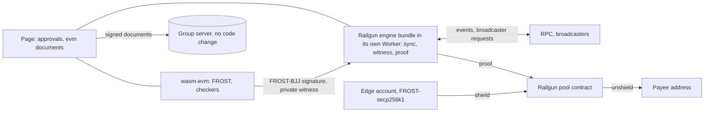

# EVM in Zigs: design

Status: frozen on 16 October 2026 by the owner, until the Zcash and Zolana work is done. Research and
design only. No code was written, no spike ran, and no transaction was sent.
All facts date from 16 October 2026 unless a row gives another date. Glamsterdam runs on Sepolia
since 6 October 2026 and has no mainnet date, so gas and rules can still change.

The question: what is the path to an EVM multisig that keeps as much private as possible? The list
is members, threshold, amounts, recipients, links between payments, and network metadata. The path
must add little new risk and must reuse the engine, the checker, the documents, the backups and the
CSP rules of the repo.

**How this note was made.** Five research notes (signer, account, stealth, shielded, Zigs fit) read
primary sources on 16 October 2026. Those notes are not in the repo, so section 9 lists every source
with a key. The fetch tool returns a summary from a small model. A number that matters needs a
re-read at the source before it enters a decision. I ran these checks myself ([CHK], section 9):
crates.io owners and versions of three crates, the file list of the ZF frost repo, four Railgun
contract files at one commit, and one search for Railgun audits.

A review pass on 16 October 2026 re-read the Railgun sources raw and added more checks ([CHK2],
section 9): on-chain reads with `cast`, the verified source of the deployed contracts, all ten audit
PDFs, the three Glamsterdam EIPs and the circuit files. Where a review claim and a check differ,
the text says so. Section 8.2 lists the conflicts.

**Labels.**

| Tag | Meaning |
|---|---|
| none | Read in a primary source on 16 October 2026. The key names the source |
| [T] | Third-party monitor (L2BEAT). Not a primary source. Counts as unverified |
| [U] | Unverified: secondary source, search summary, or not read |
| [D] | Derived: my reasoning from confirmed facts. Untested. Not confirmed |

Effort sizes in this note are [D]. S is one crate swap or one rule group with tests. M is a new
component with differential tests. L is a new ciphersuite, a new account contract, or a new engine
seam, each with a review. XL is a new threshold protocol stack.

## Summary

1. **Two layers need two keys.** The pool layer hides the most. The edge layer is the public EVM leg.
   A pool checks the spend signature inside a proof, so the pool decides the curve. A public account
   checks the signature on chain, so the EVM decides the curve (secp256k1 Schnorr by `ecrecover`).
2. **Pool layer: Railgun with a FROST key on Baby Jubjub as the spend key.** The signature is a
   private witness of the proof. The chain sees no group key, no signer list and no threshold.
   Inside the pool the amounts, recipients and links are hidden. Entry and exit are public.
3. **Edge layer: only if the group must receive or hold public funds.** It is a smart account that
   checks one FROST(secp256k1, SHA-256) signature. It hides members and threshold. It hides nothing
   else. The group key shows in every signature. A fresh key for each account (S6 and S7 in 2.2)
   could hide it. Those are scratch tests only.
4. **Do not use** EIP-7702 with FROST (it needs a dealer), a threshold-ECDSA EOA (largest bug
   record, no wasm library that is past alpha), or stealth addresses (no threshold path ships).
5. **Aztec** has the better account design and is no-go until V6 and an audit report. **Zama**
   hides amounts only. **Privacy Pools** cannot hold a threshold key.
6. **Build order.** Pool spike on Sepolia first. It needs no Solidity of our own and no funds. Edge
   spike second, only if the owner wants a public address. No mainnet funds before an independent
   review of the new parts and a written decision on the Railgun contract risk: the DAO upgrade key,
   the owner-set verification keys, the trusted setup and the owner control of fees (section 8).
7. **Largest new risks.** A new Baby Jubjub FROST ciphersuite with no audit. A Railgun pool whose
   live code has no audit report that I could find. The last report on pool logic is dated 21
   December 2022, and the live code is 131 commits later. A DAO that can upgrade the pool, replace
   its verification keys and change its fees. A Groth16 trusted setup that the group cannot check. A
   Solidity verifier with no audit and a GPL license (edge only).

## 1. What "private" means here

| Goal | Meaning | What breaks it |
|---|---|---|
| P1 Members | An observer cannot count or name the seats | A seat address as `tx.from`. A per-seat gas key. A funding trail. Seat IPs that poll one address |
| P2 Threshold | An observer cannot learn `t` or `n` | A Safe (it lists owners and threshold). Signer order in calldata |
| P3 Amounts | An observer cannot read a payment value | A transparent account. Pool entry and exit |
| P4 Recipients | An observer cannot name the payee | A transparent account. Pool exit |
| P5 Links | An observer cannot join two payments of the group | One stable address. One stable key in every signature. Amount and time matching at entry and exit |
| P6 Network | The relay, RPC, bundler and broadcaster learn little | IP address, query pattern, request timing |

**What each option hides.** "Pool" means inside the pool. Entry and exit stay public.

| Option | Members, threshold | Amounts | Recipients | Links | Network |
|---|---|---|---|---|---|
| A. FROST-secp256k1 and a Schnorr account | Hidden. The group key shows in each signature | Public | Public | Public: one address and one key | Bundler sees IP and the full userOp. RPC can group seat IPs by address [D] |
| B. Threshold-ECDSA EOA | Hidden. Looks like any EOA | Public | Public | Public: one address | RPC sees IP and the signed transaction. More rounds, larger messages at the relay |
| C. FROST and EIP-7702 | Hidden only if a dealer held the key once. Delegate address is public | Public | Public | Public | Relayer sees account, delegate and calldata |
| D. Railgun and FROST-BJJ | Hidden. No group key on chain | Hidden in pool | Hidden in pool. Public at exit | Hidden in pool. Anonymity sets shrank 40 to 59 percent in one study [U] | Local proof. Broadcaster sees a gas note only. IP and RPC leak unless Tor or own node [T] |
| E. Aztec and FROST-Grumpkin | Hidden | Hidden in private calls | Hidden in private calls | Hidden if every call is private. Public Fee Juice ties a transaction to the account | Node sees tag queries and IP |
| F. Zama ERC-7984 on an EOA | Hidden if the EOA key is threshold | Hidden. Wrap and unwrap are public | Public | Public | Zama app and relayer see reads [T] |
| G. Privacy Pools | Not enforceable | Deposit and withdrawal values are public | Public at withdrawal | Hidden. The ASP can narrow the set [T] | Relayer sees the request [T] |
| H. Stealth addresses | Not applicable | Public | Receive step hidden. Spend shows the destination | Funding and consolidation link addresses | RPC sees address queries |

Only D and E hide amounts, recipients and links for a group. Only D is usable now. A hides members
and threshold and nothing else. This is the core finding of the note.

**Leaks that no option removes.**

- Pool entry shows the sender, token and amount. Pool exit shows the recipient, token and amount.
  Amount and time can match an entry to an exit [D].
- The group server cannot read documents. Its `evm*` write times can match chain events. In D no
  group key reaches the chain, so the server can match a wallet id to an exit by time, not to a
  key [D].
- Every seat holds the viewing key. A removed seat reads history forever. Railgun documents say a
  shared viewing key cannot be revoked [RG-D].
- Seat IP addresses reach the RPC, the broadcaster network and the proof artifact host.

## 2. Signer options

### 2.1 Facts that decide the choice

- Every EVM transaction type (0, 1, 2, 3, 4) carries an ECDSA signature `(y_parity, r, s)`
  [E1559, E7702]. FROST makes Schnorr signatures. A FROST group key cannot sign a transaction.
- A contract can verify a Schnorr signature with the `ecrecover` identity (Buterin, 2018-06-29)
  [ERES]. The public key must have `x < N`, about 2^-128 of keys fail this [ERES, SF].
- An EIP-7702 authorization is an ECDSA signature by the full EOA key. The EOA key keeps full
  control after delegation [E7702]. EIP-7702 is live on Ethereum since 2025-05-07 (Pectra), on
  OP Stack and Base since 2025-05-09, and on BNB Smart Chain since 2025-03-20 [PECTRA]. A FROST DKG key cannot make the tuple.
- A shielded pool checks the spend signature inside a circuit. Then the signature is a private
  witness and the pool fixes the curve and the hash [RG-CIRC].
- Re-randomized FROST (ZIP 312, ePrint 2024/436) makes a signature that verifies under
  `P' = P + a*G` for a fresh randomizer `a`. A transparent account stores `P'`, not `P`. A fresh `a`
  for each account hides the group key and the key link between accounts. It hides no funding link
  and no consolidation link [D].

### 2.2 Comparison

| Option | What checks it | Setup | Hides | Main risks | Effort [D] | Verdict |
|---|---|---|---|---|---|---|
| S1. FROST(secp256k1, SHA-256), Schnorr account | A Solidity verifier. Signature is 160 bytes | DKG. No dealer | Members, threshold. Account type and group key are visible | Verifier and account unaudited. Verifier license is GPL-3.0-only. `frost-secp256k1` has no audit after 0.6.0 | M | Use for the edge only |
| S2. FROST with a Keccak ciphersuite (`frost-secp256k1-evm`, Chronicle `LibSchnorr`) | Chronicle verifier (audited three times) or the crate | Same as S1 | Same as S1 | The crate has one third-party owner and no audit. ZF closed the Keccak PR. A custom ciphersuite sits outside the audited ZF crates. Gas claims conflict | M to L | Compare in step E2 only if gas matters |
| S3. Threshold ECDSA EOA | The EVM itself | DKG with Paillier or OT proofs | Members, threshold. Looks like any EOA | Key-extraction bugs in 2021 to 2025. The only wasm library is alpha. Others have no wasm or a non-commercial license | XL | No. Use only if a destination needs an EOA signature |
| S4. FROST and EIP-7702 | The node checks an ECDSA tuple | A dealer holds the full key once | Members, threshold. The delegate is public | The dealer copy or the EOA key still controls the account | L | No |
| S5. FROST on the pool curve (BJJ for Railgun, Grumpkin for Aztec) | The pool circuit. Nothing on chain | DKG. No dealer | Members, threshold, and the key itself | New ciphersuite with no audit. Small libraries | L | Yes. The main path |
| S6. Re-randomized FROST (ZIP 312) on a transparent account, a fresh randomizer for each key | The account. It stores `P'` | As S1 | The group key and the key link between accounts of the group. Not funding or consolidation links | Needs a secp256k1 re-randomized FROST. The ZF README lists re-randomized FROST as not audited. The randomizer must reach every signer | M | No for v1. Scratch test in E1 and E2 |
| S7. One counterfactual account for each payment, owned by a re-randomized FROST key | The S6 verifier. CREATE2 address from the factory and `P'` | As S6, plus a factory | Same as S6. Each payer sees a new address | One factory with one code hash that only this project uses, so an observer can still group the accounts [D]. Each account needs a deployment (EIP-8037 raises a new account from 25,000 to 183,600 state gas, see 3.7). Each payment needs its own funding and sweep. The group must hand out each address. No prior work found | L | No for v1. Scratch test in E1 and E2 |

### 2.3 FROST over secp256k1 (the edge key)

| Fact | Value and source |
|---|---|
| `frost-secp256k1` and `frost-secp256k1-tr` | 3.0.0 on 2026-04-23 (MSRV 1.81). 2.2.0 on 2025-08-27. Nothing newer. Owners of `frost-secp256k1`: two users and the ZF owners team [CIO, CHK] |
| `main` branch | MSRV 1.86 and `rand` 0.10, unreleased. Last commit 2026-07-21 [ZF] |
| 3.0.0 changes | Breaking: `cheater-detection` feature gone, `SigningKey` not `Copy`, refresh and repair APIs changed. It fixes `verify_signature_share()` so that it calls the `pre_commitment_aggregate()` hook [ZF] |
| 2.2.0 changes | Security fix: `refresh` rejects a smaller `min_signers`. All crates are `no_std` except Ed448 [ZF] |
| Pin used by the repo | `frost-core 2.2.0` in both lockfiles. `frost-secp256k1 =2.2.0` needs the same `frost-core` [ZIG] |
| Audit | NCC Group audited v0.6.0 (commit 5fa17ed) of the core and the secp256k1 crate. Report of 2023-10-20: 0 critical, 0 high, 3 medium, 3 low, 2 informational, all fixed. The ZF README says `frost-secp256k1-tr` and re-randomized FROST are not audited [NCC, ZF]. I found no audit of 2.x or 3.x. A search miss is not proof |
| Least Authority | Audited the demo server and client, report 2025-04-29. Not the crates [LA] |
| Standard | RFC 9591, June 2024. It does not define a DKG. Nonce reuse can leak the key share [RFC] |
| Pairing with the verifier | `frost-secp256k1` uses `hash_to_field` with SHA-256 and DST `FROST-secp256k1-SHA256-v1chal`. The safe-frost verifier uses the same hash. The safe-frost CLI depends on `frost-secp256k1` v2 [ZF, SF] |
| Local algebra check | A pure Python check showed that the test vector of `tests/FROST.t.sol` is a valid RFC 9591 signature and that the `ecrecover` identity returns `address(-R)`. The Solidity itself did not run [D] |
| Verifier state | the `safe-frost` repository [SF], last commit `ecb45c9f8483c6460f91bbaafd6c002a0d3e85eb` on 2025-08-04. README: unaudited. License GPL-3.0-only [SF] |
| Gas | Claims conflict and none was reproduced: about 5,600 for `FROST.verify` (safe-frost README), 10,609 (author of ZF PR 749), about 4,200 plus 2,100 calldata (ERC-7816 thread) [U]. Step E2 measures it |
| `frost-secp256k1-evm` | Keccak ciphersuite. crates.io lists 2.0.0 (2024-10-26) to 3.0.0 (2026-04-24). One owner, a single user. The ZF repo tree has no such directory. ZF closed PR 749 on 2024-11-28 (no spec, no review). So it is a third-party crate that names the ZF repo. Outside the NCC scope [CHK, ZF] |
| Chronicle `LibSchnorr` | ABDK 2023-08-10, ChainSecurity 2023-07-04 (scheme out of scope), Cantina 2023-11-27 and 2024-10-01. Two High findings on rogue keys. They do not apply to a DKG key. Issue 56 (a key with `x >= N`) shows no fix [CHR] |
| BIP-445 | Draft since 2026-01. PR open on 2026-10-16. Only a reference implementation, not for production [BIP445] |

Verifier audit list (every item is a known pitfall):

1. Public key on the curve, not infinity, `px < N`.
2. `ecrecover` returns address 0 on error. Treat it as failure.
3. Scalar range `0 < z < N`. Otherwise `z` and `z + N` are two encodings of one signature.
4. `R` on the curve. `y < p` before the parity bit is read.
5. Message domain. The Schnorr check has no chain id, contract address or nonce. Sign `userOpHash`
   (it binds chain id and EntryPoint) or an EIP-712 hash.
6. ERC-1271 replay across accounts that share a key. ERC-7739 rehashing addresses this.
7. In `_ecmulmuladd`, an empty `ecrecover` result reads scratch slot 0. The chance is negligible.
   An auditor should confirm [D].
8. ERC-7562 rule OP-062 allows precompiles 0x1 to 0x11 during validation, so `ecrecover` and
   `sha256` are allowed [ERC7562].

**License.** `FROST.sol` is GPL-3.0-only. The repo is MIT and plans a public MIT release on
28 October (PROTOCOL.md section 11). Copying the file binds the repo. Write a clean-room verifier
from RFC 9591, or ask the authors of `safe-frost` for a relicense. This is a project decision, not legal advice.

### 2.4 Threshold ECDSA (only if a destination needs an EOA)

| Date | Event | Source |
|---|---|---|
| 2021 | Alpha-Rays: key extraction in GG18 and GG20 | ePrint 2021/1621 [U] |
| 2023-08-09 | BitForge: GG18, GG20, Lindell17 | [FB] |
| 2023-08-09 | TSSHOCK: `tss-lib` and forks, ZenGo, Axelar, Taurus CGGMP21 (fixed). One or two signatures extract the key | [TSS] |
| 2024 | Devious Transfer: OT bugs in `mpecdsa` and `sl-crypto` after the Trail of Bits audit. Disclosure date not on the page | [FORD] |
| 2024-12 | Cure53 on `cb-mpc`: one High finding, fixed by 2025-01-06 | [CURE] |
| 2025-11-24 | Dfns: CGGMP21 omits a Paillier-Blum modulus check. Presignature plus raw-hash signing allows a forgery. Fixed in `cggmp24` 0.7.0-alpha.2. `cggmp21` has no patch for the second bug | [DFNS, LOCK] |

Library fit for a web app:

| Library | Result |
|---|---|
| Lockness `cggmp24` 0.7.0-alpha.3 (2025-12-04), Apache-2.0 | Only candidate with a documented wasm path (`num-bigint` backend). Alpha. Its t-of-n part is the authors' own design. Only public audit is from June 2023. No key refresh. Browser time for Paillier setup is unmeasured [LOCK] |
| Silence Labs `sl-dkls23` 1.0.0-beta | Non-commercial license. No documented wasm. Out [SL] |
| Coinbase `cb-mpc` | README: no browser, no wasm. Out [CB] |

Rules if this track ever starts: never combine presignatures with raw-hash signing, keep key import
and export off, and let the device sign only decoded transactions. Additive key derivation with
presignatures also has an attack (Groth and Shoup, ePrint 2021/1330) [STEALTH-R].

### 2.5 Verdict

Use S5 for the pool and S1 for the edge. S6 and S7 get a scratch test in E1 and E2, so that the
verdict rests on data. Both S5 and S1 use the `frost-core` family and the 2-round flow that
the Zcash and Solana code already use. Neither needs a Paillier or OT sub-protocol. This is where
most key-extraction bugs of 2021 to 2025 sat. Switch to S3 only when a destination needs a plain
ECDSA signature from an EOA.

## 3. Account and gas options (edge layer)

An account is one public address. It hides members, threshold and which seat acted. It cannot hide
amounts, recipients or links. Section 5 covers those.

### 3.1 What an ERC-4337 account shows

| Item | Public value |
|---|---|
| `UserOperationEvent` | `userOpHash`, `sender`, `paymaster`, `nonce`, `success`, `actualGasCost`, `actualGasUsed` |
| `AccountDeployed` | `sender`, `factory`, `paymaster` |
| `handleOps` calldata | Every UserOp field, with the signature and the group key |
| `tx.from` | The bundler address |
| EntryPoint state | `balanceOf`, `getNonce`, deposits |
| `factoryData` | What the factory was told. A factory that takes an owner list shows the owners |

Source: `IEntryPoint.sol` at tag v0.9.0 and ERC-4337 [EP, E4337].

### 3.2 Account candidates

| Account | What is public | Verdict |
|---|---|---|
| Safe 1.4.1 or 1.5.0 and `Safe4337Module` | `getOwners`, `getThreshold`, `SafeSetup`. Signers in ascending order in calldata [SAFE] | No. It leaks P1 and P2. Exception: one FROST signer contract as sole owner. Module support for EntryPoint v0.8 and v0.9 is unverified [U] |
| Coinbase Smart Wallet | `AccountCreated(owners)` and `AddOwner` events. 1-of-n, not a threshold | No |
| Light Account multi-owner | 1-of-n | No |
| Kernel v3.3 or v4.0 | The validator address is in every UserOp nonce. v4.0 (2026-10-05) targets EntryPoint v0.9 only | Not now. Too new |
| Simple7702Account | EOA is the owner. Needs ECDSA | Only with threshold ECDSA |
| `FROSTAccount` (safe-frost) | Group key in each signature. The address must equal the group key address | No. It needs 7702 and a dealer |
| Custom minimal account (new) | What we choose | Yes, the default for the edge. It leaves no module or guard to police. Needs its own audit |

### 3.3 Three ways to put FROST in an account

| Option | How | Problem |
|---|---|---|
| A. Factory account that stores the group key | `validateUserOp` calls the verifier and compares the key to storage. CREATE2 with a random salt. The key can rotate | New code to audit. The factory call and the verifier pointer are public |
| B. 7702 EOA delegated to `FROSTAccount` | The EOA address is the group key address | Needs a dealer. The EOA key keeps power. A rotation is a new address |
| C. 7702 EOA and threshold ECDSA | A known delegate such as Simple7702Account | A different signing stack. S3 risks |

Choose A. The edge account also needs a closed ERC-1271 path: `isValidSignature` must not accept the
group signature for a hash that the checker never approved. Otherwise a `Permit` request can drain
the account [D]. Trail of Bits listed six common mistakes of 4337 accounts on 2026-03-11 [TOB4337].
The custom account must avoid each one.

### 3.4 EntryPoint versions (on-chain reads, one moment, 16 October 2026)

| Version | Released | Use in the samples |
|---|---|---|
| v0.6 | 2023-04-24 | Base: 1,375 ops in 20 minutes |
| v0.7 | 2024-02-22 | Most used |
| v0.8 | 2025-03-26 | Native 7702, EIP-712 hash. Address `0x4337084D9E255Ff0702461CF8895CE9E3b5Ff108` |
| v0.9 | 2025-11-16 | Ethereum: 5 ops in 1 hour against 764 for v0.7. Little infrastructure |

Target v0.8 for the edge. It is audited (the report date is unverified [U]) and has enough
infrastructure. Move to v0.9 when bundlers and paymasters support it [EP, ACC-RPC].

### 3.5 How to pay gas

| Option | What it reveals | Verdict |
|---|---|---|
| The account prefunds the EntryPoint. A public bundler is `tx.from` | The account address and the fee. Nothing names a seat | **Baseline. Use this** |
| Per-seat gas EOA that submits (the Solana decision) | `tx.from` shows that seat on every spend. The count of EOAs bounds `n` from below. Each funding source leaks | No |
| Shared paymaster (ERC-7677) | The service gets the unsigned UserOp, chain id, `context`. It can log and refuse | Hides the funder, adds a log keeper |
| Group-run paymaster | Alone in its set. Its funder is a link | No |
| ERC-20 paymaster | Token transfers are public | No |
| 7702 relayer | Same as a bundler | About equal to the baseline |
| ZK privacy paymaster | Only prototypes. No audit [U] | Not usable |
| In-kind fee from a shielded note (Railgun broadcaster) | The broadcaster sees the gas amount only [RG-D] | **Best for pool exits. No account needed** |

In the pool layer no seat needs ETH. The pool fee note pays the broadcaster. In the edge layer the
account holds a public gas float. One link remains: the transaction that funds the float. Do not
fund it from a pool exit. The edge account is a public inbox that payers know (section 4). An exit
to it ties that exit to the group. Fund the float from a fresh address that the group chooses. That
address is still a link to the group. List it on the Edge screen (7.4).

**The owner decided on 16 October 2026 that a per-seat key pays fees on Solana** (ZOLANA.md, branch
`sol-fee-payer`, line 270). I recommend against the same rule on EVM. A seat gas address is public
and links that seat to the account. This is owner decision D3.

Sampled UserOp counts per hour: Ethereum about 1,100, Base about 12,300, OP about 72, Arbitrum about
1,000. Paymasters per window: 4 to 14, the top three carry 81 to 98 percent [ACC-RPC]. A group
paymaster would stand alone [D].

### 3.6 Who sees what

| Party | Sees | Reduce by |
|---|---|---|
| Bundler | IP, time, full UserOp, group key | A bundler for each submission. Tor |
| Shared UserOp mempool | UserOps before inclusion (live on Ethereum, Arbitrum, Optimism since 2024-11; Base not listed) [ERC4337D] | Accept it |
| Paymaster | The UserOp, `context`, API key | Do not use one |
| RPC | Balance and log queries, with IP and time. Seat IPs for one address are the member set [D] | Own node, one proxy, Tor with one circuit for each device |
| L2 sequencer | Bundler transactions | A third-party bundler hides seat IPs |

No source states bundler or paymaster log retention [U]. Assume that they log.

### 3.7 Chain and cost

The pool decides the chain. Railgun on Ethereum holds about 109 M USD [T]. Privacy Pools exist on
Ethereum only [T]. Railgun is live on Ethereum, Polygon, BNB Chain and Arbitrum. Base was deployed
in August 2026 and is almost unused. Default chain: Ethereum.

Use of each pool, read on chain on 2026-10-16 ([CHK2]). The upper bound of commitments is
`treeNumber * 65,536 + nextLeafIndex` (`TREE_DEPTH` is 16). A full tree can leave gaps.

| Chain | Pool proxy | `treeNumber`, `nextLeafIndex` | Commitments, at most |
|---|---|---|---|
| Ethereum | `0xFA7093CD…FA4b9` | 4, 26,946 | about 289,000 |
| Arbitrum | `0xFA7093CD…FA4b9` | 1, 64,964 | about 130,500 |
| Polygon | `0x19b62092…ef8c71` | 1, 25,719 | about 91,300 |
| BNB Chain | `0x590162bf…178a10` | 0, 53,678 | about 53,700 |
| Base | `0x0047d1F9…AcF25` | 0, 1 | 1 (one shield, 2026-09-08 18:57 UTC) |

The Base address came from a reviewer. No Railgun list that I read names it: the docs
helpful-links page and the shared-models network config list no Base, and the EIP-7702 page lists a
Base delegate. On chain it answers like a Railgun pool (`shieldFee` and `unshieldFee` are 25). Its
owner chain differs from Ethereum and Arbitrum: owner contract `0x08ba0783…`, owned by a contract
`0xc73D11a8…` on Base. I did not identify either. A reviewer reports that L2BEAT logs a Base
deployment proposal on 2026-08-21 (not re-read) [T]. The Railgun docs disagree on the chain list. A reviewer read 48,225 transactions
for the Arbitrum pool in the Blockscout counters. I could not re-read them (the site now asks for a
bot check) and the tree counter above replaces them.

Cost on Ethereum. Gas price was 59,427,219 wei (0.0594 gwei) at block 26,204,124 (`cast`,
publicnode, 2026-10-16). ETH was 2,453 USD (CoinGecko). A plain transfer costs about 0.0031 USD [D].
Pool calls cost much more. The 50 newest calls to the Ethereum pool (Blockscout, 2026-10-15 23:31
to 2026-10-16 09:13 UTC, one pending row left out) had these median gas values:

| Call | Rows | Median gas | Range | Cost at 0.0594 gwei [D] |
|---|---|---|---|---|
| `transact` | 40 | 1,101,396 | 484,315 to 1,458,940 | about 0.16 USD |
| `shield` | 9 | 746,851 | 739,116 to 768,892 | about 0.11 USD |

One day is not a statistic. A group spend has its own proof and ciphertext sizes, so its pool gas
is not measured. Step R4 measures it.

**Glamsterdam changes gas.** Three EIPs of the Glamsterdam scope reprice work that a pool call and
an account deployment do. All three are in Last Call until 2026-11-01, so the numbers can still
change [E8037]:

| EIP | Change |
|---|---|
| 8037 | New storage slot 20,000 to 97,920 state gas. New account 25,000 to 183,600. Contract code 200 to 1,530 gas per byte |
| 8038 | Storage write 2,800 to 10,000. Value write 6,700 to 9,000. Cold account access 2,600 to 3,000 |
| 7976 | Calldata floor 10/40 to 64/64 gas per byte |

Sepolia activated Glamsterdam on 2026-10-06, and the announcement lists these three EIPs in scope
[GLAM]. The latest Sepolia block header that I read carries `blockAccessListHash` and `slotNumber`,
so the fork is live. The ethereum.org roadmap (page dated 2026-09-14) gives a mainnet target of Q4
2026 and no date. A pool spend writes one new slot for each nullifier and one new slot in
`rootHistory` (`Commitments.sol`) [D]. Commitments are events and not storage. The tree writes
(`filledSubTrees`, `merkleRoot`) change existing slots, so the EIP-8038 write cost applies to them
[D]. Gas on Sepolia (new rules) is not comparable with gas on mainnet (current rules). Record both
and do not compare them (R4, E2).

## 4. Receive privacy

| Topic | Fact |
|---|---|
| In the pool | A shield sends `npk = Poseidon(Poseidon(spend key, nullifying key), random)`. The note recipient is hidden. The shield sender, token and amount are public [RG-C] |
| Ordinary payers | A payer needs a Railgun-aware wallet to pay a 0zk address. Exchanges and plain wallets pay a 0x address [D]. The group then needs a public inbox. The default inbox is the edge account, swept into the pool soon after payment |
| ERC-5564 | Final. Scheme 1 gives an EOA address. The Announcer has 207 transactions in 28 months. The ERC-6538 registry has 10 [ERC5564, STEALTH-C] |
| Threshold spend of a stealth address | Scheme 1 needs ECDSA. FROST cannot sign it. 7702 does not help. Two paths exist. Path A is threshold ECDSA with an additive tweak: it meets the Groth and Shoup attack. Advisory GHSA-8frv-q972-9rq5 gives 85 bits for derivation on presignatures (CVE-2025-66017 is the matching CVE per the stealth research [U]). Path B is FROST that owns one counterfactual contract per payment (S7 in 2.2): it is not ERC-5564 and I found no prior work [STEALTH-R, D] |
| Shipped threshold stealth wallets | None found. One design paper (Dao2, arXiv 2604.04369). Its prototype runs no real threshold ECDSA [U] |
| Leaks that remain | Funding, consolidation, the `caller` field, registration timing. Umbra heuristics linked 48.5 percent of mainnet withdrawals in a 2023 study [UMBRA] |
| Registry and viewing key | Do not register in ERC-6538 (it links an address to a meta-address). Do not give the viewing key to a server. A blind server cannot hand out addresses either [D] |
| Kohaku (EF) | No stealth package. Zero issues for "stealth" on 2026-10-16 [KOH] |

**Verdict: do not build stealth addresses.** The pool layer gives receive privacy for payers who
use a 0zk address. For other payers, use the public inbox and sweep it. Habits that the Umbra study
caught: never exit to a known address, never collect many addresses into one, and use a new exit
address for each payment. The public inbox is a known address, so the same rule bars a pool exit
that funds its gas float (3.5).

## 5. Shielded options

### 5.1 What the group needs

| Need | Meaning |
|---|---|
| C1 | No single seat can spend |
| C2 | A device checker reads the message before it signs. No blind signing |
| C3 | A signing round can last minutes or hours |
| C4 | Every seat reads history. No seat can spend with the viewing role |
| C5 | Small trust in an operator, an upgrade key or a hosted prover |

### 5.2 Ranking

L2BEAT figures are [T].

| Rank | System | Status | Fit | Verdict |
|---|---|---|---|---|
| 1 | Railgun with FROST-BJJ | Live since 2022-05-08. About 109 M USD [T]. Pool upgrade on 2026-08-14 (read on chain, 5.3) | Spend signature is a private witness. Proof runs on the device. Libraries for BJJ are small and unaudited. No audit report on the live pool logic (the last one is dated 2022-12-21). The owner can replace verification keys and change fees (8.1) | **Go for a Sepolia spike** |
| 2 | Aztec with FROST-Grumpkin | Alpha. V5 live 2026-07-21. Critical flaw found 2026-07-27, disclosed 2026-08-07. V6 has no date. About 58 K USD [T] | Best account design. No FROST library for Grumpkin found. Every fork changed every address | **No-go until V6 and an audit report** |
| 3 | Zama ERC-7984 on an EOA | Live 2025-12-30. About 127 M USD [T]. ERC-7984 is Draft | Hides amounts only. 13-party KMS. Multisigs upgrade with no delay [T] | Only to hide amounts |
| 4 | Namada or Penumbra by a bridge | Not EVM. Penumbra has FROST custody in `pcli` [U] | Extra bridge trust | Check later |
| 5 | Fhenix CoFHE | Testnets in docs. One TEE run by Fhenix. Code unaudited | Not a custody base | No |
| 6 | Privacy Pools | Live. Oxorio and Auditware audits in the repo. 2/4 multisig upgrades with no delay [T] | The withdraw circuit checks no signature. Any seat that knows the secrets can withdraw | No (fails C1) |
| 7 | Intmax, Nocturne, Privacy Boost, zkDompet | Intmax paused on 2026-02-07 [T]. Nocturne closed 2024 [U]. Privacy Boost: a TEE sees all [T]. zkDompet is an MVP | n/a | Out |

Protocol watch list: EIP-8182 (private ETH and ERC-20 transfers as a system contract, Review since
2026-03-03, open objections) and EIP-8141 (frame transactions, Draft). Hegota is in planning for
Q2 2027 and its scope is not final [EIP8182, EIP8141, ETHORG]. No protocol change before 2027 fixes
gas-payer linkage.

### 5.3 Railgun in detail

**Keys** (circuits-v2 and engine code [RG-CIRC, RG-E]):

- The spend key is an EdDSA key on Baby Jubjub. The signature is `eddsa.signPoseidon` of the Railgun
  fork of circomlibjs.
- The viewing key decrypts notes and cannot spend. The nullifying key is `Poseidon(viewing private
  key)`. The master public key is `Poseidon(spend.x, spend.y, nullifyingKey)`. A 0zk address
  encodes the master public key and the viewing public key.
- In `joinsplit.circom` the signature, the public key and the nullifying key are private signals.
  The circuit checks the signature on `Poseidon(merkleRoot, boundParamsHash, nullifiers,
  commitmentsOut)`.
- The prover needs the nullifying key and the note secrets. It does not need the spend key. Any seat
  can prove once it has the signature [D].

**Contract facts, read at commit `36bcf5ed7cf94bfafb6e1a303e1832c769c16780` (main, 2026-08-15)**
[RG-C, CHK, CHK2]. The first pass used a summarizer. The second pass read the raw files `Verifier.sol`,
`RailgunLogic.sol`, `RailgunSmartWallet.sol` and `Commitments.sol`.

**Deployed code.** Mainnet: the implementation behind the proxy `0xFA7093CD…FA4b9` is
`0xd662c4b1f22aceb0beacdf3a493de6f478686a0c` (storage slot read at block 26,204,124). Voting
proposal 25 installed it on 2026-08-14 13:50 UTC (tx `0x7ac14284…`, read on chain). Its verified
source on Blockscout (verified 2026-07-29) equals this commit in all 8 files of `contracts/logic`
(Commitments, Globals, Poseidon, RailgunLogic, RailgunSmartWallet, Snark, TokenBlocklist,
Verifier), after trailing-space removal. So the facts below describe the mainnet code.

Sepolia runs older code. The proxy `0xecfcf3b4…` (listed in the Railgun docs) points to the
implementation `0x16dc2574cc30e4deecfb9ba22d95e5126a2fc0b3`, verified on 2024-06-08. It differs from
the commit in four files (Globals, RailgunLogic, RailgunSmartWallet, Verifier):

- It has no `Action` event and no `TXConfig`.
- `validateTransaction` returns `(bool, string)` and `Verifier.verify` returns `bool`.
- The token blocklist check sits in `validateCommitmentPreimage`. On mainnet it sits in `shield()`.
- The checks for gas price, adapt contract, chain id, root history and the unshield hash are the
  same. The Sepolia owner `0x90E1A007…` is not the DAO Delegator.

So on Sepolia the gas and the events differ from mainnet. The security checks that the checker uses
are the same. The Railgun 7702 page says Sepolia fits only basic shield and unshield tests [RG-D].
Deploy the commit code on a local fork or a private Sepolia deployment before R8.

| Fact | Effect on the group |
|---|---|
| `shield()` and `transact()` have no caller check | Any account or broadcaster can submit. The group needs no account for pool use |
| `rootHistory[treeNumber][root]` is set to `true` and never cleared. `validateTransaction` only requires the root to be in it | A long FROST round does not go stale on the root. This differs from Zolana. The note still fails if another spend consumed an input (nullifier) |
| `boundParams.chainID` must equal `block.chainid` | Replay across chains fails |
| `adaptContract` must be zero or `msg.sender`. `adaptParams` is not checked on chain | The checker must pin both to zero in the first version |
| The unshield preimage hash must equal the last commitment. For `REDIRECT` the preimage `npk` is `msg.sender` | The signed hash covers exit recipient, token and amount. The checker refuses `REDIRECT` [D] |
| `BoundParams` holds `treeNumber`, `minGasPrice`, `unshield`, `chainID`, `adaptContract`, `adaptParams` and the ciphertexts | `boundParamsHash` is in the signed hash. The contract computes it as `keccak256(abi.encode(boundParams))` mod the field order (`Verifier.hashBoundParams`). It covers every field, including the ciphertexts. The wasm must rebuild it the same way |
| `CommitmentPreimage.npk` hides the recipient master key behind a random value | A shield does not name the recipient |
| `validateTransaction` has no deadline. `minGasPrice` is only a floor (`tx.gasprice < minGasPrice` fails) | No expiry in the signed data (6.3, `rg-no-expiry`) |
| `changeFee` is `onlyOwner`. Each fee is at most `BASIS_POINTS / 2`, which is 50 percent. The unshield fee is taken from the unshield value when the transaction runs. Both fees are 25 basis points today (read on chain) | The signed amount is not the amount that the payee gets after a fee change (6.3, 8.1) |
| `setVerificationKey` is `onlyOwner` (`Verifier.sol`) | The owner can replace a verification key (8.1) |

**Engine seams** [RG-E]: `ViewOnlyWallet.fromShareableViewingKey` takes a viewing private key and a
spending public key. Its `sign` throws. `generateTransactionRequest` uses only the public part of
the spending key. Proving is local (snarkjs or a native prover). Whether the engine accepts a
signature from outside, and whether it accepts a transaction built outside, is untested [U]. Step
R2 tests it.

**Threshold libraries for Baby Jubjub.** None is a dependency candidate. I read the READMEs of the
first two raw on 2026-10-16. What they claim is untested [U]. The last two were read through a
summarizer [U]. Only `f3rmion/fy` targets the Railgun check, so it is the only cross-check for R1.

| Project | State |
|---|---|
| `f3rmion/fy` (Go) | FROST and DKLs23. A `railgun` package with a 2-of-3 wallet. README: signatures verifiable by `eddsa.verifyPoseidon` of the Railgun circomlibjs fork. It uses the public key `A = Y/8` and a Railgun hasher. MIT. No audit text |
| `nvnx7/frost-babyjubjub` (TypeScript) | README: unaudited. It uses `s = k + e*sk` and `R = s*G - e*PK` with its own circuit. This is a deliberate variant. It does not target the Railgun check, so it is not a cross-check. Updated 2026-06-30 |
| `ZKNoxHQ/FROSTGUN` | Hackathon. Not for production |
| `TaceoLabs/eddsa-babyjubjub` | Uses Poseidon2, not the Railgun Poseidon. No match |

**What the circuit checks (R1).** Read in circomlib v2.0.5 `eddsaposeidon.circom`, the version that
`circuits-v2` pins [RG-CIRC, CHK2]:

- The check is `S*B8 = R8 + 8*h*A`. `h = Poseidon5(R8x, R8y, Ax, Ay, M)` is used as a full 254-bit
  value. `A` is doubled three times, so the check holds for a key in the prime-order subgroup.
- `S` is range-checked below the subgroup order `l`.
- The generator is `B8` (`BASE8`). Its x coordinate is
  5299619240641551281634865583518297030282874472190772894086521144482721001553 and its y coordinate
  is 16950150798460657717958625567821834550301663161624707787222815936182638968203.
- A FROST challenge `c = 8*h mod l` makes `z*B8 = R + c*A` equal this check when `A` and `R` are in
  the subgroup [D]. The other valid form is `A = Y/8` with `c = h`, which `fy` uses. The choice fixes
  the 0zk address at the DKG.
- No circuit change is needed. The test stays, because Railgun uses a circomlibjs fork.

**Group crate for the ciphersuite (R1).** The candidate is `ark-ed-on-bn254` 0.6.0 with `ark-ec`
0.6.0 (crates.io, updated 2026-04-26, `forbid(unsafe_code)`). The other is `babyjubjub-rs` 0.0.11
(2024-01-22). The arkworks README calls the library an academic prototype that has no careful code
review and is not ready for production. The `babyjubjub-rs` README says not to use it in production.
I found no constant-time claim for either. So no candidate meets the requirement of R1 as it stands.
The arkworks curve has `a = 1` and `d = 168696/168700`. circomlib has `a = 168700` and `d = 168696`.
The two forms differ by a fixed scale on x [D]. Poseidon inputs and the master public key use the
circomlib x. R1 must convert at the boundary and test that the converted arkworks generator equals
`BASE8`.

**Proof of innocence (PPOI).** Broadcasters relay only spends with a finished PPOI. The default list
is a Chainalysis sanctions oracle. A new shield waits one hour. In that state only a return to the
source works. Self-broadcast skips the check and shows the sender [RG-D]. A flagged payer deposit can
lock a share of the group balance [D]. Whether PPOI needs a spend signature is unverified [U].

**Fees.** The shield fee and the unshield fee are 25 basis points each, which is 0.25 percent (read
on chain, 2026-10-16). The docs state 0.25 percent. They do not say that the rate is fixed [RG-D].
The code lets the owner change both fees, up to 50 percent each (`changeFee`, `onlyOwner`).
Broadcasters add a gas premium near 10 percent [RG-D]. Section 6.3 gives the effect on an approval
that does not expire.

**Trust and audits.** The pool owner is a DAO contract. Section 8.1 gives the upgrade wait, the
verification-key power and the trusted setup. The contract repo has no audit folder [RG-C]. The
audit index at `assets.railgun.org/docs/audits/` lists 10 PDFs. I opened all 10 on 2026-10-16
[RG-AUD]:

| File date | Firm | Scope in the PDF | Commit |
|---|---|---|---|
| 2021-04-01 | ABDK | Railgun contracts and circuits (v1). The conclusion text is dated 2 July 2021 | none given |
| 2021-11-02 | Hacken | Whole contract repo (24 files, 7 of them test stubs) | `d2c6357` |
| 2021-11-03 | Zokyo | 17 contracts: governance, staking, proxy, token and pool v1 logic | `d2c6357` |
| 2021-11-23 | Zokyo | `Commitments`, `Globals`, `RailgunLogic` | `0418a0f` |
| 2022-04-20 | Zokyo | `Globals`, `Snark`, `Commitments`, `Verifier`, `Poseidon`, token blocklist, `RailgunLogic` | `62401e1` |
| 2022-04-21 | Zokyo | `Rail.sol` token | Etherscan source |
| 2022-08-29 | HashCloak | Circuits v2 (22 to 29 March 2022). `Voting.sol` and `GovernorRewards.sol` (22 to 29 August 2022) | circuits `67cd4ce`, contracts `b74eeb6` |
| 2022-09-14 | Zokyo | `Voting.sol` | `d73c1da` |
| 2022-12-21 | Zokyo | `Commitments`, `RailgunLogic`, `RailgunSmartWallet` | `4385ec7` |
| 2023-02-03 | Zokyo | `Sender.sol`, `Executor.sol` (not the pool logic) | `a49a82d` |

- The last report on pool logic is Zokyo, 2022-12-21, at `4385ec7`. The commit that I read
  (`36bcf5e`) is 131 commits later (GitHub compare). The five files of `contracts/logic` changed by
  190 added and 83 removed lines, 102 added in `RailgunSmartWallet.sol`. I did not read that diff.
- L2BEAT lists pool upgrades on 2022-11-29, 2023-03-09, 2025-07-28 and 2026-08-14 [T]. It lists no
  audits [T]. I found no report for the 2023-03-09, 2025-07-28 or 2026-08-14 implementations.
- L2BEAT gives two dates for the last upgrade. The transaction is 2026-08-14 13:50 UTC (read on
  chain). Its "executed" entry is 2026-08-17 [T].
- Circuits v2 had one HashCloak auditor for one week. The report gives 2 person-weeks for both parts.
  It lists 7 findings: 3 High, 1 Low and 3 Informational. By its contents list, 3 are in the
  circuits and 4 in `Voting.sol`. I did not compare the live circuits with `67cd4ce` [U].
- I did not read the findings of the Zokyo reports. Their scopes are as the table shows.

Kohaku ships `@kohaku-eth/railgun` and calls its packages unaudited [KOH].

**Anonymity.** arXiv 2608.22987 (24 August 2026) studied 186,356 unshields in Railgun and Hinkal.
Mean anonymity set size fell 40.1 to 59.0 percent against the baseline. 1,228 spends were
singletons [U: abstract only]. Use common tokens and common amounts.

**A private multisig prototype.** DL News reported on 7 October 2025 that Railgun contributors
built one with FROST. I found no repository, release or audit [U]. Ask the Railgun team.

### 5.4 Aztec

- The Schnorr account stores one signing key as a private immutable note. The check is
  `schnorr::verify_signature` on Grumpkin with a Poseidon2 challenge (noir-lang/schnorr v0.4.0)
  [AZ-C].
- A stock Noir contract can be reused. The TypeScript side needs a custom account class. A FROST
  signature needs a sign-convention test against the Noir verifier [D]. I found no FROST-Grumpkin
  library.
- Alpha. The V5 proving system has an open critical flaw. A crafted proof may pass. Aztec tells
  users to treat V5 funds as exposed. V6 has no date. V4 to V5 changed every address [AZ-B].
- Private fee payment is an extra contract. Docs and blog disagree on what it hides [AZ-B].

### 5.5 Zama and Privacy Pools

- ERC-7984 hides balances and transfer amounts. `from`, `to`, the operator and the token stay
  public [ERC7984]. Reading a balance needs a signed permit. Whether a contract account can sign it
  (ERC-1271) is unverified [U].
- Zama's own text says it is value privacy, not full privacy [ZAMA]. Any 5 of 13 KMS operators can
  decrypt all balances [T].
- Privacy Pools: a deposit commitment is `hash(nullifier, secret)`. The withdraw circuit has no
  signature check [PP]. Secret sharing does not help, because one party must hold the whole secret
  to prove. Ragequit is a real threshold gate if a Safe deposited, but it is a public exit [D].
  MPC proving with co-circom is research [U].

## 6. What Zigs reuses and what is new

### 6.1 Reuse map

"As is" means the logic works for EVM unchanged. "Pattern" means copy the design and write new code.

| Piece | Verdict | Work | Files [ZIG] |
|---|---|---|---|
| Blind group server | As is | None. Flat names have an even number of path segments | `cf/src/index.js:227-230` |
| Signed documents | As is (engine), pattern (page) | Add flat `evm*` names (`evmstart/1`, `evmdkg1/<i>`, `evmdkg2/<i>-<j>`, `evmdone/<i>`, `evmsessions/<id>`). Add them to the path lists of `web/signed.js`. Add a test that each path has an even number of segments | `web/signed.js:6-16`, `web/sol/docs.js:8-27`, `web/test/signed.mjs` |
| Seat keys and boxes | As is | Add a curve label to the box context: `<id>:evm:<i>-><j>`. The Zcash context `<id>:<i>-><j>` would let a Zcash box open here | `web/sol/ceremony.js:121,158`, `wasm/src/lib.rs:653-685` |
| Safety number | As is | It covers wallet id, `t`, `n`, network and every box key. Add a chain-id mapping | `wasm/src/ceremony.rs:146-166` |
| Commit, reveal, echo | Pattern | New 16-byte personalizations (`Zigs_EvmCmt___v1`, `Zigs_EvmEcho__v1`, `Zigs_EvmSeed__v1`). Keep the cluster label in each hash | `wasm-sol/src/frost.rs:36-38,129-143` |
| FROST DKG and signing | Pattern | S5: a new frost-core ciphersuite (BJJ). S1: swap `frost-ed25519` for `frost-secp256k1`. The wrapper is about 800 lines | `wasm-sol/src/frost.rs`, `sign.rs`, `codec.rs` |
| Aggregate check | Pattern | S5: equals the circuit check (`verifyPoseidon` and a local witness). S1: equals the on-chain verifier (same hash, same parity rule) | `wasm-sol/src/sign.rs:165-192` |
| Nonce rules | As is (page) | Save nonces with the message digest before the commit goes out. Delete them in the save that keeps the share. Never back them up | `web/sol/nonces.js`, PROTOCOL.md 7.3, 7.5 |
| Checker | Pattern, new rules | Section 6.3 | `wasm-sol/src/approve.rs`, `check.rs`, `rule.rs` |
| Backup | As is (envelope), pattern (file) | A new inner kind `zigs-evm-backup`. Edit `backupText` to drop an `evm` sub-object. Restore checks the key share against `evmdone` | `wasm/src/backup.rs`, `web/sol/backup.js` |
| Secrets store | As is | Keep EVM secrets in one `evm` sub-object of the seat secret | `web/sol/secrets.js` |
| Worker-per-chain CSP | Pattern | `/evm` route with its own CSP that names the RPC host and the proof host. The page policy stays | `cf/src/index.js:39-88`, `web/sol/worker.js` |
| Page loader | Pattern | Dynamic import only after a seat signed `evmstart/1` | `web/app-sol.js` |
| Roles from a seed | Pattern | Viewing and nullifying keys come from the agreed seed, as `solSeed` does. All seats hold them | ZOLANA.md 4.2 |
| Fee payer | Decision | Section 3.5 and D3 | ZOLANA.md:270 (branch) |
| RPC client, chain sync | New | A JSON-RPC client or the Railgun engine bundle | none |
| Pool client | New | A vendored, hash-pinned Railgun engine bundle in its own Worker | `web/sol/zolana.bundle.js` is the pattern |
| iPhone and Mac | Not reused | iOS builds the Zcash crate only. Web first, as for Solana | `ios/build-core.sh` |

### 6.2 New crate

A new crate `wasm-evm` with its own `Cargo.lock` and wasm file. The Zcash engine, its lockfile and
its wasm stay unchanged. The Zcash audit scope stays small. `solspike/baseline.sh check` gates this.
The same reasons as for `wasm-sol` apply (ZOLANA.md 3.1). The duplicated wrapper code is small and
the repo rule is to wait for a third copy before it builds a shared helper. Copy the build flags of
`wasm-sol` (`panic = "abort"`, `opt-level = "s"`, `lto`, `strip`, path remap in `build.sh`).

Order of content: the BJJ ciphersuite and Railgun checker first. The secp256k1 FROST module and the
edge checker only if the edge is built. Sizes are unmeasured. The Solana FROST-Ed25519 part was
203,052 bytes and its checker 597,533 bytes. I expect the same order [D]. Fix a budget in step R1 and
measure.

### 6.3 Checker rules for the pool layer [D]

The wasm API takes the plaintext intent and notes, never a bare hash. It rebuilds the signed hash and
compares it with the digest in the saved nonce record. A hash-only entry point must not exist. A
test checks this.

| Rule | Check |
|---|---|
| `rg-rewrite` | Rebuild every field of the transaction from the plaintext except the ciphertexts: commitments, nullifiers, `boundParams` fields and the signed Poseidon hash. Take the ciphertext bytes from the proposal and hash them into `boundParamsHash`. The contract defines that hash as `keccak256(abi.encode(boundParams))` mod the field order, so the wasm must use the same ABI encoding. No extra fields. The rebuilt hash equals the digest in the nonce record |
| `rg-chain` | `chainID` equals the pin. 0 is refused |
| `rg-adapt` | `adaptContract` and `adaptParams` are zero. Any adapt call is refused in version 1 |
| `rg-unshield-type` | Only `NORMAL`. `REDIRECT` is refused |
| `rg-unshield` | The preimage (recipient address, token, value) equals the intent and is the last commitment. The preimage value is the gross value. The contract takes the unshield fee out of it when the transaction runs, so the payee gets less. The screen shows the gross value and the net value at the current fee (read from the chain, at most 50 percent less after a DAO fee change) |
| `rg-outputs` | Each other output is change to the group master public key, a fee note to the broadcaster address that the intent names (not verified, see `rg-fee-cap`), or a move to the new wallet address of a signer change (the address comes from the approver's own seat data, as in the Solana checker). Version 1 refuses private transfers to any other 0zk address |
| `rg-balance` | Inputs equal outputs plus unshield plus fee. Inputs are notes that the device decrypted with the viewing key. Nullifiers match them |
| `rg-token` | The token is in a pinned allowlist. Unknown tokens and NFTs are refused |
| `rg-fee-cap` | The fee note is at most `FEE_CAP` for its token. The owner sets `FEE_CAP` in D9. The proposer names the fee recipient. No device can check that the recipient is a real broadcaster. One member can name its own 0zk address and take up to the cap from every approved payment. The screen says: "Fee recipient not verified. Most that it can take in this payment: <cap>." The cap limits the loss for each payment and nothing else |
| `rg-ciphertext` | Change and move ciphertexts decrypt with the group viewing key (or the new wallet viewing key, see `rg-outputs`) to the expected notes. The fee-note ciphertext cannot be checked, because the device does not hold the broadcaster key. Its `npk` and commitment are still checked from the plaintext random value. Memo and annotation are empty. Free text from a proposer never reaches the signature unseen |
| `rg-no-expiry` | The pool has no deadline in the signed data. The screen says: "This approval does not expire. It fails only if an input is spent. To cancel it, spend one input to the group. The pool fee is read when the payment runs. After a fee change the payee can get up to 50 percent less than the amount shown." Any spend of one input of the proposal cancels it [D]. A rule that approvals are sent within a short time is a process rule only. The chain does not enforce it. After the relay, the broadcaster holds the proved transaction and can send it later, also after a fee change. Only the cancel spend stops it [D] |

Why version 1 stops at unshield, change and a wallet move: the engine encrypts payee notes with random bytes. A
device cannot recompute a payee ciphertext. A bad ciphertext does not steal. It can make a payee note
unreadable. The Solana checker avoids this with a recompute (ZOLANA.md 3.3). For Railgun, derive the
encryption randomness from the shared seed so that each device recomputes the bytes. Do this in
version 2, with private transfers. It needs an engine seam that is untested [U].

Poseidon: `wasm-sol` vendors `zolana-hasher`. No source I read confirms that its parameters equal
the circomlib parameters that Railgun uses. Reuse is unverified [U]. Step R3 tests it with engine
vectors.

### 6.4 Checker rules for the edge layer (summary)

They follow the Solana rule set (`wasm-sol/src/rule.rs`). Layer A is the byte string that the group signs
(`userOpHash` for 4337). Rules: `evm-rewrite`, `sender-pinned`, `chain-pinned`,
`entrypoint-pinned`, `nonce-lane`, `calldata-intent` (native transfer, ERC-20 `transfer`, a pinned
shield call), `no-delegatecall`, `no-approve`, `no-owner-change`, `value-leg`, `gas-cap`,
`paymaster-pinned`, `initcode-empty`, `expiry-window` (finite, at most 24 h ahead), `refuse-prefix`
(refuse 0x19, 0x05 and the transaction type bytes), and `erc1271-closed` (a contract rule, with the
account code hash pinned on every device). Layer B (an outer transaction signed by a seat gas key)
does not exist if D3 stays "no seat payer".

### 6.5 Ceremony, keys and backup

- Each new key is a new DKG on the same seats, after the wallet exists. The wallet must be version
  3. All `n` seats take part. `n` is 2 to 7 and `t` is 2 to `n`.
- `rEvm` is a fresh 32-byte part. It never reuses the Zcash `r`, `vaultSk`, `sk` or `qsk`.
- The pool key and the edge key are separate FROST keys. The BJJ key never signs an EVM transaction.
- Changing signers: the viewing key cannot be revoked and a removed seat keeps its share unless the
  key changes. A signer change on EVM is a new key, a new 0zk address and a private move of funds from the old address to the new one. The move is an in-pool transfer (`rg-outputs`), so no public exit links the two wallets. The seats derive the new viewing key, so the move ciphertext check still applies [D].
- Backups follow the Solana rule: a second file and a second passphrase.

### 6.6 Network and CSP

- Page `connect-src` stays unchanged. The `/evm` Worker route carries its own CSP.
- The RPC host list is fixed at deploy time. A user-chosen RPC is not possible.
- **Open problem [D].** Broadcasters take encrypted requests over Waku, a peer network with many
  hosts [RG-D]. A fixed CSP cannot name many hosts. Options: name one relay host (it sees the
  encrypted requests and your IP), or self-broadcast (it shows the sender and breaks P1). Step R7
  lists every host that the flow needs.
- A key in the RPC URL has the same risk as the Helius key (ZOLANA.md 3.5). Prefer a provider that
  needs none.

## 7. Phased path

### 7.1 Phases

| Phase | Goal | Needs | Go or no-go |
|---|---|---|---|
| 0 | Owner decisions D1 to D11 (8.3). Scratch checks | Nothing | **Go** |
| 1 | Pool spike on Sepolia: steps R1 to R10 | No funds. No Solidity | **Go** (testnet only) |
| 2 | Edge spike: steps E1 to E8 | D1 = yes | **Go** for E1 and E2 (scratch). **No-go** for E3 onward until D1 is answered and R1 and R2 have an outcome (pass or stop) |
| 3 | Beta in the web app for testnet wallets | Phase 1 passed. Phase 2 passed if the edge is in scope | **No-go** until then |
| 4 | Review, audit, capped mainnet | Reports from section 8.4 | **No-go** until reports exist |
| 5 | Later options: Aztec after V6, a threshold-ECDSA track, a stealth inbox | Triggers in 7.6 | **No-go** now |

If a Phase 1 stop rule fires, the fallbacks are: (a) the edge alone, with a screen that says
"members and threshold are hidden, amounts and recipients are public"; (b) wait for Aztec V6; (c) a
different pool. Do not patch around a stop rule. Write what happened and ask the owner.

### 7.2 Phase 1: pool spike (scratch crate, outside the repo)

| Step | Work | Test | Acceptance | Stop rule |
|---|---|---|---|---|
| R1 | A frost-core 2.2.0 ciphersuite for the prime-order subgroup of Baby Jubjub. Generator `B8`. Challenge `c = 8*Poseidon5(R8x, R8y, Ax, Ay, M) mod l` (see 5.3). 2-of-3 DKG and signing. Convert coordinates between the group crate and circomlib form at the boundary. Use constant-time scalar code for secret scalars. Check the subgroup on every point that is read. Record wasm size | 100 random 2-of-3 signatures checked by `eddsa.verifyPoseidon` of the Railgun circomlibjs fork. A changed byte in `R`, `z`, key or message fails. A point outside the subgroup fails to load. The converted generator equals `BASE8`. Cross-check vectors with `f3rmion/fy`, under its convention (`A = Y/8`, `c = h`) | 100 of 100 pass. Every mutation fails. Size is under the budget of D9 | Stop if one signature fails after one review of the cofactor handling. Stop if no group crate meets the constant-time requirement and the owner does not accept that ceiling in writing. The old stop rule "circuit change needed" falls away: the circuit check needs none (5.3) |
| R2 | Engine seam: a wallet class on `ViewOnlyWallet` that takes the signature from outside. Local joinsplit witness | Build one request. Sign with the 2-of-3 group. Compute the witness. Change one signature byte: the witness fails | Witness passes with the FROST signature and fails with the mutation. No engine fork | Stop if the engine needs a fork to take an outside signature |
| R3 | Poseidon and commitment recompute in wasm | 50 engine vectors: `npk`, commitment, nullifier, signed hash, `boundParamsHash` (`keccak256(abi.encode(boundParams))` mod the field order). Compare `zolana-hasher` output | Wasm equals engine on all 50 | Stop if one vector differs. Review the hash definition. Do not copy engine values to pass |
| R4 | Sepolia: shield, private transfer to self, unshield, with a local proof. Record proof time, key download size and gas. Sepolia runs older code than mainnet (5.3): gas and events differ. Record gas under both rule sets: a local fork with current mainnet rules, and Sepolia with Glamsterdam rules. Do not compare them (3.7) | Three transactions land. Balances match. Measure on a laptop-class and a phone-class device | All land. Proof time and size are inside the budget of D9 | Stop if no device class in the plan proves inside the budget |
| R5 | PPOI and broadcaster. Does PPOI need a spend signature? Does a testnet broadcaster relay an unshield? | Read engine and docs. Send one relayed unshield | A relayed unshield lands with no second signature | Stop if PPOI needs a signature that FROST cannot make. If no testnet broadcaster exists, record that the gas privacy is untested and ask the owner |
| R6 | Long round and cancel. Run it on the mainnet commit code (a local fork or a private Sepolia deployment), because Sepolia runs older code (5.3) | Sign. Wait 1 h and 24 h. Submit. Also consume an input by another spend, then submit the old signature. Also test the cancel: a new FROST round that spends one input to the group, then submit the old signature | The first lands. The second and third fail cleanly. A new round works | Stop if the pool or PPOI refuses an old root (the contract keeps roots with no age limit). Stop if the old signature still lands after the cancel |
| R7 | Host list | Run the full flow with a packet log. Test with Tor and an own node | A fixed host list that fits `connect-src` | Stop if the flow needs hosts that no CSP can name. Then decide between a named relay host and self-broadcast |
| R8 | Checker rules of 6.3. Run them against the mainnet commit code (a local fork or a private Sepolia deployment), because Sepolia runs older code (5.3) | Each rule has a named test and a mutation case: wrong chain, adapt, `REDIRECT`, extra output, token, amount, fee over cap, memo. One more test: the preimage value that the checker shows is the gross value, and a vector with a fee change shows a different net value | Every mutation is refused. Every valid vector is approved | Stop if one mutation passes |
| R9 | Ceremony, nonce two-tab test, backup and restore | Restore rehearsal as in ZOLANA.md 6.9. Two tabs sign one round: the second refuses | Pass | Stop if two tabs can reuse a nonce |
| R10 | Review gate | An independent review of the ciphersuite, its group crate (constant-time scalar code, subgroup checks) and the checker. Ask the Railgun team for any report after 2023-02-03 and any report on pool logic after 2022-12-21 | A written report | No mainnet funds before it |

### 7.3 Phase 2: edge spike

| Step | Work | Test | Acceptance | Stop rule |
|---|---|---|---|---|
| E1 | Scratch crate: 2-of-3 DKG and signing with `frost-secp256k1 =2.2.0`. Wasm build. Also a scratch test of `frost-rerandomized` over secp256k1 with a fresh randomizer for each key (S6, S7) | RFC 9591 secp256k1 vectors. 100 signatures checked by the crate verifier. 100 re-randomized signatures verify under `P' = P + a*G` | All pass. Size recorded. Zcash lock unchanged | Stop if one RFC vector fails |
| E2 | Pick the verifier. Compare a clean-room RFC 9591 verifier with the Chronicle path. Measure gas. Also: the verifier takes `P'` as an argument, and the gas of one account deployment for each payment (S7) | Foundry on a fork: 1,000 Rust signatures pass. Mutations fail, including `z + N`, `px >= N`, `R` off curve, address 0. Record gas under both rule sets (a local fork with current mainnet rules, Sepolia with Glamsterdam rules) and do not compare them | All pass. Gas measured and written down | Stop if one Rust signature fails or one mutation passes. Stop if the license is undecided. Do not copy GPL code |
| E3 | Minimal account: owner is the group key, `erc1271-closed`, code hash pinned, EntryPoint v0.8 | The account accepts one approved operation and refuses one that the checker refuses. A bundler test for ERC-7562 rules | Pass | Stop if the account accepts a hash that the checker never approved |
| E4 | Layer A checker and `evm_sign_share` | Vectors from the EIP pages and a reference client. A mutation case for each rule | Pass | Stop if one mutation passes |
| E5 | Layer B (a seat gas key) | Only if D3 changes | n/a | Skip |
| E6 | Ceremony: `evmstart/1` to `evmdone` with curve-labelled boxes | Three seats agree on the key and account address. A Zcash box does not open in the EVM context | Pass | Stop on any disagreement |
| E7 | Page: loader, tab, nonces, backup, restore, stop rule, wipe test | Restore rehearsal | Pass | As R9 |
| E8 | CSP and Worker route for `/evm` | `baseline.sh check` still passes for the Zcash files | Pass | Stop if a Zcash file changes |

Glamsterdam changes gas for account creation, storage writes and calldata: EIP-8037, EIP-8038 and
EIP-7976 (3.7). All three are in Last Call until 2026-11-01. The mainnet target is Q4 2026 with no
date. A new account can cost up to 183,600 state gas, so measure the account deployment. Measure
again after the rules are final. The announcement says nothing about `ecrecover` or `sha256`. That
is absence of mention, not confirmation [GLAM].

### 7.4 Phase 3: beta in the web app

Testnet wallets only, version 3 wallets only, the same stage label as the Solana beta ("beta, not
audited"). The screens name every public party. Draft texts:

| Screen | Text |
|---|---|
| Add EVM | "Your EVM address is public. The group server operator can link this wallet to chain events by timing. Entry to the pool shows the sender, token and amount." |
| Exit | "Recipient, token and amount are public. The link to the group is harder to see. Amount and timing can still match an entry." |
| Edge address | "Anyone can see this address, its balance and its payments. The address that funds its gas float is linked to it." |

### 7.5 Phase 4: review, audit, capped mainnet

Mainnet needs all of these: the R10 report, an audit of the edge verifier and account (if built),
a written reliance decision on the Railgun contracts (8.3, D8), the restore rehearsal, and a cap set
by the owner. The reliance decision must name four items:

1. The DAO upgrade key and its wait (7 days before execution, 8.1).
2. The owner-set verification keys.
3. The Groth16 trusted setup.
4. The owner control of the fees.

It must also record the reply of the Railgun team to open question 1 (8.2). Gas and rules are
re-measured after Glamsterdam is final. No track may hold mainnet funds before an audit.

### 7.6 Triggers to revisit

| Item | Trigger |
|---|---|
| Aztec | V6 ships and an audit report exists. A FROST-Grumpkin ciphersuite is written. Test the sign convention against the Noir verifier |
| Railgun private multisig | The Railgun team publishes a repository or answers the question |
| Threshold ECDSA | A destination needs an EOA signature. `cggmp24` leaves alpha and gets a new audit |
| EIP-8141, FOCIL, EIP-8182 | They enter a scheduled fork (Hegota, Q2 2027 at the earliest, not confirmed) |
| `frost-*` 3.0.0 | The owner moves the Zcash, Solana and EVM crates together |
| Stealth inbox | A shipped threshold stealth wallet or a reviewed path A library |

## 8. Risks, open questions, owner decisions

### 8.1 Risks

| Risk | Fact |
|---|---|
| New ciphersuite | A BJJ FROST ciphersuite is new code with no audit. A bug can leak a share or allow a forgery. Cofactor 8 handling is the first place to look [D] |
| Railgun maturity | No audit report covers the live pool logic. The last one is Zokyo, 2022-12-21, at `4385ec7`. The live commit is 131 commits later. Circuits v2 had one reviewer for one week. I found no report for the implementations of 2023-03-09, 2025-07-28 and 2026-08-14. The mainnet code equals the commit read. The Sepolia code is older (5.3) |
| Custody outside the group: DAO upgrade key | A DAO vote can upgrade the pool and change its keys and fees. The guarantee that fewer than `t` seats cannot spend covers the seats only. Chain reads, 2026-10-16: the pool owner is the Delegator `0xB6d513f6…`. Its ProxyAdmin `0x4f8e20f5…` is owned by the Delegator. The Delegator is owned by Voting `0xc480F68A…`. Voting and Delegator have verified source with no upgrade function, and their EIP-1967 slot is empty. The Delegator logs show 18 events and two live permission grants (the key setters in the next row). Six older grants on the ProxyAdmin (three EOAs, two selectors each) were revoked on 2022-05-08, and `permissions` reads false for them now. So no EOA can reach the ProxyAdmin or `changeFee` through the Delegator [CHK2] |
| Upgrade wait (code read) | Voting source on Blockscout (verified 2024-02-25): from the time T when a vote is called, voting opens at T+2 d, yay votes close at T+5 d and nay votes at T+6 d, execution opens at T+7 d and closes at T+14 d. The executed call has no further delay. A proposal and its actions are public from its creation (`getActions`), and it can wait up to 30 days for sponsors. L2BEAT says "7d" and also "no delay" for the same right [T]. Both fit the code: the wait comes before execution and none after. The result is known on day 6. A group that does not watch Voting has about one day between the result and execution. I did not compare the Blockscout source of Voting with a Railgun repo commit [U] |
| Owner-set verification keys | `setVerificationKey` is `onlyOwner` (`Verifier.sol` at `36bcf5e`). The owner is the Delegator, so a DAO vote can replace any key. A key made by a party that knows its trapdoor lets that party forge proofs for any note. This path needs no seat and no FROST threshold [D]. Two `VKeySetter` contracts (`0x64DA0892…`, `0x9086aFC6…`) hold Delegator permission to call it, and each is owned by an EOA (`0xbbc2fB58…`, `0x76EB574E…`), read on chain. The code (Blockscout source of `0x64DA…`, verified 2026-06-25) works like this. The EOA stages keys while the state is SETTING. Only the Delegator can set COMMITTING, so only a vote can. Then the EOA commits. Both setters read SETTING today. So an EOA alone cannot replace a live key. A vote can. Voters must compare the staged bytes with `getVerificationKey`. A commit of an empty slot deletes a key, which is a denial of service for that circuit size. L2BEAT lists both setters [T] |
| Groth16 trusted setup | Every circuit has a Groth16 setup. Funds can be stolen if all participants of a circuit's ceremony keep or leak their secrets (L2BEAT wording [T]). The Railgun docs say one honest participant is enough and that a changed circuit needs a new ceremony [RG-D]. L2BEAT [T]: rating yellow, 55 phase-1 and 304 phase-2 contributions on the 1x1 circuit. The same page shows 328 attestation files and gives 54 circuits for the setup against 91 for the verifier. The group cannot check any of this. A group spend uses stock circuits (5.3), so it needs no new ceremony from us. Open: which circuits and which ceremony cover the live keys (8.2, Q1) |
| Fee control by the owner | `changeFee` is `onlyOwner`. Each fee can go up to 50 percent. The unshield fee is read when the transaction runs. After a DAO fee change an old approval can lose up to 50 percent of the unshield value to the treasury. The fee is 0.25 percent today. The signed amount is the gross value (6.3, `rg-unshield`) |
| PPOI and sanctions list | Broadcasters refuse spends without a PPOI. A flagged deposit can lock funds. The list is a Chainalysis oracle by default [RG-D] |
| Approved proposals do not expire | `rootHistory` keeps roots with no age limit and `boundParams` has no deadline. After a round, any holder of `t` shares can submit that payment at any later time. Zcash expires at height plus 40. The Solana and 4337 checkers have expiry rules. Railgun has none. The only cancel is a new FROST round that spends one of the inputs to the group itself. A rule to send approvals within a short time is a process rule only. The broadcaster that holds the proved transaction can send it later. Step R6 tests it [D] |
| Checker | It is the only spend gate. A hole lets one bad proposer get a signature from approvers who trust it |
| Public entry and exit | The sender, token and amount are public at entry. The recipient, token and amount are public at exit. Time and amount can match them |
| Viewing key | All seats hold it. It cannot be revoked. A removed seat reads history forever |
| Network | RPC and broadcaster see IP addresses. The Waku and CSP problem is open (6.6) |
| Edge verifier and account | No audit. GPL license. Gas claims conflict |
| Library maturity | `frost-secp256k1` has no audit after 0.6.0. The BJJ libraries are small and unaudited |
| Nonce state | Two tabs or a copied state can reuse a nonce and leak a share |
| Bare-hash signing | A hash-only entry point would bypass the checker. A test must show that none exists |
| Two secp256k1 stacks | `secp256k1-sys` (Zcash) and `k256` (EVM FROST) are separate code. The audit names both |
| Proof cost | Proof time, key size and memory on phones are unmeasured. Step R4 |
| Group server time link | Section 1 |

**Draft text for the EVM entry of PROTOCOL.md section 13.** The text of the Zcash entry must not
carry over unchanged. The guarantee "Fewer than *t* signers cannot spend" becomes: "Fewer than *t*
signers cannot spend, if the Railgun contracts and circuits work as designed." Add these limits:

- The pool owner is a DAO contract. A passed vote can upgrade the pool code, replace verification
  keys and change fees. Execution opens 7 days after the vote is called. Funds in the pool are at
  risk if a malicious change passes and the group stays in the pool.
- The proofs rely on a Groth16 trusted setup. If all participants of one circuit's ceremony kept or
  leaked their secrets, someone could forge proofs and take funds. The group cannot check this.
- The pool takes its fee when a payment runs. The DAO can raise it to 50 percent. An approval does
  not expire, so the payee can get less than the amount shown.
- Not audited. The last report on the pool logic is dated 2022-12-21. The live code has changed
  since.

### 8.2 Open questions

1. Railgun team: which audits cover the current contracts and the 2026-08-14 upgrade? Is there any
   report after 2023-02-03, or on pool logic after 2022-12-21? Which circuits and which ceremony
   cover the live verification keys? Is there a private multisig prototype? Does PPOI need a spend
   signature? Does a broadcaster see the IP?
2. Does the engine accept a signature and a transaction built outside? (R2)
3. Does the vendored Poseidon match the Railgun parameters? (R3)
4. How does the Railgun wallet find Waku peers, and can a CSP name them? (R7)
5. What does a Railgun sync query reveal to the RPC? Unverified [U].
6. Closed: `boundParamsHash` is `keccak256(abi.encode(boundParams))` mod the field order and covers
   every field (5.3). R3 still tests that the wasm recompute equals the engine.
7. Closed (3.7): Railgun is live and used on Ethereum, Polygon, BNB Chain and Arbitrum. Base was
   deployed in August 2026 and holds one commitment. The Railgun docs disagree on the chain list.
   Open: who owns the Base pool (the owner contracts are not identified).
8. What is the verifier gas on a fork? (E2)
9. Does a Railgun-aware payer wallet exist that supports a 0zk address for plain tokens? Unverified [U].

**Conflicts between sources, and how this note resolved them.**

| Item | Conflict | Resolution |
|---|---|---|
| `frost-rerandomized` 3.0.0 date | One note: 2026-09-23. crates.io: 2026-04-23 | Use crates.io [CHK] |
| `frost-secp256k1-evm` | One note: not in any ZF crate. Another: crates.io lists 3.0.0 | A third-party crate by one owner, outside the ZF repo [CHK] |
| Verifier gas | 5,600, 10,609 and 4,200 plus 2,100 | Unknown until E2 |
| ERC-5564 status | Final on the EIP site. Draft or Last Call in search snippets | Use the EIP site |
| Per-seat gas key | Owner decision for Solana. Leaks members on EVM | Owner decision D3, recommended against |
| Upgrade wait | L2BEAT says "7d" and also "no delay" for the Voting upgrade right | Both fit the Voting code: 7 days before execution, none after (8.1) [CHK2] |
| Last pool upgrade date | L2BEAT: transaction 2026-08-14, "executed" entry 2026-08-17 | The chain shows 2026-08-14 13:50 UTC [CHK2] |
| ABDK report date | Index file name 2021-04-01. Conclusion text 2 July 2021 | Both named in 5.3 |
| Railgun chain list | Docs helpful-links and shared-models config: four chains. EIP-7702 page: adds Base | All read. Base has one commitment (3.7) |
| Trusted setup counts | L2BEAT: 304 phase-2 contributions in the 1x1 zkey, 328 attestation files. 54 circuits against 91 | Not resolved. All [T] (8.1) |
| Pool gas | A reviewer used 185,000 gas for one pool call. Blockscout shows a 1.10 M median | Measured value used (3.7) |

### 8.3 Owner decisions

| ID | Decision | Default and reason |
|---|---|---|
| D1 | Must the group receive from ordinary wallets or hold public funds at its own address? | **Default: yes, after the pool spike passes.** Ordinary payers cannot pay a 0zk address [D]. Build the edge as the inbox. Answer "no" and the edge is dropped, with no Solidity of our own |
| D2 | Pool and chain | Railgun on Ethereum, Sepolia first. Ethereum has the largest pool [T] |
| D3 | Per-seat fee payers on EVM | No. Group account or fee note pays |
| D4 | `frost-core` pin | 2.2.0, as both lockfiles. 3.0.0 fixes a hook bug but breaks the API |
| D5 | Verifier license | Clean-room from RFC 9591, or ask the authors of `safe-frost`. The repo is MIT |
| D6 | Crate layout | New `wasm-evm`. No change to the Zcash engine |
| D7 | Threshold-ECDSA track | Not started. Start only if a destination needs an EOA |
| D8 | Accept these risks for mainnet: public entry and exit; a viewing key that cannot be revoked; a DAO upgrade key (execution opens 7 days after a vote is called); the DAO power to replace verification keys; a Groth16 trusted setup that the group cannot check; the owner power to raise fees to 50 percent; no audit report on the live pool logic (the last one is dated 2022-12-21) | Decide before Phase 4. Default: not accepted without a written review. Ask the Railgun team for any report after 2023-02-03 |
| D9 | Budgets and caps: wasm size, bundle size, proof time on a phone and a laptop, and `FEE_CAP` for each token (the most that a fee recipient nobody can verify may take from one payment, 6.3) | Owner sets numbers in step R1. For `FEE_CAP`, start from the gas cost of one pool spend (about 0.16 USD at 0.0594 gwei, 3.7) and add a margin that the owner picks |
| D10 | Wallet version 3 only for add-on chains | Keep the rule |
| D11 | Chain pin: the first chain id seen for a wallet, as `network:<wallet id>` | Keep, and cover it by the safety number |

### 8.4 Go or no-go

| Item | Call | Reason |
|---|---|---|
| Pool spike on Sepolia (R1 to R10) | **Go** | No funds. It answers the signing, engine, PPOI and network questions |
| Edge scratch work (E1, E2) | **Go** | Cheap. It settles gas and license |
| Edge account and page (E3 onward) | **No-go** until D1 is answered and R1 and R2 have an outcome | May not be needed. If R1 or R2 stops, the edge may become the product (7.1, fallback a) |
| Beta in the web app | **No-go** until Phase 1 passes | |
| Any mainnet funds | **No-go** | Needs the audits and reviews of 7.5 |
| Aztec | **No-go** until V6 and an audit report | Open critical V5 flaw [AZ-B] |
| Zama | Only to hide amounts | Everything else stays public |
| Threshold ECDSA, 7702, stealth addresses | **No-go** | 2.4, 2.2, section 4 |

**Recommendation.** Take the pool spike now. It gives the most privacy for the least new code: the
only new cryptography is one ciphersuite and one checker, and every contract is Railgun's. It also
removes the largest unknown: whether a FROST key can be a Railgun spend key. The edge adds a
Solidity verifier, an account, an audit and a license decision for a gain that covers members and
threshold only. Build it when the owner answers D1.

## 9. Sources

All pages were read on 16 October 2026 unless a date is given. Keys are used in the text above.

| Key | Source |
|---|---|
| [RFC] | rfc-editor.org/rfc/rfc9591.html (June 2024) |
| [ZF] | github.com/ZcashFoundation/frost: README, `frost-core/CHANGELOG.md`, `frost-rerandomized/CHANGELOG.md`, source of `frost-secp256k1` and `-tr`, PR 749 (closed 2024-11-28), `book/` DKG page (frost.zfnd.org/tutorial/dkg.html). Last commit seen: 0966bd1529 (2026-07-21) |
| [CIO] | crates.io API: `/crates/frost-secp256k1`, `/frost-secp256k1-tr`, `/frost-secp256k1-evm`, `/frost-rerandomized`, dependency lists of 2.2.0 and 3.0.0 |
| [NCC], [LA] | nccgroup.com/research/public-report-zcash-frost-security-assessment (report v1.1, 2023-10-20); Least Authority FROST demo audit, 2025-04-29 |
| [BIP445] | github.com/bitcoin/bips/pull/2070 and github.com/siv2r/bip-frost-signing |
| [ERES] | ethresear.ch/t/you-can-kinda-abuse-ecrecover-to-do-ecmul-in-secp256k1-today/2384 (2018-06-29) |
| [SF] | The public `safe-frost` repository (a FROST verifier in Solidity, GPL-3.0-only) at commit `ecb45c9f8483c6460f91bbaafd6c002a0d3e85eb` (2025-08-04), and its authors' announcement post |
| [CHR] | github.com/chronicleprotocol/scribe: `docs/Schnorr.md`, `LibSchnorr.sol`, `audits/` (ABDK 2023-08-10, Cantina 2023-11-27 and 2024-10-01), `CHANGELOG.md`, issue 56; chainsecurity.com audit page (2023-07-04) |
| [ERC7816] | ethereum-magicians.org/t/erc-7816-schnorr-signatures-for-evm-applications/21636 |
| [E1559], [E7702], [E4337], [ERC7562] | eips.ethereum.org pages for EIP-1559, EIP-155, EIP-2930, EIP-4844, EIP-712, EIP-7702, ERC-4337 and ERC-7562 (OP-062). The 4337 and 712 pages were read through a summarizer |
| [PECTRA] | eips.ethereum.org/EIPS/eip-7600; blog.ethereum.org/2025/04/23/pectra-mainnet; docs.optimism.io isthmus page; docs.bnbchain.org/announce/pascal-bsc |
| [EP] | github.com/eth-infinitism/account-abstraction: releases API; `IEntryPoint.sol` at v0.9.0 |
| [ACC-RPC] | Read-only `eth_getLogs`, `eth_gasPrice` and receipts on public RPCs for Ethereum, Base, OP Mainnet and Arbitrum One, 2026-10-16. One moment, not a statistic. CoinGecko ETH price 2,454.09 USD |
| [ERC4337D] | docs.erc4337.io (shared mempool, paymaster types) |
| [SAFE] | github.com/safe-global/safe-smart-account (`Safe.sol`, `OwnerManager.sol`) and safe-modules releases |
| [TOB4337] | blog.trailofbits.com/2026/03/11/six-mistakes-in-erc-4337-smart-accounts/ |
| [GLAM] | blog.ethereum.org/2026/09/17/glamsterdam-testnet-announcement (Sepolia at slot 11,296,768, 2026-10-06 13:53:36 UTC; Hoodi and mainnet: TBD). Fusaka: EIP-7951 and EIP-7607 pages |
| [E8037] | EIP-8037, EIP-8038 and EIP-7976, raw files of `ethereum/EIPs` master: status Last Call, deadline 2026-11-01. ethereum.org/roadmap/glamsterdam (page dated 2026-09-14): mainnet target Q4 2026, date not confirmed |
| [LOCK] | github.com/LFDT-Lockness/cggmp21 (README, SECURITY.md, advisories GHSA-8frv-q972-9rq5 and GHSA-m95p-425x-x889, 2025-11-24, `docs/audit_report.pdf`) |
| [DFNS] | dfns.co/article/cggmp21-vulnerabilities-patched-and-explained (2025-11-24) |
| [TSS], [FB], [FORD], [CB], [CURE], [SL] | verichains.io/tsshock (2023-08-09); fireblocks.com press page (2023-08-09); blog.fordefi.com Devious Transfer; github.com/coinbase/cb-mpc and cure53.de audit report; github.com/silence-laboratories/dkls23 |
| [STEALTH-R] | Groth and Shoup, eprint.iacr.org/2021/1330; Fireblocks, eprint.iacr.org/2023/1234; Dao2, arxiv.org/abs/2604.04369; ZIP 312 (Draft), zips.z.cash/zip-0312 |
| [ERC5564], [STEALTH-C] | eips.ethereum.org EIP-5564 and EIP-6538; Blockscout counters, `eth.blockscout.com/api/v2/addresses/<addr>/counters` (2026-10-16) |
| [UMBRA] | Kovacs and Seres, arxiv.org/abs/2308.01703 (Aug 2023) |
| [KOH] | github.com/ethereum/kohaku (README, packages, issue search, releases API, 2026-10-16); blog.ethereum.org/2025/10/08/privacy-commitment |
| [RG-C] | github.com/Railgun-Privacy/contract at `36bcf5ed7cf94bfafb6e1a303e1832c769c16780` (main, 2026-08-15): `Commitments.sol`, `RailgunSmartWallet.sol`, `Globals.sol`, `RailgunLogic.sol`. First pass through a summarizer. Second pass raw: `Verifier.sol`, `RailgunLogic.sol`, `RailgunSmartWallet.sol`, `Commitments.sol`, and all 8 files of `contracts/logic` for the Blockscout comparison |
| [RG-CIRC] | github.com/Railgun-Privacy/circuits-v2 `src/library/joinsplit.circom`, `package.json` and `package-lock.json` (circomlib 2.0.5); github.com/iden3/circomlib v2.0.5 `circuits/eddsaposeidon.circom` and `babyjub.circom` |
| [RG-E] | github.com/Railgun-Community/engine main: `keys-utils.ts`, `wallet-node.ts`, `transaction.ts`, `view-only-wallet.ts`, `prover.ts` |
| [RG-D] | docs.railgun.org: wallets and keys, community broadcasters, private proofs of innocence, deductions, EIP-7702 integration, helpful-links (contract addresses), trusted-setup-ceremony, protocol-governance (it gives no wait in days). github.com/Railgun-Community/shared-models `src/models/network-config.ts` (chain list) |
| [RG-AUD] | assets.railgun.org/docs/audits/ (directory index and all 10 PDFs, read 2026-10-16). First pass: search results (hacken.io/audits/right-to-privacy) |
| [AZ-B], [AZ-C] | aztec.network/blog: introducing-alpha-v5 (2026-07-21), alpha-v5-proving-system-vulnerability (2026-08-07), how-gas-works-on-aztec (2026-07-22), post-quantum-aztec (2026-10-15). github.com/AztecProtocol/aztec-packages at v5.2.1 (`contracts/account`, `SECURITY.md`); github.com/noir-lang/schnorr v0.4.0 |
| [ZAMA], [ERC7984] | docs.zama.org/protocol; eips.ethereum.org/EIPS/eip-7984; OpenZeppelin confidential contracts v0.5.3 |
| [PP] | github.com/0xbow-io/privacy-pools-core (`withdraw.circom`, `PrivacyPool.sol`, `audit/`) |
| [EIP8141], [EIP8182], [ETHORG] | eips.ethereum.org EIP-8141 and EIP-8182; ethereum.org/roadmap glamsterdam and hegota (2026-09-14 and 2026-10-02) |
| [L2B] (tag [T]) | l2beat.com pages for Railgun, Privacy Pools, Aztec, Zama, Intmax, Base, OP Mainnet, Arbitrum. Third party |
| [ZIG] | This repo: `PROTOCOL.md`, `ZOLANA.md` (branch `sol-fee-payer`), `PRIVACY.md`, `README.md`, `wasm/`, `wasm-sol/`, `cf/src/index.js`, `web/`, lockfiles. Commits `194fd58` (main) and `ac56ec8` (`sol-fee-payer`) were read by the fit note |
| [CHK] | My own checks on 2026-10-16, first pass: crates.io owners of `frost-secp256k1` and `frost-secp256k1-evm`; crates.io versions of `frost-secp256k1-evm` and `frost-rerandomized`; ZF repo top-level tree (no `frost-secp256k1-evm` directory); Railgun contract commit list; four Railgun contract files; one search for Railgun audits; one failed docs page for Railgun networks |
| [CHK2] | My own checks on 2026-10-16, second pass (09:13 UTC, `cast` 1.5.0, public RPC, Blockscout API v2, raw GitHub, no transaction sent). **Chain reads:** Ethereum block 26,204,124 (pool `owner`, `shieldFee`, `unshieldFee`, implementation and admin slots, `treeNumber`, `nextLeafIndex`, Delegator and Voting `owner` and slots, `permissions`, VKeySetter `owner` and `state`); upgrade tx `0x7ac14284…` (Voting `Execution` event, proposal 25); Arbitrum, Polygon, BNB Chain and Base tree counters; Base block 52,676,462 (pool, owner chain); Sepolia block 11,926,421 (pool, implementation, block header). **Source:** Blockscout verified source for the mainnet implementation `0xd662c4b1…`, the Sepolia implementation `0x16dc2574…`, Voting `0xc480F68A…` (verified 2024-02-25), Delegator `0xB6d513f6…` (verified 2026-03-09) and VKeySetter `0x64DA0892…` (verified 2026-06-25); eight `contracts/logic` files compared after trailing-space removal; Delegator logs (18 events); GitHub compare `4385ec7...36bcf5e`. **Documents:** all 10 PDFs of the audit index; EIP-8037, 8038 and 7976; circomlib v2.0.5 and `joinsplit.circom`; READMEs of `f3rmion/fy`, `nvnx7/frost-babyjubjub` and arkworks `algebra`; `ark-ed-on-bn254` source; crates.io for `ark-ed-on-bn254` and `babyjubjub-rs`. **Gas:** 50 newest pool calls on Blockscout; gas price 59,427,219 wei; ETH 2,453.48 USD (CoinGecko). **Not done:** the Blockscout counters for Arbitrum and Base (bot check). L2BEAT came through the fetch tool (a summarizer) and stays [T] |

**Not confirmed from a primary source (collected).** The gas of a group spend, of the verifier (E2)
and under any final Glamsterdam rule set. The pool gas medians of 3.7 come from one day of
Blockscout rows [D]. The findings of the audit reports (I read the scopes only). The diff between
`4385ec7` and `36bcf5e`. Who owns the Base pool. The Arbitrum transaction counter of a reviewer. The
Voting and Delegator source against a Railgun repo commit. Whether the live circuits equal
circuits-v2 at `67cd4ce`. The private multisig prototype. PPOI signature need. Poseidon parameter
match. Waku peer discovery. What the four BJJ libraries claim. The coordinate map between the
arkworks curve and circomlib form. The constant-time behaviour of any Baby Jubjub group crate.
Arbitrum, Linea and zkSync 7702 dates and status. Kernel v4 audit. Safe 4337 module support for
EntryPoint v0.8 and v0.9. Spearbit report date for EntryPoint v0.8. Wasm size and browser timings
of every new part. Umbra and Fluidkey audit status after 2021. The Zama coprocessor state in
October 2026. All L2BEAT figures, including the trusted-setup counts.
