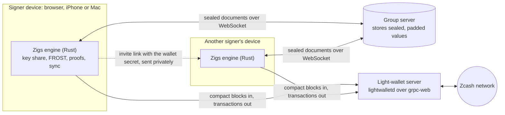
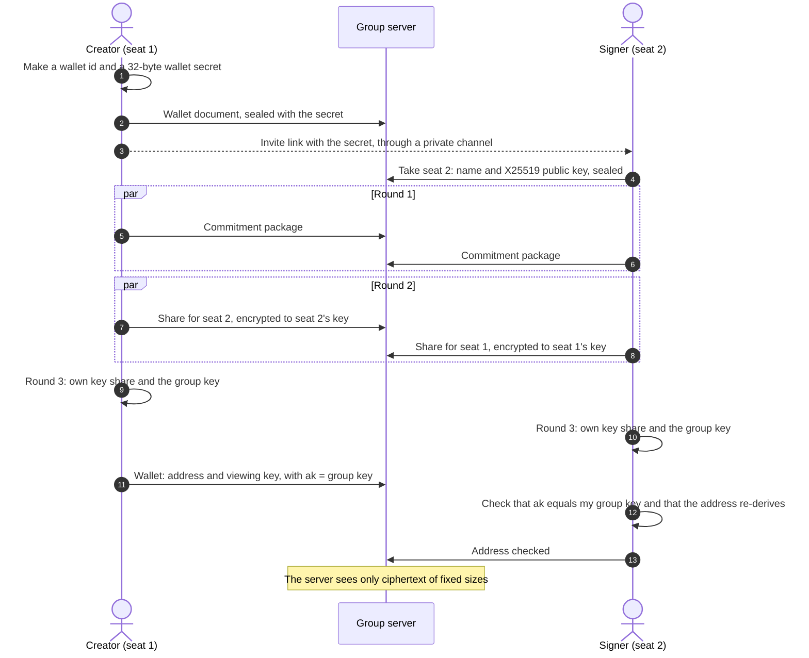
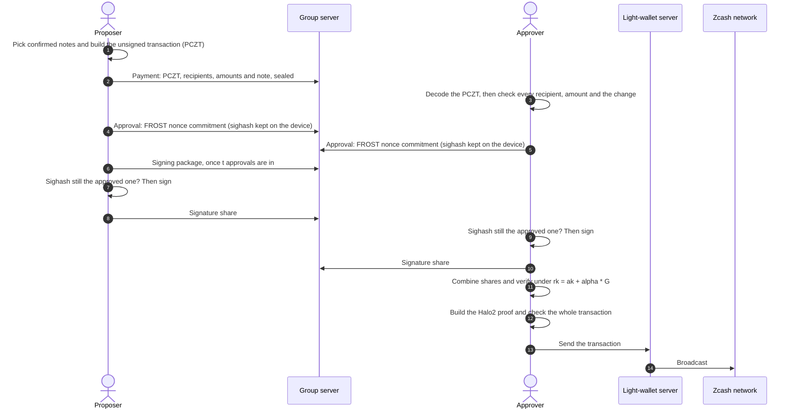
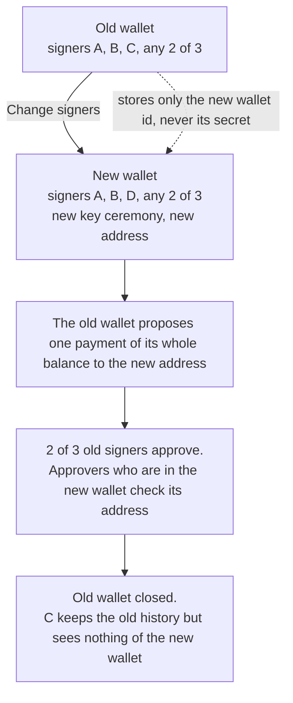

# How the Zigs protocol works

Zigs is a shared wallet for shielded Zcash. Any *t* of its *n* signers approve each payment, and
the chain sees one ordinary shielded transaction. Zigs uses re-randomized FROST threshold
signatures ([ZIP 312](https://zips.z.cash/zip-0312)) on the Ironwood shielded pool (NU7, v6
transactions).

Status: beta, not audited. It runs on testnet, and on mainnet with a warning at 0.5 ZEC.

## 1. The parts

| Part | Role | What it holds |
|---|---|---|
| **Engine** (Rust) | Runs FROST, builds and checks transactions, makes Halo2 proofs, syncs the chain. Runs as WebAssembly in the browser and as a native library on iPhone and Mac. | Nothing permanent; the app gives it data |
| **Signer device** | Runs the web, iPhone or Mac app around the engine | Its key share, the wallet secret, the viewing key, nonces, payment history |
| **Group server** | A Cloudflare Worker with one Durable Object (SQLite) per wallet. Relays and stores sealed documents over a WebSocket. | Only ciphertext, plus wallet ids, document paths, timing and IP addresses |
| **Light-wallet server** | lightwalletd over grpc-web. Serves compact blocks and accepts finished transactions. | Your IP address and the blocks you download |
| **Zcash network** | NU7, Ironwood shielded pool | One normal shielded transaction per payment |

## 2. Identities and secrets

- **Wallet id:** 20 hex characters. The group server uses it to find the wallet's Durable Object.
- **Wallet secret:** 32 random bytes that the creator makes.
  - It travels only in the invite link: `https://app.zigs.app/#<wallet-id>.<secret>`.
  - Browsers never send the part after `#` to a server.
  - The app saves the secret on the device and removes it from the address bar.
  - An invite link for a known wallet must carry the same secret, or the app refuses it.
- **Seat:** a numbered place 1..n in the wallet. Its FROST identifier is the seat number as a
  32-byte little-endian scalar.
- **Device id:** a local random id that marks "my seats". Leases on the server use a new random
  holder each time, so the server cannot link one device across wallets.
- **X25519 seat key:** each seat publishes a public key when it joins. Key ceremony shares are
  encrypted to it.

## 3. How the group server stays blind

- **Encryption.** Every field of every document is encrypted with XChaCha20-Poly1305, under a key
  derived from the wallet secret.
- **Binding.** The document path and field name are bound into each ciphertext. The server cannot
  move a value to another document or field.
- **Padding.** Values are padded to at least 64 bytes, then to the next power of two, so their
  length does not show amounts.
- **What the server can do.** It can refuse service, drop messages or replay old values. It cannot
  read values or write new valid ones.
- **What the server sees.** Wallet ids, document paths and field names, timing, and which IP
  addresses connect to which wallet. It keeps no logs.
- **Abuse limits.** A message is at most 300,000 characters, a document at most 256,000, and a
  wallet at most 10 MB. Writes and new connections are rate-limited per IP address.

## 4. Creating a wallet (distributed key generation)

The engine runs FROST distributed key generation (DKG) over RedPallas. No device and no server ever
holds the whole spending key.

1. **Setup.** The creator makes the wallet id and secret, writes the sealed wallet document (name,
   t, n, network) and takes seat 1.
2. **Invite.** The creator sends the link through a private channel, such as Signal. Each signer
   opens it and takes a free seat.
3. **Round 1.** When all seats are taken, each device publishes its FROST commitment package.
4. **Round 2.** Each device makes one share for every other seat and encrypts it with X25519 to
   that seat's key. Each box is bound to its sender and receiver.
5. **Round 3.** Each device computes its own key package and the public key package. It publishes
   a `done` document with the group key and the public key package, and keeps its key share on
   the device.
6. **Agreement.** Every seat compares all `done` documents. If they differ, the app tells the
   signers to create a new wallet.

## 5. The wallet key and the address

An Ironwood full viewing key has three parts: `ak`, `nk` and `rivk`.

- `ak`, the spend validating key, is set to the FROST group key. Only a threshold of signers can
  authorize a spend.
- `nk` and `rivk` only allow viewing. The creator makes them, and all signers receive them in the
  sealed wallet document.

The creator publishes the address and the viewing key. Then each seat checks them:

- `ak` must equal the group key that this seat computed.
- The address must re-derive from the viewing key.
- The seat keeps the result on its own device, tied to the exact wallet document. If the document
  in the store changes, the seat checks it again.
- The app shows the address only after this device's own seat checked it. Other seats' "checked"
  marks in the store are only claims.

A dishonest creator cannot publish an address that the signers do not control.

## 6. Receiving and sync

- Each device downloads compact blocks from its light-wallet server, from the wallet's birthday
  height. It trial-decrypts each output with the viewing key, so it finds its notes locally.
- The light-wallet server never learns which notes belong to the wallet.
- The notes, the note commitment tree and the sync position are saved on the device, sealed with
  the wallet key.
- On mainnet, at 0.5 ZEC the app warns and hides the address. It cannot block deposits.

## 7. Making a payment

### 7.1 Propose

- Any signer picks confirmed notes and builds the unsigned transaction (PCZT).
- A payment has 1 to 20 recipients and one change output. One payroll is one approval round and
  one transaction.
- The fee follows ZIP 317: 5,000 zatoshis × max(2, spends, outputs).
- The session document holds the PCZT, the recipient list, the total, a note and the proposer.
- Only one payment can be open at a time, because a second one could pick the same notes.

### 7.2 Check (on each approving device)

- The engine decodes the PCZT itself.
  - It ties every output that carries value to a recipient.
  - It computes the change and the fee.
  - It refuses a transaction that moves more than the standard fee out of the shielded pool.
- The app compares the decoded outputs with the proposed list: the same addresses and amounts,
  nothing missing and nothing extra. Any difference disables Approve.
- The seat's own wallet check must have passed.
- For a move to a new wallet, the destination must equal the address that this device's own seat
  in the new wallet checked.

A proposer cannot hide a different recipient, amount or extra output behind the text they typed.

### 7.3 Approve

- The engine makes FROST nonces and their commitments.
- The device saves the nonces together with the transaction's **sighash** (ZIP 244, v6).
- Only the commitment goes to the group server.

### 7.4 Signing package

- When t approvals exist, one device takes a short lease, reads the session again, and publishes
  the signing package: the chosen signers and their commitments.

### 7.5 Sign

Each chosen device signs automatically, after these checks:

- It decodes the current PCZT again and compares its sighash with the one it approved. If they
  differ, it burns its nonces, marks the payment failed and does not sign.
- It re-runs the PCZT verifier role.
- It checks that its own commitment is in the package unchanged.
- It deletes its nonces before it publishes its signature share, so a nonce is never used twice.

### 7.6 Combine, prove and send

- Any device combines the shares and verifies the result under the re-randomized key
  `rk = ak + [alpha]G`. A bad share names its sender.
- `alpha` is new for each spend, so spends cannot be linked to the wallet or to each other.
- A device builds the Halo2 proof, checks the whole transaction, and sends it through its
  light-wallet server.
- On chain, the payment is one normal Ironwood shielded transaction.

## 8. Changing signers

The signers and the threshold are part of the wallet key, so they cannot change in place. Zigs
creates a replacement wallet and moves the funds with one normal, approved payment.

## 9. Keys on the device

- **Web.** Secrets are in browser storage.
  - Optional passkey lock. The WebAuthn PRF extension gives a 32-byte secret on each Face ID,
    Touch ID or security key check. That secret is the AES-256-GCM key for one sealed record.
  - The key always comes from a passkey sign-in, so the app proves that the passkey gives the
    same key back before it deletes the plain copy.
- **iPhone.** Secrets are in the Keychain, on this device only.
  - Optional Face ID lock. A random vault key is kept in the Keychain behind Face ID or the
    passcode, and the secrets are sealed with it.
  - A Keychain read error keeps the app locked.
- **Mac.** No lock yet.
- **Passkeys do not sign.** A passkey cannot make a RedPallas signature. It protects the key share
  on the device; the FROST share signs.
- **Backup (web).** An unencrypted file with the key share, and never the nonces.
  - On restore, the app checks the key share against the key data the wallet published for that
    seat.
  - Tor Browser forgets everything when it closes, so a Tor user restores the backup in each
    session.

## 10. The apps

All three apps use the same engine and the same group server, so one wallet can have signers on
the web, on iPhone and on Mac at the same time.

### 10.1 Web app: https://app.zigs.app

- **No install and no account.** One HTML page, the WebAssembly engine, and small scripts for the
  store client, the passkey lock, QR codes and recipient lists.
- **Hosting.** A Cloudflare Worker serves the page and the `/ws` WebSocket of the group server.
- **Content-Security-Policy.** The page can connect only to its own host, the group server's
  WebSocket and the named light-wallet servers. It loads no scripts, fonts or images from other
  hosts. It cannot be framed.
- **Other headers.** HSTS, `nosniff`, `no-referrer`, and a Permissions-Policy that turns off the
  camera, microphone and location.
- **Networks.**

  | Network | Light-wallet servers | Address prefix | Notes |
  |---|---|---|---|
  | Testnet | `lwd.zigs.app`, `zcash-testnet.chainsafe.dev` | `utest1` | Free coins from a faucet |
  | Mainnet | `zcash-mainnet.chainsafe.dev` | `u1` | Real ZEC. Warning and hidden address at 0.5 ZEC |

- **Main screens.**
  - Wallet list, and a "Create wallet" form (name, *t*, *n*, network).
  - Invite card with the link and a QR code.
  - Setup steps: signers join, create the key together, check the address.
  - Wallet view with the tabs Overview, Activity, Signers and Details.
  - Send: one or more recipients, "Paste a list" from a spreadsheet, and a fee estimate.
  - Receive: the checked address, a QR code and a copy button.
  - Payment drawer: the decoded transaction, the recipient check, the approval steps, and the
    buttons Approve, Build proof and Send to network.
  - Change signers.
- **Device features.** Optional passkey lock, backup and restore of key shares, and a message
  when the browser blocks WebAssembly (Tor Browser at the Safer level).
- **Tor Browser.** Prepared for the Standard level. Restore the backup in each session and finish
  each approval in one session. A full session is not tested yet.

### 10.2 iPhone and Mac apps

- **Native SwiftUI apps.** iPhone needs iOS 17, Mac needs macOS 14. They are built from source in
  `ios/` with Xcode. There is no App Store or TestFlight build yet.
- **Engine.** The same Rust engine, compiled to a native library (`ZigsCore.xcframework`) with a
  C interface.
- **Same screens as the web app.** Wallet list, setup steps, the four wallet tabs, send with
  pasted lists, receive with a QR code, the decoded payment with "What the chain sees" after it is
  sent, and change signers.
- **Invites.** The app opens web invite links and `zigs://join#<wallet-id>.<secret>` links. The
  invite secret stays in the Keychain.
- **Keys.** The Keychain, on this device only. The iPhone has an optional Face ID lock. The Mac
  has no lock yet, and no backup.
- **Proofs.** The device builds Halo2 proofs natively. The time on a real iPhone is not measured
  yet.

## 11. The website: https://zigs.app

- **Purpose.** The public landing page. It explains the product and links to the web app with
  "Open the app".
- **Content.** The headline "The multisig the blockchain can't see", a view of what the team sees
  next to what the chain sees, the stage label (beta, not audited), and "Open source (MIT) on
  October 28".
- **Launch news.** An optional email form.
  - The addresses go to a Cloudflare D1 database that only the Zigs team reads.
  - They are used only for launch news. A reply to any message removes the address.
  - The form has a hidden field that catches bots, and limits of 5 sign-ups per minute per IP
    address and 100 per minute in total. Requests from other origins get 403.
- **Privacy.** No trackers and no analytics. Fonts are served from zigs.app, so visitors never
  contact Google.
- **Headers.** A strict Content-Security-Policy with no inline script or style, HSTS, `nosniff`,
  `no-referrer`, a Permissions-Policy, and no framing.
- **Hosting.** A separate Cloudflare Worker with static assets. It shares no data with the app or
  the group server.

## 12. What each party learns

| Party | Learns | Does not learn |
|---|---|---|
| Chain observer | One shielded transaction, its fee and its number of actions | That a group signed it, the signers, the approval rule, recipients, amounts |
| Group server | Wallet ids, document paths, timing, IP addresses | Names, addresses, keys, amounts, recipients, transactions |
| Light-wallet server | IP address, birthday height, blocks downloaded, transactions sent | Which notes belong to the wallet |
| Other signers | Everything about the shared wallet | Your key share and your nonces |

## 13. Guarantees and limits

**Guarantees**

- Fewer than *t* signers cannot spend.
- One honest approving device sees the true payment, and signs only the transaction it approved.
- A dishonest creator cannot publish an address that the signers do not control.
- The group server cannot read the wallet or forge documents.

**Limits**

- Not audited.
- The sighash binding is in the apps. The engine's `sign_share` does not take the approved
  sighash yet.
- Malicious light-wallet servers and chain reorganisations are not handled.
- A full session in Tor Browser is not tested yet.
- `alpha` comes from the PCZT, as in the Zcash Foundation's `zcash-sign`. Compare this with the
  final ZIP 312 text before production use.
- The group server's storage and abuse limits are loose for a public relay.
