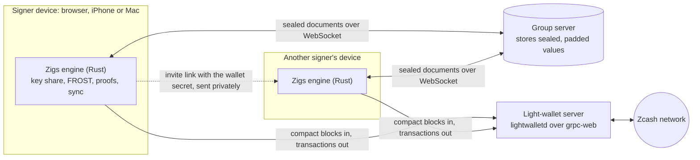
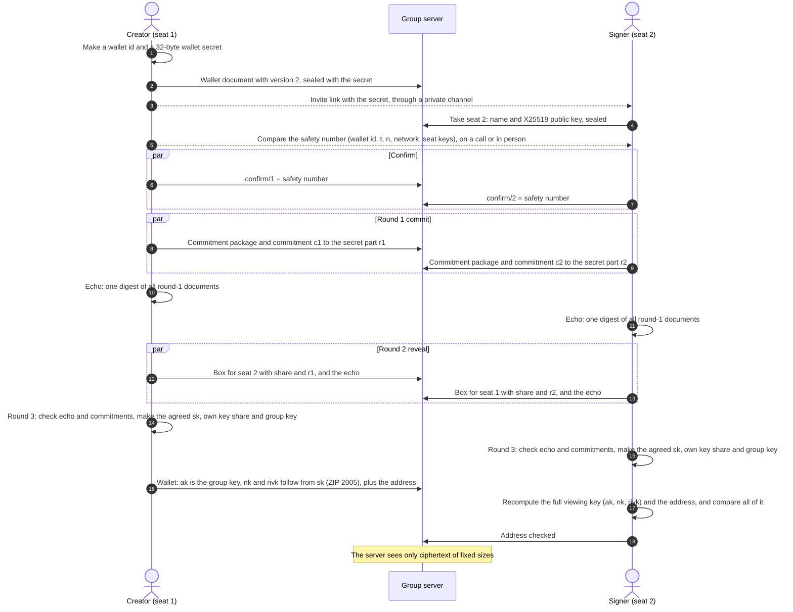
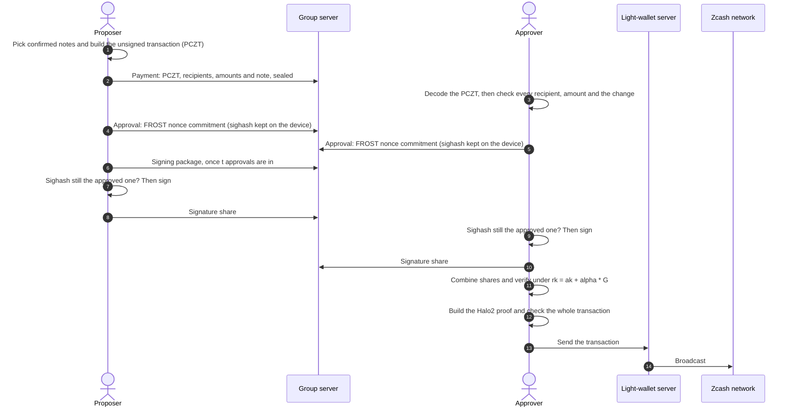
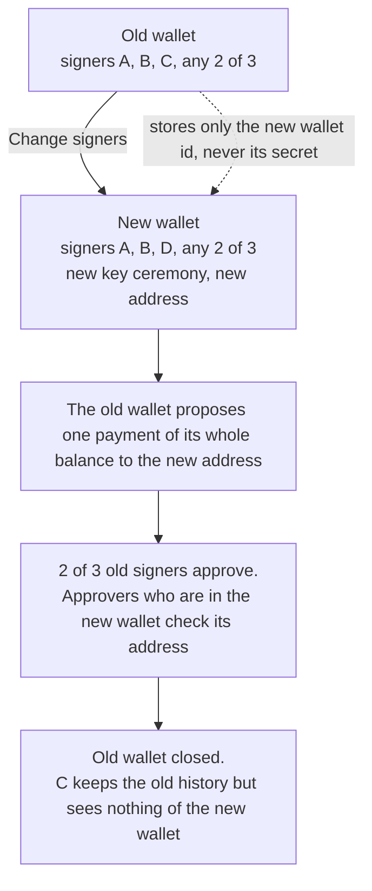

# How the Zigs protocol works

Zigs is a shared wallet for shielded Zcash. Any *t* of its *n* signers approve each payment, and
the chain sees one ordinary shielded transaction. Zigs uses re-randomized FROST threshold
signatures ([ZIP 312](https://zips.z.cash/zip-0312)) on the Ironwood shielded pool (NU7, v6
transactions).

Status: beta, not audited. It runs on testnet, and on mainnet with a warning at 0.5 ZEC.

## 1. The parts

| Part | Role | What it holds |
|---|---|---|
| **Engine** (Rust) | Runs FROST, builds and checks transactions, makes Halo2 proofs, syncs the chain. Runs as WebAssembly in the browser and as a native library on iPhone and Mac. | Nothing permanent; the app gives it data |
| **Signer device** | Runs the web, iPhone or Mac app around the engine | Its key share, the wallet secret, the viewing key, nonces, payment history |
| **Group server** | A Cloudflare Worker with one Durable Object (SQLite) per wallet. Relays and stores sealed documents over a WebSocket. | Only ciphertext, plus wallet ids, document paths, timing and IP addresses |
| **Light-wallet server** | lightwalletd over grpc-web. Serves compact blocks and accepts finished transactions. | Your IP address and the blocks you download |
| **Zcash network** | NU7, Ironwood shielded pool | One normal shielded transaction per payment |

## 2. Identities and secrets

- **Wallet id:** 20 hex characters. The group server uses it to find the wallet's Durable Object.
- **Wallet secret:** 32 random bytes that the creator makes.
  - It travels only in the invite link: `https://app.zigs.app/#<wallet-id>.<secret>`.
  - Browsers never send the part after `#` to a server.
  - The app saves the secret on the device and removes it from the address bar.
  - An invite link for a known wallet must carry the same secret, or the app refuses it.
- **Seat:** a numbered place 1..n in the wallet. Its FROST identifier is the seat number as a
  32-byte little-endian scalar.
- **Device id:** a local random id that marks "my seats". Leases on the server use a new random
  holder each time, so the server cannot link one device across wallets.
- **X25519 seat key:** each seat publishes a public key when it joins. Key ceremony shares are
  encrypted to it.
- **Ed25519 seat key:** each seat also has a signing key for messages (section 14).

## 3. How the group server stays blind

- **Encryption.** Every field of every document is encrypted with XChaCha20-Poly1305, under a key
  derived from the wallet secret.
- **Binding.** The document path and field name are bound into each ciphertext. The server cannot
  move a value to another document or field.
- **Padding.** Values are padded to at least 64 bytes, then to the next power of two, so their
  length does not show amounts.
- **What the server can do.** It can refuse service, drop messages or replay old values. It cannot
  read values or write new valid ones.
- **What the server sees.** Wallet ids, message room ids, document paths and field names, timing,
  and which IP addresses connect to which wallet. It keeps no logs.
- **Abuse limits.** A message is at most 300,000 characters, a document at most 256,000, and a
  wallet at most 10 MB. Writes and new connections are rate-limited per IP address.

## 4. Creating a wallet (distributed key generation)

The engine runs FROST distributed key generation (DKG) over RedPallas. No device and no server ever
holds the whole spending key.

A wallet document has a `version` field.

- **Version 2** is the ceremony below. All new wallets use it. The signers agree on a secret `sk`,
  and the wallet keys follow from it as ZIP 2005 (Proposed) specifies.
- **Version 1** has no `version` field. An older app made it. The creator's device chose `nk` and
  `rivk`, and there is no `qsk`. Version 1 wallets keep working with the old flow (section 4.3).
- **Any other value.** The app does not know it. It refuses to run the setup and shows a message.

The `version` field is one sealed field of the wallet document. The group server cannot read it
and does not check who writes it. So each seat keeps the version that its wallet had when it took
the seat (`version` in the seat secret). If the wallet document later shows another version, the
seat ends its setup. A joiner who sees a wallet that is not version 2 gets a warning first. The
joiner must say yes. The warning reads: "This wallet is not built to ZIP 2005. Funds cannot be
recovered if quantum computers break today's keys."

### 4.1 The ceremony, version 2

1. **Setup.** The creator makes the wallet id and secret, writes the sealed wallet document (name,
   t, n, network, `version: 2`) and takes seat 1.
2. **Invite.** The creator sends the link through a private channel, such as Signal. Each signer
   opens it and takes a free seat. The device keeps its box key pair (`boxSk`, `boxPk`) and the
   wallet version (`version`) in the seat secret.
3. **Safety number.** When all seats are taken, each device shows a number of 30 digits, in six
   groups of five.
   - The number is `BLAKE2b-256` with the personalization `Zigs_SafetyNo_v1` over this input:
     `walletId || u8(t) || u8(n) || u32le(len) || network`, then, for each seat in order,
     `u16le(seat) || boxPk`. `walletId` and `network` are their UTF-8 bytes, and `len` is the
     byte length of `network`. `network` is `testnet` or `mainnet`, as the app reads it from the
     wallet document. The first 16 bytes, read as a little-endian integer modulo 10^30, give the
     30 digits.
   - The wallet document holds `t`, `n` and `network`, and no key authenticates it. So the number
     covers them. A signer who sees another threshold, seat count or network sees another number.
   - 30 digits are about 100 bits. A shorter number would let an attacker find two seat lists
     with the same number, and show one list to each signer.
   - The signers compare the number on a call or in person. A different number means that
     someone else took a seat, or that a device saw other seat data.
   - The number alone cannot show that a seat key was replaced, because every device then shows
     the same number. So each device also compares the key in the store with the key that it
     made. It does this for every seat that it holds a secret for. If the keys differ, the device
     ends its setup: "Your seat key was replaced. Do not use this wallet. Create a new wallet."
   - Each person taps "It matches". The device keeps the confirmed number in the seat secret
     (`confirmed`) and writes `confirm/<seat> = { number }`.
   - After the tap, the device compares the number it computes now with the confirmed number each
     time the store changes. If they differ and the seat holds no key share, the device ends its
     setup: "The safety number changed after you confirmed it. Someone may have replaced a seat.
     Do not use this wallet. Create a new wallet." It does not ask for a new tap.
   - Round 1 and round 2 start only when three values are equal. The values are the number this
     device computes now, the number its person confirmed, and the number in every `confirm`
     document. A `confirm` document alone is a claim and does not start anything.
   - A device that holds every seat (a demo) confirms for all its seats without a tap.
4. **Round 1.** Each device makes its FROST commitment package and a random secret part `r` of 32
   bytes. It keeps `r` in the seat secret (`skPart`) and saves it before it publishes anything.
   It writes `dkg1/<seat> = { package, commit }`, where
   `commit = BLAKE2b-256("Zigs_SkCommit_v1", walletId || u16le(seat) || boxPk || r)`.
5. **Echo.** When all `dkg1` documents are present, each device computes
   `echo = BLAKE2b-256("Zigs_DkgEcho__v1", ...)`. The hash covers the wallet id. Then, for every
   seat in order, it covers the seat number, the round-1 package in its FROST binary encoding, and
   `commit`. Each variable part has a 4-byte length in front. A device stores its echo in the seat
   secret.
6. **Round 2.** Each device makes one share for every other seat. It encrypts
   `{ package, r }` with X25519 to that seat's key. Each box is bound to its sender and receiver.
   It writes `dkg2/<from>-<to> = { sealed, echo }`.
7. **Round 3.** A device does these checks before it makes any key.
   - Its stored echo equals the echo it computes now from the `dkg1` documents.
   - Every `dkg2/<j>-<me>` document has the same echo. If not, the device ends its setup with
     "Signers saw different setup data. Do not use this wallet. Create a new wallet."
   - Every `r` that a box reveals matches the commitment of its seat in `dkg1`. If not, the device
     ends its setup and names the seat.

   Then the device computes
   `sk = BLAKE2b-256("Zigs_VaultSk__v1", walletId || echo || r_1 || ... || r_n)` in seat order.
   It computes its key package and the public key package. It saves `sk` as `vaultSk` in the seat
   secret and deletes `skPart`. It publishes a `done` document with the group key and the public
   key package, and keeps its key share on the device.
8. **Agreement.** Every seat compares all `done` documents. If they differ, the app tells the
   signers to create a new wallet.

An aborted setup stays aborted: the seat keeps the reason (`aborted`) and does not retry. It
also writes `abort/<seat> = { reason }`, so the other seats see which seat stopped and why. An
`abort` document counts as published only if it exists and its `reason` is a string. A device
writes it again until the store holds such a document. A seat that sees a published `abort`
document and holds no key share yet stops too. A device retries the `done` write until the write
succeeds.

Document layout of a version 2 wallet, all fields sealed with the wallet secret:

| Path | Fields |
|---|---|
| `groups/<id>` | `name`, `n`, `t`, `network`, `version`, `createdBy`, `createdAt` |
| `groups/<id>/confirm/<seat>` | `number` |
| `groups/<id>/dkg1/<seat>` | `package`, `commit`, `at` |
| `groups/<id>/dkg2/<from>-<to>` | `sealed`, `echo`, `at` |
| `groups/<id>/abort/<seat>` | `reason` |
| `groups/<id>/done/<seat>` | `groupKey`, `publicKeyPackage`, `at` |

### 4.2 Why this commit-reveal and echo

- A seat reveals `r` only in round 2, after every commitment is public. No seat can choose its
  `r` after it saw the others.
- The commitment binds `r` to the seat number and the encryption key, so a box from another seat
  cannot replace it.
- The echo makes all seats confirm that they saw the same round-1 data. A seat that got other
  data produces another echo, and the other seats find it before they use its box.
- ZIP 2005 says that the protocol MUST ensure that all participants obtain the same `ak`, `nk` and
  `rivk_ext`. The echo, the commitments and the final check in section 5 give this.
- The store does not stop a holder of the wallet secret from overwriting `groups/<id>` or a seat
  document, because the server cannot read them. The seat secret holds the version and the box
  key, so the device finds such a change itself.
- A seat on an old app writes a round-1 document without `commit`. The apps show "Seat N uses an
  old version of Zigs and cannot join this wallet. Update it, or create a new wallet."

### 4.3 Version 1 wallets

The flow is the one before ZIP 2005 support: round 1, round 2 and round 3 without `confirm`,
`commit` or `echo`. The creator makes the viewing key parts `nk` and `rivk`. A version 1 wallet
shows a note in Details: "This wallet was made before quantum recoverability (ZIP 2005). To get it,
move the funds to a new wallet with Change signers." Section 8 describes that move.

## 5. The wallet key and the address

An Ironwood full viewing key has three parts: `ak`, `nk` and `rivk`.

- `ak`, the spend validating key, is set to the FROST group key. Only a threshold of signers can
  authorize a spend.
- **Version 2.** Every signer computes `nk` and `rivk` from `sk`. ZIP 2005 (Proposed) defines them
  for FROST with `use_qsk = true`:
  - `nk = ToBase(PRF^expand_sk([0x07]))`
  - `qsk` = the first 32 bytes of `PRF^expand_sk([0x0C])`
  - `qk` = BLAKE3 `derive_key` with the context `Zcash ZIP 2005 qk-derivation v1` over `qsk`
  - `rivk = ToScalar(PRF^expand_qk([0x0D] || ak || nk))`
  - `PRF^expand_k(t)` is BLAKE2b-512 with the personalization `Zcash_ExpandSeed` over `k || t`.
    `ak` and `nk` are their 32-byte little-endian encodings.
  - The internal keys follow the ZIP 32 derivation, keyed by this `rivk`.
- **Version 1.** `nk` and `rivk` only allow viewing. The creator makes them, and all signers
  receive them in the sealed wallet document.

The creator publishes the address and the viewing key. Then each seat checks them:

- **Version 2.** The seat recomputes the whole viewing key and the address from its own public key
  package and its own `sk`. It compares all of it with the published wallet: the version, the
  network, `ak`, `nk`, `rivk`, the wallet key, the viewing key and the address. The error names the
  first part that differs. A seat that holds `sk` never uses the version 1 check.
- **Version 1.** `ak` must equal the group key that this seat computed. The address must
  re-derive from the viewing key.
- The seat keeps the result on its own device, tied to the exact wallet document. If the document
  in the store changes, the seat checks it again.
- The app shows the address only after this device's own seat checked it. Other seats' "checked"
  marks in the store are only claims.

A dishonest creator cannot publish an address that the signers do not control. In a version 2
wallet, the creator also cannot choose `nk` or `rivk`.

## 6. Receiving and sync

- Each device downloads compact blocks from its light-wallet server, from the wallet's birthday
  height. It trial-decrypts each output with the viewing key, so it finds its notes locally.
- The light-wallet server never learns which notes belong to the wallet.
- The notes, the note commitment tree and the sync position are saved on the device, sealed with
  the wallet key.
- On mainnet, at 0.5 ZEC the app warns and hides the address. It cannot block deposits.

## 7. Making a payment

### 7.1 Propose

- Any signer picks confirmed notes and builds the unsigned transaction (PCZT).
- A payment has 1 to 20 recipients and one change output. One payroll is one approval round and
  one transaction.
- The fee follows ZIP 317: 5,000 zatoshis × max(2, spends, outputs).
- The session document holds the PCZT, the recipient list, the total, a note and the proposer.
- Only one payment can be open at a time, because a second one could pick the same notes.

### 7.2 Check (on each approving device)

- The engine decodes the PCZT itself.
  - It ties every output that carries value to a recipient.
  - It computes the change and the fee.
  - It refuses a transaction that moves more than the standard fee out of the shielded pool.
- The app compares the decoded outputs with the proposed list: the same addresses and amounts,
  nothing missing and nothing extra. Any difference disables Approve.
- The seat's own wallet check must have passed.
- For a move to a new wallet, the destination must equal the address that this device's own seat
  in the new wallet checked.

A proposer cannot hide a different recipient, amount or extra output behind the text they typed.

### 7.3 Approve

- The engine makes FROST nonces and their commitments.
- The device saves the nonces together with the transaction's **sighash** (ZIP 244, v6).
- Only the commitment goes to the group server.

### 7.4 Signing package

- When t approvals exist, one device takes a short lease, reads the session again, and publishes
  the signing package: the chosen signers and their commitments.

### 7.5 Sign

Each chosen device signs automatically, after these checks:

- It decodes the current PCZT again and compares its sighash with the one it approved. If they
  differ, it burns its nonces, marks the payment failed and does not sign.
- The engine checks the same thing again: `sign_share` takes the saved approval (nonces,
  commitments and sighash) and refuses a transaction with another sighash.
- It re-runs the PCZT verifier role.
- It checks that its own commitment is in the package unchanged.
- It deletes its nonces before it publishes its signature share, so a nonce is never used twice.

### 7.6 Combine, prove and send

- Any device combines the shares and verifies the result under the re-randomized key
  `rk = ak + [alpha]G`. A bad share names its sender.
- `alpha` is new for each spend, so spends cannot be linked to the wallet or to each other.
- A device builds the Halo2 proof, checks the whole transaction, and sends it through its
  light-wallet server.
- On chain, the payment is one normal Ironwood shielded transaction.

### 7.7 Cancel

- Until the shares are combined, any signer can cancel a payment, for example one whose approval
  was lost. The payment is then closed: no device approves, signs or combines it.
- The cancelling device deletes its own unused nonces for the payment.
- Cancel coordinates honest signers. It is not a security control: t signers who hold all the
  shares could still combine them.

## 8. Changing signers

The signers and the threshold are part of the wallet key, so they cannot change in place. Zigs
creates a replacement wallet and moves the funds with one normal, approved payment.

## 9. Keys on the device

- **Web.** Secrets are in browser storage.
  - Optional passkey lock. The WebAuthn PRF extension gives a 32-byte secret on each Face ID,
    Touch ID or security key check. That secret is the AES-256-GCM key for one sealed record.
  - The key always comes from a passkey sign-in, so the app proves that the passkey gives the
    same key back before it deletes the plain copy.
- **iPhone.** Secrets are in the Keychain, on this device only.
  - Optional Face ID lock. A random vault key is kept in the Keychain behind Face ID or the
    passcode, and the secrets are sealed with it.
  - A Keychain read error keeps the app locked.
- **Mac.** No lock yet.
- **Passkeys do not sign.** A passkey cannot make a RedPallas signature. It protects the key share
  on the device; the FROST share signs.
- **Backup (web).** An unencrypted file with the key share, and never the nonces.
  - For a version 2 wallet the file also holds `vaultSk`. From it anyone can compute `qsk`, so keep
    the file as secret as the key share.
  - On restore, the app checks the key share against the key data the wallet published for that
    seat.
  - Tor Browser forgets everything when it closes, so a Tor user restores the backup in each
    session.

## 10. The apps

All three apps use the same engine and the same group server, so one wallet can have signers on
the web, on iPhone and on Mac at the same time.

### 10.1 Web app: https://app.zigs.app

- **Access.** Until launch, the live app asks for one shared password on every request,
  including the WebSocket. Without the password set on the server, it refuses everything.
- **No install and no account.** One HTML page, the WebAssembly engine, and small scripts for the
  store client, the passkey lock, QR codes and recipient lists.
- **Hosting.** A Cloudflare Worker serves the page and the `/ws` WebSocket of the group server.
- **Content-Security-Policy.** The page can connect only to its own host, the group server's
  WebSocket and the named light-wallet servers. It loads no scripts, fonts or images from other
  hosts. No inline script runs: the app script is a separate file. It cannot be framed.
- **Other headers.** HSTS, `nosniff`, `no-referrer`, and a Permissions-Policy that turns off the
  camera, microphone and location.
- **Networks.**

  | Network | Light-wallet servers | Address prefix | Notes |
  |---|---|---|---|
  | Testnet | `lwd.zigs.app`, `zcash-testnet.chainsafe.dev` | `utest1` | Free coins from a faucet |
  | Mainnet | `zcash-mainnet.chainsafe.dev` | `u1` | Real ZEC. Warning and hidden address at 0.5 ZEC |

- **Main screens.**
  - Wallet list, and a "Create wallet" form (name, *t*, *n*, network).
  - Invite card with the link and a QR code.
  - Setup steps: signers join, create the key together, check the address. A version 2 wallet
    shows a safety number card before the three steps.
  - Wallet view with the tabs Overview, Activity, Messages, Signers and Details.
  - Send: one or more recipients, "Paste a list" from a spreadsheet, and a fee estimate.
  - Receive: the checked address, a QR code and a copy button.
  - Payment drawer: the decoded transaction, the recipient check, the approval steps, and the
    buttons Approve, Build proof and Send to network.
  - Change signers.
  - Messages: the wallet thread, a discussion in each payment drawer, and unread counts (section 14).
- **Device features.** Optional passkey lock, backup and restore of key shares, and a message
  when the browser blocks WebAssembly (Tor Browser at the Safer level).
- **Tor Browser.** Prepared for the Standard level. Restore the backup in each session and finish
  each approval in one session. A full session is not tested yet.

### 10.2 iPhone and Mac apps

- **Native SwiftUI apps.** iPhone needs iOS 17, Mac needs macOS 14. They are built from source in
  `ios/` with Xcode. There is no App Store or TestFlight build yet.
- **Engine.** The same Rust engine, compiled to a native library (`ZigsCore.xcframework`) with a
  C interface.
- **Same screens as the web app, same ceremony.** Wallet list, setup steps with the safety number,
  the four wallet tabs, send with
  pasted lists, receive with a QR code, the decoded payment with "What the chain sees" after it is
  sent, and change signers.
- **Server password.** Settings has a password field for a server that has one, as app.zigs.app
  does until launch.
- **Invites.** The app opens web invite links and `zigs://join#<wallet-id>.<secret>` links. The
  invite secret stays in the Keychain.
- **Keys.** The Keychain, on this device only. The iPhone has an optional Face ID lock. The Mac
  has no lock yet, and no backup.
- **Proofs.** The device builds Halo2 proofs natively. The time on a real iPhone is not measured
  yet.

## 11. The website: https://zigs.app

- **Purpose.** The public landing page. It explains the product and collects early-access sign-ups.
  It does not link to the app before launch.
- **Content.** The headline "The multisig the blockchain can't see", a view of what the team sees
  next to what the chain sees, the stage label (beta, not audited), and "Open source (MIT) on
  October 28".
- **Early access.** An email form.
  - The addresses go to a Cloudflare D1 database that only the Zigs team reads.
  - They are used only to tell people when Zigs opens. A reply to any message removes the address.
  - The form has a hidden field that catches bots, and limits of 5 sign-ups per minute per IP
    address and 100 per minute in total. Requests from other origins get 403.
- **Privacy.** No trackers and no analytics. Fonts are served from zigs.app, so visitors never
  contact Google.
- **Headers.** A strict Content-Security-Policy with no inline script or style, HSTS, `nosniff`,
  `no-referrer`, a Permissions-Policy, and no framing.
- **Hosting.** A separate Cloudflare Worker with static assets. It shares no data with the app or
  the group server.

## 12. What each party learns

| Party | Learns | Does not learn |
|---|---|---|
| Chain observer | One shielded transaction, its fee and its number of actions | That a group signed it, the signers, the approval rule, recipients, amounts |
| Group server | Wallet ids, message room ids, document paths, timing, message counts and sizes, IP addresses | Names, addresses, keys, amounts, recipients, transactions, message text and senders |
| Light-wallet server | IP address, birthday height, blocks downloaded, transactions sent | Which notes belong to the wallet |
| Other signers | Everything about the shared wallet | Your key share and your nonces |

## 13. Guarantees and limits

**Guarantees**

- Fewer than *t* signers cannot spend.
- One honest approving device sees the true payment, and signs only the transaction it approved.
- A dishonest creator cannot publish an address that the signers do not control.
- In a version 2 wallet, the creator cannot choose `nk` or `rivk`. Every signer recomputes them
  from `sk` and checks the published wallet.
- The group server cannot read the wallet or forge documents.

**Limits**

- Not audited.
- A version 2 wallet is built to ZIP 2005 (Proposed) so that funds can be recovered if quantum
  computers break today's keys. The ZIP is not final, and the Recovery Protocol does not exist
  yet. If the ZIP changes before it is final, a wallet that follows the current text may need to
  move its funds.
- Every signer holds `qsk`. As ZIP 2005 says, a quantum attacker who has `qsk` may steal the
  funds. So under a quantum attacker, one signer or one stolen backup could take the funds.
  Move the funds to a post-quantum protocol when one exists.
- The safety number protects only if the signers compare it over a channel that the attacker does
  not control. It has about 100 bits, so a split view needs about 2^50 work.
- The `version` field is not authenticated. A holder of the wallet secret can change it. A seat
  made by this app ends its setup when it sees another version. A joiner who accepts the warning
  for a wallet that is not version 2, and a seat of an older app, run the old flow.
- The agreement on `sk` is not quantum-resistant. The secret parts `r` travel in X25519 boxes, and
  the `dkg2` documents stay in the store. An attacker who recorded them and later learns the
  wallet secret can break X25519 with a quantum computer. That attacker then gets `sk` and `qsk`.
  Keep the invite link as private as the key share.
- A version 1 wallet has no `qsk` and is not recoverable under ZIP 2005. Move its funds to a new
  wallet with Change signers.
- Malicious light-wallet servers and chain reorganisations are not handled.
- A full session in Tor Browser is not tested yet.
- `alpha` comes from the PCZT, as in the Zcash Foundation's `zcash-sign`. Compare this with the
  final ZIP 312 text before production use.
- The group server's storage and abuse limits are loose for a public relay.

## 14. Messages

Phase 1 of [CHAT.md](CHAT.md). The web app has it. The iPhone and Mac apps do not yet.

- **Room.** Each wallet has a room: a store namespace with its own id (20 hex characters) and its
  own secret (32 bytes). The wallet document holds both in the sealed field `room`, as
  `{id, key}`. A device that holds a seat and sees no valid room makes one, under a lease on the
  wallet document. The room secret is kept apart from the wallet secrets, so a room never shows
  as a wallet. A device never makes a second room for a wallet it has a pinned room for. If the
  field is missing, a device that still holds the pinned room's key writes that room again.
- **Message.** One document at `groups/<room id>/messages/<message id>` with the sealed fields
  `seat`, `thread`, `text`, `at` and `sig`. Sealing is the same as for wallet fields, with the
  room secret. `thread` is `wallet` or `pay:<session id>`. `text` is plain text of 1 to 2,000
  UTF-16 code units (the JavaScript `length`). A client must count the same way. `at` is the
  sender's clock in milliseconds.
- **Seat signing key.** Ed25519 from Web Crypto. The private key (PKCS8, base64) is the seat
  secret `signSk`. The public key (raw, hex) is the field `signPk` of the seat document. A seat
  made before messages gets its key once, when its device opens the wallet. The key is in the
  seat's backup file. A backup made before the key existed does not hold it, so the page asks for
  a new backup when it makes the key.
- **Signature.** `sig` is the base64 Ed25519 signature over the UTF-8 bytes of
  `JSON.stringify(["zigs-msg-v1", wallet id, room id, message id, seat, thread, at, text])`.
  [`web/test/chat.mjs`](web/test/chat.mjs) holds a fixed text, public key and signature to test
  against.
- **Pinning.** Each device keeps the first room id it sees for a wallet, and the first `signPk`
  it sees for each seat. A later room id pauses messages and shows a warning. So does a missing
  room field when the device no longer holds the pinned room's key. A later `signPk`
  shows "Key changed. Not verified." on that seat's messages.
- **Verified.** A message is verified when `seat` is a seat of the wallet, the seat document's
  `signPk` equals the pinned key, and the signature is valid. Any other message shows as "Not
  verified". The app never hides it.
- **Payment threads.** The thread `pay:<session id>` is the discussion of one payment. The
  wallet thread also shows payment events (proposed, sent, cancelled). They come from the payment
  documents and need no extra writes.
- **Unread and notifications.** Each device keeps the time of the newest message from another
  seat that it showed in each thread. Only the wallet thread and the threads of payments that
  exist count. A message dated more than 10 minutes ahead is shown but not counted. A window
  without focus does not mark messages read. A browser notification, if the person turns it on,
  carries no message text.
- **Limits.** A device downloads the whole room when it connects, and a room holds about 5,000 to
  10,000 messages (10 MB). Times come from the sender's clock. Messages are not forward secret.

### Direct chats

Phase 2 of [CHAT.md](CHAT.md). The web app has it. The group server is the transport for now, so it
learns that two member ids talk to each other.

- **Chat.** A store namespace with a random id (20 hex characters) and secret (32 bytes). No
  document `groups/<chat id>` exists, so a chat is never a wallet. The contact link is
  `<app URL>#c.<chat id>.<secret>`. The app keeps the chat in the browser only (`zf-chats`, or the
  sealed record when the passkey lock is on). A backup file does not hold it. The secret opens
  every document of the namespace, so anyone who has the link can read the chat and write in it at
  any time, also after two people joined.
- **Member.** `groups/<chat id>/members/<member id>` with the sealed fields `name`, `signPk` and
  `at`. The member id is random (20 hex characters). `signPk` is the public key of the personal
  Ed25519 key of that browser, in the same format as a seat key. The app saves the chat and the
  key in the browser first, and then writes the member document. A failed save leaves nothing on
  the server. The person who made the chat writes the first member document. A page that only
  loads the link joins nothing. The person enters a name and clicks "Join chat". Then the app
  takes a lease on `groups/<chat id>/meta/join` and reads the members. The checks run in this
  order:
  1. Two or more members: "This chat already has two people. Ask for a new contact link." This
     holds also when someone else has the lease.
  2. The lease is held by someone else: "Someone else is joining this chat. Try again in a moment."
  3. No member: "This contact link does not open a chat. Ask for a new one."

  Only a chat with exactly one member and a free lease can be joined. After a failure the link
  stays in the page, so the person can try again.
- **Message.** `groups/<chat id>/messages/<message id>` with the sealed fields `from` (a member
  id), `text`, `at` and `sig`. `text` has the same limits as in a room.
- **Signature.** `sig` is the base64 Ed25519 signature over the UTF-8 bytes of
  `JSON.stringify(["zigs-dm-v1", chat id, message id, from, at, text])`.
  [`web/test/chat.mjs`](web/test/chat.mjs) holds a fixed text, public key and signature. A wallet
  message signature never verifies as a direct message, and the reverse, because the tags differ.
- **Pinning.** Each device pins the first two member ids it sees in a chat, and the first `signPk`
  for each. A message from another member id shows "Unknown sender. Not verified." A message from
  a member whose `signPk` differs from the pin shows "Key changed. Not verified." The chat also
  shows a warning. The app never hides these messages.
- **Unread and notifications.** The same as in a room, with the read mark `<chat id>:dm`. The
  first visit leaves a mark even when the chat is empty. A message from an unknown sender counts
  as unread, so it is not hidden. A notification carries no message text. It says "New message
  from <name>" only when every new message comes from the pinned contact. Otherwise it says
  "New message in a chat".
- **Leaving.** "Leave chat" removes the chat from the browser. The documents stay on the group
  server.
