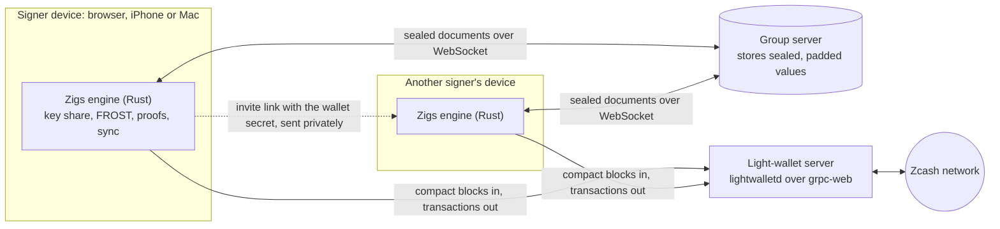
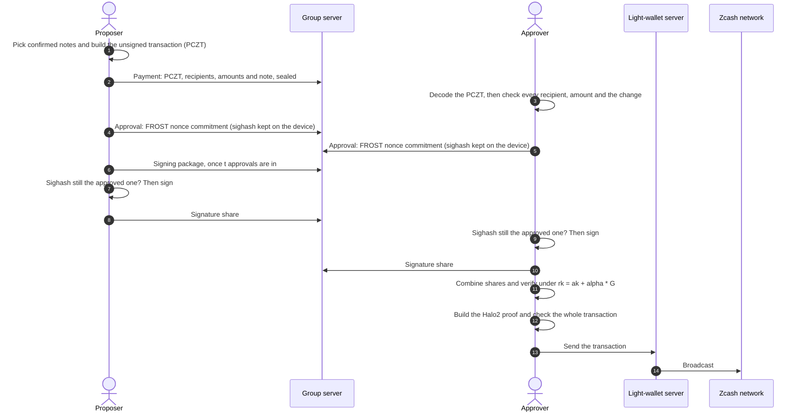
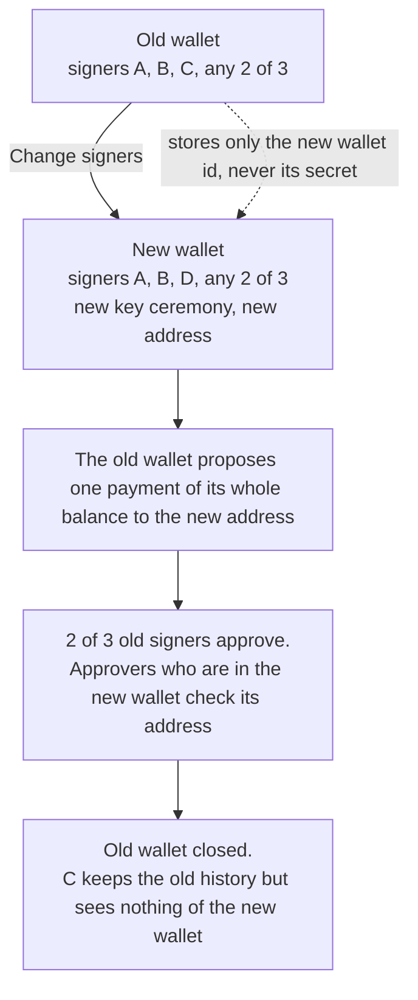

# How the Zigs protocol works

Zigs is a shared wallet for shielded Zcash. Any *t* of its *n* signers approve each payment, and
the chain sees one ordinary shielded transaction. Zigs uses re-randomized FROST threshold
signatures ([ZIP 312](https://zips.z.cash/zip-0312)) on the Ironwood shielded pool (NU7, v6
transactions).

Status: beta, not audited. It runs on testnet, and on mainnet with a warning at 0.5 ZEC.

## 1. The parts

| Part | Role | What it holds |
|---|---|---|
| **Engine** (Rust) | Runs FROST, builds and checks transactions, makes Halo2 proofs, syncs the chain. Runs as WebAssembly in the browser and as a native library on iPhone and Mac. | Nothing permanent; the app gives it data |
| **Signer device** | Runs the web, iPhone or Mac app around the engine | Its key share, the wallet secret, the viewing key, nonces, payment history |
| **Group server** | A Cloudflare Worker with one Durable Object (SQLite) per wallet. Relays and stores sealed documents over a WebSocket. | Only ciphertext, plus wallet ids, document paths, timing and IP addresses |
| **Light-wallet server** | lightwalletd over grpc-web. Serves compact blocks and full transactions, and accepts finished transactions. | Your IP address, the blocks you download and the transactions you fetch |
| **Zcash network** | NU7, Ironwood shielded pool | One normal shielded transaction per payment |

## 2. Identities and secrets

- **Wallet id:** 20 hex characters. The group server uses it to find the wallet's Durable Object.
- **Wallet secret:** 32 random bytes that the creator makes.
  - It travels only in the invite link: `https://app.zigs.app/#<wallet-id>.<secret>`.
  - Browsers never send the part after `#` to a server.
  - The app saves the secret on the device and removes it from the address bar.
  - An invite link for a known wallet must carry the same secret, or the app refuses it.
- **Seat:** a numbered place 1..n in the wallet. Its FROST identifier is the seat number as a
  32-byte little-endian scalar.
- **Device id:** a local random id that marks "my seats". Leases on the server use a new random
  holder each time, so the server cannot link one device across wallets.
- **X25519 seat key:** each seat publishes a public key when it joins. Key ceremony shares are
  encrypted to it.
- **Ed25519 seat key:** each seat also has a signing key for messages (section 14). In a version 3
  wallet it also signs documents (section 15).

## 3. How the group server stays blind

- **Encryption.** Every field of every document is encrypted with XChaCha20-Poly1305, under a key
  derived from the wallet secret.
- **Binding.** The document path and field name are bound into each ciphertext. The server cannot
  move a value to another document or field.
- **Padding.** Values are padded to at least 64 bytes, then to the next power of two, so their
  length does not show amounts.
- **What the server can do.** It can refuse service, drop messages or replay old values. It cannot
  read values or write new valid ones. A holder of the wallet secret can write values. A version 3
  wallet makes devices ignore the values that carry no valid signature (section 15).
- **What the server sees.** Wallet ids, message room ids, document paths and field names, timing,
  and which IP addresses connect to which wallet. It keeps no logs.
- **Abuse limits.** A message is at most 300,000 characters, a document at most 256,000, and a
  wallet at most 10 MB. Writes and new connections are rate-limited per IP address.

## 4. Creating a wallet (distributed key generation)

The engine runs FROST distributed key generation (DKG) over RedPallas. No device and no server ever
holds the whole spending key.

A wallet document has a `version` field.

- **Version 3** is the ceremony below with signed writes (section 15). All new wallets use it.
- **Version 2** is the ceremony below, without signed writes. The signers agree on a secret `sk`,
  and the wallet keys follow from it as ZIP 2005 (Proposed) specifies.
- **Version 1** has no `version` field. An older app made it. The creator's device chose `nk` and
  `rivk`, and there is no `qsk`. Version 1 wallets keep working with the old flow (section 4.3).
- **Any other value.** The app does not know it. It refuses to run the setup and shows a message.

The `version` field is one sealed field of the wallet document. The group server cannot read it
and does not check who writes it. So each seat keeps the version that its wallet had when it took
the seat (`version` in the seat secret). If the wallet document later shows another version, the
seat ends its setup. A joiner who sees a wallet that is not version 2 or 3 gets a warning first. The
joiner must say yes. The warning reads: "This wallet is not built to ZIP 2005. Funds cannot be
recovered if quantum computers break today's keys."

### 4.1 The ceremony, versions 2 and 3

1. **Setup.** The creator makes the wallet id and secret, writes the sealed wallet document (name,
   t, n, network, `version: 3`) and takes seat 1.
2. **Invite.** The creator sends the link through a private channel, such as Signal. Each signer
   opens it and takes a free seat. The device keeps its box key pair (`boxSk`, `boxPk`) and the
   wallet version (`version`) in the seat secret.
3. **Safety number.** When all seats are taken, each device shows a number of 30 digits, in six
   groups of five.
   - The number is `BLAKE2b-256` with the personalization `Zigs_SafetyNo_v1` over this input:
     `walletId || u8(t) || u8(n) || u32le(len) || network`, then, for each seat in order,
     `u16le(seat) || boxPk`. `walletId` and `network` are their UTF-8 bytes, and `len` is the
     byte length of `network`. `network` is `testnet` or `mainnet`, as the app reads it from the
     wallet document. The first 16 bytes, read as a little-endian integer modulo 10^30, give the
     30 digits.
   - The wallet document holds `t`, `n` and `network`, and no key authenticates it. So the number
     covers them. A signer who sees another threshold, seat count or network sees another number.
   - 30 digits are about 100 bits. A shorter number would let an attacker find two seat lists
     with the same number, and show one list to each signer.
   - The signers compare the number on a call or in person. A different number means that
     someone else took a seat, or that a device saw other seat data.
   - The number alone cannot show that a seat key was replaced, because every device then shows
     the same number. So each device also compares the key in the store with the key that it
     made. It does this for every seat that it holds a secret for. If the keys differ, the device
     ends its setup: "Your seat key was replaced. Do not use this wallet. Create a new wallet."
   - Each person taps "It matches". The device keeps the confirmed number in the seat secret
     (`confirmed`) and writes `confirm/<seat> = { number }`.
   - After the tap, the device compares the number it computes now with the confirmed number each
     time the store changes. If they differ and the seat holds no key share, the device ends its
     setup: "The safety number changed after you confirmed it. Someone may have replaced a seat.
     Do not use this wallet. Create a new wallet." It does not ask for a new tap.
   - Round 1 and round 2 start only when three values are equal. The values are the number this
     device computes now, the number its person confirmed, and the number in every `confirm`
     document. A `confirm` document alone is a claim and does not start anything.
   - A device that holds every seat (a demo) confirms for all its seats without a tap.
4. **Round 1.** Each device makes its FROST commitment package and a random secret part `r` of 32
   bytes. It keeps `r` in the seat secret (`skPart`) and saves it before it publishes anything.
   It writes `dkg1/<seat> = { package, commit }`, where
   `commit = BLAKE2b-256("Zigs_SkCommit_v1", walletId || u16le(seat) || boxPk || r)`.
5. **Echo.** When all `dkg1` documents are present, each device computes
   `echo = BLAKE2b-256("Zigs_DkgEcho__v1", ...)`. The hash covers the wallet id. Then, for every
   seat in order, it covers the seat number, the round-1 package in its FROST binary encoding, and
   `commit`. Each variable part has a 4-byte length in front. A device stores its echo in the seat
   secret.
6. **Round 2.** Each device makes one share for every other seat. It encrypts
   `{ package, r }` with X25519 to that seat's key. Each box is bound to its sender and receiver.
   It writes `dkg2/<from>-<to> = { sealed, echo }`.
7. **Round 3.** A device does these checks before it makes any key.
   - Its stored echo equals the echo it computes now from the `dkg1` documents.
   - Every `dkg2/<j>-<me>` document has the same echo. If not, the device ends its setup with
     "Signers saw different setup data. Do not use this wallet. Create a new wallet."
   - Every `r` that a box reveals matches the commitment of its seat in `dkg1`. If not, the device
     ends its setup and names the seat.

   Then the device computes
   `sk = BLAKE2b-256("Zigs_VaultSk__v1", walletId || echo || r_1 || ... || r_n)` in seat order.
   It computes its key package and the public key package. It saves `sk` as `vaultSk` in the seat
   secret and deletes `skPart`. It publishes a `done` document with the group key and the public
   key package, and keeps its key share on the device.
8. **Agreement.** Every seat compares all `done` documents. If they differ, the app tells the
   signers to create a new wallet.

An aborted setup stays aborted: the seat keeps the reason (`aborted`) and does not retry. It
also writes `abort/<seat> = { reason }`, so the other seats see which seat stopped and why. An
`abort` document counts as published only if it exists and its `reason` is a string. A device
writes it again until the store holds such a document. A seat that sees a published `abort`
document and holds no key share yet stops too. A device retries the `done` write until the write
succeeds.

Document layout of a version 2 wallet, all fields sealed with the wallet secret. A version 3
wallet adds the fields `by` and `sig` to the documents in section 15.4. It adds the part fields
of section 15.5 to the payment documents. Its `version` is 3:

| Path | Fields |
|---|---|
| `groups/<id>` | `name`, `n`, `t`, `network`, `version`, `createdBy`, `createdAt` |
| `groups/<id>/confirm/<seat>` | `number` |
| `groups/<id>/dkg1/<seat>` | `package`, `commit`, `at` |
| `groups/<id>/dkg2/<from>-<to>` | `sealed`, `echo`, `at` |
| `groups/<id>/abort/<seat>` | `reason` |
| `groups/<id>/done/<seat>` | `groupKey`, `publicKeyPackage`, `at` |

### 4.2 Why this commit-reveal and echo

- A seat reveals `r` only in round 2, after every commitment is public. No seat can choose its
  `r` after it saw the others.
- The commitment binds `r` to the seat number and the encryption key, so a box from another seat
  cannot replace it.
- The echo makes all seats confirm that they saw the same round-1 data. A seat that got other
  data produces another echo, and the other seats find it before they use its box.
- ZIP 2005 says that the protocol MUST ensure that all participants obtain the same `ak`, `nk` and
  `rivk_ext`. The echo, the commitments and the final check in section 5 give this.
- The store does not stop a holder of the wallet secret from overwriting `groups/<id>` or a seat
  document, because the server cannot read them. The seat secret holds the version and the box
  key, so the device finds such a change itself.
- A seat on an old app writes a round-1 document without `commit`. The apps show "Seat N uses an
  old version of Zigs and cannot join this wallet. Update it, or create a new wallet."

### 4.3 Version 1 wallets

The flow is the one before ZIP 2005 support: round 1, round 2 and round 3 without `confirm`,
`commit` or `echo`. The creator makes the viewing key parts `nk` and `rivk`. A version 1 wallet
shows a note in Details: "This wallet was made before quantum recoverability (ZIP 2005). To get it,
move the funds to a new wallet with Change signers." Section 8 describes that move.

## 5. The wallet key and the address

An Ironwood full viewing key has three parts: `ak`, `nk` and `rivk`.

- `ak`, the spend validating key, is set to the FROST group key. Only a threshold of signers can
  authorize a spend.
- **Version 2.** Every signer computes `nk` and `rivk` from `sk`. ZIP 2005 (Proposed) defines them
  for FROST with `use_qsk = true`:
  - `nk = ToBase(PRF^expand_sk([0x07]))`
  - `qsk` = the first 32 bytes of `PRF^expand_sk([0x0C])`
  - `qk` = BLAKE3 `derive_key` with the context `Zcash ZIP 2005 qk-derivation v1` over `qsk`
  - `rivk = ToScalar(PRF^expand_qk([0x0D] || ak || nk))`
  - `PRF^expand_k(t)` is BLAKE2b-512 with the personalization `Zcash_ExpandSeed` over `k || t`.
    `ak` and `nk` are their 32-byte little-endian encodings.
  - The internal keys follow the ZIP 32 derivation, keyed by this `rivk`.
- **Version 1.** `nk` and `rivk` only allow viewing. The creator makes them, and all signers
  receive them in the sealed wallet document.

The creator publishes the address and the viewing key. Then each seat checks them:

- **Version 2.** The seat recomputes the whole viewing key and the address from its own public key
  package and its own `sk`. It compares all of it with the published wallet: the version, the
  network, `ak`, `nk`, `rivk`, the wallet key, the viewing key and the address. The error names the
  first part that differs. A seat that holds `sk` never uses the version 1 check.
- **Version 1.** `ak` must equal the group key that this seat computed. The address must
  re-derive from the viewing key.
- The seat keeps the result on its own device, tied to the exact wallet document. If the document
  in the store changes, the seat checks it again.
- The app shows the address only after this device's own seat checked it. Other seats' "checked"
  marks in the store are only claims.

A dishonest creator cannot publish an address that the signers do not control. In a version 2 or 3
wallet, the creator also cannot choose `nk` or `rivk`.

## 6. Receiving and sync

- Each device downloads compact blocks from its light-wallet server, from the wallet's birthday
  height. It trial-decrypts each output with the viewing key, so it finds its notes locally.
- While a device downloads blocks, the light-wallet server does not learn which notes belong to
  the wallet. Every wallet downloads the same blocks.
- The device saves the notes, the note commitment tree, the block hashes and the sync position.
  It seals them with the wallet key (snapshot format 3). A device that finds an older format
  scans again from the birthday.
- **Memos.** A compact block holds only part of each note ciphertext, so it does not hold the
  memo. The full transaction holds it.
  - Reading memos is off until a signer turns it on, for one wallet in one browser (section 14).
  - With it on, the device asks the light-wallet server (`GetTransaction`, by transaction id) for
    the full transaction of each note that is not change. It decrypts the memo with the incoming
    viewing key and keeps the memo with the note.
  - This request tells the server which transactions pay the wallet. The server can link them to
    one IP address.
  - The device tries again after a failure, and it does not make the sync wait for it. At most 25
    transactions go in one round. A transaction that was in a round goes behind the ones that
    were not. So a transaction that never gives its memo cannot hold up the others.
  - The transaction id covers every note ciphertext (ZIP 244). The engine takes an answer only
    when its id is the one that was asked for. These answers come from a faulty server: another
    id, a format that does not parse, and a size above 2,000,000 bytes. That size is the largest
    block. Such an answer changes nothing, and the notes stay pending.
  - A note in a transaction with the right id can fail to decrypt in full. Its ciphertext on the
    chain is damaged, so the memo can never be read. The engine saves the note as "not text"
    and does not ask for it again.
  - The device treats a memo as text only when it is ZIP 302 text (UTF-8). Change and empty memos
    (first byte 0xF6) show nothing. Any other memo is "not text".
- **Reorganisations.** Each block that the device applies must chain onto the stored tip. The
  field `prev_hash` of the new block must equal the hash of the tip. If it does not, the device
  drops its newest block and asks again from the block before it. It repeats this until a block
  chains. The tree goes back to the checkpoint of the block before. The device removes the
  notes, the spends, the sent marks and the memos of the dropped blocks. The device keeps the
  hashes and the tree checkpoints of the last 101 blocks, so it can undo up to 100 blocks. It
  also keeps the hash of the block before the birthday, from the tree state. A deeper
  reorganisation, or a fork below the birthday, stops the sync with an error. The engine words
  that error, and every app asks the engine (`isDeepReorg`) whether an error starts with those
  words. Server errors start with "lightwalletd: ", so a server cannot send that error. The web, iPhone and Mac apps
  then delete their saved state, and the next sync scans the wallet again from the birthday. A
  false light-wallet server can still show a chain that does not exist.
- On mainnet, at 0.5 ZEC the app warns and hides the address. It cannot block deposits.

## 7. Making a payment

### 7.1 Propose

- Any signer picks confirmed notes and builds the unsigned transaction (PCZT).
- A payment has 1 to 20 recipients and one change output. One payroll is one approval round and
  one transaction.
- The fee follows ZIP 317: 5,000 zatoshis × max(2, spends, outputs).
- The session document holds the PCZT, the recipient list (address, amount and optional memo),
  the total, a note and the proposer.
- A recipient can have a memo: ZIP 302 text of at most 512 UTF-8 bytes, with no null character.
  The engine puts it in the output of that recipient. A recipient with no memo gets the empty
  memo (0xF6). A memo for an address without a shielded receiver is refused. The memo is part of
  the signed field `payees`, so a proposal without memos stays valid as it was.
- Only one payment can be open at a time, because a second one could pick the same notes.

### 7.2 Check (on each approving device)

- The engine decodes the PCZT itself.
  - It ties every output that carries value to a recipient.
  - It reads the memo of every output from the transaction, with the wallet's outgoing viewing
    keys. It reports `memo_status` (`empty`, `text`, `not_text` or `unknown`) and the text.
  - It never takes the memo from the proposer's fields. `unknown` means that the engine could
    not read it.
  - It computes the change and the fee.
  - It refuses a transaction that moves more than the standard fee out of the shielded pool.
- The app compares the decoded outputs with the proposed list: the same addresses, amounts and
  memos, nothing missing and nothing extra. A proposal without a memo matches only an empty memo.
  Any difference disables Approve, also when only the memo differs or the engine cannot read it.
  The payment panel shows each memo, and the memo of the transaction when it differs. The web,
  iPhone and Mac apps apply these rules. The compared text is the raw memo. The panel shows
  control characters and bidirectional marks as U+FFFD. `ios/check-backup.sh` checks that the
  iPhone code reaches the verdicts of `web/payees.js` on the same cases.
- The seat's own wallet check must have passed.
- For a move to a new wallet, the destination must equal the address that this device's own seat
  in the new wallet checked.

A proposer cannot hide a different recipient, amount or extra output behind the text they typed.

### 7.3 Approve

- The engine makes FROST nonces and their commitments.
- The device saves the nonces together with the transaction's **sighash** (ZIP 244, v6).
- Only the commitment goes to the group server.

### 7.4 Signing package

- When t approvals exist, one device takes a short lease, reads the session again, and publishes
  the signing package: the chosen signers and their commitments.

### 7.5 Sign

Each chosen device signs automatically, after these checks:

- It decodes the current PCZT again and compares its sighash with the one it approved. If they
  differ, it burns its nonces, marks the payment failed and does not sign.
- The engine checks the same thing again: `sign_share` takes the saved approval (nonces,
  commitments and sighash) and refuses a transaction with another sighash.
- It re-runs the PCZT verifier role.
- It checks that its own commitment is in the package unchanged.
- It deletes its nonces before it publishes its signature share, so a nonce is never used twice.

### 7.6 Combine, prove and send

- Any device combines the shares and verifies the result under the re-randomized key
  `rk = ak + [alpha]G`. A bad share names its sender.
- `alpha` is new for each spend, so spends cannot be linked to the wallet or to each other.
- A device builds the Halo2 proof, checks the whole transaction, and sends it through its
  light-wallet server.
- On chain, the payment is one normal Ironwood shielded transaction.

### 7.7 Cancel

- Until the shares are combined, any signer can cancel a payment, for example one whose approval
  was lost. The payment is then closed: no device approves, signs or combines it.
- The cancelling device deletes its own unused nonces for the payment.
- Cancel coordinates honest signers. It is not a security control: t signers who hold all the
  shares could still combine them.

## 8. Changing signers

The signers and the threshold are part of the wallet key, so they cannot change in place. Zigs
creates a replacement wallet and moves the funds with one normal, approved payment.

## 9. Keys on the device

- **Web.** Secrets are in browser storage.
  - Optional passkey lock. The WebAuthn PRF extension gives a 32-byte secret on each Face ID,
    Touch ID or security key check. That secret is the AES-256-GCM key for one sealed record.
  - The key always comes from a passkey sign-in, so the app proves that the passkey gives the
    same key back before it deletes the plain copy.
- **iPhone.** Secrets are in the Keychain, on this device only.
  - Optional Face ID lock. A random vault key is kept in the Keychain behind Face ID or the
    passcode, and the secrets are sealed with it.
  - A Keychain read error keeps the app locked.
- **Mac.** No lock yet.
- **Passkeys do not sign.** A passkey cannot make a RedPallas signature. It protects the key share
  on the device; the FROST share signs.
- **Backup.** A `.zigsbackup` file with the key share, locked with a passphrase. The web, iPhone
  and Mac apps make and open the same file.
  - File. One compact JSON object. Its fields, in this order, are `kind` (`zigs-backup`), `v` (1),
    `kdf` (`argon2id`), `m` (65536), `t` (3), `p` (1), `salt`, `nonce` and `ct`. `salt` is 16
    random bytes and `nonce` is 24 random bytes. `salt`, `nonce` and `ct` are standard base64 with
    padding.
  - Key. Argon2id (RFC 9106, version 0x13) of the passphrase as UTF-8, with the salt, `m` KiB of
    memory, `t` passes and `p` lanes. The output is 32 bytes. The engine does not normalize the
    passphrase. The apps do not trim it. The apps normalize it to Unicode NFC (`normalize("NFC")`
    in JavaScript, `precomposedStringWithCanonicalMapping` in Swift). They do this before they
    count it, compare it with its confirmation and call the engine. So one passphrase gives one
    key, whatever keyboard typed it.
  - Cipher. XChaCha20-Poly1305 with the nonce. `ct` is the ciphertext followed by the 16-byte tag.
    The apps add no padding.
  - Authenticated header. The associated data is the file without `ct`: the same object, in the
    same field order, as compact JSON with no spaces. A changed `m`, `t`, salt or nonce makes the
    file fail to open. The engine builds the data from the parsed values, so the layout of a file
    on disk does not matter.
  - Limits. The engine refuses `m` above 262144, `t` above 10, `p` other than 1, `v` other than 1
    and `kdf` other than `argon2id`. These checks run before Argon2, so a hostile file cannot force
    heavy work.
  - Passphrase. At least 16 characters, counted as Unicode scalar values after the NFC step, and
    at least 8 different characters. The engine enforces both rules. The apps show the same rules
    before they call it. The second rule stops text such as 16 equal characters. "Make a
    passphrase for me" draws 30 random symbols of 5 bits (150 bits). The symbols come from
    `0123456789abcdefghjkmnpqrstvwxyz`. The app shows them as 6 groups of 5, with `-` between the
    groups. The app asks the person to type or paste the passphrase again before it makes the
    file. Zigs cannot recover a lost passphrase.
  - Sealed text. The JSON of the older plain backup: `kind` (`zec-frost-key-share`), `group`,
    `groupName`, `seat`, `threshold`, `of`, `key` (the wallet secret), `wallet` and `secret` (the
    seat secret). It never holds nonces. For a version 2 or 3 wallet the seat secret holds `vaultSk`,
    the ZIP 2005 `sk` that the signers agreed on. From it anyone can compute `qsk`, so keep the
    file and the passphrase as secret as the key share. On the web, the seat secret also holds the
    seat's signing keys.
  - Check before save. The app seals the text, opens the result in memory, and compares it with
    the text. Only then does it offer the file. The seat counts as backed up when the file is
    saved.
  - Clipboard. On iPhone, "Copy passphrase" keeps the text on the device for 2 minutes: it is not
    sent to other devices. On Mac the item is marked as concealed and leaves the clipboard after 2
    minutes. A browser has no such control.
  - Restore. The app takes only these fields of the seat secret from the file: `keyPackage`,
    `publicKeyPackage`, `groupKey`, `vaultSk`, `boxSk`, `boxPk`, `signSk`, `signPk`, `version` and
    `room`. It drops the others, such as `checkedWallet`, `rejectedWallet`, `uid` and setup
    state. These are claims of whoever made the file. The restored seat checks the wallet again.
    The app refuses a restore in these cases:
    - The file has another wallet secret than the one the device holds for that wallet.
    - The file has another key share than the one the device holds for that seat.
    - The device holds a secret for that seat without a key share. The seat is still in setup on
      the device: the person finishes setup or removes the seat first.
    - The file has no key package.
    - The file gives a wallet the id of a chat that the web app holds.
    - The wallet is open, and the file does not fit it (see Fit).
    - The seat has an earlier restore that is not settled yet (see Settle).

    The device keeps the nonces that it already has. A device that holds a key share for the seat
    takes no field of the file at once: it keeps what it holds, and the seat does not get the mark
    `restored`. The app does not store the key pairs of the file (`boxSk` with `boxPk`, `signSk`
    with `signPk`) at once. It does not store the `version` and the `room` of the file at once
    either. They wait for Settle.
  - Fit. A restored seat counts as a seat of this device only while it fits the wallet, also
    after a restart. The identity of the seat does not count for it. The app ignores a restored
    seat that does not fit, and shows "This restored seat does not match the wallet. Restore it
    again." A seat fits when three values of the file equal what the wallet published in the done
    document of the seat:
    - the key share (the identifier and the verifying share);
    - the public key package, compared with its keys in sorted order;
    - the group key.

    For a version 2 or 3 wallet, `vaultSk` of the file must also give the full viewing key of the
    wallet. The check is `walletVerifyV2` with the published key package, `vaultSk` and the wallet
    document. A seat of a version 2 or 3 wallet without `vaultSk` does not fit.
  - Settle. The app decides when the done document and the seat document have loaded. For a version
    2 or 3 wallet it also waits for the wallet document. Until then the restored seat is not a seat of
    this device. If the seat does not fit, the app undoes the restore:
    - A seat that held no secret returns to that state.
    - A seat that held a key share keeps what it holds. The old copy would bring back old nonces.

    If the seat fits, the app takes a key pair of the file only when two things are true. The seat
    published the public key of the pair (`boxPk` or `signPk` in the seat document), and the secret
    key makes that public key. The check is X25519 for `boxSk` and Ed25519 for `signSk`. The app
    drops a pair that fails. A pair that the seat holds already stays. The seat counts as backed
    up only after an encrypted file and a fit.

    If the seat fits, the app also takes the `version` and the `room` of the file. It takes each
    only when it equals the value in the wallet document, and it stores the value of the wallet.
    One case differs: a file that says version 3 keeps version 3 when the wallet document shows
    a lower version. The seat then stays in signed mode, and it shows that the version moved. A
    holder of the link cannot turn signed writes off for a restored seat. A seat that held a key
    share takes neither value. Until then the file cannot stop the setup of the seat with a false
    version, and it cannot pin a false message room.

    The app settles each restore apart, by wallet and seat. It refuses a second restore of a seat
    until the first one settles. A restore that added the wallet secret removes it again only when
    no seat of that wallet remains.
  - Older files. A plain file from before encryption (`kind` `zec-frost-key-share`) still
    restores. The app warns about it, and the backup note stays until the person makes an
    encrypted backup.
  - Tor Browser forgets everything when it closes, so a Tor user restores the backup in each
    session.

## 10. The apps

All three apps use the same engine and the same group server, so one wallet can have signers on
the web, on iPhone and on Mac at the same time.

### 10.1 Web app: https://app.zigs.app

- **Access.** Until launch, the live app asks for one shared password on every request,
  including the WebSocket. Without the password set on the server, it refuses everything.
- **No install and no account.** One HTML page, the WebAssembly engine, and small scripts for the
  store client, the passkey lock, QR codes and recipient lists.
- **Hosting.** A Cloudflare Worker serves the page and the `/ws` WebSocket of the group server.
- **Content-Security-Policy.** The page can connect only to its own host, the group server's
  WebSocket and the named light-wallet servers. It loads no scripts, fonts or images from other
  hosts. No inline script runs: the app script is a separate file. It cannot be framed.
- **Other headers.** HSTS, `nosniff`, `no-referrer`, and a Permissions-Policy that turns off the
  camera, microphone and location.
- **Networks.**

  | Network | Light-wallet servers | Address prefix | Notes |
  |---|---|---|---|
  | Testnet | `lwd.zigs.app`, `zcash-testnet.chainsafe.dev` | `utest1` | Free coins from a faucet |
  | Mainnet | `zcash-mainnet.chainsafe.dev` | `u1` | Real ZEC. Warning and hidden address at 0.5 ZEC |

- **Main screens.**
  - Wallet list, and a "Create wallet" form (name, *t*, *n*, network).
  - Invite card with the link and a QR code.
  - Setup steps: signers join, create the key together, check the address. A version 2 or 3
    wallet shows a safety number card before the three steps.
  - Wallet view with the tabs Overview, Activity, Messages, Signers and Details.
  - Send: one or more recipients, "Paste a list" from a spreadsheet, and a fee estimate.
  - Receive: the checked address, a QR code and a copy button.
  - Payment drawer: the decoded transaction, the recipient check, the approval steps, and the
    buttons Approve, Build proof and Send to network.
  - Change signers.
  - Messages: the wallet thread, a discussion in each payment drawer, and unread counts (section 14).
- **Device features.** Optional passkey lock, and encrypted backup and restore of key shares. The
  page also shows a message when the browser blocks WebAssembly (Tor Browser at the Safer level).
  Argon2id runs in the same worker as the proof. So the page stays responsive while the app shows
  "Encrypting…" or "Opening…". If the worker does not start, a backup runs on the main thread and
  the page freezes for a moment.
- **Tor Browser.** Prepared for the Standard level. Restore the backup in each session and finish
  each approval in one session. A full session is not tested yet.

### 10.2 iPhone and Mac apps

- **Native SwiftUI apps.** iPhone needs iOS 17, Mac needs macOS 14. They are built from source in
  `ios/` with Xcode. There is no App Store or TestFlight build yet.
- **Engine.** The same Rust engine, compiled to a native library (`ZigsCore.xcframework`) with a
  C interface.
- **Same screens as the web app, same ceremony.** Wallet list, setup steps with the safety number,
  the five wallet tabs, send with
  pasted lists, receive with a QR code, the decoded payment with "What the chain sees" after it is
  sent, and change signers.
- **Server password.** Settings has a password field for a server that has one, as app.zigs.app
  does until launch.
- **Invites.** The app opens web invite links and `zigs://join#<wallet-id>.<secret>` links. The
  invite secret stays in the Keychain.
- **Keys.** The Keychain, on this device only. The iPhone has an optional Face ID lock. The Mac
  has no lock yet.
- **Backup.** "Back up seat N" in the Signers tab (and in Overview until the seat has a backup)
  makes the encrypted file of section 9. The app offers it with the system file exporter.
  "Restore from backup" on the wallet list opens a file and asks for the passphrase. A restore
  stores the wallet secret and the seat secret in the Keychain, as joining by invite link does. It
  follows the rules of section 9. A restored seat counts as a seat of this device when it fits the
  wallet. The device then also counts it as the proposer of a payment that the seat made.
- **Signed writes.** New wallets have version 3. The apps sign and check documents as in section
  15, in the same way as the web app. A wallet can have seats on the web, on iPhone and on Mac.
  `ios/check-backup.sh` checks that each app accepts the signatures of the other.
- **Messages.** Phases 1 and 2 of [CHAT.md](CHAT.md), with the formats of section 14. The
  Messages tab (also on the setup page) and the Discussion section of a payment use the wallet
  room. The room secret stays in the seat secrets in the Keychain, and the app pins the first room
  of each wallet. The home screen has a Chats list and "New chat". "Join with an invite link"
  also takes a contact link (`zigs://join#c.<chat id>.<secret>` or the web link). A contact link
  only offers the chat. The person taps "Join chat" to join. The chats and the personal signing key stay
  in the Keychain, or in the sealed record when the Face ID lock is on. The apps show unread counts
  and send no notifications.
- **Memos.** The payment screen shows the memo of each recipient and the memo that the
  transaction carries. It compares them as the web app does (section 7.2). Approve stays off
  while they differ. The apps do not send memos and do not read the memos of received payments
  yet.
- **Reorganisations.** After a reorganisation that is too deep to undo, the app closes the wallet
  and deletes its saved file. It then shows how to scan again. The next sync starts at the
  birthday.
- **Message reading.** The app opens each message document once and keeps the result. It opens
  new documents off the main thread. A room or a chat with more than 10,000 documents is not
  read, and the screen says so.
- **Proofs.** The device builds Halo2 proofs natively. The time on a real iPhone is not measured
  yet.

## 11. The website: https://zigs.app

- **Purpose.** The public landing page. It explains the product and collects early-access sign-ups.
  It does not link to the app before launch.
- **Content.** The headline "The multisig the blockchain can't see", a view of what the team sees
  next to what the chain sees, the stage label (beta, not audited), and "Open source (MIT) on
  October 28".
- **Early access.** An email form.
  - The addresses go to a Cloudflare D1 database that only the Zigs team reads.
  - They are used only to tell people when Zigs opens. A reply to any message removes the address.
  - The form has a hidden field that catches bots, and limits of 5 sign-ups per minute per IP
    address and 100 per minute in total. Requests from other origins get 403.
- **Privacy.** No trackers and no analytics. Fonts are served from zigs.app, so visitors never
  contact Google.
- **Headers.** A strict Content-Security-Policy with no inline script or style, HSTS, `nosniff`,
  `no-referrer`, a Permissions-Policy, and no framing.
- **Hosting.** A separate Cloudflare Worker with static assets. It shares no data with the app or
  the group server.

## 12. What each party learns

| Party | Learns | Does not learn |
|---|---|---|
| Chain observer | One shielded transaction, its fee and its number of actions | That a group signed it, the signers, the approval rule, recipients, amounts |
| Group server | Wallet ids, message room ids, document paths, timing, message counts and sizes, IP addresses | Names, addresses, keys, amounts, recipients, transactions, message text and senders |
| Light-wallet server | IP address, birthday height, blocks downloaded, transactions sent, and which full transactions a device fetches to read memos (only where memo reading is on) | Which notes belong to the wallet (the fetches are the exception: they point to payments to the wallet), the memo text (the transaction is encrypted), keys |
| Other signers | Everything about the shared wallet, memos included | Your key share and your nonces |

## 13. Guarantees and limits

**Guarantees**

- Fewer than *t* signers cannot spend.
- One honest approving device sees the true payment, and signs only the transaction it approved.
  The web, iPhone and Mac apps compare the memo of each recipient as well.
- A dishonest creator cannot publish an address that the signers do not control.
- In a version 2 or 3 wallet, the creator cannot choose `nk` or `rivk`. Every signer recomputes them
  from `sk` and checks the published wallet.
- The group server cannot read the wallet or forge documents.
- In a version 3 wallet, a holder of the invite link without a seat cannot make a device show
  a false fact. A false fact is an approval, cancel, check mark, proposer, seat name or result
  such as "Sent". Devices ignore a document without a valid signature of the right seat
  (section 15).

**Limits**

- Not audited.
- A wallet of version 2 or 3 is built to ZIP 2005 (Proposed) so that funds can be recovered if
  quantum computers break today's keys. The ZIP is not final, and the Recovery Protocol does not
  exist yet. If the ZIP changes before it is final, a wallet that follows the current text may
  need to move its funds.
- Every signer holds `qsk`. As ZIP 2005 says, a quantum attacker who has `qsk` may steal the
  funds. So under a quantum attacker, one signer or one stolen backup with its passphrase could
  take the funds. Move the funds to a post-quantum protocol when one exists.
- The safety number protects only if the signers compare it over a channel that the attacker does
  not control. It has about 100 bits, so a split view needs about 2^50 work.
- The `version` field is not authenticated. A holder of the wallet secret can change it. A seat
  made by this app ends its setup when it sees another version. A joiner who accepts the warning
  for such a wallet runs the old flow. A seat of an older app runs it too. A device keeps the first
  version that it saw. So a version 3 wallet cannot be turned into an unsigned one on a device
  that knew it before.
- The agreement on `sk` is not quantum-resistant. The secret parts `r` travel in X25519 boxes, and
  the `dkg2` documents stay in the store. An attacker who recorded them and later learns the
  wallet secret can break X25519 with a quantum computer. That attacker then gets `sk` and `qsk`.
  Keep the invite link as private as the key share.
- A version 1 wallet has no `qsk` and is not recoverable under ZIP 2005. Move its funds to a new
  wallet with Change signers.
- Malicious light-wallet servers are not handled. A false server can show a chain that does not
  exist, or hide transactions. The wallet follows real reorganisations of up to 100 blocks
  (section 6).
- A memo on chain comes from the payer and is not authenticated. Every signer can read it, and a
  signer who kept the viewing key can read it after "Change signers".
- A full session in Tor Browser is not tested yet.
- `alpha` comes from the PCZT, as in the Zcash Foundation's `zcash-sign`. Compare this with the
  final ZIP 312 text before production use.
- The group server's storage and abuse limits are loose for a public relay.

## 14. Messages

Phases 1 and 2 of [CHAT.md](CHAT.md). The web, iPhone and Mac apps have them. Section 10.2 lists
the iPhone and Mac screens.

- **Room.** Each wallet has a room: a store namespace with its own id (20 hex characters) and its
  own secret (32 bytes). The wallet document holds both in the sealed field `room`, as
  `{id, key}`. A device that holds a seat and sees no valid room makes one, under a lease on the
  wallet document. The room secret is kept apart from the wallet secrets, so a room never shows
  as a wallet. A device never makes a second room for a wallet it has a pinned room for. If the
  field is missing, a device that still holds the pinned room's key writes that room again.
- **Message.** One document at `groups/<room id>/messages/<message id>` with the sealed fields
  `seat`, `thread`, `text`, `at` and `sig`. Sealing is the same as for wallet fields, with the
  room secret. `thread` is `wallet` or `pay:<session id>`. `text` is plain text of 1 to 2,000
  UTF-16 code units (the JavaScript `length`). A client must count the same way. `at` is the
  sender's clock in milliseconds.
- **Seat signing key.** Ed25519 from Web Crypto. The private key (PKCS8, base64) is the seat
  secret `signSk`. The public key (raw, hex) is the field `signPk` of the seat document. A seat
  made before messages gets its key once, when its device opens the wallet. The key is in the
  seat's backup file. A backup made before the key existed does not hold it, so the page asks for
  a new backup when it makes the key.
- **Signature.** `sig` is the base64 Ed25519 signature over the UTF-8 bytes of
  `JSON.stringify(["zigs-msg-v1", wallet id, room id, message id, seat, thread, at, text])`.
  [`web/test/chat.mjs`](web/test/chat.mjs) holds a fixed text, public key and signature to test
  against.
- **Pinning.** Each device keeps the first room id it sees for a wallet, and the first `signPk`
  it sees for each seat. A later room id pauses messages and shows a warning. So does a missing
  room field when the device no longer holds the pinned room's key. A later `signPk`
  shows "Key changed. Not verified." on that seat's messages.
- **Verified.** A message is verified when `seat` is a seat of the wallet, the seat document's
  `signPk` equals the pinned key, and the signature is valid. Any other message shows as "Not
  verified". The app never hides it.
- **Payment threads.** The thread `pay:<session id>` is the discussion of one payment. The
  wallet thread also shows payment events (proposed, sent, cancelled). They come from the payment
  documents and need no extra writes.
- **Unread and notifications.** Each device keeps the time of the newest message from another
  seat that it showed in each thread. Only the wallet thread and the threads of payments that
  exist count. A message dated more than 10 minutes ahead is shown but not counted. A window
  without focus does not mark messages read. A browser notification, if the person turns it on,
  carries no message text.
- **Limits.** A device downloads the whole room when it connects, and a room holds about 5,000 to
  10,000 messages (10 MB). Times come from the sender's clock. Messages are not forward secret.

### Memos on payments

Phase 3 of [CHAT.md](CHAT.md). The web app has it. The iPhone and Mac apps show and compare the
memos of a payment that they approve. They do not send memos, and they do not read the memos of
received payments yet. The engine has the calls for them.

- **Sending.** Each recipient of a proposal is `{to, amount, memo?}`. `memo` is present only when
  it has text. Sections 7.1 and 7.2 give the rules. The web form counts bytes with UTF-8 and
  accepts a third column in "Paste a list". In that list, a comma directly between digits makes
  the line an error. It could be a decimal comma or a field separator. The person writes the
  amount with a point, or puts a space after the comma.
- **Receiving.** Section 6 gives the rules. Reading memos is a switch under Details, in "Privacy
  and keys". It is off for every wallet until a signer turns it on. The switch keeps its state in
  the browser only (`zf-memos`, wallet id to true). Its text names the leak: the light-wallet
  server learns which transactions pay the wallet. A payment whose memo is not read yet shows
  "Memo not read yet" while the switch is on. A received memo shows on the Activity row of its
  payment. It also shows as a message in the Messages tab of the wallet, with the label "On chain
  · shared with all signers". It has no sender and no signature. The app never calls it verified
  or private. The app shows control characters and bidirectional marks of the text as U+FFFD, and
  it puts no memo text in a notification. Memos do not count as unread messages.
- **Engine interface** (web names; the native names have the prefix `wallet`):
  - `createSpend(payees)` and `walletSpend`: `payees` is `[{"to", "amount", "memo"?}]`. A row
    error names the row: `recipient 2: the memo is 513 bytes long; the limit is 512`.
  - `inspect(pczt, fvk)`: each `output` line has `memo_status` and, for text, `memo`.
  - `memoNeeds()` and `walletMemoNeeds`: `[{"txid", "hash", "height"}]` for the notes whose memo
    is not read yet. `hash` is the transaction id in hex, in the byte order of
    `TxFilter.hash`. `txid` is the id as an explorer shows it. The transactions that were listed
    least often come first, the oldest first among equals.
  - `fetchTransaction(endpoint, hash)` (web only): the full transaction as base64. The native
    apps call `GetTransaction` themselves.
  - `attachTransaction(txid, raw)` and `walletTransaction(key, txid, raw)`: `txid` is the `txid`
    of `memoNeeds` and `raw` is the transaction as base64. The result is `{"attached": n}`: the
    number of notes that left the pending state, also those saved as `not_text`. It fails when
    `raw` is too large, does not parse, or has another id than `txid`.
  - `isDeepReorg(message)` and `isDeepReorg` in the native table: `true` when `message` is the
    error of a reorganisation that is deeper than the wallet can undo.
  - `received()` and `walletReceived`: each payment also has `memos` (a list of
    `{"status": "text", "text"}` or `{"status": "not_text"}`) and `memo_pending`.
  - `walletBlocks` stops after a block that does not chain onto the tip. The wallet has then
    dropped its newest block. The app calls `walletNeeds` again, which names a lower `from`.

### Direct chats

Phase 2 of [CHAT.md](CHAT.md). The web, iPhone and Mac apps have it. The group server is the
transport for now, so it learns that two member ids talk to each other.

- **Chat.** A store namespace with a random id (20 hex characters) and secret (32 bytes). No
  document `groups/<chat id>` exists, so a chat is never a wallet. The contact link is
  `<app URL>#c.<chat id>.<secret>`. The app keeps the chat in the browser only (`zf-chats`, or the
  sealed record when the passkey lock is on). A backup file does not hold it. The secret opens
  every document of the namespace, so anyone who has the link can read the chat and write in it at
  any time, also after two people joined.
- **Member.** `groups/<chat id>/members/<member id>` with the sealed fields `name`, `signPk` and
  `at`. The member id is random (20 hex characters). `signPk` is the public key of the personal
  Ed25519 key of that browser, in the same format as a seat key. The app saves the chat and the
  key in the browser first, and then writes the member document. A failed save leaves nothing on
  the server. The person who made the chat writes the first member document. A page that only
  loads the link joins nothing. The person enters a name and clicks "Join chat". Then the app
  takes a lease on `groups/<chat id>/meta/join` and reads the members. The checks run in this
  order:
  1. Two or more members: "This chat already has two people. Ask for a new contact link." This
     holds also when someone else has the lease.
  2. The lease is held by someone else: "Someone else is joining this chat. Try again in a moment."
  3. No member: "This contact link does not open a chat. Ask for a new one."

  Only a chat with exactly one member and a free lease can be joined. After a failure the link
  stays in the page, so the person can try again.
- **Message.** `groups/<chat id>/messages/<message id>` with the sealed fields `from` (a member
  id), `text`, `at` and `sig`. `text` has the same limits as in a room.
- **Signature.** `sig` is the base64 Ed25519 signature over the UTF-8 bytes of
  `JSON.stringify(["zigs-dm-v1", chat id, message id, from, at, text])`.
  [`web/test/chat.mjs`](web/test/chat.mjs) holds a fixed text, public key and signature. A wallet
  message signature never verifies as a direct message, and the reverse, because the tags differ.
- **Pinning.** Each device pins its own member id and the first `signPk` of it. It pins one other
  member id, with the first `signPk`, only when that member is the only new one in the documents
  that it reads. Two new members that arrive together are both unpinned, because the time in a
  member document is the writer's own claim. A device never pins a third member id. A message
  from another member id shows "Unknown sender. Not verified." A message from
  a member whose `signPk` differs from the pin shows "Key changed. Not verified." The chat also
  shows a warning. The app never hides these messages.
- **Unread and notifications.** The same as in a room, with the read mark `<chat id>:dm`. The
  first visit leaves a mark even when the chat is empty. A message from an unknown sender counts
  as unread, so it is not hidden. A notification carries no message text. It says "New message
  from <name>" only when every new message comes from the pinned contact. Otherwise it says
  "New message in a chat".
- **Leaving.** "Leave chat" removes the chat from the browser. The documents stay on the group
  server.

## 15. Signed writes (version 3)

The wallet secret in the invite link lets its holder write any document in the wallet. Funds stay
safe, because FROST and the device checks do not depend on the store. But the screen could show
false facts. A holder could write `commits/2` so that the app shows "Ana approved". He could
cancel or fail a payment, write "checked" marks for other seats, or make a proposal that shows
as "Proposed by Ana". A version 3 wallet closes this. Every document that matters carries the
signature of the seat that wrote it, and a device ignores a document that has no valid signature.
Messages (section 14) were already signed.

### 15.1 Version 3

- `version: 3` in the wallet document at `groups/<id>`. Version 3 is the version 2 ceremony
  (section 4.1) with signed writes. Versions 1 and 2 behave as before.
- The `version` field inside `meta/wallet` stays 2. It names the key ceremony that the wallet
  check uses (`walletVerifyV2`).
- The wallet document `groups/<id>` has no signature. So a device keeps the first version that it
  sees for a wallet (`zf-signpins`, key `version:<wallet id>`), and the version of its own seats.
  Once a device knows a wallet as version 3, a later lower value in the store does not turn signed
  writes off.
- A device also keeps the first `n` and the first `t` that it sees for a version 3 wallet. They
  are in `zf-signpins`, under the key `shape:<wallet id>`, as `n/t`. A device reads `n` and `t`
  from the pin, never from a later value in the store. So a holder of the link cannot add a seat
  above `n`. If the store shows other values, the wallet page says so.
- A seat in a version 3 wallet needs Ed25519. A browser without it cannot create a wallet or
  take a seat ("This browser cannot sign, so it cannot take part in this wallet."). It shows
  "This wallet needs signatures, and this browser cannot check them." instead of the wallet.
  The iPhone and Mac apps always have Ed25519 (CryptoKit).
- The iPhone and Mac apps keep the same pins in `UserDefaults`, under the same name
  (`zf-signpins`) and with the same keys.

### 15.2 Keys

- Every seat has an Ed25519 signing key, made when the seat is taken. The format is the one of
  section 14. The seat secret holds `signSk`: base64 of the PKCS8 DER, which is the prefix
  `302e020100300506032b657004220420` and the 32-byte seed. The seat document holds `signPk`: the
  lowercase hex of the 32-byte public key. A backup holds both in the seat secret.
- A device pins the first `signPk` that it sees for each seat from 1 to `n`
  (`zf-signpins`, key `<wallet id>:<seat>`). It checks every signature with the pinned key. A later
  different key in the seat document is a changed key and is never trusted.
- A device pins a key only when the seat document is signed with that same key (section 15.4).
  A made-up seat document pins nothing.
- The iPhone and Mac apps make the key when they take a seat, in a wallet of any version. They use
  CryptoKit (`Curve25519.Signing`). They store the key in the Keychain with the seat secret, in
  the format above, so a backup moves between the apps.

### 15.3 What a seat signs

The engine builds the text that is signed, so that every app signs the same bytes:
`docPayload(walletId, path, seat, fieldsJson)` returns the compact JSON array

    ["zigs-doc-v1", walletId, path, seat, fields]

- `path` is the path of the document below the wallet, without `groups/<wallet id>/`. For example
  `confirm/1` or `sessions/<session id>/commits/2`.
- `seat` is the number of the signing seat, a JSON integer.
- `fields` is the JSON object of signed fields, with the keys sorted at every level. There are no
  spaces. Strings are written as `serde_json` writes them. A number must be an integer. The
  engine refuses a float, and a value that is no object.
- The signature is Ed25519 over the UTF-8 bytes of this text, in base64.
- A seat writes the signature in the same document, in the fields `by` (the seat number) and
  `sig`. These two fields are not part of `fields`.
- A field with the value `undefined` is not written, so it is not signed. A field with the value
  `null` is written and signed.

Known answer, for the wallet id `0123456789abcdef0123`, the path `confirm/2`, the seat 2 and the
fields `{"number":"12345 67890 12345 67890 12345 67890","at":1760000000000}`:

    ["zigs-doc-v1","0123456789abcdef0123","confirm/2",2,{"at":1760000000000,"number":"12345 67890 12345 67890 12345 67890"}]

The signing seed is the bytes 0 to 31. The public key is
`03a107bff3ce10be1d70dd18e74bc09967e4d6309ba50d5f1ddc8664125531b8`. The signature is
`HfeBGagkHgfSW/dlhgyAuMGNEUigk6iD3xyUyS0FrO035rvYkbv+qEvQtn/KczG4cpUvbg2vhBrKw2hQgWrfDw==`.
[`web/test/signed.mjs`](web/test/signed.mjs) checks this vector.

### 15.4 Documents that a seat signs as a whole

`fields` is every field of the document except `by` and `sig`. The writer must be the seat in the
column "Writer". A document with another `by` is ignored.

| Path below the wallet | Writer |
|---|---|
| `seats/<i>`, `confirm/<i>`, `abort/<i>`, `dkg1/<i>`, `done/<i>`, `verify/<i>` | seat `i` |
| `dkg2/<i>-<j>` | seat `i`, the sender |
| `meta/wallet` | seat 1, the seat of the creator |
| `sessions/<session id>/commits/<i>`, `sessions/<session id>/shares/<i>` | seat `i` |

- The seat document `seats/<i>` holds `uid`, `name`, `boxPk`, `signPk` and `at`. The seat signs it
  with the new key when it takes the seat. Until a key is pinned for the seat, a reader checks the
  document with the key that it names. Then it pins that key.
- A reader takes names and identities only from a seat document that verifies. So a holder of the
  link cannot rename a seat or copy the identity of another.
- A seat chooses its own name, and two seats can use one name. So the apps show the seat number
  beside a name, for example "Proposed by Ana (seat 1)".

### 15.5 Session documents

A session document has several writers. Each part has its own `by` and `sig` fields, and a
signature over only its own fields. The path in the signed text is `sessions/<session id>`.

| Part | Signed fields | Writer fields | Writer |
|---|---|---|---|
| proposal | `payees` (each `{to, amount}` and `memo` when set), `note`, `pool`, `amount`, `change`, `fee`, `noteValue`, `pczt`, `move`, `createdAt` | `by`, `sig` | a seat |
| package | `package`, `signers` | `packageBy`, `packageSig` | a seat |
| signed | `signed`, `signatures` | `signedBy`, `signedSig` | a seat, after the package |
| final | `final` | `finalBy`, `finalSig` | a seat, after `signed` |
| sent | `broadcastTxid`, `broadcastAt` | `sentBy`, `sentSig` | a seat, after `final` |
| cancel | `status` (always `"cancelled"`), `error` | `cancelBy`, `cancelSig` | a seat |
| failure | `error` | `errorBy`, `errorSig` | a seat |

- A proposal comes from a seat. A browser with no seat cannot propose in a version 3 wallet.
- The proposer's device builds the signing package, as before.
- A part that builds on another part counts only when the other part counts. `signed` needs the
  package, `final` needs `signed`, and `sent` needs `final`. The `broadcastTxid` of `sent` must be
  the `txid` inside `final`.
- A device with no seat that can sign cannot combine the signatures, build the proof or send the
  transaction in a version 3 wallet. Each of these steps is a signed write.
- `status`, `provingAt`, `cancelledAt`, `broadcastError` and `createdBy` have no signature. A
  reader ignores `status` and `createdBy` in a version 3 wallet. The three other fields only show
  a time or a text.
- The engine still checks the signed PCZT, the proof and the txid when it uses them. The
  signature of a part says which seat wrote it. It does not replace these checks.
- The reader derives the state of a payment from the verified parts, and never from the stored
  `status`. The first rule that holds decides:
  1. cancelled, when the cancel part is valid;
  2. failed, when the failure part is valid;
  3. sent, when `sent` is valid;
  4. ready to send, when `final` is valid;
  5. signed, when `signed` is valid;
  6. signing, when the package is valid;
  7. collecting, in all other cases.

  The stored `status` counts only for the progress mark `proving`, and only for a signed payment.
- The proposer is the seat in `by`. The reader takes the proposer's name from that seat and
  ignores `createdBy`.
- A cancel and a failure share the field `error`. If two devices write them at the same time,
  the later write wins, and the part of the earlier write fails its check.

### 15.6 What a reader does

- A document, or a part of a session document, is **ignored as if absent** when
  - its `by` is no seat of the wallet (1 to the pinned `n`), or is not the writer that the path
    names (for example `commits/2` signed by seat 3), or
  - the signature does not verify against the pinned `signPk` of the seat in `by`, or
  - `by` or `sig` is missing, or no key is pinned for that seat after the seats have loaded.
- A session whose proposal is ignored is ignored as a whole. Any other part that is ignored is
  taken out of the session, and the rest stays.
- A field must be plain JSON. The device drops a field that holds a number that is not finite,
  or a value nested more than 32 levels deep. JSON writes an infinite number as `null`, so a
  signature over `null` would also cover `-1e999`.
- The device logs each ignored document once. The log key is the path, never the signature. The
  log starts again each time the wallet opens, and it keeps at most 200 paths for a wallet.
- The wallet page shows one quiet line when any document was ignored: "Some data in this wallet
  was not signed by a signer. Zigs ignored it." The line counts the documents of the wallet and
  of its payments. It counts the approvals and shares of the open payment only, because the web
  app loads only those.
- Verification is asynchronous in a browser. A device keeps the result for the signed text, the
  key and the signature together. A text of the same length is a new check. The memo has a limit,
  and it drops old entries first.
- A document with no result yet counts as absent. The device does nothing for the wallet until
  all results are known. It must not act on a document before it knows the result.
- A device checks a document again when it reads it from the store for a decision. One example is
  the check before it writes a wallet document or a signing package. An unsigned document in a
  place does not block a real write there.

### 15.7 Limits

- A holder of the invite link can still read everything, and can write documents. Devices ignore
  the documents that carry no valid signature. A write can still replace a real document, so the
  holder can stop a wallet. This is a denial of service. Funds stay safe.
- A holder can replay an older signed document of the same path, for example an old `commits/2`.
  The payment checks (sighash, nonces, aggregate verification) catch the harm. The result is
  at most a payment that cannot finish.
- A signer who holds a seat can sign a wrong PCZT or a wrong proof. The engine rejects it when it
  checks, and the payment cannot finish. The signature shows which seat wrote it.
- The first `signPk` that a device sees for a seat is trusted, if the seat document is signed with
  it. The safety number covers the box keys, not the signing keys. A holder who takes an open seat
  first can set the key that the device pins for it. Compare the safety number and the seat names
  with the other signers.
- The first `n` and `t` that a device sees are trusted. A holder who changes them before a device
  first sees the wallet sets them for that device. The safety number covers `t` and `n`, so
  signers who compare it in the setup find the change.
- These documents stay unsigned: the wallet document `groups/<id>` (`name`, `room`, `movedTo`,
  `version`, `n`, `t`, `createdBy`), and the progress marks listed in section 15.5. A holder can
  write a progress mark such as `status: "proving"`. A signer then cannot start the proof until
  the mark is three minutes old, and the holder can write it again. This is a denial of service.
