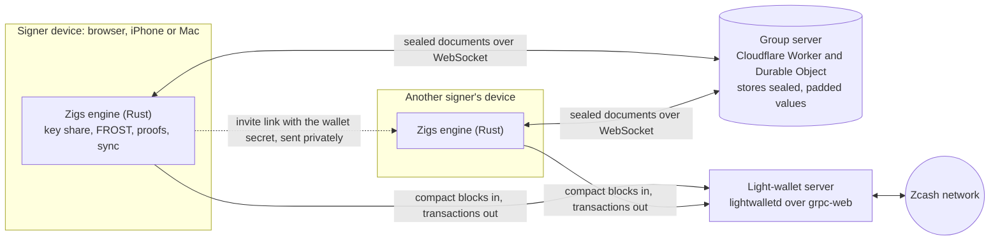
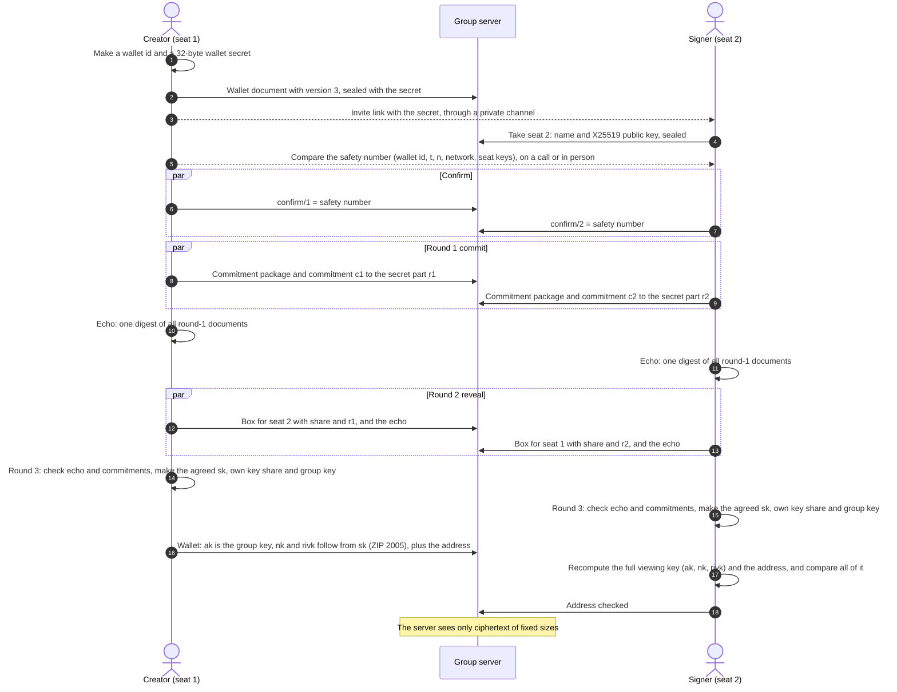
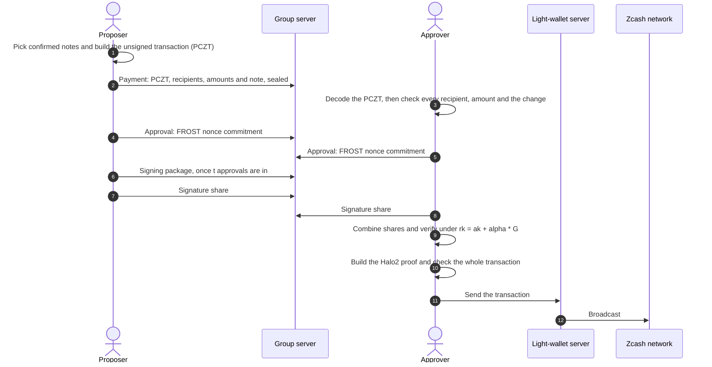
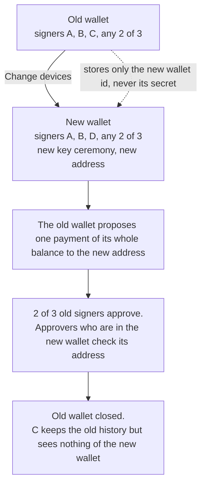

# Zigs

**Shared wallets for shielded Zcash.** A team creates one private address together, and any *t* of
its *n* signers must approve each payment. Nobody ever holds the whole key, the server cannot read
the wallet, and on chain each payment looks like a shielded payment from a standard wallet.

- Web app: https://app.zigs.app (no install, no account). Until launch, the browser asks for a
  user name and a password. Any user name works. Ask the Zigs team for the password.
- iPhone and Mac apps: in [`ios/`](ios). They use the same Rust engine. Build them from source in Xcode.
- Website: https://zigs.app
- How it works, end to end: [PROTOCOL.md](PROTOCOL.md)
- Signed writes: in a new wallet (version 3), each signer signs the documents it writes. The apps
  ignore any document without a valid signature. So a holder of an invite link cannot make the
  screen show a false approval ([how](PROTOCOL.md#15-signed-writes-version-3)).
- Messages: each wallet has a private room for its signers, with a discussion thread on every
  payment. Two Zigs users can also chat directly through a contact link. Later phases are in
  [CHAT.md](CHAT.md).
- Memos: a payment can carry a memo for each recipient (up to 512 bytes). Approvers see it, and
  the app checks it against the transaction. The web, iPhone and Mac apps do this. A memo that
  arrives with a payment to the wallet shows in the Activity list and the Messages tab. Its label
  is "On chain · shared with all devices". Reading it asks the light-wallet server for the
  transaction, so a signer must turn it on first. It is off by default. The web app has it. The
  iPhone and Mac screens for received memos follow.
- Payment requests: a message whose whole text is a ZIP 321 link (`zcash:…`) shows as a request
  card. The card shows the total, each payee and the check of the sender. **Propose this** opens
  the Send form with the request, and sends nothing. **Request a payment** makes the link in a
  wallet room or in a direct chat. Pasting a link in the Send form fills its rows. The web app has
  it. The iPhone and Mac apps show the link as text ([how](PROTOCOL.md#payment-requests)).
- ZNS names (testnet, web app): the Send form accepts a name such as `alice.zec` and shows the
  address that the name gives. The page looks the name up in a copy of the whole registry, so no
  server learns which name you pay. Each approver in the web app looks the name up again and
  refuses a payment whose address the name no longer gives. The iPhone and Mac apps show the
  address only ([privacy](PRIVACY.md#zns-names-testnet)).
- Personal account: the web app can hold a small single-signer account that pays the fee of
  messages on chain. Add the shielded address of a contact, and write to them, also if they do not
  use Zigs. Each message is a payment of no value, and its text is the memo. Each contact gets an
  address of the account of their own, so the app shows which contact's address received a
  message. A message to any other address shows as not verified. A message of up to 2,000
  characters goes in up to 5 memos. A request to fund the account has 3 payees and a wallet of
  yours pays it. The iPhone and Mac apps do not have it yet
  ([how](CHAT.md#5-the-personal-account-on-chain-messages)).
- Solana beta: the web app can give a testnet wallet a private balance of SOL on Devnet, in Zolana,
  the Helius shielded pool on Solana. It is a beta, off for mainnet wallets, and the iPhone and Mac
  apps do not have it. For such a wallet the page also connects to the Helius Devnet host. Helius
  sees more than the light-wallet server does: it builds the proofs, so it sees amounts and
  recipients of each spend. Each seat pays fees and rents from its own fee address on Devnet, and
  a member adds SOL to the group with Add SOL: the fee address shows on chain next to the group.
  Read [ZOLANA.md](ZOLANA.md) first, then [PRIVACY.md](PRIVACY.md#solana-beta-helius-devnet). The
  open work is in [TICKETS.md](TICKETS.md).
- The wallet follows chain reorganisations of up to 100 blocks
  ([how](PROTOCOL.md#6-receiving-and-sync)). After a deeper one, the web, iPhone and Mac apps
  scan the wallet again from its birthday.

Zigs uses re-randomized FROST threshold signatures ([ZIP 312](https://zips.z.cash/zip-0312)) on
the Ironwood shielded pool. It is a **beta** and **not audited**. The web app of this release runs
on **Zcash testnet and Solana Devnet only**, with free test coins, and makes no mainnet wallets. A
mainnet wallet made before still opens. At **0.5 ZEC** the app warns and hides its address. It
cannot block deposits.

## For judges: try it alone

You can play every device from one browser. Use a desktop browser with Zigs in one tab, not a
private window. Zigs runs on Zcash testnet and Solana Devnet only, so every coin is a free test
coin. The runbook of a demo with three devices is in [docs/demo.md](docs/demo.md).

**Zcash testnet**

1. Open https://app.zigs.app. The browser asks for a user name and a password. Type any user name
   and the password that the Zigs team gave you.
2. Click **New wallet**. The network is **Testnet**, the only choice. Set **Devices** to 2 and
   **Approvals needed** to 2, then click **Create wallet**. This browser is now device 1.
3. Open **Trying Zigs alone? Play the other devices in this browser** and click
   **Play device 2**. The two devices create the key together. Within half a minute the wallet
   opens, and both devices show **Address checked**.
4. Click **Receive** and copy the address. Then click **Get testnet ZEC**: it opens the Valar
   faucet, which pays 0.125 TAZ to a `utest1…` address, once for each IP address and once for
   each address every 24 hours. On a shared network, such as a venue or an office, only the first
   person gets coins. The faucet lists each payout in public, with a short form of the address and
   the transaction id. Paste the address there. The balance appears as **Incoming**, then as
   **Available** after 3 confirmations (about 75 s).
5. Click **Send**, paste any testnet unified address (`utest1…`), enter an amount, and click
   **Review payment**. The review shows what your browser decoded from the transaction that it
   built. Click **Propose payment**. For a payroll, click **Add recipient** or **Paste a list**: up
   to 20 recipients go into one transaction with one approval round. A payment request (`zcash:…`)
   pasted in the recipient field fills the rows. The form keeps what you typed as a draft on this
   device for 24 hours.
6. In the payment panel, click **Approve as seat 1** and **Approve as seat 2**. Read **What this
   payment does**: your browser decoded it from the transaction itself.
7. Click **Build proof** (about one minute in the browser), then **Send to network**, then
   **View in explorer**.

**Solana Devnet** (beta, web app only)

8. Open the **Solana** tab of the wallet and click **Add Solana**. The two seats of this browser
   run a second key ceremony. Wait until the tab shows **Seat 1: key ready** and
   **Seat 2: key ready**.
9. Under **Fund the fee address**, each seat shows **Your fee address**. Send at least 0.03 SOL of
   Devnet SOL to each of them (**Get Devnet SOL** opens the Solana faucet), then click **Check
   balance**. Fund every seat: a seat with an empty fee address can take the execute and fail,
   and the payment then waits.
10. Under **Add SOL**, keep 0.02 and click **Add SOL**. Then click **Sync Solana**. The **Private
    balance** shows the SOL. The first sync can take about 25 s.
11. Under **Pay from the group**, choose one:
    - **Send privately** pays the **Shielded address** of another group. Make a second wallet in
      the same way, and copy the address from its Solana tab. The chain hides the amount.
    - **Withdraw** pays a public Devnet address, for example the fee address of seat 2 (click
      its **Copy** button). The chain shows the recipient and the amount.
12. In the proposal, click **Approve as seat 1** and **Approve as seat 2**. If the screen says
    "Zigs is reading your wallet to check this payment", wait until it shows the payment, then
    click. After 2 approvals, a seat with a funded fee address executes the payment by itself. The
    status goes from **Approved, executing** to **Executed**, with the transaction id. Click
    **Sync Solana** to see the new balance.

To see device changes, open **Devices**, then **Change devices**. To see the privacy model, read
[PRIVACY.md](PRIVACY.md).

## How Zigs meets the judging criteria

| Criterion | Evidence |
|---|---|
| **Privacy** | On chain, the transaction shape matches the standard wallet library: same builder, padding, standard fee and anchor depth. A group payment expires after one day instead of 40 blocks, because its approvals take hours, so the expiry marks it, and so does a priority fee ([comparison](PRIVACY.md#on-chain)). The server stores only encrypted values, padded so that even their length hides amounts. On the device, key shares can be locked with a passkey (web) or Face ID (iPhone) ([how](PRIVACY.md#lock-with-a-passkey-or-face-id)). Key share backups are encrypted with a passphrase (Argon2id and XChaCha20-Poly1305) and open on the web, iPhone and Mac ([how](PRIVACY.md#key-share-backups)). The page can connect only to its own host (the group server and the testnet light-wallet relay) and two ChainSafe light-wallet servers (Content-Security-Policy). For testnet wallets, the Solana Worker of the page also connects to the Helius Devnet host ([how](PRIVACY.md#solana-beta-helius-devnet)). It is prepared for Tor Browser, but not yet tested end to end ([how](PRIVACY.md#use-zigs-over-tor)). The Zigs server code keeps no logs; its host, Cloudflare, can see connection data. Every remaining leak is listed in [PRIVACY.md](PRIVACY.md). |
| **Usefulness** | Designed for team treasuries, DAOs and families. Usable today on Zcash testnet (web, iPhone and Mac) and Solana Devnet (web): invite links and QR codes; batch payments for payroll and grants (up to 20 recipients, one approval round, pasted from a spreadsheet); signer changes; encrypted key share backups. |
| **Execution** | The live app works end to end. Seventeen testnet transactions made by the apps are [listed below](#proof-on-testnet). The engine has 127 tests, and a command-line suite runs adversarial cases. |
| **Originality** | An end-user app for re-randomized FROST: no command line, no trusted dealer, and no server that can read the wallet. Each device decodes the PCZT and checks every output before it approves, and binds its approval to the transaction's sighash. Signer changes, batch payments and native iPhone and Mac apps are included. Built during the Zecathon window: the first commit is from October 10, 2026. |

## Architecture

Each signer's device runs the same Rust engine: compiled to WebAssembly in the browser, and as a
native library on iPhone and Mac. The engine holds the key share, signs, builds proofs and syncs
the chain. The group server only relays sealed documents.



| Part | What it knows |
|---|---|
| Signer device | Its own key share, the wallet secret, the viewing key, all payments |
| Group server | Wallet ids, document names, timing, IP addresses. Never keys, amounts, addresses or names |
| Light-wallet server | IP address and the blocks requested, as for any light wallet. On testnet, the app Worker relays the requests, so our node sees the Worker and not the device. Where memo reading is on, it also sees which full transactions a device fetches to read memos. Never a key |
| Zcash network | A normal shielded transaction |
| Helius (Solana beta, testnet wallets only) | IP address, the app origin, the owner key, and for each spend the amounts, recipients and the nullifier secret that its prover needs. Never a key share |
| ZNS resolver (testnet names) | That the app Worker downloads the whole name registry. Never which name a person pays, never a key |

## Creating a wallet

The signers run a FROST distributed key generation over RedPallas. No device and no server ever
holds the whole spending key. In a new wallet (version 2 or 3), no single signer chooses any part
of the viewing key. The steps:

1. The signers compare a safety number. It covers the wallet id, *t*, *n*, the network and every
   seat key. Each person confirms it.
2. Each device commits to a secret part of a shared secret `sk`, together with its FROST round-1
   package.
3. Each device computes an echo: one digest of all round-1 documents. A signer who saw other data
   than the rest is found before anyone uses its data.
4. Each device sends its secret part to the other seats in an encrypted box, with the echo. This
   reveals the part.
5. Each device checks the echo and every commitment. Then it computes the agreed `sk`, its own key
   share and the group key.
6. The creator derives the viewing key from `sk` as ZIP 2005 specifies, and publishes the wallet.
7. Each signer recomputes the full viewing key (`ak`, `nk` and `rivk`) and the address from its own
   data. It compares all of it with the published wallet before the wallet opens.



**Keys.** An Ironwood full viewing key has three parts: `ak`, `nk` and `rivk`. Zigs sets `ak` (the
spend validating key) to the FROST group key, so only a threshold of signers can authorize a spend.
`nk` and `rivk` only allow viewing; all signers get them. New wallets are built to ZIP 2005
(Proposed) so that funds can be recovered if quantum computers break today's keys: the signers agree
on a secret, and each computes `nk` and `rivk` from it ([how](PROTOCOL.md#4-creating-a-wallet-distributed-key-generation)).
A creator who publishes a different `ak`, `nk` or `rivk` is caught by every signer's check.

**Older wallets.** A version 1 wallet, made before ZIP 2005 support, keeps the old flow. The
creator's device picks `nk` and `rivk`, and the wallet has no `qsk`.

## Making a payment

Any signer proposes; the others approve on their own devices. A payment can have up to 20
recipients. Each approving device decodes the unsigned transaction (PCZT) itself and checks that
its outputs are exactly the listed recipients and amounts, and that nothing beyond the standard
fee leaves the shielded pool. A proposer cannot hide a different recipient, amount or extra output
behind the text they typed.



**Signing.** Each spend is signed under a re-randomized key `rk = ak + [alpha]G` with a fresh
`alpha`, so spends cannot be linked to the wallet or to each other. Before a device signs, it
re-runs the PCZT verifier role, recomputes the sighash (ZIP 244, v6), and refuses unless it equals
the sighash saved when its user approved. The app and the engine both check this. The device also
checks that its own nonce commitment was not replaced, and deletes its nonces after use. Any device can combine the shares;
a bad share names its sender.

## Changing signers

The signers and the threshold are part of the wallet key, so they cannot change in place. Zigs
creates a replacement wallet and moves the funds with one normal, approved payment.



## Privacy

The full threat model is in [PRIVACY.md](PRIVACY.md). In short:

| Party | Sees | Does not see |
|---|---|---|
| Chain observers | A normal shielded Ironwood transaction | That a group signed it, the signers, amounts, addresses |
| Group server | Wallet ids, document paths and field names, timing, which IP addresses connect to which wallet | Wallet and signer names, addresses, viewing key, amounts or their length, recipients, transactions, signing data |
| Light-wallet server | Your IP address (on testnet, our server sees the app Worker), the wallet's birthday height, the blocks you download, the transactions you send, the full transactions you fetch to read memos (only where memo reading is on) | Which notes are yours while you download blocks (the memo fetches are the exception), any key |
| Helius (Solana beta, testnet wallets only) | Your IP address, the app origin, the owner key of the wallet, and the witness of each spend: owners, assets, amounts and the nullifier secret. With local proving on (a group setting), no witness: the devices of the group make the proofs. The sender and the recipient of a transfer are public on chain | Any key share, the Ed25519 seed, the viewing key. It cannot sign |
| ZNS resolver (testnet names) | That the app Worker downloads the whole name registry, and when | Your IP address, which name you look up or pay |
| Other signers | Everything about the shared wallet | Your key share and your signing nonces |

How the group server is kept blind:

- The invite link is `https://app.zigs.app/#<wallet-id>.<secret>`. Browsers never send the part
  after `#` to a server. The app keeps the secret on the device and removes it from the address
  bar.
- Every field of every document is encrypted with XChaCha20-Poly1305 under a key derived from the
  wallet secret. The document path and field name are bound into each ciphertext. Values are padded
  to at least 64 bytes and then to the next power of two before encryption.
- Key ceremony shares are also encrypted from one seat to another with X25519.
- Cached balances and the saved sync state on the device are sealed with the wallet key too.

## Proof on testnet

These transactions were made by the Zigs apps on the NU7 testnet (v6 transactions, Ironwood pool),
with 2-of-2 wallets and one 2-of-3 wallet:

| Transaction | Block | What |
|---|---|---|
| [`4838de4c…6612`](https://testnet.zecblock.com/tx/4838de4c250d85c82657a600bd9886b75080711c37723c7a07f311c96f046612) | 4,485,020 | First FROST spend from the web app |
| [`86807799…45fd`](https://testnet.zecblock.com/tx/86807799c1393829e9de9b1158caa0285d198797c4194b2520f23a713b4f45fd) | 4,485,097 | Payment into a wallet with an encrypted group store |
| [`9859c24b…2409`](https://testnet.zecblock.com/tx/9859c24b961bb196f9a1de74cc099c32d4f2c9812c12a2db47a504cb88ff2409) | 4,485,106 | Spend from that wallet |
| [`d2fc7ad5…e72f`](https://testnet.zecblock.com/tx/d2fc7ad573342648dcdaef65256288e38189753f0087a06e7217cc7a3bb8e72f) | 4,488,891 | **Change signers:** whole balance moved to the replacement wallet |
| [`6572ce88…80a8`](https://testnet.zecblock.com/tx/6572ce88c248350c71225889819c23eefd5e5f8df2af07e9cc216f87337380a8) | 4,488,977 | Web wallet pays a wallet created on an iPhone |
| [`4dc4fd73…7049`](https://testnet.zecblock.com/tx/4dc4fd73274936b81b8ef1897490f0ffc17ec1ec6827f1e92715f7d8115a7049) | 4,488,995 | **iPhone:** proposed, approved, proved and sent from the phone |
| [`b87248fa…3636`](https://testnet.zecblock.com/tx/b87248fa7a06b7a42f082e07c1c4f5da94d1673d7c0fc98d8be2745209f73636) | 4,489,104 | Payment with the padded store format |
| [`9822e109…a43f`](https://testnet.zecblock.com/tx/9822e109ef8416a44b28777971ec661f8e83961a2c57f9c74b6a1f5fb535a43f) | 4,489,326 | **Batch payment** from the web app: 4 recipients, pasted as a list, one transaction |
| [`fb7da6ae…ffde`](https://testnet.zecblock.com/tx/fb7da6ae2fe90c1e1b39637b6608c59b13b701286b6f917762d9b5b82408ffde) | 4,489,332 | **Batch payment** from the iPhone: 2 recipients |
| [`df9b264e…5216`](https://testnet.zecblock.com/tx/df9b264e17b70b0d419af6a272e11b7fb4ac5e48fbd80dfb469496600dac5216) | 4,489,434 | iPhone spends 4 notes at once (more inputs than outputs) |
| [`7c09aacb…302a`](https://testnet.zecblock.com/tx/7c09aacb67ae8d312f611f890913c1db586d3ac0c65501b9062e484f8dc7302a) | 4,489,484 | **Passkey lock:** signed from a locked browser, with a reload and unlock between the two approvals |
| [`72004cb2…92ca`](https://testnet.zecblock.com/tx/72004cb20cfbdc7acc9592b01deac70490c3452744c92fe9c8c717f28d4a92ca) | 4,489,938 | **2-of-3 wallet:** seats 1 and 3 approve, seat 2 does not |
| [`bcad9990…c83d`](https://testnet.zecblock.com/tx/bcad99901fd954e4fefb1f85223ea4e30722d155f9a8c20cbc5066ab3e5ec83d) | 4,493,885 | **ZIP 2005 wallet:** spend from a version 2 wallet (agreed `sk`, `use_qsk = true`) |
| [`1a13fe55…2ebe`](https://testnet.zecblock.com/tx/1a13fe552eb09ba2fa034cc27d42ea4775f251360da27abcd5608c93a2572ebe) | 4,497,189 | **Signed writes:** spend from a version 3 wallet, two browsers, with forged documents ignored |
| [`2d72e9b1…f707`](https://testnet.zecblock.com/tx/2d72e9b173fb7f63a4101dcfcc26ade1a916e9a5678e0bb8b43d2c319661f707) | 4,497,745 | **Memo:** a wallet with one browser seat and one iPhone seat pays with a memo, and the memo shows in the receiving wallet's inbox |
| [`0e2fc103…da7b`](https://testnet.zecblock.com/tx/0e2fc103d8be65dd12070f683b317a26a6c3f28638b0a25ea2b3d589c824da7b) | 4,498,021 | **Payment request:** a signer posts a ZIP 321 request in the wallet room, the other signer proposes it with **Propose this**, and both approve |
| [`646e6edd…819e`](https://testnet.zecblock.com/tx/646e6edd0bc003b796f54f2fec4f748a5b65a15290d30d31eb73b4fe79d8819e) | 4,498,648 | **On-chain message:** a personal account sends a 3-part message (3 zero-value outputs with memos), and the recipient's account joins it under the right contact |

Before this release turned mainnet off in the web app, a 2-of-2 mainnet wallet was created and
synced to the mainnet tip in the web app and on the iPhone.

## Repository layout

| Path | Content |
|---|---|
| [`wasm/src/lib.rs`](wasm/src/lib.rs) | Engine: key generation, wallet creation and checks, PCZT inspection, FROST signing, proof, sealing |
| [`wasm/src/ceremony.rs`](wasm/src/ceremony.rs) | Key ceremony, versions 2 and 3: commitments, echo, agreed secret, safety number, ZIP 2005 key derivation and the wallet check |
| [`wasm/src/request.rs`](wasm/src/request.rs) | Payment requests (ZIP 321): reads and writes the `zcash:` link, with the network, payee, memo and size rules of Zigs |
| [`wasm/src/chain.rs`](wasm/src/chain.rs) | Chain sync, balance, note selection, payment building, network rules |
| [`wasm/src/snapshot.rs`](wasm/src/snapshot.rs) | Saved sync state: notes and the note commitment tree |
| [`wasm/src/backup.rs`](wasm/src/backup.rs) | Encrypted key share backups: Argon2id, XChaCha20-Poly1305 |
| [`wasm/src/ffi.rs`](wasm/src/ffi.rs) | C interface for the iPhone and Mac apps |
| [`web/index.html`](web/index.html), [`web/app.css`](web/app.css), [`web/app.js`](web/app.js), `web/app-*.js` | The web app: page, styles, and the script: `web/app.js` lists the 9 pure modules and the 25 page modules and starts the page (no inline script or style; see [The page modules](#the-page-modules)) |
| [`web/shim.js`](web/shim.js), [`web/qr.js`](web/qr.js), [`web/payees.js`](web/payees.js), [`web/requests.js`](web/requests.js), [`web/personal.js`](web/personal.js), [`web/vault.js`](web/vault.js), [`web/chat.js`](web/chat.js), [`web/signed.js`](web/signed.js), [`web/zns.js`](web/zns.js) | Store client, QR encoder, payment list parser with the memo rules and the recipient check, payment request cards and Send form rows, the rules of the personal account (contacts, fee, states of a message, backup), passkey lock, message helpers, the rules for signed writes, and the ZNS name lookup with the check of an approver (no third-party code) |
| [`cf/src/index.js`](cf/src/index.js) | Group server: Cloudflare Worker with one Durable Object per wallet, limits against abuse. It also serves `/sol` and `/sol/config.json` for the Solana beta, relays `/lwd` to our testnet light-wallet node, and serves `/zns`, a copy of the testnet ZNS name registry |
| [`web/sol/`](web/sol) | Solana beta in the page: ceremony, signing sessions, backup, the Worker that talks to Helius, the Solana wasm, and the vendored Zolana SDK bundle (third-party code, hash pinned in `SHA256SUMS`) |
| [`infra/lwd/`](infra/lwd) | Our testnet light-wallet node: Zakura, lightwalletd and Envoy with a keyed tunnel listener and a tailnet listener, and the Cloudflare tunnel |
| [`wasm-sol/`](wasm-sol) | Solana engine in Rust: message checker, FROST-Ed25519 ceremony and signing, key roles. It has its own lockfile and builds to `web/sol/wasm/` |
| [`sol-program/`](sol-program) | The Solana program that owns a group's funds at an address of the group key and settles an approved payment through the pool (ZOLANA.md 7.2). `build.sh` rebuilds it and checks the hash, `build.sh test` runs its tests. The beta uses version 5 of it on Devnet (SOL-36) |
| [`solspike/`](solspike) | Checks of the Solana beta: the Zcash baseline gate, the headless Chrome harness, the mock run and the bundle build. See [`solspike/README.md`](solspike/README.md) |
| [`ZOLANA.md`](ZOLANA.md), [`TICKETS.md`](TICKETS.md) | The Solana design, spike results and risks. The open work |
| [`ios/Zigs/`](ios/Zigs) | SwiftUI app for iPhone and Mac |
| [`src/`](src), [`tests/e2e.sh`](tests/e2e.sh) | Command-line version of the ceremony (version 1) and adversarial tests |
| [`PRIVACY.md`](PRIVACY.md) | Threat model |

### The page modules

Each `web/app-*.js` holds one part of the page. A module that assigns a `let` owns it; other
modules read it as a live import. `web/test/graph.mjs` checks the import graph, and
`solspike/lint.sh` checks the imports with `solspike/oxlintrc-page.json`.

| Module | Content |
|---|---|
| [`web/app-kit.js`](web/app-kit.js) | Pure helpers and the localStorage merge helpers. It imports no page module. |
| [`web/app-state.js`](web/app-state.js) | Shared state objects (`state`, `ui`, `raw`, `inbox`, `ready`, `busy`), the log and the banner. It imports nothing. |
| [`web/app-engine.js`](web/app-engine.js) | The WebAssembly engine, and the worker for slow engine calls. |
| [`web/app-chain.js`](web/app-chain.js) | Networks, chain sync, the balance cache, memo reading and the 60 s refresh. |
| [`web/app-keystore.js`](web/app-keystore.js) | Local secrets, the passkey lock, other-tab sync and IndexedDB. |
| [`web/app-account.js`](web/app-account.js) | The personal account: store, sync, send and contacts; `startUp`. |
| [`web/app-groups.js`](web/app-groups.js) | Boot, the sealed store, the group and session watchers and the approval queue. |
| [`web/app-seats.js`](web/app-seats.js) | Facts derived from `state`: the seats of this browser and their keys. |
| [`web/app-dom.js`](web/app-dom.js) | `el`, `act`, widgets, wording and labels. |
| [`web/app-loop.js`](web/app-loop.js) | Reactor, render loop, focus, layers and page listeners. |
| [`web/app-filter.js`](web/app-filter.js) | Pins, signature checks, signed writes and the filter from store to state. |
| [`web/app-dkg.js`](web/app-dkg.js) | Wallet creation, the key ceremony, safety number, address check and seat join. |
| [`web/app-setup.js`](web/app-setup.js) | The setup page: join, invite, safety and progress. |
| [`web/app-payments.js`](web/app-payments.js) | Propose, approve, sign, cancel and broadcast; the payment check and expiry. |
| [`web/app-messages.js`](web/app-messages.js) | Wallet rooms, read marks, notices and direct chats. |
| [`web/app-links.js`](web/app-links.js) | Invite links and hash routing. |
| [`web/app-payreq.js`](web/app-payreq.js) | Payment requests: logic, card and form. |
| [`web/app-backups.js`](web/app-backups.js) | Backup and restore: logic and dialogs. |
| [`web/app-sol.js`](web/app-sol.js) | Solana host glue: `solHost()` and the lazy load of `web/sol`. |
| [`web/app-shell.js`](web/app-shell.js) | Side navigation, lock screen, wallet list and create dialog. |
| [`web/app-wallet.js`](web/app-wallet.js) | The wallet page: tabs, overview, activity, signers and details. |
| [`web/app-thread.js`](web/app-thread.js) | The message card, composer and bubbles; the direct chat page. |
| [`web/app-send.js`](web/app-send.js) | Receive and send dialogs. |
| [`web/app-drawer.js`](web/app-drawer.js) | The payment drawer. |
| [`web/app-account-view.js`](web/app-account-view.js) | The pages of the personal account and its contacts. |

## Run it yourself

### Web app and group server

Needs Rust with the `wasm32-unknown-unknown` target, `wasm-bindgen-cli` 0.2.129, LLVM with a
wasm32 target (for `secp256k1-sys`), and Node.js.

```bash
cd wasm
CC_wasm32_unknown_unknown=/opt/homebrew/opt/llvm/bin/clang \
AR_wasm32_unknown_unknown=/opt/homebrew/opt/llvm/bin/llvm-ar \
RUSTFLAGS="--remap-path-prefix=$HOME=/build" \
cargo build --release --target wasm32-unknown-unknown
wasm-bindgen --target web --out-dir ../web/pkg \
  target/wasm32-unknown-unknown/release/zigs_engine.wasm
```

```bash
cd cf
npm install
echo DEV_NO_AUTH=1 > .dev.vars
npx wrangler dev --port 8787
```

A testnet wallet reaches our light-wallet node through the Worker, at `/lwd` of the page origin. The
Worker adds the secret `LWD_KEY` (64 lowercase hex characters), which the node checks, and the page
never holds it. For local development, add the key to `cf/.dev.vars`:

```bash
echo 'LWD_KEY=<the key of infra/lwd/.env.lwd-key>' >> .dev.vars
```

Without it, `/lwd` answers 503 and the page uses the ChainSafe server. On the server, set the secret
of each Worker with `npx wrangler secret put LWD_KEY --env=""` (production) and
`npx wrangler secret put LWD_KEY --env staging`. `scripts/deploy-staging.sh` sets the staging
secret from `~/.config/zigs/lwd-key`.

The Solana beta needs the secret `HELIUS_DEVNET_URL`: your Helius Devnet URL, which holds the API
key. For local development, add it to `cf/.dev.vars`, which Git ignores:

```bash
echo 'HELIUS_DEVNET_URL=<your Helius Devnet URL>' >> .dev.vars
```

The Worker gives this URL to the page at `/sol/config.json`, behind the password gate. Without it,
the Solana tab says "Solana is not available on this server". The key must accept the origin of the
page (`http://localhost:8787` here, `https://app.zigs.app` on the server): set Allowed Domains at
Helius for the deployed key. On the server, set the secret with
`npx wrangler secret put HELIUS_DEVNET_URL`. The variable `SOL` in `cf/wrangler.jsonc` is `"1"`.
Set it to another value to turn the Solana beta off: the tab then says the same text. The Solana
tab shows for version 3 wallets on testnet only. Build the Solana wasm with
`sh wasm-sol/build.sh`, and see [`solspike/README.md`](solspike/README.md) for the checks.

To try the beta by hand, make a testnet wallet, add the Solana part, and open the Solana tab. Each
seat that this browser holds shows **Your fee address**. Send Devnet SOL to it (the **Get Devnet
SOL** link opens the faucet), then press **Check balance**. The fee address pays the fees and the
rents of the proposals of its seat, and the fee of each payment that its seat executes, so fund
every seat. Then use **Add SOL** to put SOL from the fee address of the seat into the shielded
balance of the group, at the program address of the group: only that seat signs it, and the amount
and the sender are public. The group is never registered, and a new group needs no nonce account
(ZOLANA.md 4.2 and 7.2). **Send privately** and **Withdraw** make a proposal. It needs the approval
of `t` seats, and then a seat with a funded fee address executes it.

Open http://localhost:8787. To act as a second person on the same computer, also open
http://127.0.0.1:8787: it is a separate origin, so it has separate storage. Deploy production
with `npx wrangler deploy --env=""` in `cf/` (the top level of `cf/wrangler.jsonc`). Until launch,
the live app asks for one shared password: set it with `npx wrangler secret put APP_PASSWORD
--env=""`. Without that secret, the app refuses every request.

A staging copy runs at https://staging.zigs.app, with its own Worker, Durable Object data and
password (`env.staging` in `cf/wrangler.jsonc`). After each merge, `sh scripts/deploy-staging.sh`
deploys `origin/main` there and checks it from outside. Deploy production only from a commit
that ran on staging. The staging password is in `~/.config/zigs/staging-password`, which the
script makes on its first run.

Group payments now expire after one day, and the web app can pay a priority fee (TICKETS.md,
ZEC-2 and ZEC-4). The iPhone and Mac apps get these screens later (ZEC-8). Their payments also
expire after one day, because the engine builds them, but they do not check the expiry when
they approve. An app build made before this change refuses a priority fee.

Do not roll back to an older build after the deploy of 16 October 2026. That deploy changed the
backup format (PROTOCOL.md section 9). An older build refuses the new backup files, and it shows
every seat as not backed up. Older iPhone and Mac builds cannot open the new files or the new key
ceremony messages either. If a build is bad, deploy a fixed build of the new format.

### Light-wallet node

`infra/lwd/` runs the testnet node of the web app with Docker Compose: Zakura, lightwalletd and
Envoy. Only the app Worker and the devices of the tailnet may use it. Envoy has two listeners:

| Listener | Port | Used by | Check |
|---|---|---|---|
| `tunnel` | 8080, not published | The Cloudflare tunnel, which sends `lwd.zigs.app` here. Only the app Worker calls it | The header `x-zigs-lwd-key` must hold the key. Any other request gets 404. No CORS |
| `tailnet` | 8081, published as `${LWD_BIND}:9080` | Devices on the tailnet, at `http://<tailnet address>:9080` | None. CORS allows `https://app.zigs.app` and localhost |

The node host needs these files in one folder, as a copy or a checkout of `infra/lwd`:
`docker-compose.yml`, `envoy.yaml`, `envoy-start.sh`, `zcash.conf`, `.env.lwd-key` and
`.env.tunnel`. If `envoy-start.sh` is missing, Docker makes a folder with its name and Envoy does
not start, so both listeners are down.

Make the key once on the node host, and keep the file private. Git ignores it:

```bash
cd infra/lwd
echo "LWD_KEY=$(openssl rand -hex 32)" > .env.lwd-key && chmod 600 .env.lwd-key
docker compose --profile tunnel up -d
```

Envoy refuses to start unless `LWD_KEY` has 64 lowercase hex characters. Give the same value to the
Worker secrets `LWD_KEY` of production and staging, and to `~/.config/zigs/lwd-key`. Deploy the
Worker and its secrets first, then change Envoy. The new Worker also works with the old Envoy. A
page of the old version calls `lwd.zigs.app` directly, and the new Envoy refuses it. Every device
of the tailnet can use the `tailnet` listener. The owner accepts that: the keys and listeners
protect the node against access from outside the tailnet.

### iPhone and Mac apps

Needs Xcode 26, XcodeGen, and the Rust targets `aarch64-apple-ios`, `aarch64-apple-ios-sim` and
`aarch64-apple-darwin`.

```bash
cd ios
./build-core.sh
xcodegen generate
open Zigs.xcodeproj
```

Use the `Zigs` scheme for iPhone and `ZigsMac` for Mac (Apple silicon). The apps connect to
`https://app.zigs.app`; change the server and enter its password in Settings. They join wallets
from web invite links or `zigs://join#<wallet-id>.<secret>`, and they sit in the same wallets as
browsers.

`./build-dmg.sh` builds the Mac app and packs it into `dist/`. It stops if the app contains a home
folder path.

## Tests

- `sh scripts/test-fast.sh`: the fast suite, about 5 s, for every change: the web tests that end
  in seconds, listed in `FAST` of the script (the pure modules, the engine calls through the wasm
  build, the short Solana tests and the link test). The long page tests and the browser and live
  checks run before a merge, with `bash solspike/baseline.sh check`. The page tests run on a test
  clock (`web/test/page.mjs`) that leaves out a stall such as a sleep of the computer, so a
  lifetime that the page measures with `Date.now()` cannot run out in the middle of a test. Timers
  still count a stall.
- `cargo test --release` in `wasm/` (127 tests, and 1 ignored test for ZEC-1 in TICKETS.md):
  - Signing: full 2-of-3 flows for Ironwood (paying 4 recipients in one transaction) and Orchard.
  - Expiry and fees: a group payment expires after one day of blocks (75 or 25 seconds each), at
    most up to the next upgrade. The approver refuses an expired payment and one that stays valid
    much longer. A fee from the ZIP 317 fee to 10 times it passes, and a transparent or Sapling
    output inside that range is refused. The id that `inspect` gives is the id of the final
    transaction.
  - Session state: "done" and "expired" need the sighash that the device approved, and
    signatures count only under the wallet key. A proposal alone, an unsigned copy, signatures of
    another transaction or wallet, a changed signature (also with a value field of zero) and
    spent notes never give "expired". An old signed payment copied into a session never gives
    "done". A payment proposed again after an expired one spends every note of it, and a note
    of it that is spent now stops it. `spent` says that another transaction spent a note of the
    approved one 3 blocks deep, and a reorganisation that takes the spend back clears it.
  - A bad share is attributed to its sender. A swapped recipient on any payee output is refused.
  - Spends of 3 notes for 1 recipient, recipient lists checked row by row, and fees that count
    outputs.
  - Mainnet and testnet upgrade rules, note selection, fees and the largest sendable amount.
  - Padded sealing: old values, wrong keys and moved values. The saved sync state. The native
    wallet interface.
  - The version 2 and 3 key ceremony: hashes against their written formulas, known answers, the
    safety number and the wallet check.
  - The backup file: round trip, wrong passphrase, each changed header field and a known answer
    made outside the crate. Limits, passphrase rules and a later file version.
  - The signed text of a document: key order and spacing do not matter, a known answer holds, and
    floats are refused.
  - Memo tests: the limit, the first byte of a memo field, and the memo that each payee gets in
    a final transaction. An output that the engine cannot read.
  - The inbox path from a compact block to a memo. An answer with another transaction id, a note
    with a damaged tag, and the order of the memo list.
  - Reorganisation tests: drop notes, spends and memos, rewind after a saved state, stop at 100
    blocks and rewind through the native interface. The words of the error for a reorganisation
    that is too deep.
  - Payment request tests: a round trip, one and several payees, a request without an amount, and
    memos. The wrong network, 21 payees, a zero amount and a repeated parameter.
  - A memo for a transparent address, and a memo that is not base64 or not text. A payee index
    that ZIP 321 does not allow, and text that is not a request. Each error names the payee.
  - The native interface has both calls.
  - Personal account tests: the keys of a seed (the same result each time, a fixed answer for each
    network, refusal of a bad seed).
  - The split and join rules of a message: 512 and 513 bytes, a 4-byte character at a cut, 5
    parts, 2,000 characters, and a fake or repeated marker. The fee of a message.
  - The index of every received note, also one with an empty memo or a memo not read yet.
  - A message of three parts that is built, signed, proved and read by its recipient. A wrong seed
    is refused.
  - The words of a node refusal: a transport error or a forged prefix is not a refusal.
- `cargo test --release --locked` in `wasm-sol/`: 419 tests: the Solana message checker (101 rules,
  with the vectors of the Zolana SDK built with a sponsor as fee payer, and real Devnet messages),
  the fee payer rules and the fee key, the FROST-Ed25519 ceremony and signing, and the key roles.
  First run `sh build.sh` and then `node tools/diff_cases.cjs target/pkg-node` in `wasm-sol/`: the
  second command writes the cases that the test `wasm_native_diff` replays, and that test fails
  without them. Nine tests read the Zolana repo and are ignored: run them with
  `ZOLANA_REPO=<checkout at commit c232da1b> cargo test --release --test repo_pins -- --ignored`.
- `node web/test/sol-config.mjs` and its ten siblings `sol-docs`, `sol-ceremony`, `sol-app`,
  `sol-wasm`, `sol-sessions`, `sol-limits`, `sol-pay`, `sol-transfer`, `sol-fee` and `sol-rent`
  (the files `sol-rig`, `sol-setup`, `sol-chain`, `sol-vector` and `sol-fixture` are helpers: do
  not run them). They test the
  Solana part of the page on the real page modules: the ceremony, the fee key of each seat, signing
  sessions, payments, Add SOL, backup and restore, the stop that holds everywhere, the gate (a
  mainnet wallet, a wallet before version 3, a stored network that changed, and a start document
  that no seat signed get no Solana tab and load nothing) and the config from the server.
- `bash solspike/baseline.sh check`: the Zcash baseline gate. All `web/test/*.mjs`,
  `cf/test/gate.mjs`, the group server limits, the hashes of the Zcash engine and `web/signed.js`, the page policy and the
  served headers must equal `solspike/baseline.json`. `node solspike/test/policy.test.mjs` checks
  the `/sol` routes of the Worker, `/sol/config.json` included.
- `node cf/test/limits.mjs ws://localhost:8787`: the group server's size, rate and path limits.
- `node cf/test/gate.mjs`: the password gate of the Worker, offline. The session cookie is set
  once, opens every route alone and refuses a forged, expired or old-password value. Only a
  navigation or a request without fetch metadata gets the Basic challenge.
- `node web/test/payees.mjs`: the pasted payment list parser (the memo column, header, byte limit,
  and a comma directly between digits, which is an error), the memo rules, and the recipient
  check: address, amount and memo of every payee against the decoded outputs.
- `node web/test/vault.mjs`: the passkey lock's sealed record (wrong key, changed record, new IV).
- `node web/test/util.mjs`: address grouping, number checks, the key package comparison, the
  rules that stop a seat's setup, the backup passphrase rules (length, different characters,
  NFC), the fields that a restore takes, the fit of a restored seat (key share, key package and
  group key against the published ones), the key pairs of a restore (X25519 is checked with the
  engine in `web/pkg`), the undo of a restore, the rule that ignores an invite link, and the table
  of slow engine calls.
- `ios/check-backup.sh`: a backup made by the web code opens in the iPhone code, and the reverse,
  with the same bytes. The iPhone code also applies the fit rule, the key pair check (X25519 and
  Ed25519 keys made by the web code) and the undo rule. It also checks signed writes in both
  directions. The iPhone code accepts the signatures and the text of a wallet that the web code
  made, and it ignores the false documents. The web code accepts the documents that the iPhone
  code made. The two tables of signed parts must be equal. The iPhone code also reaches the
  verdicts of `web/payees.js` on the same recipient cases, with memos. It checks the rule that
  pins chat members and the message cache that opens each document once. It also checks the
  reset after a reorganisation that is too deep. It needs `ZigsCore.xcframework` (run
  `ios/build-core.sh`) and `node`.
- `node web/test/chat.mjs`: message signatures (wallet and direct chat), the check that a signing
  key makes its public key, room, key and member pinning, saved chats, text limits and unread
  counts.
- `node web/test/signed.mjs`: the signed text of a document against the engine, a known
  signature and the writer of each document. It also checks a whole wallet with false documents
  that the reader ignores. The false documents are a copied approval, a wrong key and a seat that
  did not write the document. Others are a false cancel or proposer, a made-up seat 4 in a wallet
  of 3, made-up payment results and a renamed seat. Every writer of a payment part signs with the
  real engine and Ed25519, and the reader accepts it. The bounded memo of checks is tested too.
- `node web/test/graph.mjs`: the link test of the page modules. Every module that `web/app.js` lists
  loads on a stub page, once with empty storage and once with a passkey-locked vault. The imports
  come in the order of the list, as in the browser; the modules run depth first along their
  imports. The import graph keeps its rules: every `web/app-*.js` is listed, app-kit and app-state
  and the pure modules import no page module, no module imports `web/sol` statically or a test
  setter, every imported name is an export of its source, no page module takes a page name from a
  pure module, no file of `web/sol` imports a page module, and every host key that `web/sol` reads
  is a key of `solHost()`. `web/test/page.mjs` is a
  helper: it loads the page modules for `app.mjs` and `sol-rig.mjs`, and its `NAMES` lists the page
  names that the tests read.
- `node web/test/app.mjs`: the real page modules with a stub page and an in-memory store. A browser
  that holds every seat runs the whole version 3 ceremony and the payment writers, and the reader
  accepts all of it. A made-up seat 4, a raised `n`, a renamed seat and made-up payment results are
  ignored. A write for a wallet that is not open is signed for its own wallet. The memo of checks
  and the log stay bounded. A run that reads memos is off by default, skips a failed read, and
  ends after three failures to reach the server. A reorganisation that is too deep deletes the
  saved state. **Propose this** fills the Send form and writes nothing to the store, and a form
  made for one wallet is dropped when another wallet opens. The text of the cards and the request
  form is checked with a small recorder in place of the page. The same recorder checks these
  points:
  - The request form names a wallet by its id.
  - A mainnet wallet with no known balance gets no request form.
  - No card offers a wallet that the request pays.
  - The Send form refuses a submit when **Send** is off.
  - A testnet wallet takes a ZNS name in the Send form: an address, a request or a mainnet wallet
    asks no registry, the payment names the registry address, and an approving browser looks the
    name up again and makes no nonce for a moved name. The wallet downloads the registry on open.
  - A field of a closed request form does not keep the page from drawing.
  - After signing, "Sent", "Expired" and "Propose again" come from the engine's session state
    on a browser that approved (ZEC-13). The page passes the PCZT and sighash that it kept, not
    a rewritten proposal. A reset to a fresh proposal shows no approval, Approve button or Cancel. A
    copied older signed part is not "Sent" on a browser that approved. "Propose again" spends the
    notes of the expired payment, needs a PCZT with the approved sighash, and refuses rows that
    do not match what the approved transaction pays. The tests also
    cover an approver that never saw the package, a lost nonce, a mark of another tab, blocked
    storage, a move and its Move button, the payments that hold no notes, the hold of an
    approval (without a sent mark, with a dropped document, of a second seat, and each way it
    ends), a late load of the kept PCZT, a stale restored seat whose approval holds, and a
    browser that did not approve.

  The same file runs the personal account on the real page code. It uses a fake light-wallet
  server, a map in place of IndexedDB and fixed answers for the proof:
  - The seed is in no storage entry, log line or view state. The device key cannot be exported.
  - A record that does not read blocks a new account. The sealed record of the passkey lock holds
    the account, and the lock takes it from the device copy.
  - The page opens at once, also when IndexedDB never answers. A store that fails as a whole blocks
    neither the lock nor a new account.
  - A tab that shows the Create card adopts the saved account. The store refuses a second record,
    also when the read misses it.
  - A message is built, signed and proved, saved, and only then broadcast. A failed save sends
    nothing. One message is built at a time, also across tabs, and two changes at once both stay.
  - A node refusal on every server frees the account. A timeout or a lost connection on one server
    keeps the note held until a block holds the message or it expires.
  - The account reads memos by itself. Backup, removal and restore give back the same account.
  - A new contact waits for the first sync. It does not take an index that the chain shows, after a
    restore from an old file. An index at the end of the range is refused.
  - A record that does not read offers a backup of the seed and the contacts that read, and
    Remove. The lock deletes the device copy of such a record too.
  - A page from before the accounts does not drop the account from the sealed record, and a field
    of another version stays in it.
  - The remove question and the funding form name the real risk. The contact dialog opens over an
    open wallet.
  - The chat of a contact shows joined, unjoined, sent, failed, unsure and expired messages. The
    other messages show as not verified. A payment request in a memo shows as a card.
  - The composer shows the fee as the text changes, and Enter does not send a message on chain.
- `node web/test/requests.mjs`: the rule that only a whole trimmed text is a request, with the
  real engine. It also checks these points:
  - the cards: total, open amounts, wrong network, a payee that Zigs cannot pay, and the warning
    for each check of the sender
  - the rows that fill the Send form, with a memo as one line
  - the note, which names only a verified sender
  - the text that the sender wrote, cut to 3 lines and 120 characters
  - a request that the form makes and the card reads back
- `node web/test/account.mjs`: the calls of the personal account through the WebAssembly build:
  keys, addresses, the split and join of a message, and the refusals.
- `node web/test/personal.mjs`: the rules of the personal account, with the real engine. It checks
  these points:
  - the fee for 1 to 5 parts, the fee line and the split errors
  - the warnings for a low and a high balance, and the rule that turns the composer off
  - the funding request with 3 payees
  - the funding warning, which counts the amount and the balance together
  - the contact rules: the next free index, a repeated address or name, and an address of the
    account itself
  - the wrong network, a name with a hiding character, and a name that is not text
  - the next index above every index in use on chain, and the end of the index range
  - the backup payload through the encrypted file, and each refusal of a damaged file
  - the backup of a record that does not read, with the contacts that read
  - the state of a sent message: sending, on chain, not sent, unsure and expired
  - the file that was made once and is out of date, and the question before a removal
  - the joining of received memos, the routing to a chat or to the other messages, and the order
- `node web/test/qr.mjs`: the QR encoder against libqrencode (needs the `qrencode` command).
- `node web/test/shim.mjs`: the notice of `web/shim.js` when a module of the page does not load
  or link before the first paint, and no notice for an image or style, or after the first paint.
- `node web/test/lwd.mjs`: the `/lwd` route of `cf/src/index.js` with a stub for `fetch`: the five
  methods that pass and the 404 for the others, the bound of a `GetBlockRange` body (400 for a range
  over 2,000 blocks or a bad body), the method rule, the password gate, the limit for each network
  (429 before the call to the node), the key of a network at the three limits (an IPv4 address, or
  the /64 of IPv6), the headers to the node (the allowed ones and the key only), the answer, the 503
  and 502 cases, and a response that streams.
- `node web/test/zns.mjs`: the `/zns` route with a fake resolver: a full load over pages on each
  refresh after 60 s, a page size that the resolver states, the page cap, a bad record or a name
  with two addresses left out, the 502 cases (another registry key, a cut page, a failed or hung
  call) with one fixed cause and a 30 s pause, the method rule, the password gate, and the headers
  to the resolver (content-type only). Then
  `web/zns.js`: the names that the Send form accepts (no t-address or TEX form), a lookup, an
  unknown name, a registry too far behind the tip of the wallet, a name that moved, and the
  refusal of an approving device whose copy gives another address.
- `node web/test/mainnet-off.mjs`: mainnet is off for this release. The network picker of a new
  wallet and of the personal account shows Testnet only and no tick, a chat reads testnet
  requests only, the page texts name Zcash testnet and Solana Devnet, and the testnet faucet is
  the Valar faucet.
- `node web/test/chain-fallback.mjs`: the light-wallet fallback with a fake engine. A server that
  did not answer goes to the end of the list for 5 minutes, the first try waits 3 s, a sync that
  gets no blocks for 60 s stops and frees the busy flag, and a tab that comes back syncs at once.
- `node web/test/shim-status.mjs`: the link state of `web/shim.js` with a fake WebSocket and a
  virtual clock: connecting, open, retrying with the HTTP status of a refusal, the wallet list
  that waits for each group, the error callback, the send timeout, and the text of the status
  line.
- `node web/test/demo-check.mjs`: `solspike/demo-check.sh`, the read-only preflight of the demo
  days, against local stubs. Each fault that a stub plays gives FAIL, and the script sends only
  reads and prints no secret.
- `bash tests/e2e.sh`: the command-line ceremony in separate processes, with attacks: wallet
  substitution, fewer than t signers, tampered randomizer and sighash, nonce reuse, wrong share
  attribution, foreign notes.
- Live runs (they spend test coins, so they are not tests): `node live/zec-pay.mjs [--priority]`
  restores the two seats of the permanent 2-of-2 testnet wallet, pays 0.001 TAZ through the page on
  a local server, and checks the expiry, the fee and the header of the mined transaction. It spends
  0.0011 TAZ of the test wallet (0.002 with `--priority`) and needs the wallet folder
  `~/.config/zigs/testwallets/zec-testnet/`. Its own chain reads use `ZIGS_LWD`, else the server in
  `lwd.txt` of that folder (our testnet node), else the public server. `node live/zec-pay.check.mjs` checks its rules
  offline.

## Known limits

- **Not audited, and test networks only.** The web app of this release makes Zcash testnet wallets
  only. In a mainnet wallet made before, at 0.5 ZEC the app hides the address and warns. It cannot
  stop someone from sending more.
- **ZIP 2005 is Proposed, and every signer holds `qsk`.** New wallets are built to it so that funds
  can be recovered if quantum computers break today's keys. A quantum attacker who has `qsk` may
  steal the funds, so one signer or one stolen backup with its passphrase could take them. The
  agreement on the secret `sk` is not quantum-resistant either
  ([limits](PROTOCOL.md#13-guarantees-and-limits)). Wallets made before ZIP 2005 support have no
  `qsk`.
- **Chain reorganisations** deeper than 100 blocks stop the sync. The web, iPhone and Mac apps
  then scan the wallet again from its birthday.
- **One payment at a time.** While a payment waits for its block, the app blocks a second one.
- **Randomizer source.** Signing uses the `alpha` that the transaction builder puts in the PCZT, as
  the Zcash Foundation's `zcash-sign` does. Check the final ZIP 312 text before production use.
- **No key refresh.** Signer changes use a new wallet. Each wallet has one address.
- **Pre-release crates.** The engine uses the NU7 pre-release crate line: `zcash_protocol`
  0.11.0-pre.0, `zcash_primitives` 0.31.0-pre.1, `pczt` 0.10.0-pre.1, `zcash_keys` 0.17.0-pre.1,
  `orchard` 0.16.0, `zcash_client_backend` 0.25.0-pre.1, `zip321` 0.10.0-pre.1, and `reddsa` at git
  rev `ed49e9c` for FROST. Mainnet follows the NU6.3 rules, which already use v6 transactions and
  Ironwood.
- **One mainnet server.** Mainnet wallets depend on ChainSafe's public light-wallet server.
- **ZNS names trust the registry.** A name gives the address that the ZNS Mint wrote, and one
  registrar runs it. The app checks the key that the resolver states, not each record on chain,
  and it trusts the app Worker for its copy. Names work on testnet only.
- **Solana is a beta on Devnet.** Testnet wallets only, web app only, not audited. The hosted prover
  of Helius sees the witness of each spend unless the group turns on local proving (experimental,
  slower, not tested on phones), the pool has an upgrade key outside the group, and sender and
  recipient of a transfer are public. [TICKETS.md](TICKETS.md) lists the open work.

## License

Copyright (C) 2026 the Zigs authors.

Zigs is free software under the GNU Affero General Public License, version 3 only
(`AGPL-3.0-only`), see [LICENSE](LICENSE). You may use, change and share it. If you share a
changed version, or run it as a service that other people use over a network, you must publish
the full source of your version under the same licence. Zigs comes with no warranty.

The licence covers the code only. It gives no right to use the name "Zigs", its logo or the
zigs.app domain for another product.

Third-party parts keep their own licences:

| Part | Licence |
|---|---|
| Zolana SDK bundle and prover (`web/sol/zolana.bundle.js`, `web/sol/prover/`) | Apache-2.0, see [web/sol/prover/LICENSE](web/sol/prover/LICENSE) |
| `wasm-sol/vendor/light-poseidon`, `wasm-sol/vendor/zolana-hasher` | Apache-2.0, see each folder |
| Rust crates compiled into the wasm engines (`wasm/Cargo.lock`, `wasm-sol/Cargo.lock`) | MIT or Apache-2.0, as each crate states |
| Geist fonts in `web/fonts/` | SIL Open Font License 1.1 |

The apps serve the fonts from `web/fonts/`, so users never contact Google.
