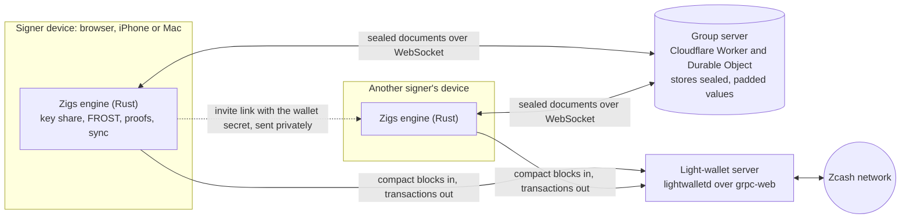
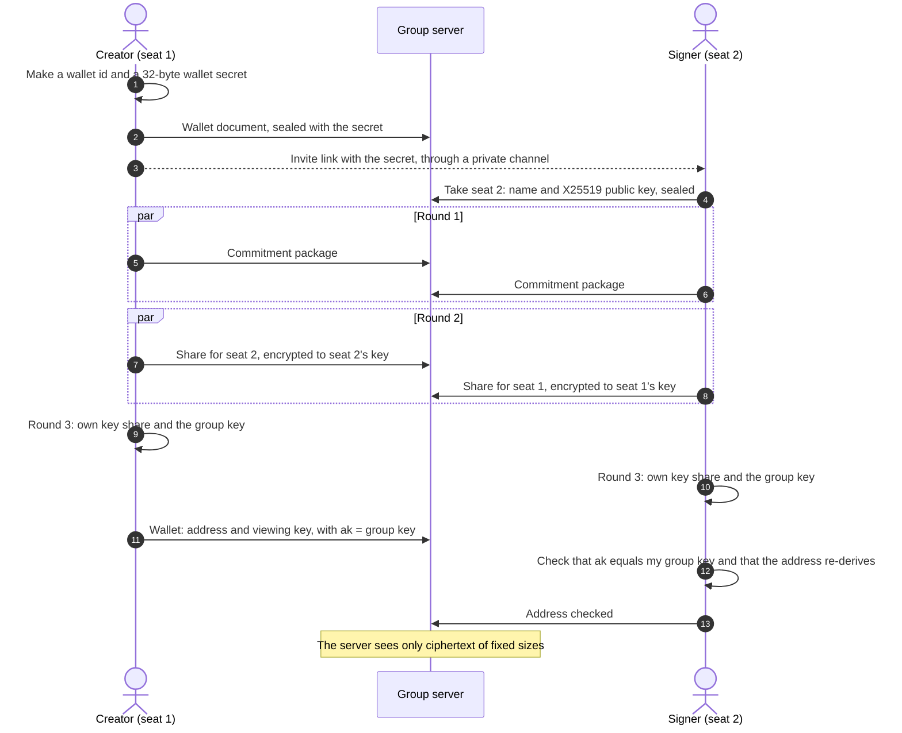
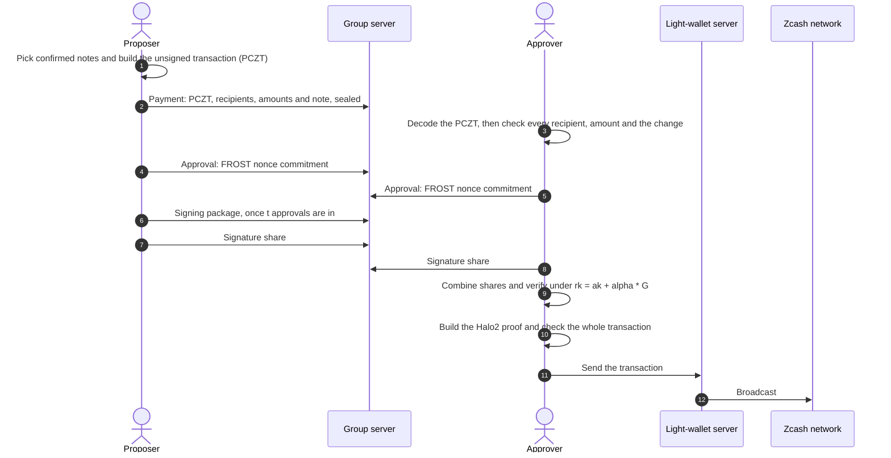
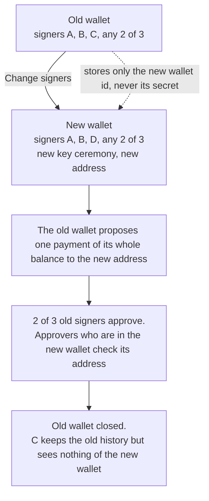

# Zigs

**Shared wallets for shielded Zcash.** A team creates one private address together, and any *t* of
its *n* signers must approve each payment. Nobody ever holds the whole key, the server cannot read
the wallet, and on chain each payment looks like a shielded payment from a standard wallet.

- Web app: https://app.zigs.app (no install, no account)
- iPhone and Mac apps: in [`ios/`](ios), built from the same code
- Website: https://zigs.app

Zigs uses re-randomized FROST threshold signatures ([ZIP 312](https://zips.z.cash/zip-0312)) on
the Ironwood shielded pool. It is a **beta** and **not audited**. Testnet wallets use free test
coins. Mainnet wallets hold real ZEC. At **0.5 ZEC** the app warns and hides the address. It cannot
block deposits.

## For judges: try it alone in five minutes

You can play every signer from one browser. Use a desktop browser with Zigs in one tab.

1. Open https://app.zigs.app and click **New wallet**. Keep **Testnet**, set **Signers** to 2 and
   **Approvals needed** to 2, then click **Create wallet**. You now hold seat 1.
2. Open **Trying Zigs alone? Play the other seats in this browser** and click **Play seat 2**.
   The two seats create the key together. Within half a minute the wallet opens, and both seats
   show **Address checked**.
3. Click **Receive**, then **Get testnet ZEC**, and send some test ZEC to the address. The
   balance appears as **Incoming**, then as **Available** after 3 confirmations (a few
   minutes).
4. Click **Send**, paste any testnet unified address (`utest1…`), enter an amount, and click
   **Propose payment**. For a payroll, click **Add recipient** or **Paste a list**: up to 20
   recipients go into one transaction with one approval round.
5. In the payment panel, click **Approve as seat 1** and **Approve as seat 2**. Read **What this
   payment does**: your browser decoded it from the transaction itself.
6. Click **Build proof** (about one minute in the browser), then **Send to network**, then
   **View in explorer**.

To see signer changes, open **Signers**, then **Change signers**. To see the privacy model, read
[PRIVACY.md](PRIVACY.md).

## How Zigs meets the judging criteria

| Criterion | Evidence |
|---|---|
| **Privacy** | On chain, the transaction shape matches the standard wallet library: same builder, padding, fee, expiry and anchor depth ([comparison](PRIVACY.md#on-chain)). The server stores only encrypted values, padded so that even their length hides amounts. On the device, key shares can be locked with a passkey (web) or Face ID (iPhone) ([how](PRIVACY.md#lock-with-a-passkey-or-face-id)). The page can connect only to the group server and three named light-wallet servers (Content-Security-Policy). It is prepared for Tor Browser, but not yet tested end to end ([how](PRIVACY.md#use-zigs-over-tor)). The server keeps no logs. Every remaining leak is listed in [PRIVACY.md](PRIVACY.md). |
| **Usefulness** | Designed for team treasuries, DAOs and families. Usable today on testnet, and on mainnet with a warning at 0.5 ZEC: web, iPhone and Mac; invite links and QR codes; batch payments for payroll and grants (up to 20 recipients, one approval round, pasted from a spreadsheet); signer changes. |
| **Execution** | The live app works end to end. Eleven testnet transactions made by the apps are [listed below](#proof-on-testnet). The engine has 24 tests, and a command-line suite runs adversarial cases. |
| **Originality** | An end-user app for re-randomized FROST: no command line, no trusted dealer, and no server that can read the wallet. Each device decodes the PCZT and checks every output before it approves, and binds its approval to the transaction's sighash. Signer changes, batch payments and native iPhone and Mac apps are included. Built during the Zecathon window: the first commit is from October 10, 2026. |

## Architecture

Each signer's device runs the same Rust engine: compiled to WebAssembly in the browser, and as a
native library on iPhone and Mac. The engine holds the key share, signs, builds proofs and syncs
the chain. The group server only relays sealed documents.



| Part | What it knows |
|---|---|
| Signer device | Its own key share, the wallet secret, the viewing key, all payments |
| Group server | Wallet ids, document names, timing, IP addresses. Never keys, amounts, addresses or names |
| Light-wallet server | IP address and the blocks requested, as for any light wallet. Never which notes are yours |
| Zcash network | A normal shielded transaction |

## Creating a wallet

The signers run a FROST distributed key generation over RedPallas. No device and no server ever
holds the whole spending key. Each signer then checks the published address against their own key
share before the wallet opens.



**Keys.** An Ironwood full viewing key has three parts: `ak`, `nk` and `rivk`. Zigs sets `ak` (the
spend validating key) to the FROST group key, so only a threshold of signers can authorize a spend.
`nk` and `rivk` only allow viewing; all signers get them. A creator who publishes a different `ak`
is caught by every signer's check.

## Making a payment

Any signer proposes; the others approve on their own devices. A payment can have up to 20
recipients. Each approving device decodes the unsigned transaction (PCZT) itself and checks that
its outputs are exactly the listed recipients and amounts, and that nothing beyond the standard
fee leaves the shielded pool. A proposer cannot hide a different recipient, amount or extra output
behind the text they typed.



**Signing.** Each spend is signed under a re-randomized key `rk = ak + [alpha]G` with a fresh
`alpha`, so spends cannot be linked to the wallet or to each other. Before a device signs, it
re-runs the PCZT verifier role, recomputes the sighash (ZIP 244, v6), checks that its own nonce
commitment was not replaced, and deletes its nonces after use. Any device can combine the shares;
a bad share names its sender.

## Changing signers

The signers and the threshold are part of the wallet key, so they cannot change in place. Zigs
creates a replacement wallet and moves the funds with one normal, approved payment.



## Privacy

The full threat model is in [PRIVACY.md](PRIVACY.md). In short:

| Party | Sees | Does not see |
|---|---|---|
| Chain observers | A normal shielded Ironwood transaction | That a group signed it, the signers, amounts, addresses |
| Group server | Wallet ids, document paths and field names, timing, which IP addresses connect to which wallet | Wallet and signer names, addresses, viewing key, amounts or their length, recipients, transactions, signing data |
| Light-wallet server | Your IP address, the wallet's birthday height, the blocks you download, the transactions you send | Which notes are yours |
| Other signers | Everything about the shared wallet | Your key share and your signing nonces |

How the group server is kept blind:

- The invite link is `https://app.zigs.app/#<wallet-id>.<secret>`. Browsers never send the part
  after `#` to a server. The app keeps the secret on the device and removes it from the address
  bar.
- Every field of every document is encrypted with XChaCha20-Poly1305 under a key derived from the
  wallet secret. The document path and field name are bound into each ciphertext. Values are padded
  to at least 64 bytes and then to the next power of two before encryption.
- Key ceremony shares are also encrypted from one seat to another with X25519.
- Cached balances and the saved sync state on the device are sealed with the wallet key too.

## Proof on testnet

These transactions were made by the Zigs apps with 2-of-2 wallets on the NU7 testnet (v6
transactions, Ironwood pool):

| Transaction | Block | What |
|---|---|---|
| [`4838de4c…6612`](https://testnet.zecblock.com/tx/4838de4c250d85c82657a600bd9886b75080711c37723c7a07f311c96f046612) | 4,485,020 | First FROST spend from the web app |
| [`86807799…45fd`](https://testnet.zecblock.com/tx/86807799c1393829e9de9b1158caa0285d198797c4194b2520f23a713b4f45fd) | 4,485,097 | Payment into a wallet with an encrypted group store |
| [`9859c24b…2409`](https://testnet.zecblock.com/tx/9859c24b961bb196f9a1de74cc099c32d4f2c9812c12a2db47a504cb88ff2409) | 4,485,106 | Spend from that wallet |
| [`d2fc7ad5…e72f`](https://testnet.zecblock.com/tx/d2fc7ad573342648dcdaef65256288e38189753f0087a06e7217cc7a3bb8e72f) | 4,488,891 | **Change signers:** whole balance moved to the replacement wallet |
| [`6572ce88…80a8`](https://testnet.zecblock.com/tx/6572ce88c248350c71225889819c23eefd5e5f8df2af07e9cc216f87337380a8) | 4,488,977 | Web wallet pays a wallet created on an iPhone |
| [`4dc4fd73…7049`](https://testnet.zecblock.com/tx/4dc4fd73274936b81b8ef1897490f0ffc17ec1ec6827f1e92715f7d8115a7049) | 4,488,995 | **iPhone:** proposed, approved, proved and sent from the phone |
| [`b87248fa…3636`](https://testnet.zecblock.com/tx/b87248fa7a06b7a42f082e07c1c4f5da94d1673d7c0fc98d8be2745209f73636) | 4,489,104 | Payment with the padded store format |
| [`9822e109…a43f`](https://testnet.zecblock.com/tx/9822e109ef8416a44b28777971ec661f8e83961a2c57f9c74b6a1f5fb535a43f) | 4,489,326 | **Batch payment** from the web app: 4 recipients, pasted as a list, one transaction |
| [`fb7da6ae…ffde`](https://testnet.zecblock.com/tx/fb7da6ae2fe90c1e1b39637b6608c59b13b701286b6f917762d9b5b82408ffde) | 4,489,332 | **Batch payment** from the iPhone: 2 recipients |
| [`df9b264e…5216`](https://testnet.zecblock.com/tx/df9b264e17b70b0d419af6a272e11b7fb4ac5e48fbd80dfb469496600dac5216) | 4,489,434 | iPhone spends 4 notes at once (more inputs than outputs) |
| [`7c09aacb…302a`](https://testnet.zecblock.com/tx/7c09aacb67ae8d312f611f890913c1db586d3ac0c65501b9062e484f8dc7302a) | 4,489,484 | **Passkey lock:** signed from a locked browser, with a reload and unlock between the two approvals |

A 2-of-2 mainnet wallet was also created and synced to the mainnet tip in the web app and on the
iPhone.

## Repository layout

| Path | Content |
|---|---|
| [`wasm/src/lib.rs`](wasm/src/lib.rs) | Engine: key generation, wallet creation and checks, PCZT inspection, FROST signing, proof, sealing |
| [`wasm/src/chain.rs`](wasm/src/chain.rs) | Chain sync, balance, note selection, payment building, network rules |
| [`wasm/src/snapshot.rs`](wasm/src/snapshot.rs) | Saved sync state: notes and the note commitment tree |
| [`wasm/src/ffi.rs`](wasm/src/ffi.rs) | C interface for the iPhone and Mac apps |
| [`web/index.html`](web/index.html) | The web app |
| [`web/shim.js`](web/shim.js), [`web/qr.js`](web/qr.js), [`web/payees.js`](web/payees.js), [`web/vault.js`](web/vault.js) | Store client, QR encoder, payment list parser and passkey lock (no third-party code) |
| [`cf/src/index.js`](cf/src/index.js) | Group server: Cloudflare Worker with one Durable Object per wallet, limits against abuse |
| [`ios/Zigs/`](ios/Zigs) | SwiftUI app for iPhone and Mac |
| [`src/`](src), [`tests/e2e.sh`](tests/e2e.sh) | Command-line version of the ceremony and adversarial tests |
| [`PRIVACY.md`](PRIVACY.md) | Threat model |

## Run it yourself

### Web app and group server

Needs Rust with the `wasm32-unknown-unknown` target, `wasm-bindgen-cli` 0.2.129, LLVM with a
wasm32 target (for `secp256k1-sys`), and Node.js.

```bash
cd wasm
CC_wasm32_unknown_unknown=/opt/homebrew/opt/llvm/bin/clang \
AR_wasm32_unknown_unknown=/opt/homebrew/opt/llvm/bin/llvm-ar \
RUSTFLAGS="--remap-path-prefix=$HOME=/build" \
cargo build --release --target wasm32-unknown-unknown
wasm-bindgen --target web --out-dir ../web/pkg target/wasm32-unknown-unknown/release/zec_frost_wasm.wasm
```

```bash
cd cf
npm install
npx wrangler dev --port 8787
```

Open http://localhost:8787. To act as a second person on the same computer, also open
http://127.0.0.1:8787: it is a separate origin, so it has separate storage. Deploy with
`npx wrangler deploy` in `cf/`.

### iPhone and Mac apps

Needs Xcode 26, XcodeGen, and the Rust targets `aarch64-apple-ios`, `aarch64-apple-ios-sim` and
`aarch64-apple-darwin`.

```bash
cd ios
./build-core.sh
xcodegen generate
open Zigs.xcodeproj
```

Use the `Zigs` scheme for iPhone and `ZigsMac` for Mac (Apple silicon). The apps connect to
`https://app.zigs.app`; change the server in Settings. They join wallets from web invite links or
`zigs://join#<wallet-id>.<secret>`, and they sit in the same wallets as browsers.

## Tests

- `cargo test --release` in `wasm/` (24 tests): full 2-of-3 signing flows for Ironwood (paying 4
  recipients in one transaction) and Orchard, with a bad share that is attributed to its sender;
  a swapped recipient on any payee output is refused; 3 notes spent for 1 recipient; recipient lists checked row by row; fees
  that count outputs; mainnet and testnet upgrade rules; note
  selection, fees and the largest sendable amount; padded sealing, old values, wrong keys and moved
  values; the saved sync state; the native wallet interface; key ceremony routing.
- `node cf/test/limits.mjs ws://localhost:8787`: the group server's size, rate and path limits.
- `node web/test/payees.mjs`: the pasted payment list parser.
- `node web/test/vault.mjs`: the passkey lock's sealed record (wrong key, changed record, new IV).
- `node web/test/qr.mjs`: the QR encoder against libqrencode (needs the `qrencode` command).
- `bash tests/e2e.sh`: the command-line ceremony in separate processes, with attacks: wallet
  substitution, fewer than t signers, tampered randomizer and sighash, nonce reuse, wrong share
  attribution, foreign notes.

## Known limits

- **Not audited.** At 0.5 ZEC in a mainnet wallet, the app hides the address and warns. It cannot
  stop someone from sending more.
- **Chain reorganisations** are not handled in the saved sync state.
- **One payment at a time.** While a payment waits for its block, the app blocks a second one.
- **Randomizer source.** Signing uses the `alpha` that the transaction builder puts in the PCZT, as
  the Zcash Foundation's `zcash-sign` does. Check the final ZIP 312 text before production use.
- **No key refresh.** Signer changes use a new wallet. Each wallet has one address.
- **Pre-release crates.** The engine uses the NU7 pre-release crate line: `zcash_protocol`
  0.11.0-pre.0, `zcash_primitives` 0.31.0-pre.1, `pczt` 0.10.0-pre.1, `zcash_keys` 0.17.0-pre.1,
  `orchard` 0.16.0, `zcash_client_backend` 0.25.0-pre.1, and `reddsa` at git rev `ed49e9c` for
  FROST. Mainnet follows the NU6.3 rules, which already use v6 transactions and Ironwood.
- **One mainnet server.** Mainnet wallets depend on ChainSafe's public light-wallet server.

## License

MIT, see [LICENSE](LICENSE). The apps serve the Geist fonts (SIL Open Font License 1.1) from
`web/fonts/`, so users never contact Google.
