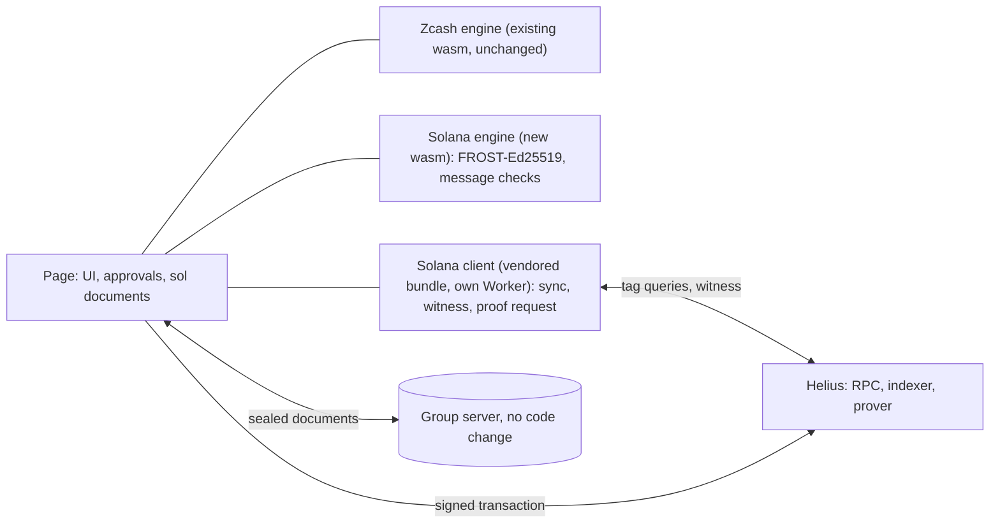

# Solana in Zigs: design

Status: beta in the web app, for testnet wallets only (Devnet). The design spike ran from 13 to 15
October 2026 and its results are in section 6. The beta adds no iPhone or Mac work: those apps have
no Solana part. The work that is still open is in `TICKETS.md`.

The beta switches:

- `SOL` in `vars` of `cf/wrangler.jsonc`. The value `"1"` makes the Worker serve `web/sol/` and
  `/sol/config.json`. Any other value makes every `/sol` path answer 404, and the page says "Solana
  is not available on this server".
- `HELIUS_DEVNET_URL`, a Worker secret. It is the Helius Devnet URL with its API key. The Worker
  gives it to the page at `/sol/config.json`, behind the password gate, with the header
  `Cache-Control: no-store`. Without the secret that path answers 503, and the page says "Solana is
  not available on this server". In local development, the secret goes into `cf/.dev.vars`.
- The Solana tab shows for every version 3 wallet whose network is `testnet`. The network is the
  first one that the device saw for the wallet: the group document has no signature, so a later
  value in the store never counts (PROTOCOL.md section 15.1). A mainnet wallet, a wallet before
  version 3, and a wallet that is not loaded yet, never load `/sol` and never show the tab.
- The page loads `/sol` before the tab opens only when a seat signed `solstart/1`. A start
  document without a valid signature of seat 1 loads nothing.
- The browser has no switch. The spike flag `zf-sol` and the spike setting `zf-sol-rpc` are gone.

The question: can a Zigs group also hold private Solana balances in Zolana, the Helius shielded pool
on Solana (Apache-2.0, beta, Devnet only)? The group key would be a FROST-Ed25519 key and the
Zolana owner. The outside evaluation of 12 October 2026 [E] says yes. This document treats every
claim of [E] as unverified until a primary source confirms it. Section 8 defines the source keys.

## 1. What the evaluation got right and wrong

| Claim of [E] | Verdict | Evidence |
|---|---|---|
| The pool separates a signed fee payer from separately signed owners, and the proof binds both. The Rust builder takes `owner_signers` | Confirmed | [Z]programs/shielded-pool/src/instructions/transact/account.rs:21-63; transact/verify.rs:238-262; sdk-libs/program/src/instruction/transact.rs:45-53 |
| A test signs with extra native signers | Partly. No caller passes extra signers: two wrappers pass an empty list, and `rfq.rs:96` sets `owner_signers` directly. The cosigned test has a payer that also owns an input. No passing case has a payer with no input | [Z]program-tests/test-utils/src/wallet/actions/transaction.rs:569,627; sdk-tests/rfq/tests/rfq.rs:22-125 |
| The TS SDK blocks owner != payer and omits owner signers. `LocalKeys.fromKeys` takes outside viewing and nullifier keys. Registration needs owner and payer signatures | Confirmed for the Default Ring. The ring builder appends the owner signers. `fromKeys` never asks for a signing secret | [Z]sdk-libs/ts/src/wallet/private-transaction.ts:114-120; interface/instructions/index.ts:431-531; transaction/wallet/keys.ts:129-153; programs/user-registry/src/instructions/register.rs:25 |
| The Default Ring hides amount, not sender. Custom Rings can be anonymous | Ring: confirmed. Anonymous: partly. The TS SDK supports confidential Rings only, and the anonymous rail needs P-256 ECDSA, so FROST-Ed25519 can never use it | [Z]docs/spec.md:186, 3036, 3041; sdk-libs/ts/README.md:358 |
| Transaction v1 and its 4,096-byte limit | v1 confirmed. The limit covers the whole transaction, not only the message | [Z]sdk-libs/ts/src/interface/transaction-size.ts:8-12 |
| Beta, Devnet, no audit established. The hosted program may differ from source | Beta and Devnet: confirmed. Audit: Helius says the rings undergo independent audits [H]. I found no report. Mismatch: refuted on 13 October (section 6.1). The deployed pool `sppU489…` and registry match the release hashes. `sppXZU59…` on the Helius address page is an older deployment | [Z]prover/tee/README.md:3; releases/tag/v0.4.0-alpha |
| Custody by a program-owned address (PDA) works | Not found. No test spends a user UTXO owned by a PDA | [Z]sdk-libs/keypair/src/pda.rs:1-70 |
| 10.4: a new blockhash may force a new proof | Wrong. The blockhash is not a proof input. Root history limits proof life. [E] misses the durable nonce | [Z]sdk-libs/client/src/client/transaction.rs:171-179 |
| 10.2 signs SHA-256 of the message. 10.3 checks amount and asset from the message | Wrong. FROST signs the raw bytes. The message holds only hashes and ciphertexts | [RFC]7.6; [Z]sdk-libs/ts/src/transaction/wallet/intent.ts:63-69 |
| 6.1: an audited dealerless DKG exists | Partly. The audit covers frost v0.6.0 and excludes re-randomized FROST | [F]README.md, "NCC Audit" |
| 6.3: secret-sharing the nullifier secret hardens it. 6.2: the viewing role reads history | No gain while a hosted prover gets that secret. The viewing key also reads outgoing payments | [Z]sdk-libs/ts/src/client/keys.ts:166-177; docs/spec.md:367-395 |

## 2. The product

A user opens a wallet with a Solana part. Devnet only. The Zcash part stays as it is.

- **Add Solana.** One key ceremony (section 4) and one registration. The wallet must be version 3.
- **See.** The owner address (the group key), the shielded address, and the private and public SOL
  balances. The public balance pays fees.
- **Use.** Anyone deposits SOL to the group's shielded address. The group can shield its own public
  SOL, send a private transfer to a shielded address, or withdraw to a public address.
- **Not offered.** SPL tokens, anonymous Rings, swaps, bridges, memos, a merge service, mainnet, and
  a transfer to an unregistered payee ([E] 9.3, not checked).

Helius runs the RPC, the indexer and the prover. The screen texts name the public parties. They do
not copy the Helius claim that the RPC cannot decrypt state, because the prover shares its URL:

| Screen | Text |
|---|---|
| Transfer | "Hidden on the public chain. Helius sees amount, asset and recipient while it builds the proof. Sender and recipient are public." |
| Deposit | "Sender, recipient, asset and amount are public." |
| Withdrawal | "Recipient, asset and amount are public." |
| Add Solana | "Your Solana address is public. The Zigs server operator can link this wallet to that address by timing. Helius sees that you use Zigs. The address needs a public SOL funding trail." |

| Property | Zcash (Ironwood, today) | Solana (Zolana Default Ring) |
|---|---|---|
| Amount, asset | Hidden | Hidden on chain in a transfer. Public in a deposit and a withdrawal [Z]docs/spec.md:3036-3041 |
| Sender, recipient, and the link | Hidden | Public: payer and owner signer are in the account list, the owner key tags the output [Z]programs/shielded-pool/src/instructions/transact/verify.rs:238-262; docs/spec.md:402 |
| Spends linked to the group | No. `alpha` is new for each spend | Yes. The group key is a stable tag. A FROST signature does not show a multisig |
| Who sees the witness | Nobody. The proof runs on the device | The hosted prover: owners, assets, amounts, blindings, nullifier secret [Z]sdk-libs/ts/src/client/prover/client.ts:1215-1262; [H]integration/wallet. Local proving is listed as coming soon |
| What the index learns | IP address and blocks. Trial decryption runs on the device | Tag queries (the owner key), IP address, timing, Merkle proofs of inputs, and the app `Origin` header, which Allowed Domains needs |
| What the group server can link | Nothing it can match to the chain | The time of its `sol*` writes matches chain time. That links the wallet id to the owner key and the full history |
| Custody | Fewer than `t` seats cannot spend | The same for the seats. But the pool upgrade key can replace the pool, and the protocol authority can pause trees (section 7) |

The prover cannot spend. Spending needs the owner signature [Z]docs/spec.md:310-314. The group
server sees paths, timing and sizes, never keys or amounts. Every seat can read the whole Solana
history.

## 3. Architecture in the web app

**3.1 Separate module, separate keys.** Web files go under `web/sol/`. The engine is a new crate
with its own `Cargo.lock` and wasm file. The Zcash engine, its lockfile and its 7.6 MB wasm stay
unchanged. Two files keep the Zcash audit scope apart. A Zcash-only user never loads the Solana
code. The pin is `frost-ed25519 =2.2.0`: the newest 2.x, and the version whose `lib.rs` I read [F].
It needs `frost-core ^2.2.0` and `frost-rerandomized ^2.2.0` [CIO]. Version 3.0.0 exists (crates.io,
23 April
2026) and I did not read it. I did not run `cargo check` on this pairing.

**3.2 What Solana shares with the wallet.** The roster, the approval screens, the group server and
the signed writes of PROTOCOL.md section 15. Seat Ed25519 keys sign the Solana documents. The group
key never signs a document.

The server accepts a document only at a path with an even number of segments (`apply()` in
`cf/src/index.js`). The client `sub()` reads collections at odd depth. So `groups/<id>/sol/dkg1/<i>`
fails. The Solana documents use flat names: `solstart/1`, `soldkg1/<i>`, `soldkg2/<i>-<j>`,
`soldone/<i>`, `solsessions/<id>`, and `commits/<i>` and `shares/<i>` below `solsessions/<id>`. The
server needs no code change. The web app adds the names to the `FLAT`, `DKG2` and `IN_SESSION`
expressions and the reader list in `web/signed.js`. It adds them to the collection list in
`openGroup()` of `web/app.js`. Old apps and the iPhone and Mac readers ignore them.
`web/test/signed.mjs` asserts that each `sol*` path has an even number of segments.

**3.3 Who does what.**

- **Solana wasm:** DKG, nonces, shares, aggregation and strict verification. Role secrets. The v1
  message parser. The Poseidon and ciphertext recompute. The program ids and trees of each cluster.
- **TS bundle, in its own Worker:** sync, UTXO decryption, witness, prover call, `transact`
  instruction. The page passes it the two role secrets for one session. It never gets the FROST
  share, `solSeed` or the nonces (3.6). A bad bundle can leak history or propose a bad message. It
  can get a signature only if the message check of section 5 has a hole.

**3.4 The bundle.**

| Topic | Plan or fact |
|---|---|
| SDK version | This design assumes the main commit pinned in [Z] (SDK 0.4.1-alpha, unreleased in its changelog). The npm release 0.4.0-alpha differs. Its `endpoint.js` has no `/v1/zolana/` path [UNPKG]. Its release notes say that the prover fetches Merkle data, needs `PROVER_INDEXER_URL` and serves `/prove/<key>` [Z]releases/tag/v0.4.0-alpha. P4 records the host and path of each call. The CSP host does not change with the path, but Allowed Domains behavior may |
| Why a TS bundle | `zolana-client` needs `hpke`, `dcap-qvl`, `tokio` and `solana-transaction`, and the repo has no wasm build [Z]sdk-libs/client/Cargo.toml. The smaller crates `zolana-hasher` and `zolana-transaction` hold the Poseidon and UTXO hash code. I did not build them for wasm32. P3 tries them first |
| Import chain | `src/index.ts:1` leads to `src/client/prover/tee/dstack.ts:1`, which loads `@phala/dcap-qvl`, a CommonJS package. An import map needs an inline script, which the CSP forbids |
| Build | One esbuild bundle in `web/sol/`, its SHA-256 in the repo, and a script that rebuilds it. The build aliases `dcap-qvl` to a stub that throws on every call. The TEE policy stays unset, as in this commit. A stub that returned would let an enabled policy claim an unchecked attestation |
| Hasher wasm | The slim build is 20 KB of script and 1.28 MB of wasm, not the 4.39 MB fat build [UNPKG]. It loads the wasm with `fetch(new URL(..., import.meta.url))`, and the SDK calls `loadHasher()` with no argument [Z]sdk-libs/ts/src/hasher/index.ts. esbuild does not emit that file. The build copies it to `web/sol/` and patches the URL. It also cuts the home path of the upstream author out of the panic text of each wasm file (same length, so every offset stays valid), and `SHA256SUMS` pins the cleaned files |
| Packages | 12 direct runtime packages and the `@solana/kit` peer. The root `package-lock.json` at the pinned commit lists 84 packages that the SDK reaches, with peer and optional edges. I read the file and ran no install. The SDK declares `node >=24` and I found no `node:` import. P3b tests it in a browser |
| Size | Budget: the Solana wasm at most 1.5 MB, and the bundle at most 1 MB without the hasher wasm. Measured: the checker wasm is 597,533 bytes (6.7); the minified bundle is 851,099 bytes and the hasher SIMD wasm 1.28 MB (6.8). P8 measures load time |

**3.5 CSP and the Helius key.**

| Topic | Plan or fact |
|---|---|
| Host | `connect-src` (`policy()` in `cf/src/index.js`) gains the Helius Devnet host over https and wss. RPC, indexer and prover share it under `/v1/zolana/` [Z]sdk-libs/ts/src/endpoint.ts:12-34. `script-src` and `worker-src` need no change. `policy()` is one policy, so a Zcash-only user gets the wider `connect-src` too. The other choice is a build flag and a second deploy |
| Key | The key sits in the URL query, so the first version uses Allowed Domains [H]rpc/protect-your-keys. It limits use by other sites. It does not protect the key, because a script that copies the key from the page can send any `Origin`. The app sends `Referrer-Policy: no-referrer`, and I do not know if Allowed Domains reads `Origin` or `Referer` |
| Proxy | None in the Zigs Worker. A prover proxy there sees the witness. An RPC proxy links wallet ids to the owner key |
| Doc work | Done for the beta. `README.md`, `PRIVACY.md` and `PROTOCOL.md` (section 10.1 and section 16) name the Helius host and say what it sees. The link rows of section 2 are in `PROTOCOL.md` section 16 |

**3.6 State.**

| Topic | Plan or fact |
|---|---|
| Secrets | The Solana key package, `solSeed`, role secrets and FROST nonces go into the seat secret with `putSec(gid, seat, patch)` in `web/app.js`, under new field names. The passkey lock, the tab sync (`TAB_KEYS`) and the backup then cover them. They never go into IndexedDB, because a same-origin Worker can read IndexedDB but not `localStorage`. The device saves the nonces with the message digest before it publishes (PROTOCOL.md 7.3) |
| Snapshot | UTXOs, cursors, spent flags and the plaintext of open sessions, sealed with a key from `solSeed`, in a new IndexedDB store `sol`. `idb()` opens version 1 and creates only `chain`, so it must open version 2 with an upgrade step. A tab that stays open on version 1 blocks the upgrade (`onblocked`), so it must close its connection and ask for a reload. A device with no snapshot rebuilds it from the indexer. A session plaintext leaves the snapshot only after the indexer output decrypts to it |

## 4. The second DKG, key roles and backups

**4.1 The ceremony.** It runs on the same seats, after the wallet exists. It does not touch the
Zcash key. Each step writes a signed document (3.2).

| Step | Document | Content |
|---|---|---|
| 1 Start | `solstart/1` | Cluster (4.4). A seat refuses unless the wallet is version 3 and the safety number that the device computes now equals the number its person confirmed. That number covers the wallet id, `t`, `n`, `network` and every box key (PROTOCOL.md 4.1). Testnet gives Devnet. A mainnet wallet gets no Solana. The ceremony needs all `n` seats. A seat on an app without Solana support writes nothing. The wallet page then shows "Seat N has not started" for each seat with no `soldkg1` document |
| 2 Round 1 | `soldkg1/<i>` | The `frost-ed25519` round-1 package and a commitment to a fresh 32-byte part `rSol`. The commitment is BLAKE2b-256 with the personalization `Zigs_SolCmt___v1` over the wallet id, seat, box key, cluster and `rSol` |
| 3 Echo | none | BLAKE2b-256 with `Zigs_SolEcho__v1` over the wallet id, safety number, cluster, and every package and commitment, in seat order |
| 4 Round 2 | `soldkg2/<i>-<j>` | A box with the share and `rSol`. The box context carries a curve label (`<id>:sol:<i>-><j>`). Today's context `<id>:<i>-><j>` would let a Zcash box open here |
| 5 Round 3 | none | Each device checks the echo and every commitment, then builds its key package, the group key and `solSeed = BLAKE2b-256("Zigs_SolSeed__v1", walletId, echo, rSol_1 … rSol_n)` |
| 6 Done | `soldone/<i>` | The group key, public key package, `nullifier_pk`, `viewing_pk`, shielded address, cluster and a version label of the program ids. The ids are in the wasm. A label that differs from the label of the wasm aborts the seat. Seats compare all `soldone` documents |

The safety number needs no change: the roster is the same, and step 1 checks it again. The echo and
the `soldone` agreement bind the Solana values to that roster. `rSol` never reuses the Zcash `r`
parts, `vaultSk`, `sk` or `qsk`. A recovery under ZIP 2005 may hand `qsk` to a host wallet
[ZIP2005], and one disclosure would then expose both chains. A signature cannot seed the roles,
because FROST signatures differ each time [Z]sdk-libs/ts/src/client/keys.ts:161-195.

**4.2 Key roles.**

| Role | Held by | The holder can | Rotation |
|---|---|---|---|
| Ed25519 key share | One seat each | Give one share of a signature | New group key and a migration spend |
| Nullifier secret (31 bytes) | Every seat and the Worker | Build proofs, compute spent status. Cannot spend [Z]docs/spec.md:352-358 | Never in place [Z]programs/user-registry/src/instructions/update_keys.rs:32-38 |
| Viewing key (P-256) | Every seat and the Worker | Read incoming and outgoing UTXOs | With an owner signature |

The engine derives both secrets from `solSeed` with Zigs labels, not the `TSPP/*` labels. The
viewing scalar is HKDF output of 48 bytes reduced modulo the P-256 order
[Z]sdk-libs/ts/src/keypair/derivation.ts:222-227,309. A separate check requires 1 <= k < n
[Z]sdk-libs/ts/src/keypair/viewing-key.ts:52-59.

| Topic | Rule |
|---|---|
| Registration is permanent | One FROST-signed `register` transaction, with the group key as owner and payer. The record `(owner, nullifier_pk, viewing_pk)` is public. `register` fails if a record exists, `update_keys` refuses a new nullifier key, and no operation deletes a record [Z]programs/user-registry/src/instructions/register.rs:36-42,57-60; docs/spec.md:2805 |
| Registration check | Before any seat signs, the wasm recomputes `nullifier_pk` and `viewing_pk` from `solSeed` and compares them byte for byte with the instruction data. It requires `owner_p256` to be `None`. The group sends one `register` only. After it lands, each seat compares the on-chain record with its own values. Receiving needs no signature |
| Refused by default | `set_merging_enabled(true)` and `update_keys` are separate intents with their own screens. The first version does not offer them. `merging_enabled` stays false, the registration default [Z]programs/user-registry/src/instructions/register.rs:60 |
| Merge | When `merging_enabled` is true, anyone can submit `merge_transact` with no owner signature [Z]docs/spec.md:2270-2274. A merge consolidates inputs into the same owner, so no funds move. It does spend the inputs of an open proposal, and the proposal then fails. That is a denial of service. The group merges with a normal approved self-transfer |
| Members | A removed member keeps the secrets and reads the history permanently. A member change needs a new wallet and group key (PROTOCOL.md section 8) and one approved payment. That payment links the old key to the new key in public |

**4.3 Backups.** The Zcash `.zigsbackup` and its restore stay unchanged. The engine seals an opaque
plaintext string, and restore reads a fixed list of fields and drops the rest
(`wasm/src/backup.rs`).

| Design | Result |
|---|---|
| Second file, kind `zigs-sol-backup`, same Argon2id and XChaCha20-Poly1305 format and passphrase rules (PROTOCOL.md section 9) | Cost: a second file and a second passphrase. Recommended, because one file would hold the keys of both chains |
| Solana fields inside the plaintext of the existing file | `v` stays 1, so iPhone and Mac restore still opens it. A re-backup there drops the Solana part without a warning |
| `v: 2` in the Zcash file | The engine refuses `v` other than 1, so restore breaks on iPhone and Mac |

The second file holds the key package, public key package, group key and `solSeed`. Restore and Fit
check that the key share equals the `soldone` entry and that `solSeed` gives the published keys and
address. The snapshot is not in the file. A restored seat that has `soldone/<i>` on the server and
no Solana key package shows "Solana part missing".

**4.4 Version marker.** An old app ignores the Solana documents, so the wallet document needs no
marker. Recommended: `solstart/1`, signed by seat 1, and no change to the wallet version.

## 5. The signing flow

The flow follows PROTOCOL.md section 7. The message is a v1 transaction. Its bytes show no amount or
recipient, and its life depends on a nonce, an expiry and roots.

1. **Propose.** A seat enters kind, payee and amount. The payee is a full shielded address
   (`owner_hash` and `viewing_pk`). A registry lookup may fill the form, but registry reads are not
   authenticated [Z]docs/spec.md:2811. The Worker syncs, picks UTXOs, builds the plaintext outputs
   and ciphertexts, and asks for the proof. The wasm compiles the v1 message from a fixed template.
   The smallest listed `transact` (2 in, 4 out) takes 1,278 of 4,096 bytes [Z]docs/spec.md:1811.
2. **Publish.** `solsessions/<id>` holds the intent, plaintext outputs, input UTXO ids, the
   ciphertext salt and the message bytes. The proposer signs this proposal part (PROTOCOL.md 15.5).
3. **Check, on each approving device, in the Solana wasm.** Every rule that applies to the intent
   must hold. The approval screen shows the payee fingerprint, the amount, the computed change, the
   fee and the expiry.

| Rule | Check |
|---|---|
| Instructions | Parse the message as v1, write it again, and compare the bytes with the received message. The ordered list equals the list of the intent (second table). Every account has its pinned address, signer flag and writable flag. Any other program, discriminator or account is refused. The wasm holds the program ids and trees. The group key is the fee payer and the only signer |
| Limits | The v1 config mask sets the loaded-accounts limit (bit 3), or the wasm refuses the message (6.3). Priority fee and compute units stay under the fixed maxima of the template. Unknown mask bits and `ComputeBudget` instructions are refused. `transact` uses the Default Ring with no `ring_config` and no cache. Any other v1 config value is refused. `expiry_unix_ts` is finite: proposal time plus the expiry window. 0 and `u64::MAX` are refused |
| Outputs | Each output is the payee, the change to the group `owner_hash`, or a true dummy (`DummyDomain`, owner 0, amount 0). Its `utxo_hash` equals Poseidon over the approved plaintext. For a move to a new wallet (PROTOCOL.md section 8), the payee equals the address that the approver's own seat in the new wallet checked |
| Legs, conservation | The legs equal the intent. The inputs from the device's own snapshot plus the deposit legs equal the outputs plus the withdrawal legs. The nullifiers equal those of the snapshot |
| Ciphertexts | `tx_viewing_sk` derives from `tx_viewing_secret` and the first nullifier [Z]docs/spec.md:383-398. The key schedule is deterministic [Z]docs/spec.md:707-725. The device recomputes every output ciphertext. It checks that `tx_viewing_pk` equals the derived key and that each owner tag equals the payee or the group key. The pool ignores output `data` [Z]docs/spec.md:1878, so a bad blob would land and hide the output from the payee and the other seats |
| Not checked | The Groth16 proof. A bad proof fails on chain, loses no funds and costs the fee |

| Intent | Ordered instructions | Legs | Outputs |
|---|---|---|---|
| Create nonce account (once) | `CreateAccountWithSeed` (base = group key, so no second signer), `InitializeNonceAccount` (authority = group key). Uses a recent blockhash | None | None |
| Register (once) | `AdvanceNonceAccount`, `register` (pinned accounts, data per 4.2) | None | None |
| Shield | `AdvanceNonceAccount`, pool `deposit` (tag 15, no proof) | The deposit from the group's public SOL | One output to the group |
| Transfer | `AdvanceNonceAccount`, `transact` | None | Payee, change to the group, dummies |
| Withdrawal | `AdvanceNonceAccount`, `transact` | One withdrawal leg: intent recipient, amount, SOL | Change to the group, dummies |
| Cancel | `AdvanceNonceAccount` only | None | None |

The wasm refuses these in every intent: a pool `deposit` (tag 15) outside the Shield intent,
`merge_transact` (tag 17), `update_keys`, `set_merging_enabled`, `WithdrawNonceAccount`,
`AuthorizeNonceAccount`, a System `Transfer` and `ComputeBudget`. The pool treats a relayer fee as a
withdrawal leg to any recipient [Z]docs/spec.md:2647-2660. Without the leg rule, a transfer could
pay an attacker.

4. **Approve.** The engine makes nonces and commitments and stores them with
   `BLAKE2b-256("Zigs_SolMsg___v1", cluster || message bytes)`, as Zigs stores the sighash today.
5. **Package, sign.** At `t` commitments with one digest, one device publishes the package. Each
   device re-parses the message, compares the digest, signs the raw message bytes and deletes its
   nonces before it publishes the share. The group key has no domain separation
   [F]frost-ed25519/src/lib.rs:182-187, so it would sign any text. The engine refuses any bytes that
   fail step 3, the off-chain prefix (0xFF "solana offchain") and `TSPP/derive/` payloads.
6. **Combine, send.** Any seat aggregates, checks the result with `verify_strict` (never Web Crypto)
   and sends at once. The transaction id is the first signature. The device tracks the transaction
   by signature and writes a signed `sent` part after confirmation.

A recent blockhash lives about 60 to 90 seconds [SOL]. Zcash approvals take hours. The target is a
durable nonce, so the message is fixed at proposal time, as the sighash is in Zcash.

| Topic | Rule |
|---|---|
| Expiry | `transact` carries `expiry_unix_ts`. The program checks it and the proof binds it. The SDK default is `NO_EXPIRY`, which is `u64::MAX` [Z]sdk-libs/ts/src/transaction/instructions/transact.ts:250,346. The expiry window is 24 hours (proposal) |
| Cancel | A signed, unsent transaction is valid until the nonce advances, the expiry passes or the root goes stale. The group server holds the signature shares under the wallet secret. Any seat, former seat or link holder with `t` shares can aggregate and send until then. So cancel is advisory once `t` shares exist (PROTOCOL.md 7.7). The screen says "cancelled" only after the nonce advanced or the expiry passed. To cancel early, the group runs a FROST session over `AdvanceNonceAccount`, because the group key is the nonce authority. To cancel late, it waits |
| Nonce account | One account allows one open Solana payment. Rent is 1,056,640 lamports on Devnet (6.3). The first transaction creates the account, so it uses a blockhash, and `t` devices sign inside the blockhash lifetime. A nonce with a v1 transaction works on Devnet (6.3) |
| Stale roots | A proof lives while its roots stay in history. The UTXO tree keeps the final root of the latest 500 slots with updates. The nullifier tree keeps its last 100 roots [Z]docs/spec.md:1454; program-libs/interface/src/state/tree.rs:9-14. Chain activity counts, not hours. A proposal ends at the earlier of the expiry and the stale root. After a stale root the proposer proves again. The new bytes give a new digest, so all signing rounds repeat and the old nonces go. P6 measured it (6.6): many hours on Devnet today, about 200 s with an append in every slot |
| Fee payer | The group key pays, owns and holds the nonce authority, so one FROST signature suffices. Its address needs public SOL. The priority fee is a total in lamports with no maximum, and SIMD-0385 is in Review with no feature gate [SIMD]. One proposal could spend the whole public balance. So the template fixes maxima for the priority fee and the compute units. The values come from P2 and P5, which record the compute units and priority fee of each landed transaction. The cap is the largest recorded value plus 50 percent |
| Later work | Not planned: a separate payer with the group as an extra owner signer. The TS SDK needs a patch in four places for it: wallet/private-transaction.ts:114-120, transaction/instructions/builders.ts:404-410, interface/instructions/index.ts:527 and client/client.ts:1189-1195, all under [Z]sdk-libs/ts/src/. Questions 1 and 7 concern only this work |

## 6. Devnet proof of concept

P1 to P3b need no Helius account. Scratch code stays outside the repo until a step passes.

| Step | Test | Acceptance | Needs |
|---|---|---|---|
| P1 | 2-of-3 DKG and signing with `frost-ed25519 =2.2.0`. Check each signature with `verify_strict` and with `verify_simd0376` (cofactored, rejects small-order or non-canonical A and R) through `solana-signature`. Run RFC 9591 E.1 inputs. Build for wasm32 | Every signature of a run of 100 passes both checks. E.1 matches, or the gap has a cause. The Zcash lockfile is unchanged | Nothing |
| P2 | On a public Devnet RPC (`getVersion` shows Agave 4.2.2 or newer): create the nonce account (`CreateAccountWithSeed`, base = group key). Send a group-signed v1 SOL transfer with `AdvanceNonceAccount` first, after 10 minutes. Send the same bytes twice. Test the loaded-accounts default of 0. Record the compute units and priority fee of each transaction that lands | Lands once. If v1 with a nonce fails, record it and test a blockhash transaction. The cap values of section 5 follow from the results | Devnet SOL |
| P3 | Solana wasm: v1 parser, byte-exact rewrite, policy, Poseidon and ciphertext check. First, run `cargo check --target wasm32-unknown-unknown` on `zolana-hasher` and `zolana-transaction`, and reuse them if they build. Vectors: `hash_vectors.rs` and TS SDK vectors (non-zero amount, SPL mint, change to the group) | Every vector matches. The wasm refuses a message that breaks any rule of section 5. It refuses a changed recipient, change owner, flag or account, and an extra instruction, leg or output. It refuses a bad ciphertext or `tx_viewing_pk`, wrong registration keys, expiry 0 or `u64::MAX`, the off-chain prefix, and any config outside the template. Wasm size is within the budget | Nothing |
| P3b | Bundle smoke test: esbuild bundle with the hasher wasm copy and the throwing stub. Load it in a Worker in a browser, start the hasher, run a sync against a mock server | No CSP violation, no `node:` import. The stub throws. Bundle size is within the budget | Nothing |
| P4 | Baseline: one ordinary key, the pinned main commit. Register, deposit, transfer, withdraw. Repeat with npm 0.4.0-alpha only if the main paths fail | Round trip passes. Record the live pool id, the program hashes against the release and the upgrade authority from `ProgramData`. Record proof time and size, and the host and path of each indexer and prover call. Record any fee inside the circuit, because the conservation rule needs it | Helius key, Devnet SOL |
| P5 | Group key as owner and payer: register, shield, transfer, withdraw | One share fails. A substituted payer or owner fails. The recipient reads the output. Every approving seat refuses a bad ciphertext. The compute units and priority fee of each landed transaction are recorded | Helius key, Devnet SOL |
| P6 | Root window in wall time. Approvals spread over one hour with a nonce | The stale-root path works: new proof, new digest, old nonces gone. The root window is at least the minimum approval time | Helius key |
| P8 | Web spike behind a flag: Worker bundle, CSP hosts, second DKG on three seats, registration, payment, backup, wipe, restore. Check if Allowed Domains uses `Origin` or `Referer`, covers WebSocket and needs a paid plan | No CSP violation. Restored balance equals the old one. Zcash tests unchanged. Load time is within the budget | Helius key (Allowed Domains) |

**6.1 Devnet facts, checked on 13 October 2026** (read-only RPC calls through the owner's Helius
Devnet key):

- The RPC answers `getHealth` with `ok` and runs Agave `4.4.0-beta.0`. That meets the 4.2.2 minimum
  for v1.
- Pool `sppU489…`: deployed at slot 508538476, the release slot. The SHA-256 of its ELF (cut at the
  size in its ELF header) equals the release hash `3641ffe2…`. Registry `regyS5rk…`: deployed at
  slot 503573056, and its ELF hash equals the release hash `2010baa2…`.
- Pool `sppXZU59…` also exists. It was deployed at slot 481005012, so it is the older deployment.
- All three programs have the upgrade authority `2kgbLowv…`. That address is a point on Ed25519, so
  it is an ordinary key pair, not a program address of a multisig. On Devnet one key can replace the
  pool.

**6.2 P1 result, 13 October 2026** (scratch crate outside the repo, `frost-ed25519 =2.2.0`):

- A 2-of-3 dealerless DKG gives every seat the same group key. 100 sessions (and 2,000 more in
  repeat runs), with messages of 1 to 4,096 bytes, pass frost's verify, `ed25519-dalek`
  `verify_strict`, Solana's `Signature::verify` and `verify_non_strict`. Changed messages,
  signatures, keys and a non-canonical S fail. An independent verifier re-ran the tests and the
  mutation checks.
- The RFC 9591 E.1 inputs give the RFC's group commitment, shares and signature byte for byte.
- The wasm32 build links the whole flow: 203,052 bytes after wasm-bindgen, 64,127 bytes gzip.
- Open: the SIMD-0376 item could not run, because no published crate has that function. The tests
  do not yet tell `verify` from `verify_non_strict` apart, and no test parses a real v1 transaction.

**6.3 P2 result, 13 October 2026** (public Devnet, solana-core 4.4.0-beta.0,
`solana-message 5.1.0`):

- The 2-of-3 group key funded, then created a nonce account with `CreateAccountWithSeed` (base =
  group key) and `InitializeNonceAccount` (authority = group key), signed by seats 1 and 2.
- Seats 2 and 3 signed a v1 transaction (version byte 0x81): `AdvanceNonceAccount`, then a transfer
  of 0.001 SOL. It landed 615 s after the signature, 2,640 slots after the nonce account, so far
  past any blockhash. The first signature on chain is the FROST aggregate. Fee 7,000 lamports (5,000
  base and the 2,000 priority fee set in the header), 300 compute units. The same bytes sent again
  did not land. Transaction `4tRzAK6V…dX7Z` on explorer.solana.com, cluster devnet.
- The v1 field "loaded accounts data size" must be set. At its default of 0, a transaction fails at
  load with `MaxLoadedAccountsDataSizeExceeded`, is still charged, and still advances the nonce. So
  one template mistake costs a fee and destroys every approval. This transaction loads 6,422 bytes.
- Nonce account rent on Devnet is 1,056,640 lamports, not the 0.0015 SOL assumed in section 5.
- Not measured: a fee cap for `transact` (P5). Legacy and v0 with a nonce were not needed.

**6.4 P4 result, 13 October 2026** (TS SDK at the pinned main commit, 0.4.1-alpha, Node 24, Helius
Devnet gateway):

- Two ordinary keys registered, A deposited 0.05 SOL, A sent 0.02 SOL privately to B (B synced and
  read exactly 0.02), and B withdrew 0.01 SOL to a public address. All six transactions landed the
  first time. An independent verifier re-checked them on Devnet and re-synced B.
- Compute units: registration 8,532 and 16,032, deposit 37,918, transfer 138,500, withdrawal
  142,587. The SDK asks for 450,000 for `transact` and sets the loaded-accounts limit to 64 MiB,
  with no priority fee. Fees were the 5,000-lamport base. Registration rent is 1,330,960 lamports
  per record.
- Proofs: one `POST /v1/zolana/prove` per spend, 297 to 436 ms, about 0.7 to 0.9 s with the proof
  data fetch. The proof on chain is 192 bytes. The request body is about 8.3 KB.
- What the hosted prover receives, by field name: input and output UTXOs (owner, asset, amount,
  blinding), Merkle and non-inclusion paths, and `nullifierSecret` in clear. Not the Ed25519 seed
  and not the viewing key. This confirms the privacy rows of section 2.
- All 120 calls went to one host, `devnet.helius-rpc.com`, with the API key in the query of every
  call, the prove call included. On the gateway the client fetches the proof data itself.
- No fee inside the circuit: inputs plus public amounts equal outputs, exactly. Tree 0 charges no
  fee today, but the fee authority can change that (`set_tree_fees`), so the conservation rule reads
  the fee schedule. The tree pays 701,040 lamports of nullifier rent per spent input.
- Corrections: the live instruction tags are deposit 15, `transact` 16 and `merge_transact` 17, not
  11, 12 and 13. The SDK keeps payer equal to owner and derives the signer and the shielded keys
  from one seed.

**6.5 P5 result, 13 October 2026** (the P2 group, the unpatched SDK for the main steps):

- The 2-of-3 group key, as owner and fee payer, registered, shielded 0.05 SOL with the pool deposit
  (tag 15), sent 0.02 SOL privately to an ordinary key (which read it), and withdrew 0.01 SOL. Each
  signature is a FROST session of a different seat pair over the exact message bytes, and verifies
  under the group key on chain. An independent verifier re-checked all of it and re-synced both.
- The SDK takes the group as an outside key set (`LocalKeys.fromKeys` with the group key as owner,
  and a kit signer whose address is the group key). The shielded keys came from a random `solSeed`
  with the SDK's own labels, through `roleExpansion`, which the package does not export.
- Refused as expected: one share alone (frost `IncorrectNumberOfCommitments`), a replaced owner or
  payer (simulation: `TransactProofVerificationFailed`), and a message changed after signing.
- Stretch: a private transfer with the durable nonce as lifetime and `AdvanceNonceAccount` first
  landed 301 s after signing, with a small patch to the SDK's compile step (lifetime setter only).
- Compute units of `transact`: 138,500 to 144,591, so the cap rule of section 5 gives about 217,000.
  The priority fee was 0. The prover got the group's nullifier secret, as in P4.
- Not tested: a seat refusing a bad ciphertext (needs P3), distributed seats (one process ran both
  seats), a separate fee payer, and the root window (P6, now in 6.6).

**6.6 P6 result, 14 October 2026** (the P5 group, FROST rounds split in time, a patched SDK compile
step):

- How a root expires. Both histories sit in the tree 0 account `33KVhbT4…`. The UTXO history has 500
  entries, one per slot with at least one append (deposit, `transact`, `merge_transact`); idle slots
  add none. The nullifier history has 100 entries, one per forester batch of 250 nullifiers, so
  25,000 nullifiers in all. The `transact` data carries one history index per tree, and the program
  reads the root at that index; it never searches. A stale root gives the ordinary proof error,
  custom 7008 (`TransactProofVerificationFailed`). So a device detects a stale root by the value at
  the index.
- Devnet activity is low. Over 24 hours the UTXO history moved 3 to 33 entries per hour, and the
  nullifier history moved about 0.2 batches per hour. The roots of all five P4 and P5 proofs from 13
  October were still valid the next morning.
- Run 1: an approval over one hour. Seat 1 made its FROST commitment at 07:13 UTC, seat 2 at 07:43,
  and both signed at 08:13. The transaction landed at once: `4CyFR9Ld…` on explorer.solana.com,
  cluster devnet. It had the template of section 5: `AdvanceNonceAccount` first, a durable nonce, a
  finite expiry of 24 hours, v1 config mask 12 (compute limit 217,000 and the loaded-accounts limit,
  no priority fee). It used 142,007 compute units and a fee of 5,000 lamports. B received exactly
  0.001 SOL. The tree did not move during the hour, so run 1 proves the nonce flow, not the root
  window.
- Run 2: a forced stale root. Both seats committed to a new proposal. Then 510 pool deposits from
  one key, about one per slot, moved the UTXO history out past the proof's root in about 4.5 minutes
  (107 to 119 entries per minute), for 0.0078 Devnet SOL. At the next sample the device saw the
  stale root (simulation error 7008). Both seats deleted their nonces for the old digest, and a sign
  request on the old bytes failed on both seats. The device proved again in 0.98 s. New bytes, a new
  digest and a new FROST round followed, and the transaction landed 8 s after the detection:
  `3dbRcEbV…`, cluster devnet. Both transactions are finalized, and each first signature verifies
  under the group key (checked again with Node's Ed25519, outside the spike code).
- What this means. The window counts pool activity, not time. On Devnet today it lasts many hours.
  One sender alone shortened it to about 4.5 minutes. With an append in every slot it is 500 slots,
  about 200 s; the repo doc says about 100 s. A 30-minute approval cannot keep its proof on a busy
  pool. Then the proof must be rebuilt, and the new bytes need a new signing round with `t` devices
  online at the same time (run 2 needed about 1 s for that round). Whether people must approve
  again, or their devices sign again for an approved intent, is an open design point. Helius
  question 6 asks for the mainnet root window.

**6.7 P3 result, 14 October 2026** (a Rust crate outside the repo, an independent verifier per
half):

- The checker runs the structure rules of section 5 (P3a) and the Outputs, Legs and Ciphertexts
  rules (P3c): 76 rules, each with a named test, 83 after the fix round below. It is one wasm file
  of 506,694 bytes (176,753 gzip), 597,533 bytes after the fix round, under half of the 1.5 MB
  budget. A trimmed copy of `light-poseidon` keeps only the widths 2, 3, 4 and 8; the whole crate
  makes the wasm 1.78 MB. `zolana-hasher` builds for wasm32 as is; `zolana-transaction` needs three
  `getrandom` changes, so the checker does not use it.
- Vectors: the repo vectors, five TS SDK vectors (non-zero amount, SPL mint, change, dummy), the
  real P5 data and both landed P6 messages match. Every P5 message, built with the SDK defaults, is
  refused (no nonce, 450,000 compute units, no expiry). Both P6 messages are accepted.
- The template accepts the v1 config mask 12 (no priority fee) or 15 (a priority fee up to 3,000).
  Compute units must be at least the largest recorded use (a lower limit fails on chain and burns
  the nonce) and at most that plus 50 percent.
- Facts from the code: every output is encrypted alone with AES-256-CTR and no tag; integrity comes
  from the `utxo_hash`, which the proof binds. The tree insertion fee comes from the payer's public
  SOL, so it is not part of shielded conservation; the check caps and shows it.
- The first verifier found four false accepts in P3a (output fields not read, no compute floor,
  circuit counts not compared, a repeated nullifier). P3c fixed all four. It also found a
  funds-relevant hole during its own work: the payee keys came from the untrusted plan. The transfer
  intent now carries the full payee address.
- The second verifier found one fail-open rule (a spend with no inputs skips the ciphertext rule; it
  cannot land and moves nothing) and gaps that can hide a payment or waste a fee: the asset-id table
  and the group's public keys come from the snapshot and are not pinned; output blindings are not
  recomputed; no supported-shape rule; a reused salt is not refused; the Register keys are not
  compared with the snapshot.
- Fix round (a third verifier checked it): every rule fails closed when its data is missing; the
  wasm takes the group key, `nullifier_pk` and `viewing_pk` as pins, and the snapshot secrets must
  derive them; asset ids are pinned per mint (84 Devnet mints); every output blinding is recomputed
  from the root blinding seed of the plan; the 38 supported circuit shapes are pinned; the dummy-tag
  rule equals the circuit; an all-zero or reused salt is refused; the Register keys are compared on
  every link; the approval screen echoes the withdrawal recipient and the expiry. Now 83 rules, 267
  tests, 113 mutation cases killed, and a wasm of 597,533 bytes (209,285 gzip), 40 percent of the
  budget.
- Still open: a dummy placed before a real output is accepted, though the circuit refuses it (it
  costs the fee and the nonce, no funds); the minimum remaining life of an expiry and the tree fee
  cap are product values; the 89 bytes of a dummy blob are free. The landed P5 and P6 messages no
  longer pass, because their root blinding seed was never recorded; they pass every other rule. The
  salt history must cover every proposal on the group server, not only those of one device.

**6.8 P3b result, 14 October 2026** (esbuild, headless Chrome 155, a local mock of the Helius API):

- One minified ES-module bundle of the SDK at the pinned commit is 851,099 bytes (249,826 gzip,
  204,682 brotli), under the 1 MB budget; the unminified build (1.73 MB) is over it. The slim hasher
  has two wasm files: SIMD 1.28 MB (Chrome loads this one) and a SISD fallback of 1.99 MB. The
  bundle has no `node:` import and no import at all, after two aliases: `@phala/dcap-qvl` and a bare
  `crypto` import in `@hpke/common` go to stubs that throw. Only the minified hash is the same in
  every checkout location.
- In a module Worker under a strict CSP, the stub throws, the hasher starts, and a sync of key B
  from a replay of one real Devnet sync gives 0.035 SOL, the same as Node. No CSP violation. Against
  the Zigs policy exactly as `policy()` builds it, only `connect-src` must change.
- The SDK opens no WebSocket: confirmation polls over HTTP, so `wss` is probably not needed (P8
  confirms). Each sync sends three CORS preflights; P8 must check the answers of the real Helius
  host.
- Zigs sends its CSP on the page only. A Worker loaded from a URL takes the policy of its own script
  response, so the Zcash `web/worker.js` runs with no CSP today. A header on the Worker script
  response alone binds the Worker and every module it imports.

**6.9 P8 progress, 15 October 2026** (the web app in an isolated local clone, behind
the flag `zf-sol`; local server only, never deployed; one independent verifier per step):

- P8a: the clone, a Zcash baseline gate (11 tests, 17 file hashes, the served security headers) and
  a headless harness with three seats in three in-memory browser contexts. The Zcash tests and
  hashes stayed equal through every later step.
- P8b: one Solana wasm (`wasm-sol`, 982 KB) with the message checker, FROST-Ed25519 DKG and split
  signing, the role derivation and the template compiler. The checker gained the circuit's
  dummies-last rule and byte-exact pin tests; a separate verifier signed that delta (125 mutation
  cases killed). The hardening round moved the echo check into round 3 and added a constant-time
  share check and the program-id label.
- P8c: the SDK bundle (856 KB) runs in its own Worker, which alone talks to Helius. Only the Worker
  script response carries the Helius host; the page policy is byte-identical to today's. With the
  flag off, no `/sol/` file is served. Read-only live check on Devnet: 30 of 30.
- P8d: the second DKG on three seats, the Solana documents with their own reader, the Solana secrets
  in one sub-object of the seat secret (left out of the Zcash backup), a sealed snapshot in its own
  IndexedDB database, a separate Solana backup file with a share check on restore, and a stop that
  holds everywhere. Flag-off load cost: +1.2 percent (budget 5 percent).
- P8e: signing sessions in the page (propose, approve, package, share, aggregate, send, track), a
  signed abort document, single-use FROST nonces, and an approval screen built from the checker
  result. The app landed its first Devnet transactions, each signed by a different pair of seats:
  create the nonce account (`5cipks9L…`), register (`efuf187T…`) and shield 0.02 SOL (`3c6UNDnG…`),
  after a funding transfer (`Ctt2Q4M6…`). Every first signature verifies under the group key, the
  registry record equals the agreed keys, and the Worker reads 0.02 SOL. The verifier found two
  session bugs, fixed in P8f: a wallet stopped watching after 50 session documents, and sessions on
  a used nonce never ended.
- P8f fixes: D1, the page now watches only the valid sessions that did not end, at most 50, and an
  ended session gives its watches back. D2, when a transaction lands, every other session on the
  same nonce ends, from the signed documents alone (no RPC read).
- P8f could not use the P8e group. Its seats were in memory only and no backup was saved, so its
  funds stay on Devnet with no key: 0.02 SOL shielded and about 0.0276 SOL public (owner
  `4wP3MjZB…`). A new group with the same setup landed the funding, nonce, register and shield
  transactions again.
- P8f payments, 2 of 3, to the Devnet key B. 0.005 SOL signed by seats 1 and 2 (`4eT1KehY…`, slot
  511294980, 138,650 compute units). After the restore, 0.002 SOL signed by seats 2 and 3
  (`xJejBEJL…`, slot 511295710, 140,391 compute units). Each fee is 5,000 lamports, each lifetime is
  the nonce, and each first signature verifies under the group key. B rose by exactly 0.005 and
  0.002 SOL. The private balance of the group fell to 0.003 SOL, then to 0.001 SOL. The full
  signatures are in the run record of the spike, which this repo does not keep.
- The first try of the payment stopped before it landed. The page compared the asset field of the
  prover body with the asset id 1, but the prover writes the hash of the zero mint. The fix
  (`80a0ddb`) compares with that hash, and a test and a mutant pin it.
- Restore rehearsal: each seat saved a Zcash file and a Solana file, each with its own passphrase.
  The three contexts were wiped, three blank contexts restored from the files, and all three showed
  0.003 SOL at slots 511295612 to 511295645, after the backup slot 511295531. The second payment
  then landed from the restored seats. The verifier repeated the rehearsal without a landing: the
  same keys and 0.001 SOL on all three seats.
- The P8f verifier passed with gaps: no defect, but four mutants survived, because only the live
  landings tested the signing path of a payment. A follow-up closed the gaps offline. A test group
  from the real ceremony and a payment that the TS SDK built for it run through propose, approve,
  share, aggregate and send against a fake chain. The four mutants now fail their tests. The
  baseline gate runs the eight Solana page tests (19 tests in all) and stops on an unlisted test
  file. The harness drives five restore refusals in Chrome: a wrong passphrase, a changed file, the
  Solana file of another seat, the Solana file before the Zcash seat is restored, and the Solana
  file of a seat whose address check did not settle. Flag-off load cost after the `/sol` route
  change of the cf Worker: +2.4 percent (budget 5 percent).
- P8 acceptance: every item is met except one. The Allowed Domains check of the Helius key was not
  tested in the spike. The owner set Allowed Domains afterwards (see the end of this section): the
  key accepts only calls that carry the origin of the app, and the SDK opens no WebSocket.

Stop rules: the plan stops if P1 fails strict verification, P4 fails on the hosted deployment, or P5
fails. It also stops if P6 measures a root window shorter than the minimum approval time (proposal:
30 minutes). One approval round cannot finish then, so the plan changes to a one-sitting flow with
`t` devices online. A no to question 6 selects the blockhash fallback (section 5).

The owner provides a Helius account, a Devnet API key (I created none) and Devnet SOL. The key is
never committed. In the spike, the developer entered it in a local browser setting. The beta serves
it as the Worker secret `HELIUS_DEVNET_URL` at `/sol/config.json`. It is then public to every user
of the page, guarded only by Allowed Domains. The owner checked that guard on 15 October 2026: a
call with the origin of the app gets 200, a call with another origin or with none gets 403, and
the CORS preflights pass.

## 7. Risks, questions and recommendation

| Risk | Fact |
|---|---|
| Maturity | Alpha SDK. Beta, Devnet only. Helius says audits are in progress. I found no report and no `SECURITY.md` in the repo. v0.3.x clients stopped working at v0.4.0-alpha |
| Custody | The pool is a loader-v3 deployment with a non-zero upgrade authority [Z]docs/spec.md:1578. A 2-of-5 Squads protocol authority can pause trees and rotate every authority [Z]docs/spec.md:1497-1520,1581. The fee authority can claim tree lamports [Z]docs/spec.md:1597. The guarantee that fewer than `t` seats cannot spend covers only the seats. The PROTOCOL.md section 13 text must not carry over unchanged. The Details screen shows the upgrade authority that P4 records |
| Message check | It is the only spend gate. A hole in it lets one bad proposer, with `t-1` approvers who trust the check, get a signature. The check is new code, and a bug gives a false accept or a false refuse. The test vectors and P3 bound this |
| Prover | The hosted prover sees the witness. No browser prover is merged. A research branch reports 232 ms with 18 threads and needs cross-origin isolation and keys of 7.6 to 37.3 MB per shape [Z]branch feat/mopro-browser-arkworks. A TEE prover is opt-in and off by default [Z]prover/tee/README.md |
| Signature rules | P1 passed on 13 October (section 6.2). Validators call `Signature::verify` (solana-perf 4.4.0-beta.0 sigverify.rs:48). In solana-signature 3.6.0 and solana-ed25519 0.2.4, the newest published, it is `verify_dalek`: strict, cofactorless, rejects small-order A and R and non-canonical S. No published crate has `verify_simd0376`; the code says the switch to the ZIP-215 path comes with the SIMD-0376 cleanup. Re-run P1 when a release has it |
| Privacy | Sender and recipient are public. The group tag is stable and the registry record is public. Helius sees the group key, the witness and the app origin. A user who reads "private" may expect Zcash privacy |

**Questions for Helius.**

1. Has a passing Devnet spend a payer with no input and a separate Ed25519 owner?
2. Answered on Devnet (section 6.1): `sppU489…` is the release. Who holds key `2kgbLowv…` on
   mainnet?
3. Do the services run on mainnet? Is there a free tier, a rate limit and a CORS header for
   browsers? Does Allowed Domains cover `/v1/zolana/` and WebSocket, read `Origin` or `Referer`, and
   need a plan?
4. Does the gateway serve `/tee/v1/attestation`? When does local proving ship?
5. What is the audit scope? Who holds the pool upgrade key, and is there a timelock?
6. How many roots stay valid? Is a durable nonce with a v1 transaction supported?
7. Will you take a patch for owner signers in `transact`? Can you sign a release manifest?

**Helius answers, 15 October 2026** [HA]. The project asked about long approvals, caching, nullifier
roots, transaction lifetime, key management, output checks and browser proving.

| Topic | Answer | Effect on Zigs |
|---|---|---|
| Long approvals | Write a small Solana program, as in [HM]. It solves the nullifier expiry, with no durable nonce and no cache account | The main redesign: section 7.1 |
| Custom rings | They will verify an EdDSA signature in the circuit, which solves expiring nullifier roots. Helius thinks about the same for the Default Ring | Watch; it could remove the program later |
| Caching | It lets a client prove without the state root of a UTXO. Fully supported; Helius fixes SDK gaps. It does not solve the nullifier root expiry | Not the fix for long approvals |
| Durable nonces | Deprecated next year | The beta flow (section 5) has an end date: ticket SOL-36 |
| Key derivation | The protocol does not enforce how the viewing and nullifier keys are derived | Our own roles from `solSeed` (4.2) are fine |
| Output checks | Clients must check outputs and ciphertexts. No change planned | Keep the checker rules of section 5 |
| Browser proving | It exists, but it is slow. Speed is on the roadmap | SOL-4 stays open |

Questions 2, 3 and 5 above (key holders, mainnet service, audit) are still open.

**7.1 Next design: approvals owned by a program** [HM]. The shielded UTXOs belong to a program
address that the program derives from the group key (`[b"multisig", group key]`). A proposer creates
an immutable proposal account that holds a hash of the transaction contents. The FROST group signs
that hash once, as a detached Ed25519 signature. Roots, witnesses and the proof are not in the hash.
At execution, any executor makes a fresh proof, adds an Ed25519 verify instruction with the group
signature, and calls the program. The program checks the signature and the hash, and settles
through the pool by CPI. An expiry time and abort authorities end a proposal.

| Problem today | With the program |
|---|---|
| A stale root forces a new proof and a new FROST round (6.6) | The proof is made at execution, so the group signs once |
| The group key pays fees and holds a nonce account (5) | The executor pays the fees. No nonce account. This also closes the separate-payer work (SOL-7) |
| Durable nonces end next year | Not needed |
| One open payment per nonce account (SOL-6) | One proposal account per payment |

What it costs: a program of our own on Solana, with its own upgrade key, review and audit. The
group address becomes a program address, so registration and every intent change. The proposal
account and the Ed25519 instruction are public, as the group key is today. Ticket SOL-35 plans a
spike on Devnet before any change to the beta.

**Owner decisions.** A committed, hash-pinned bundle in a repo with no bundler. Allowed Domains or a
proxy host for the key. A second wasm file, or Ed25519 inside the Zcash engine. Durable nonces, with
approvals that repeat after a stale root. The backup design (4.3), the flat paths (3.2), the pins
and the size budget (3.1, 3.4). One CSP for all users or a build flag, and the doc work (3.5). The
expiry window, the minimum approval time and the fee caps (5, 6). SOL and Devnet only at first.

**Recommendation.**

- **Go** for the bounded Devnet spike, P1 to P3b first. It costs no funds and answers the signing
  questions.
- **No-go** for user-facing work, mainnet, any anonymity claim and any default-on use. The pool is
  beta with no audit report. The hosted prover sees the plaintext witness, and no browser proving
  exists. The pool upgrade key and the protocol authority sit outside the group. The bundle
  conflicts with the no-bundler rule. A payer with no input and v1 with a durable nonce are
  untested.
- Move from spike to product only when all of these hold:
  - P1 to P6, P3b and P8 pass. P8 includes the restore rehearsal.
  - Helius answers questions 2, 3, 5 and 6. Question 1 gates only the later sponsor work.
  - An audit report or an equal review exists.

## 8. Sources

| Key | Source |
|---|---|
| [E] | The outside evaluation "Zigs Helius Zolana CTO Integration Evaluation", 12 October 2026 |
| [Z] | github.com/helius-labs/zolana/blob/89640630b3ed2402b83bd20c313406cb3fe906d4/ (main, 13 October 2026). Cited files equal commit 82dc62d, the pin of [E]. Release: .../releases/tag/v0.4.0-alpha |
| [H] | helius.dev/docs/privacy (overview, `integration/wallet`) and helius.dev/docs/rpc/protect-your-keys |
| [HA] | Answers of the Helius team to the project's seven questions, by private message, 15 October 2026 |
| [HM] | github.com/helius-labs/zolana-examples/blob/827f3d4c83125c5890a5ea9e704351822b406d0f/min-multisig/spec.md (the minimal multisig program spec; read as a summary, not line by line) |
| [F], [CIO] | github.com/ZcashFoundation/frost/blob/3ffc19d8f473d5bc4e07ed41bc884bdb42d6c29f/ (frost-ed25519 v2.2.0); crates.io/api/v1/crates/frost-ed25519/2.2.0/dependencies |
| [AG], [CR] | github.com/anza-xyz/agave/blob/2b9f9302fb049d88a11f100ea25e29ecf8dcf677/ and github.com/anza-xyz/cryptography/blob/3efe73c7395f735f073bd25162cdc2fb4333f570/ |
| [RFC], [SIMD], [SOL] | rfc-editor.org/rfc/rfc9591.html; github.com/solana-foundation/solana-improvement-documents/blob/main/proposals/0385-transaction-v1.md (and 0376); solana.com/docs/core/transactions/confirmation |
| [UNPKG], [ZIP2005] | unpkg.com/@heliuslabs/zolana@0.4.0-alpha/dist/endpoint.js and unpkg.com/@lightprotocol/hasher.rs@0.2.1/?meta and .../dist/browser-slim/es/index_browser_slim.js; ZIP 2005 (Proposed), as PROTOCOL.md section 5 cites it |
