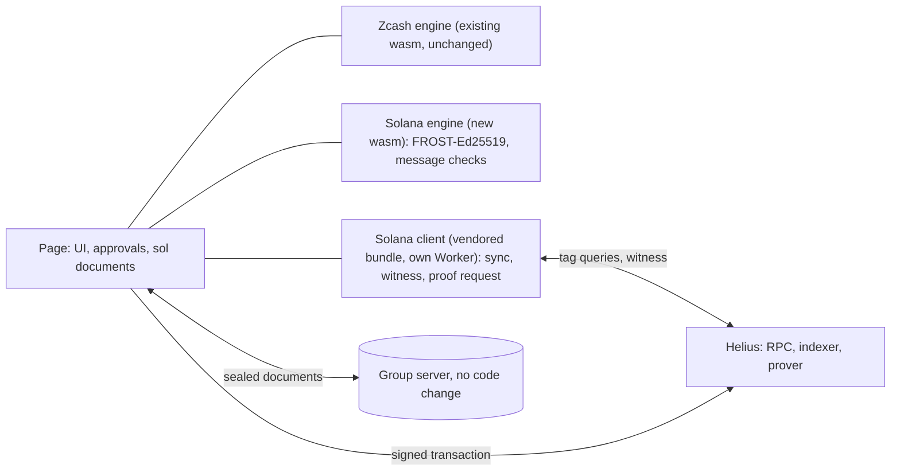

# Solana in Zigs: design

Status: beta in the web app, for testnet wallets only (Devnet). The design spike ran from 13 to 15
October 2026 and its results are in section 6. The beta adds no iPhone or Mac work: those apps have
no Solana part. The work that is still open is in `TICKETS.md`.

The beta switches:

- `SOL` in `vars` of `cf/wrangler.jsonc`. The value `"1"` makes the Worker serve `web/sol/` and
  `/sol/config.json`. Any other value makes every `/sol` path answer 404, and the page says "Solana
  is not available on this server".
- `HELIUS_DEVNET_URL`, a Worker secret. It is the Helius Devnet URL with its API key. The Worker
  gives it to the page at `/sol/config.json`, behind the password gate, with the header
  `Cache-Control: no-store`. Without the secret that path answers 503, and the page says "Solana is
  not available on this server". In local development, the secret goes into `cf/.dev.vars`.
- The Solana tab shows for every version 3 wallet whose network is `testnet`. The network is the
  first one that the device saw for the wallet: the group document has no signature, so a later
  value in the store never counts (PROTOCOL.md section 15.1). A mainnet wallet, a wallet before
  version 3, and a wallet that is not loaded yet, never load `/sol` and never show the tab.
- The page loads `/sol` before the tab opens only when a seat signed `solstart/1`. A start
  document without a valid signature of seat 1 loads nothing.
- The browser has no switch. The spike flag `zf-sol` and the spike setting `zf-sol-rpc` are gone.

The question: can a Zigs group also hold private Solana balances in Zolana, the Helius shielded pool
on Solana (Apache-2.0, beta, Devnet only)? The group key would be a FROST-Ed25519 key and the
Zolana owner. The outside evaluation of 12 October 2026 [E] says yes. This document treats every
claim of [E] as unverified until a primary source confirms it. Section 8 defines the source keys.

## 1. What the evaluation got right and wrong

| Claim of [E] | Verdict | Evidence |
|---|---|---|
| The pool separates a signed fee payer from separately signed owners, and the proof binds both. The Rust builder takes `owner_signers` | Confirmed | [Z]programs/shielded-pool/src/instructions/transact/account.rs:21-63; transact/verify.rs:238-262; sdk-libs/program/src/instruction/transact.rs:45-53 |
| A test signs with extra native signers | Partly. No caller passes extra signers: two wrappers pass an empty list, and `rfq.rs:96` sets `owner_signers` directly. The cosigned test has a payer that also owns an input. No passing case had a payer with no input. A Devnet simulation of 16 October passes with one (6.11) | [Z]program-tests/test-utils/src/wallet/actions/transaction.rs:569,627; sdk-tests/rfq/tests/rfq.rs:22-125 |
| The TS SDK blocks owner != payer and omits owner signers. `LocalKeys.fromKeys` takes outside viewing and nullifier keys. Registration needs owner and payer signatures | Confirmed for the Default Ring at the first pin. The ring builder appends the owner signers. `fromKeys` never asks for a signing secret. Since #424 (`838aef27`) the helpers take a payer other than the owner and list the owner as an owner signer (section 5) | [Z]sdk-libs/ts/src/wallet/private-transaction.ts:114-120; interface/instructions/index.ts:431-531; transaction/wallet/keys.ts:129-153; programs/user-registry/src/instructions/register.rs:25 |
| The Default Ring hides amount, not sender. Custom Rings can be anonymous | Ring: confirmed. Anonymous: partly. The TS SDK supports confidential Rings only, and the anonymous rail needs P-256 ECDSA, so FROST-Ed25519 can never use it | [Z]docs/spec.md:186, 3036, 3041; sdk-libs/ts/README.md:358 |
| Transaction v1 and its 4,096-byte limit | v1 confirmed. The limit covers the whole transaction, not only the message | [Z]sdk-libs/ts/src/interface/transaction-size.ts:8-12 |
| Beta, Devnet, no audit established. The hosted program may differ from source | Beta and Devnet: confirmed. Audit: Helius says the rings undergo independent audits [H]. I found no report. Mismatch: refuted on 13 October (section 6.1). The deployed pool `sppU489…` and registry match the release hashes. `sppXZU59…` on the Helius address page is an older deployment | [Z]prover/tee/README.md:3; releases/tag/v0.4.0-alpha |
| Custody by a program-owned address (PDA) works | Confirmed on Devnet, 16 October 2026 (6.10). The SDK has `ShieldedPda` and `ShieldedAddress.forPda`, and `zolana-program` has a `transact` CPI that signs for a PDA. A deposit to a PDA owner and a spend through our program landed | [Z]sdk-libs/keypair/src/pda.rs:1-70; sdk-libs/program/src/cpi.rs |
| 10.4: a new blockhash may force a new proof | Wrong. The blockhash is not a proof input. Root history limits proof life. [E] misses the durable nonce | [Z]sdk-libs/client/src/client/transaction.rs:171-179 |
| 10.2 signs SHA-256 of the message. 10.3 checks amount and asset from the message | Wrong. FROST signs the raw bytes. The message holds only hashes and ciphertexts | [RFC]7.6; [Z]sdk-libs/ts/src/transaction/wallet/intent.ts:63-69 |
| 6.1: an audited dealerless DKG exists | Partly. The audit covers frost v0.6.0 and excludes re-randomized FROST | [F]README.md, "NCC Audit" |
| 6.3: secret-sharing the nullifier secret hardens it. 6.2: the viewing role reads history | No gain while a hosted prover gets that secret. The viewing key also reads outgoing payments | [Z]sdk-libs/ts/src/client/keys.ts:166-177; docs/spec.md:367-395 |

## 2. The product

A user opens a wallet with a Solana part. Devnet only. The Zcash part stays as it is.

- **Add Solana.** One key ceremony (section 4) and one registration. The wallet must be version 3.
- **See.** The owner address (the group key), the shielded address, the private balance, and the
  fee address of each seat of this browser with its public balance. The fee address pays the fees
  and the rents of the proposals that its seat makes (section 5).
- **Use.** Anyone deposits SOL to the group's shielded address. A member can add SOL from the fee
  address of its seat (Add SOL: no approval round, it is the member's own SOL). The group can send
  a private transfer to a shielded address, or withdraw to a public address.
- **Not offered.** SPL tokens, anonymous Rings, swaps, bridges, memos, a merge service, mainnet, and
  a transfer to an unregistered payee ([E] 9.3, not checked).

Helius runs the RPC, the indexer and the prover. The screen texts name the public parties. They do
not copy the Helius claim that the RPC cannot decrypt state, because the prover shares its URL:

| Screen | Text |
|---|---|
| Transfer | "Hidden on the public chain. Helius sees amount, asset and recipient while it builds the proof. Sender and recipient are public." |
| Deposit | "Sender, recipient, asset and amount are public." |
| Add SOL | "Moves SOL from the fee address of your seat into the shielded balance of the group. The amount and the sender are public. It needs no approval: it is your own SOL." |
| Withdrawal | "Recipient, asset and amount are public." |
| Add Solana | "Your Solana address is public. Each seat also gets a fee address, which appears on chain next to the group. The Zigs server operator can link this wallet to these addresses by timing. Helius sees that you use Zigs. A fee address needs a public SOL funding trail." |
| Fund card | "It pays the fees and the rents of the proposals that this seat makes. It appears on chain next to the group. Send Devnet SOL to it." |

| Property | Zcash (Ironwood, today) | Solana (Zolana Default Ring) |
|---|---|---|
| Amount, asset | Hidden | Hidden on chain in a transfer. Public in a deposit and a withdrawal [Z]docs/spec.md:3036-3041 |
| Sender, recipient, and the link | Hidden | Public: payer and owner signer are in the account list, the owner key tags the output [Z]programs/shielded-pool/src/instructions/transact/verify.rs:238-262; docs/spec.md:402 |
| Spends linked to the group | No. `alpha` is new for each spend | Yes. The group key is a stable tag. A FROST signature does not show a multisig |
| Member addresses next to the group | Not applicable | Each seat that proposes shows its fee address as the first account of the transaction, next to the group key. The address has a public SOL funding trail (a faucet or a transfer), so it links that member to the group. Add SOL shows the amount and the fee address of the member as the sender of a deposit |
| Who sees the witness | Nobody. The proof runs on the device | The hosted prover: owners, assets, amounts, blindings, nullifier secret [Z]sdk-libs/ts/src/client/prover/client.ts:1215-1262; [H]integration/wallet. Local proving is listed as coming soon |
| What the index learns | IP address and blocks. Trial decryption runs on the device | Tag queries (the owner key), IP address, timing, Merkle proofs of inputs, and the app `Origin` header, which Allowed Domains needs |
| What the group server can link | Nothing it can match to the chain | The time of its `sol*` writes matches chain time. That links the wallet id to the owner key and the full history |
| Custody | Fewer than `t` seats cannot spend | The same for the seats. But the pool upgrade key can replace the pool, and the protocol authority can pause trees (section 7) |

The prover cannot spend. Spending needs the owner signature [Z]docs/spec.md:310-314. The group
server sees paths, timing and sizes, never keys or amounts. Every seat can read the whole Solana
history.

## 3. Architecture in the web app

**3.1 Separate module, separate keys.** Web files go under `web/sol/`. The engine is a new crate
with its own `Cargo.lock` and wasm file. The Zcash engine, its lockfile and its 7.6 MB wasm stay
unchanged. Two files keep the Zcash audit scope apart. A Zcash-only user never loads the Solana
code. The pin is `frost-ed25519 =2.2.0`: the newest 2.x, and the version whose `lib.rs` I read [F].
It needs `frost-core ^2.2.0` and `frost-rerandomized ^2.2.0` [CIO]. Version 3.0.0 exists (crates.io,
23 April
2026) and I did not read it. I did not run `cargo check` on this pairing.

**3.2 What Solana shares with the wallet.** The roster, the approval screens, the group server and
the signed writes of PROTOCOL.md section 15. Seat Ed25519 keys sign the Solana documents. The group
key never signs a document.

The server accepts a document only at a path with an even number of segments (`apply()` in
`cf/src/index.js`). The client `sub()` reads collections at odd depth. So `groups/<id>/sol/dkg1/<i>`
fails. The Solana documents use flat names: `solstart/1`, `soldkg1/<i>`, `soldkg2/<i>-<j>`,
`soldone/<i>`, `solfee/<i>` (the fee key of a seat, section 5), `solsessions/<id>`, and
`commits/<i>` and `shares/<i>` below `solsessions/<id>`. The server needs no code change. The web
app reads the names with its own reader in `web/sol/docs.js` (the `FLAT`, `DKG2` and `IN_SESSION`
expressions and the collection list), so `web/signed.js` and the Zcash baseline hashes stay as
they are. Old apps and the iPhone and Mac readers ignore them.
`web/test/signed.mjs` asserts that each `sol*` path has an even number of segments.

**3.3 Who does what.**

- **Solana wasm:** DKG, nonces, shares, aggregation and strict verification. Role secrets. The v1
  message parser. The Poseidon and ciphertext recompute. The program ids and trees of each cluster.
- **TS bundle, in its own Worker:** sync, UTXO decryption, witness, prover call, `transact`
  instruction. The page passes it the two role secrets for one session. It never gets the FROST
  share, `solSeed` or the nonces (3.6). A bad bundle can leak history or propose a bad message. It
  can get a signature only if the message check of section 5 has a hole.

**3.4 The bundle.**

| Topic | Plan or fact |
|---|---|
| SDK version | The bundle is built from commit `c232da1b` of the Zolana repo [Z2] (SDK 0.5.0-alpha, unreleased in its changelog). It is the newest main commit that the live Devnet pool can serve (6.10). The design cites the older commit in [Z]. The npm release 0.4.0-alpha (7 October 2026) is older than both. It differs. Its `endpoint.js` has no `/v1/zolana/` path [UNPKG]. Its release notes say that the prover fetches Merkle data, needs `PROVER_INDEXER_URL` and serves `/prove/<key>` [Z]releases/tag/v0.4.0-alpha. P4 records the host and path of each call. The CSP host does not change with the path, but Allowed Domains behavior may |
| Why a TS bundle | `zolana-client` needs `hpke`, `dcap-qvl`, `tokio` and `solana-transaction`, and the repo has no wasm build [Z]sdk-libs/client/Cargo.toml. The smaller crates `zolana-hasher` and `zolana-transaction` hold the Poseidon and UTXO hash code. I did not build them for wasm32. P3 tries them first |
| Import chain | `src/index.ts:1` leads to `src/client/prover/tee/dstack.ts:1`, which loads `@phala/dcap-qvl`, a CommonJS package. An import map needs an inline script, which the CSP forbids |
| Build | One esbuild bundle in `web/sol/`, its SHA-256 in the repo, and a script that rebuilds it. The build changes no SDK source. It has no plugin and only maps module names, and a test checks that every SDK file in the bundle is its blob at the pin. Two aliases stand in for modules that cannot load in a Worker: `@phala/dcap-qvl` goes to a stub that throws on every call, and a bare `crypto` import in `@hpke/common` goes to a stub with no value. A third alias takes the slim build of the hasher package. The newest SDK proves through an attested enclave by default. The Worker passes the Helius gateway as `proverUrl` and `proverTee: false`, so no other host is called and the policy of the Worker script stays as it is (TICKETS.md SOL-4). A stub that returned would let an enabled policy claim an unchecked attestation |
| Hasher wasm | The slim build is 20 KB of script and 1.28 MB of wasm, not the 4.39 MB fat build [UNPKG]. It loads the wasm with `fetch(new URL(..., import.meta.url))`, and the SDK calls `loadHasher()` with no argument [Z]sdk-libs/ts/src/hasher/index.ts. esbuild does not emit that file. The build copies the two wasm files next to the bundle under the names that the package gives them, so the default URL finds them and no source is patched. It also cuts the home path of the upstream author out of the panic text of each wasm file (same length, so every offset stays valid), and `SHA256SUMS` pins the cleaned files |
| Packages | 12 direct runtime packages and the `@solana/kit` peer. The root `package-lock.json` at the pinned commit lists 84 packages that the SDK reaches, with peer and optional edges. I read the file and ran no install. The SDK declares `node >=24` and I found no `node:` import. P3b tests it in a browser |
| Size | Budget: the Solana wasm at most 1.5 MB, and the bundle at most 1 MB without the hasher wasm. Measured: the checker wasm is 597,533 bytes (6.7); the minified bundle is 851,099 bytes and the hasher SIMD wasm 1.28 MB (6.8). At the pin of [Z2] the bundle is 856,921 bytes. P8 measures load time |

**3.5 CSP and the Helius key.**

| Topic | Plan or fact |
|---|---|
| Host | `connect-src` (`policy()` in `cf/src/index.js`) gains the Helius Devnet host over https and wss. RPC, indexer and prover share it under `/v1/zolana/` [Z]sdk-libs/ts/src/endpoint.ts:12-34. `script-src` and `worker-src` need no change. `policy()` is one policy, so a Zcash-only user gets the wider `connect-src` too. The other choice is a build flag and a second deploy |
| Key | The key sits in the URL query, so the first version uses Allowed Domains [H]rpc/protect-your-keys. It limits use by other sites. It does not protect the key, because a script that copies the key from the page can send any `Origin`. The app sends `Referrer-Policy: no-referrer`, and I do not know if Allowed Domains reads `Origin` or `Referer` |
| Proxy | None in the Zigs Worker. A prover proxy there sees the witness. An RPC proxy links wallet ids to the owner key |
| Doc work | Done for the beta. `README.md`, `PRIVACY.md` and `PROTOCOL.md` (section 10.1 and section 16) name the Helius host and say what it sees. The link rows of section 2 are in `PROTOCOL.md` section 16 |

**3.6 State.**

| Topic | Plan or fact |
|---|---|
| Secrets | The Solana key package, `solSeed`, role secrets and FROST nonces go into the seat secret with `putSec(gid, seat, patch)` in `web/app.js`, under new field names. The passkey lock, the tab sync (`TAB_KEYS`) and the backup then cover them. They never go into IndexedDB, because a same-origin Worker can read IndexedDB but not `localStorage`. The device saves the nonces with the message digest before it publishes (PROTOCOL.md 7.3) |
| Snapshot | UTXOs, cursors, spent flags and the plaintext of open sessions, sealed with a key from `solSeed`, in a new IndexedDB store `sol`. `idb()` opens version 1 and creates only `chain`, so it must open version 2 with an upgrade step. A tab that stays open on version 1 blocks the upgrade (`onblocked`), so it must close its connection and ask for a reload. A device with no snapshot rebuilds it from the indexer. A session plaintext leaves the snapshot only after the indexer output decrypts to it |

## 4. The second DKG, key roles and backups

**4.1 The ceremony.** It runs on the same seats, after the wallet exists. It does not touch the
Zcash key. Each step writes a signed document (3.2).

| Step | Document | Content |
|---|---|---|
| 1 Start | `solstart/1` | Cluster (4.4). A seat refuses unless the wallet is version 3 and the safety number that the device computes now equals the number its person confirmed. That number covers the wallet id, `t`, `n`, `network` and every box key (PROTOCOL.md 4.1). Testnet gives Devnet. A mainnet wallet gets no Solana. The ceremony needs all `n` seats. A seat on an app without Solana support writes nothing. The wallet page then shows "Seat N has not started" for each seat with no `soldkg1` document |
| 2 Round 1 | `soldkg1/<i>` | The `frost-ed25519` round-1 package and a commitment to a fresh 32-byte part `rSol`. The commitment is BLAKE2b-256 with the personalization `Zigs_SolCmt___v1` over the wallet id, seat, box key, cluster and `rSol` |
| 3 Echo | none | BLAKE2b-256 with `Zigs_SolEcho__v1` over the wallet id, safety number, cluster, and every package and commitment, in seat order |
| 4 Round 2 | `soldkg2/<i>-<j>` | A box with the share and `rSol`. The box context carries a curve label (`<id>:sol:<i>-><j>`). Today's context `<id>:<i>-><j>` would let a Zcash box open here |
| 5 Round 3 | none | Each device checks the echo and every commitment, then builds its key package, the group key and `solSeed = BLAKE2b-256("Zigs_SolSeed__v1", walletId, echo, rSol_1 … rSol_n)` |
| 6 Done | `soldone/<i>` | The group key, public key package, `nullifier_pk`, `viewing_pk`, shielded address, cluster and a version label of the program ids. The PDA identity of 7.2: the PDA, its `nullifier_pk`, its `owner_hash` and its shielded address. The ids are in the wasm. A label that differs from the label of the wasm aborts the seat. Seats compare all `soldone` documents. A seat whose `soldone` is from before the program design publishes it again with the PDA identity |

The safety number needs no change: the roster is the same, and step 1 checks it again. The echo and
the `soldone` agreement bind the Solana values to that roster. `rSol` never reuses the Zcash `r`
parts, `vaultSk`, `sk` or `qsk`. A recovery under ZIP 2005 may hand `qsk` to a host wallet
[ZIP2005], and one disclosure would then expose both chains. A signature cannot seed the roles,
because FROST signatures differ each time [Z]sdk-libs/ts/src/client/keys.ts:161-195.

**4.2 Key roles.**

| Role | Held by | The holder can | Rotation |
|---|---|---|---|
| Ed25519 key share | One seat each | Give one share of a signature | New group key and a migration spend |
| Nullifier secret (31 bytes) | Every seat and the Worker | Build proofs, compute spent status. Cannot spend [Z]docs/spec.md:352-358 | Never in place [Z]programs/user-registry/src/instructions/update_keys.rs:32-38 |
| PDA nullifier secret (31 bytes) | Every seat and the Worker | The same, for the funds of the PDA identity (7.2, option D). The PDA signature authorizes a spend | Never in place |
| Viewing key (P-256) | Every seat and the Worker | Read incoming and outgoing UTXOs | With an owner signature |

The engine derives both secrets from `solSeed` with Zigs labels, not the `TSPP/*` labels. The
viewing scalar is HKDF output of 48 bytes reduced modulo the P-256 order
[Z]sdk-libs/ts/src/keypair/derivation.ts:222-227,309. A separate check requires 1 <= k < n
[Z]sdk-libs/ts/src/keypair/viewing-key.ts:52-59.

| Topic | Rule |
|---|---|
| No registration | The beta never registers the group. The PDA identity of 7.2 needs no record: the pool and the indexer accept a PDA owner with no record (6.10). Nothing signs the old `register` intent (`intent-retired`). A record would be permanent and public: `register` fails if a record exists, `update_keys` refuses a new nullifier key, and no operation deletes a record [Z]programs/user-registry/src/instructions/register.rs:36-42,57-60; docs/spec.md:2805. Payers use the full shielded address of the PDA identity |
| Refused by default | `set_merging_enabled(true)` and `update_keys` are separate intents with their own screens. The first version does not offer them. `merging_enabled` stays false, the registration default [Z]programs/user-registry/src/instructions/register.rs:60 |
| Merge | When `merging_enabled` is true, anyone can submit `merge_transact` with no owner signature [Z]docs/spec.md:2270-2274. A merge consolidates inputs into the same owner, so no funds move. It does spend the inputs of an open proposal, and the proposal then fails. That is a denial of service. The group merges with a normal approved self-transfer |
| Members | A removed member keeps the secrets and reads the history permanently. A member change needs a new wallet and group key (PROTOCOL.md section 8) and one approved payment. That payment links the old key to the new key in public |

**4.3 Backups.** The Zcash `.zigsbackup` and its restore stay unchanged. The engine seals an opaque
plaintext string, and restore reads a fixed list of fields and drops the rest
(`wasm/src/backup.rs`).

| Design | Result |
|---|---|
| Second file, kind `zigs-sol-backup`, same Argon2id and XChaCha20-Poly1305 format and passphrase rules (PROTOCOL.md section 9) | Cost: a second file and a second passphrase. Recommended, because one file would hold the keys of both chains |
| Solana fields inside the plaintext of the existing file | `v` stays 1, so iPhone and Mac restore still opens it. A re-backup there drops the Solana part without a warning |
| `v: 2` in the Zcash file | The engine refuses `v` other than 1, so restore breaks on iPhone and Mac |

The second file holds the key package, public key package, group key and `solSeed`. It holds no
fee key: the key share gives it (section 5), so the restore of any file, also one from before the
fee keys, brings back the key that the seat published. Restore and Fit check that the key share
equals the `soldone` entry and that `solSeed` gives the published keys and address, and the PDA
identity too when the `soldone` names one. When a valid
`solfee/<i>` shows another key than the key share gives, that document is forged or broken: the
restore says that this seat cannot pay, that it can still approve and sign, and that the other
seats can propose and add SOL. The snapshot is not in the file. A restored seat that has
`soldone/<i>` on the server and no Solana key package shows "Solana part missing".

**4.4 Version marker.** An old app ignores the Solana documents, so the wallet document needs no
marker. Recommended: `solstart/1`, signed by seat 1, and no change to the wallet version.

## 5. The signing flow

Since SOL-36 a private payment follows the program design of 7.2: the group signs the digest of a
proposal account once, and a seat executes it later with a fresh proof. 5.1 gives that flow. The
flow below with a nonce stays for two intents only: the nonce account and the one-time move of the
beta funds to the PDA address. Add SOL keeps its own row.

The flow follows PROTOCOL.md section 7. The message is a v1 transaction. Its bytes show no amount or
recipient, and its life depends on a nonce, an expiry and roots.

1. **Propose.** A seat enters kind, payee and amount. The payee is a full shielded address
   (`owner_hash` and `viewing_pk`). A registry lookup may fill the form, but registry reads are not
   authenticated [Z]docs/spec.md:2811. The Worker syncs, picks UTXOs, builds the plaintext outputs
   and ciphertexts, and asks for the proof. The fee key of the proposing seat is the payer (see the
   fee payer row below), so the proof binds the payer and the group key as owner signer. The wasm
   compiles the v1 message from a fixed template. The smallest listed `transact` (2 in, 4 out)
   takes 1,278 of 4,096 bytes [Z]docs/spec.md:1811.
2. **Publish.** `solsessions/<id>` holds the intent, plaintext outputs, input UTXO ids, the
   ciphertext salt, the message bytes and the signature of the payer on them (`feeSig`: the wasm
   signs it with the fee key after the checker accepted the bytes). The proposer signs this
   proposal part (PROTOCOL.md 15.5).
3. **Check, on each approving device, in the Solana wasm.** Every rule that applies to the intent
   must hold. The approval screen shows the payee fingerprint, the amount, the computed change, the
   fee, the expiry and who pays ("Fees paid by seat N" with its address).

| Rule | Check |
|---|---|
| Instructions | Parse the message as v1, write it again, and compare the bytes with the received message. The ordered list equals the list of the intent (second table). Every account has its pinned address, signer flag and writable flag. Any other program, discriminator or account is refused. The wasm holds the program ids and trees |
| Signers and payer | Exactly two signers: the payer first, which is the fee payer, then the group key (the payer alone for Add SOL). The payer is the fee key that the proposing seat published in its signed `solfee/<i>` document: the page takes it from that document, never from the proposal, and the checker requires it as the first account (`fee-payer-not-payer`). The group key is never the payer (`payer-is-group`). It is a readonly signer in every instruction, so no instruction can take its lamports, and no System `Transfer`, `CreateAccount`, `CreateAccountWithSeed` or `TransferWithSeed` may name it as funder (`group-debit`). The payer signature on the message bytes must verify (`verify_strict`) under the published fee key. Add SOL has no group account |
| Limits | The v1 config mask sets the loaded-accounts limit (bit 3), or the wasm refuses the message (6.3). Priority fee and compute units stay under the fixed maxima of the template. Unknown mask bits and `ComputeBudget` instructions are refused. `transact` uses the Default Ring with no `ring_config` and no cache. Any other v1 config value is refused. `expiry_unix_ts` is finite: proposal time plus the expiry window. 0 and `u64::MAX` are refused |
| Outputs | Each output is the payee, the change to the group `owner_hash`, or a true dummy (`DummyDomain`, owner 0, amount 0). Its `utxo_hash` equals Poseidon over the approved plaintext. For a move to a new wallet (PROTOCOL.md section 8), the payee equals the address that the approver's own seat in the new wallet checked |
| Legs, conservation | The legs equal the intent. The inputs from the device's own snapshot plus the deposit legs equal the outputs plus the withdrawal legs. The nullifiers equal those of the snapshot |
| Ciphertexts | `tx_viewing_sk` derives from `tx_viewing_secret` and the first nullifier [Z]docs/spec.md:383-398. The key schedule is deterministic [Z]docs/spec.md:707-725. The device recomputes every output ciphertext. It checks that `tx_viewing_pk` equals the derived key and that each owner tag equals the payee or the group key. The pool ignores output `data` [Z]docs/spec.md:1878, so a bad blob would land and hide the output from the payee and the other seats |
| Not checked | The Groth16 proof. A bad proof fails on chain, loses no funds and costs the fee |

| Intent | Ordered instructions | Legs | Outputs |
|---|---|---|---|
| Create nonce account (once) | `CreateAccountWithSeed` (funder = payer, base = group key, which signs as a readonly account), `InitializeNonceAccount` (authority = group key). Uses a recent blockhash | None | None |
| Add SOL (intent Shield) | Pool `deposit` (tag 15, no proof) from the payer. A recent blockhash, no nonce: the payer signs alone and the group does not approve | The deposit from the payer's public SOL | One output to the PDA identity (7.2) |
| Move of the beta funds (intent Transfer) | `AdvanceNonceAccount`, `transact` (payer first, the group key as owner signer after the nullifier accounts) | None | The whole balance of the group key to the PDA address, no change (`migration-payee`) |
| Propose (5.1) | The approvals program `create` (the payer funds the proposal account). A recent blockhash: the fee key of the proposing seat signs alone | None | None |
| Execute (5.1) | The Ed25519 instruction with the approval, then the program `execute` with the `transact` accounts and the owner PDA last. A recent blockhash: the fee key of the executing seat signs alone | None | Payee, change to the PDA identity, dummies |

Nothing signs the intents of the beta that the program design retired: register, a withdrawal and
a nonce cancel (`intent-retired`). Withdrawals wait for SOL-36 condition 1.

The wasm refuses these in every intent: a pool `deposit` (tag 15) outside the Shield intent,
`merge_transact` (tag 17), `update_keys`, `set_merging_enabled`, `WithdrawNonceAccount`,
`AuthorizeNonceAccount`, a System `Transfer` and `ComputeBudget`. The pool treats a relayer fee as a
withdrawal leg to any recipient [Z]docs/spec.md:2647-2660. Without the leg rule, a transfer could
pay an attacker.

4. **Approve.** The engine makes nonces and commitments and stores them with
   `BLAKE2b-256("Zigs_SolMsg___v1", cluster || message bytes)`, as Zigs stores the sighash today.
5. **Package, sign.** At `t` commitments with one digest, one device publishes the package. Each
   device re-parses the message, compares the digest, signs the raw message bytes and deletes its
   nonces before it publishes the share. The shares are for the group key only: the payer signed at
   proposal time. The group key has no domain separation
   [F]frost-ed25519/src/lib.rs:182-187, so it would sign any text. The engine refuses any bytes that
   fail step 3, the off-chain prefix (0xFF "solana offchain") and `TSPP/derive/` payloads.
6. **Combine, send.** Any seat aggregates, checks the result with `verify_strict` (never Web
   Crypto), adds the signature of the payer from the proposal, and sends at once. The transaction
   has two signatures in the order of its signers: the payer first, then the group key. The
   transaction id is the first signature, so it is the signature of the payer. The device tracks the
   transaction by that signature and writes a signed `sent` part after confirmation.

A recent blockhash lives about 60 to 90 seconds [SOL]. Zcash approvals take hours. The target is a
durable nonce, so the message is fixed at proposal time, as the sighash is in Zcash.

| Topic | Rule |
|---|---|
| Expiry | `transact` carries `expiry_unix_ts`. The program checks it and the proof binds it. The SDK default is `NO_EXPIRY`, which is `u64::MAX` [Z]sdk-libs/ts/src/transaction/instructions/transact.ts:250,346. `finalize()` of a transfer fixes `u64::MAX`, also at [Z2] (transact.ts:1530), and no setting changes it (only `Merge.withExpiry`). The Worker needs no patch for this: `web/sol/transfer.js` builds the transfer with public classes, rebuilds the external data with `createExternalData` and the expiry, proves the new proof inputs with `client.proveTransact`, and `prepare` reads the expiry back from the instruction data. The expiry window is 24 hours (proposal) |
| Cancel | A signed, unsent transaction is valid until the nonce advances, the expiry passes or the root goes stale. The group server holds the signature shares under the wallet secret. Any seat, former seat or link holder with `t` shares can aggregate and send until then. So cancel is advisory once `t` shares exist (PROTOCOL.md 7.7). The screen says "cancelled" only after the nonce advanced or the expiry passed. To cancel early, the group runs a FROST session over `AdvanceNonceAccount`, because the group key is the nonce authority. To cancel late, it waits |
| Nonce account | One account allows one open Solana payment. Rent is 1,056,640 lamports on Devnet (6.3). The first transaction creates the account, so it uses a blockhash, and `t` devices sign inside the blockhash lifetime. A nonce with a v1 transaction works on Devnet (6.3) |
| Stale roots | A proof lives while its roots stay in history. The UTXO tree keeps the final root of the latest 500 slots with updates. The nullifier tree keeps its last 100 roots [Z]docs/spec.md:1454; program-libs/interface/src/state/tree.rs:9-14. Chain activity counts, not hours. A proposal ends at the earlier of the expiry and the stale root. After a stale root the proposer proves again. The new bytes give a new digest, so all signing rounds repeat and the old nonces go. P6 measured it (6.6): many hours on Devnet today, about 200 s with an append in every slot. After a pool update with #428 the nullifier tree keeps 5 roots of 4,999 nullifiers (6.10) |
| Fee payer | The owner decided on 16 October 2026 that a per-seat key pays the fees and the rents, and the group key never pays. Each seat has a fee key. The wasm derives it from the signing share of that seat: HKDF-SHA256 with an empty salt, the share as input key material, and the info `zigs-sol/fee-key/v1`, the group key and the seat (2 bytes, little endian). The output is the Ed25519 seed (`sol_fee_key`). So a second tab, a second browser and the restore of any Solana backup hold the same key, a group set up before the fee keys gets its key at the first run, and the page stores no fee key. No other seat can derive it: it needs the share. Any `t` seats can compute the share of another seat, but they can already sign for the group without it. The key never reaches the Worker: the wasm signs with it, and only after the checker accepted the exact bytes (`sol_fee_sign`). The seat publishes its public key in the signed document `solfee/<i>`, and only when no valid document shows a key for the seat. A valid document with another key than the share gives is forged or broken: nobody rewrites it, the seat shows "The fee document of seat N does not show the key of this seat" in place of its address, and that seat cannot propose or add SOL while that document stands. It can still approve and sign. A browser that holds several seats proposes and adds SOL with the first seat that holds a key share and whose document shows its fee key, and the Propose and Add SOL cards name that seat. An approver accepts a payer only if it equals that key of the proposing seat (`ss.by`, the signer of the proposal part). The payer funds every fee and rent of its seat's proposals: the nonce account (a rent that the nonce account keeps) and the registry record included. The priority fee is a total in lamports with no maximum, and SIMD-0385 is in Review with no feature gate [SIMD]. One proposal could spend the whole fee balance of its payer. So the template fixes maxima for the priority fee and the compute units. The values come from P2 and P5, which record the compute units and priority fee of each landed transaction. The cap is the largest recorded value plus 50 percent |
| SDK sponsor mode | The SDK supports a payer that is not the owner since `838aef27` (#424, in the pin): the built transaction lists the owner as a signer and `transactInstruction` takes `ownerSigners`. This replaces the patch in four places that this row named before, so the patch part of Helius question 7 needs no answer. `web/sol/transfer.js` builds the proof inputs with the fee key as payer, and `ownerSigners` there lists the Ed25519 input owners that are not the payer, as `ownerSignerAddresses` of the SDK does (the package does not export it; a test compares both). The checks against the deployed pool are in 6.11 |
| Proposals from before the fee keys | A proposal with no `feeSig` was paid by the group key. A sent mark of such a proposal counts when its id is the group signature, so a payment that landed still reads as sent. Such a proposal that no signature completed ends once, with the text "This proposal is from before the fee keys. Propose it again." A signed one gets one status read first: if it landed, the page writes the sent mark, and if it did not, nothing sends it (the group key would pay) and it ends with the same text |
| Old public SOL | SOL that the group key held before the fee keys stays on its address. The beta has no feature to move it (TICKETS.md SOL-38). Nothing pays from it any more, and the screen still shows its balance |

**5.1 Payments of the program design (SOL-36).** The fee key of the proposing seat pays the create
and the rent. The rent comes back to that seat at the execute. The group key signs no message.

1. **Propose.** The Worker proves the payment once for the PDA identity (`prepare` with kind
   `pay`, no owner signers: the program signs as the owner). The checker of the proposing device
   accepts it as an approver would (`check_payment`, with no chain state) and gives the
   commitment, the body and the proposal account. The fee key signs the create message, and the
   device lands it: a create that is not confirmed at once is read again until its blockhash
   ends. Then the seat publishes the proposal part: the intent (tag 8), the plan, the input ids,
   the salt, the transact data of the first proof, the account, the body and the id of the create
   transaction. The Worker takes a count of inputs that has a circuit with no dummy input, at most
   16: one `execute` carries at most 18 inputs, and the checker refuses more (`execute-inputs`).
2. **Check, on each approving device** (`check_payment`). The Outputs, Legs and Ciphertexts rules
   of the table above, on the first proof. The device recomputes `private_tx_hash` from the inputs
   of its own snapshot, the plan outputs and the blinding of the first nullifier, then the
   commitment. It reads the proposal account: the owner is the program, the address derives from
   the group key and the commitment, and the data is `[1, bump]` and the body. The body names the
   commitment, the group key, an expiry inside the window, and the fee key of the proposing seat as
   rent recipient and as the only abort authority. A seat refuses a second body for a commitment
   that it approved (one body per commitment). The screen shows the payee, the amount, the change,
   the rent, the fees, the proposal account and the public link of the fee address.
3. **Approve.** One FROST round over the 32-byte digest of 7.2. There is no nonce account and no
   message. The nonces are saved under the digest, and `sol_approval_share` signs only a digest
   that the checker gave for this payment.
4. **Execute.** A seat of a browser with a ready fee key executes: the proposing seat when this
   browser holds it, else the first ready seat. The Worker proves again with the same plan
   (`reprove`), and checks that the first proof and the new proof give the commitment of the body.
   The wasm compiles the execute message, checks that the approval verifies under the group key
   over the digest of the new data, and only then does the fee key sign. The executing seat pays
   10,000 lamports (two signatures) and the tree fee. Only a confirmed execute is a sent mark. A
   tab sends no second execute while its first one can still land (150 s; a blockhash lives 150
   blocks, about 60 to 90 s). An execute that fails on chain is a counted try, and the approval stays valid.
   After error 7008 (a stale root) the seat proves again. After 3 failed tries the card shows the
   error and a button. A proposal account that is gone (or holds no body) was executed by another
   device: the page reads the history of the account, oldest first, and writes the sent mark with
   the first transaction that carries the Ed25519 instruction of this approval. Before the expiry
   it reads the history again until it finds one. After the expiry it ends the session only when
   that history reaches back to the create and every transaction of it was read. One read holds
   1,000 transactions: a gone account with more later transactions on it reads as not complete.
   A signed payment ends at its expiry only after the page read its account (still open: the
   program refuses the execute), with a margin of 600 s for the clock of the device. A payment
   that nobody signed ends at the expiry and the same margin.
6. **One input, one payment.** A new payment avoids the inputs of the open payments (the Worker
   skips them). When a payment executes, every open payment over one of its inputs ends.
5. **The move of the beta funds** (SOL-36 condition 3). While the group key holds private SOL, the
   tab shows a card: first the nonce account if it is missing, then the move. The card counts only
   the UTXOs that a move can take (plain SOL of the live tree). The group key signs no other spend,
   so a UTXO of another kind (another tree, a token, data or a ring) stays at the old address. A move takes whole UTXOs, as many
   as one proof can (at most 16), and pays them to the PDA address with no change.
   A group key with more notes moves them in several steps, and a payment to the old address
   shows the card again.

Not built: withdrawals and deposits of public SOL through the program (SOL-36 condition 1), and a
cancel or close of a proposal (SOL-47). A proposal account that expires keeps its rent until its
abort authority (the fee key of the proposing seat) cancels it. So does a create that landed when
its tab crashed before it published the proposal part.

## 6. Devnet proof of concept

P1 to P3b need no Helius account. Scratch code stays outside the repo until a step passes.

| Step | Test | Acceptance | Needs |
|---|---|---|---|
| P1 | 2-of-3 DKG and signing with `frost-ed25519 =2.2.0`. Check each signature with `verify_strict` and with `verify_simd0376` (cofactored, rejects small-order or non-canonical A and R) through `solana-signature`. Run RFC 9591 E.1 inputs. Build for wasm32 | Every signature of a run of 100 passes both checks. E.1 matches, or the gap has a cause. The Zcash lockfile is unchanged | Nothing |
| P2 | On a public Devnet RPC (`getVersion` shows Agave 4.2.2 or newer): create the nonce account (`CreateAccountWithSeed`, base = group key). Send a group-signed v1 SOL transfer with `AdvanceNonceAccount` first, after 10 minutes. Send the same bytes twice. Test the loaded-accounts default of 0. Record the compute units and priority fee of each transaction that lands | Lands once. If v1 with a nonce fails, record it and test a blockhash transaction. The cap values of section 5 follow from the results | Devnet SOL |
| P3 | Solana wasm: v1 parser, byte-exact rewrite, policy, Poseidon and ciphertext check. First, run `cargo check --target wasm32-unknown-unknown` on `zolana-hasher` and `zolana-transaction`, and reuse them if they build. Vectors: `hash_vectors.rs` and TS SDK vectors (non-zero amount, SPL mint, change to the group) | Every vector matches. The wasm refuses a message that breaks any rule of section 5. It refuses a changed recipient, change owner, flag or account, and an extra instruction, leg or output. It refuses a bad ciphertext or `tx_viewing_pk`, wrong registration keys, expiry 0 or `u64::MAX`, the off-chain prefix, and any config outside the template. Wasm size is within the budget | Nothing |
| P3b | Bundle smoke test: esbuild bundle with the hasher wasm copy and the throwing stub. Load it in a Worker in a browser, start the hasher, run a sync against a mock server | No CSP violation, no `node:` import. The stub throws. Bundle size is within the budget | Nothing |
| P4 | Baseline: one ordinary key, the pinned main commit. Register, deposit, transfer, withdraw. Repeat with npm 0.4.0-alpha only if the main paths fail | Round trip passes. Record the live pool id, the program hashes against the release and the upgrade authority from `ProgramData`. Record proof time and size, and the host and path of each indexer and prover call. Record any fee inside the circuit, because the conservation rule needs it | Helius key, Devnet SOL |
| P5 | Group key as owner and payer: register, shield, transfer, withdraw | One share fails. A substituted payer or owner fails. The recipient reads the output. Every approving seat refuses a bad ciphertext. The compute units and priority fee of each landed transaction are recorded | Helius key, Devnet SOL |
| P6 | Root window in wall time. Approvals spread over one hour with a nonce | The stale-root path works: new proof, new digest, old nonces gone. The root window is at least the minimum approval time | Helius key |
| P8 | Web spike behind a flag: Worker bundle, CSP hosts, second DKG on three seats, registration, payment, backup, wipe, restore. Check if Allowed Domains uses `Origin` or `Referer`, covers WebSocket and needs a paid plan | No CSP violation. Restored balance equals the old one. Zcash tests unchanged. Load time is within the budget | Helius key (Allowed Domains) |

**6.1 Devnet facts, checked on 13 October 2026** (read-only RPC calls through the owner's Helius
Devnet key):

- The RPC answers `getHealth` with `ok` and runs Agave `4.4.0-beta.0`. That meets the 4.2.2 minimum
  for v1.
- Pool `sppU489…`: deployed at slot 508538476, the release slot. The SHA-256 of its ELF (cut at the
  size in its ELF header) equals the release hash `3641ffe2…`. Registry `regyS5rk…`: deployed at
  slot 503573056, and its ELF hash equals the release hash `2010baa2…`.
- Pool `sppXZU59…` also exists. It was deployed at slot 481005012, so it is the older deployment.
- All three programs have the upgrade authority `2kgbLowv…`. That address is a point on Ed25519, so
  it is an ordinary key pair, not a program address of a multisig. On Devnet one key can replace the
  pool.

**6.2 P1 result, 13 October 2026** (scratch crate outside the repo, `frost-ed25519 =2.2.0`):

- A 2-of-3 dealerless DKG gives every seat the same group key. 100 sessions (and 2,000 more in
  repeat runs), with messages of 1 to 4,096 bytes, pass frost's verify, `ed25519-dalek`
  `verify_strict`, Solana's `Signature::verify` and `verify_non_strict`. Changed messages,
  signatures, keys and a non-canonical S fail. An independent verifier re-ran the tests and the
  mutation checks.
- The RFC 9591 E.1 inputs give the RFC's group commitment, shares and signature byte for byte.
- The wasm32 build links the whole flow: 203,052 bytes after wasm-bindgen, 64,127 bytes gzip.
- Open: the SIMD-0376 item could not run, because no published crate has that function. The tests
  do not yet tell `verify` from `verify_non_strict` apart, and no test parses a real v1 transaction.

**6.3 P2 result, 13 October 2026** (public Devnet, solana-core 4.4.0-beta.0,
`solana-message 5.1.0`):

- The 2-of-3 group key funded, then created a nonce account with `CreateAccountWithSeed` (base =
  group key) and `InitializeNonceAccount` (authority = group key), signed by seats 1 and 2.
- Seats 2 and 3 signed a v1 transaction (version byte 0x81): `AdvanceNonceAccount`, then a transfer
  of 0.001 SOL. It landed 615 s after the signature, 2,640 slots after the nonce account, so far
  past any blockhash. The first signature on chain is the FROST aggregate. Fee 7,000 lamports (5,000
  base and the 2,000 priority fee set in the header), 300 compute units. The same bytes sent again
  did not land. Transaction `4tRzAK6V…dX7Z` on explorer.solana.com, cluster devnet.
- The v1 field "loaded accounts data size" must be set. At its default of 0, a transaction fails at
  load with `MaxLoadedAccountsDataSizeExceeded`, is still charged, and still advances the nonce. So
  one template mistake costs a fee and destroys every approval. This transaction loads 6,422 bytes.
- Nonce account rent on Devnet is 1,056,640 lamports, not the 0.0015 SOL assumed in section 5.
- Not measured: a fee cap for `transact` (P5). Legacy and v0 with a nonce were not needed.

**6.4 P4 result, 13 October 2026** (TS SDK at the pinned main commit, 0.4.1-alpha, Node 24, Helius
Devnet gateway):

- Two ordinary keys registered, A deposited 0.05 SOL, A sent 0.02 SOL privately to B (B synced and
  read exactly 0.02), and B withdrew 0.01 SOL to a public address. All six transactions landed the
  first time. An independent verifier re-checked them on Devnet and re-synced B.
- Compute units: registration 8,532 and 16,032, deposit 37,918, transfer 138,500, withdrawal
  142,587. The SDK asks for 450,000 for `transact` and sets the loaded-accounts limit to 64 MiB,
  with no priority fee. Fees were the 5,000-lamport base. Registration rent is 1,330,960 lamports
  per record.
- Proofs: one `POST /v1/zolana/prove` per spend, 297 to 436 ms, about 0.7 to 0.9 s with the proof
  data fetch. The proof on chain is 192 bytes. The request body is about 8.3 KB.
- What the hosted prover receives, by field name: input and output UTXOs (owner, asset, amount,
  blinding), Merkle and non-inclusion paths, and `nullifierSecret` in clear. Not the Ed25519 seed
  and not the viewing key. This confirms the privacy rows of section 2.
- All 120 calls went to one host, `devnet.helius-rpc.com`, with the API key in the query of every
  call, the prove call included. On the gateway the client fetches the proof data itself.
- No fee inside the circuit: inputs plus public amounts equal outputs, exactly. Tree 0 charges no
  fee today, but the fee authority can change that (`set_tree_fees`), so the conservation rule reads
  the fee schedule. The tree pays 701,040 lamports of nullifier rent per spent input.
- Corrections: the live instruction tags are deposit 15, `transact` 16 and `merge_transact` 17, not
  11, 12 and 13. The SDK keeps payer equal to owner and derives the signer and the shielded keys
  from one seed.

**6.5 P5 result, 13 October 2026** (the P2 group, the unpatched SDK for the main steps):

- The 2-of-3 group key, as owner and fee payer, registered, shielded 0.05 SOL with the pool deposit
  (tag 15), sent 0.02 SOL privately to an ordinary key (which read it), and withdrew 0.01 SOL. Each
  signature is a FROST session of a different seat pair over the exact message bytes, and verifies
  under the group key on chain. An independent verifier re-checked all of it and re-synced both.
- The SDK takes the group as an outside key set (`LocalKeys.fromKeys` with the group key as owner,
  and a kit signer whose address is the group key). The shielded keys came from a random `solSeed`
  with the SDK's own labels, through `roleExpansion`, which the package does not export.
- Refused as expected: one share alone (frost `IncorrectNumberOfCommitments`), a replaced owner or
  payer (simulation: `TransactProofVerificationFailed`), and a message changed after signing.
- Stretch: a private transfer with the durable nonce as lifetime and `AdvanceNonceAccount` first
  landed 301 s after signing, with a small patch to the SDK's compile step (lifetime setter only).
- Compute units of `transact`: 138,500 to 144,591, so the cap rule of section 5 gives about 217,000.
  The priority fee was 0. The prover got the group's nullifier secret, as in P4.
- Not tested: a seat refusing a bad ciphertext (needs P3), distributed seats (one process ran both
  seats), a separate fee payer, and the root window (P6, now in 6.6).

**6.6 P6 result, 14 October 2026** (the P5 group, FROST rounds split in time, a patched SDK compile
step):

- How a root expires. Both histories sit in the tree 0 account `33KVhbT4…`. The UTXO history has 500
  entries, one per slot with at least one append (deposit, `transact`, `merge_transact`); idle slots
  add none. The nullifier history has 100 entries, one per forester batch of 250 nullifiers, so
  25,000 nullifiers in all. The `transact` data carries one history index per tree, and the program
  reads the root at that index; it never searches. A stale root gives the ordinary proof error,
  custom 7008 (`TransactProofVerificationFailed`). So a device detects a stale root by the value at
  the index.
- Devnet activity is low. Over 24 hours the UTXO history moved 3 to 33 entries per hour, and the
  nullifier history moved about 0.2 batches per hour. The roots of all five P4 and P5 proofs from 13
  October were still valid the next morning.
- Run 1: an approval over one hour. Seat 1 made its FROST commitment at 07:13 UTC, seat 2 at 07:43,
  and both signed at 08:13. The transaction landed at once: `4CyFR9Ld…` on explorer.solana.com,
  cluster devnet. It had the template of section 5: `AdvanceNonceAccount` first, a durable nonce, a
  finite expiry of 24 hours, v1 config mask 12 (compute limit 217,000 and the loaded-accounts limit,
  no priority fee). It used 142,007 compute units and a fee of 5,000 lamports. B received exactly
  0.001 SOL. The tree did not move during the hour, so run 1 proves the nonce flow, not the root
  window.
- Run 2: a forced stale root. Both seats committed to a new proposal. Then 510 pool deposits from
  one key, about one per slot, moved the UTXO history out past the proof's root in about 4.5 minutes
  (107 to 119 entries per minute), for 0.0078 Devnet SOL. At the next sample the device saw the
  stale root (simulation error 7008). Both seats deleted their nonces for the old digest, and a sign
  request on the old bytes failed on both seats. The device proved again in 0.98 s. New bytes, a new
  digest and a new FROST round followed, and the transaction landed 8 s after the detection:
  `3dbRcEbV…`, cluster devnet. Both transactions are finalized, and each first signature verifies
  under the group key (checked again with Node's Ed25519, outside the spike code).
- What this means. The window counts pool activity, not time. On Devnet today it lasts many hours.
  One sender alone shortened it to about 4.5 minutes. With an append in every slot it is 500 slots,
  about 200 s; the repo doc says about 100 s. A 30-minute approval cannot keep its proof on a busy
  pool. Then the proof must be rebuilt, and the new bytes need a new signing round with `t` devices
  online at the same time (run 2 needed about 1 s for that round). Whether people must approve
  again, or their devices sign again for an approved intent, is an open design point. Helius
  question 6 asks for the mainnet root window.
- The numbers above are those of the pool that runs on Devnet today. The nullifier history has 5
  roots of 4,999 nullifiers after #428, and 6.10 gives the facts.

**6.7 P3 result, 14 October 2026** (a Rust crate outside the repo, an independent verifier per
half):

- The checker runs the structure rules of section 5 (P3a) and the Outputs, Legs and Ciphertexts
  rules (P3c): 76 rules, each with a named test, 83 after the fix round below. It is one wasm file
  of 506,694 bytes (176,753 gzip), 597,533 bytes after the fix round, under half of the 1.5 MB
  budget. A trimmed copy of `light-poseidon` keeps only the widths 2, 3, 4 and 8; the whole crate
  makes the wasm 1.78 MB. `zolana-hasher` builds for wasm32 as is; `zolana-transaction` needs three
  `getrandom` changes, so the checker does not use it.
- Vectors: the repo vectors, five TS SDK vectors (non-zero amount, SPL mint, change, dummy), the
  real P5 data and both landed P6 messages match. Every P5 message, built with the SDK defaults, is
  refused (no nonce, 450,000 compute units, no expiry). Both P6 messages are accepted.
- The template accepts the v1 config mask 12 (no priority fee) or 15 (a priority fee up to 3,000).
  Compute units must be at least the largest recorded use (a lower limit fails on chain and burns
  the nonce) and at most that plus 50 percent.
- Facts from the code: every output is encrypted alone with AES-256-CTR and no tag; integrity comes
  from the `utxo_hash`, which the proof binds. The tree insertion fee comes from the payer's public
  SOL, so it is not part of shielded conservation; the check caps and shows it.
- The first verifier found four false accepts in P3a (output fields not read, no compute floor,
  circuit counts not compared, a repeated nullifier). P3c fixed all four. It also found a
  funds-relevant hole during its own work: the payee keys came from the untrusted plan. The transfer
  intent now carries the full payee address.
- The second verifier found one fail-open rule (a spend with no inputs skips the ciphertext rule; it
  cannot land and moves nothing) and gaps that can hide a payment or waste a fee: the asset-id table
  and the group's public keys come from the snapshot and are not pinned; output blindings are not
  recomputed; no supported-shape rule; a reused salt is not refused; the Register keys are not
  compared with the snapshot.
- Fix round (a third verifier checked it): every rule fails closed when its data is missing; the
  wasm takes the group key, `nullifier_pk` and `viewing_pk` as pins, and the snapshot secrets must
  derive them; asset ids are pinned per mint (84 Devnet mints); every output blinding is recomputed
  from the root blinding seed of the plan; the 38 supported circuit shapes are pinned; the dummy-tag
  rule equals the circuit; an all-zero or reused salt is refused; the Register keys are compared on
  every link; the approval screen echoes the withdrawal recipient and the expiry. Now 83 rules, 267
  tests, 113 mutation cases killed, and a wasm of 597,533 bytes (209,285 gzip), 40 percent of the
  budget.
- Still open: a dummy placed before a real output is accepted, though the circuit refuses it (it
  costs the fee and the nonce, no funds); the minimum remaining life of an expiry and the tree fee
  cap are product values; the 89 bytes of a dummy blob are free. The landed P5 and P6 messages no
  longer pass, because their root blinding seed was never recorded; they pass every other rule. The
  salt history must cover every proposal on the group server, not only those of one device.

**6.8 P3b result, 14 October 2026** (esbuild, headless Chrome 155, a local mock of the Helius API):

- One minified ES-module bundle of the SDK at the pinned commit is 851,099 bytes (249,826 gzip,
  204,682 brotli), under the 1 MB budget; the unminified build (1.73 MB) is over it. The slim hasher
  has two wasm files: SIMD 1.28 MB (Chrome loads this one) and a SISD fallback of 1.99 MB. The
  bundle has no `node:` import and no import at all, after two aliases: `@phala/dcap-qvl` and a bare
  `crypto` import in `@hpke/common` go to stubs that throw. Only the minified hash is the same in
  every checkout location.
- In a module Worker under a strict CSP, the stub throws, the hasher starts, and a sync of key B
  from a replay of one real Devnet sync gives 0.035 SOL, the same as Node. No CSP violation. Against
  the Zigs policy exactly as `policy()` builds it, only `connect-src` must change.
- The SDK opens no WebSocket: confirmation polls over HTTP, so `wss` is probably not needed (P8
  confirms). Each sync sends three CORS preflights; P8 must check the answers of the real Helius
  host.
- Zigs sends its CSP on the page only. A Worker loaded from a URL takes the policy of its own script
  response, so the Zcash `web/worker.js` runs with no CSP today. A header on the Worker script
  response alone binds the Worker and every module it imports.

**6.9 P8 progress, 15 October 2026** (the web app in an isolated local clone, behind
the flag `zf-sol`; local server only, never deployed; one independent verifier per step):

- P8a: the clone, a Zcash baseline gate (11 tests, 17 file hashes, the served security headers) and
  a headless harness with three seats in three in-memory browser contexts. The Zcash tests and
  hashes stayed equal through every later step.
- P8b: one Solana wasm (`wasm-sol`, 982 KB) with the message checker, FROST-Ed25519 DKG and split
  signing, the role derivation and the template compiler. The checker gained the circuit's
  dummies-last rule and byte-exact pin tests; a separate verifier signed that delta (125 mutation
  cases killed). The hardening round moved the echo check into round 3 and added a constant-time
  share check and the program-id label.
- P8c: the SDK bundle (856 KB) runs in its own Worker, which alone talks to Helius. Only the Worker
  script response carries the Helius host; the page policy is byte-identical to today's. With the
  flag off, no `/sol/` file is served. Read-only live check on Devnet: 30 of 30.
- P8d: the second DKG on three seats, the Solana documents with their own reader, the Solana secrets
  in one sub-object of the seat secret (left out of the Zcash backup), a sealed snapshot in its own
  IndexedDB database, a separate Solana backup file with a share check on restore, and a stop that
  holds everywhere. Flag-off load cost: +1.2 percent (budget 5 percent).
- P8e: signing sessions in the page (propose, approve, package, share, aggregate, send, track), a
  signed abort document, single-use FROST nonces, and an approval screen built from the checker
  result. The app landed its first Devnet transactions, each signed by a different pair of seats:
  create the nonce account (`5cipks9L…`), register (`efuf187T…`) and shield 0.02 SOL (`3c6UNDnG…`),
  after a funding transfer (`Ctt2Q4M6…`). Every first signature verifies under the group key, the
  registry record equals the agreed keys, and the Worker reads 0.02 SOL. The verifier found two
  session bugs, fixed in P8f: a wallet stopped watching after 50 session documents, and sessions on
  a used nonce never ended.
- P8f fixes: D1, the page now watches only the valid sessions that did not end, at most 50, and an
  ended session gives its watches back. D2, when a transaction lands, every other session on the
  same nonce ends, from the signed documents alone (no RPC read).
- P8f could not use the P8e group. Its seats were in memory only and no backup was saved, so its
  funds stay on Devnet with no key: 0.02 SOL shielded and about 0.0276 SOL public (owner
  `4wP3MjZB…`). A new group with the same setup landed the funding, nonce, register and shield
  transactions again.
- P8f payments, 2 of 3, to the Devnet key B. 0.005 SOL signed by seats 1 and 2 (`4eT1KehY…`, slot
  511294980, 138,650 compute units). After the restore, 0.002 SOL signed by seats 2 and 3
  (`xJejBEJL…`, slot 511295710, 140,391 compute units). Each fee is 5,000 lamports, each lifetime is
  the nonce, and each first signature verifies under the group key. B rose by exactly 0.005 and
  0.002 SOL. The private balance of the group fell to 0.003 SOL, then to 0.001 SOL. The full
  signatures are in the run record of the spike, which this repo does not keep.
- The first try of the payment stopped before it landed. The page compared the asset field of the
  prover body with the asset id 1, but the prover writes the hash of the zero mint. The fix
  (`80a0ddb`) compares with that hash, and a test and a mutant pin it.
- Restore rehearsal: each seat saved a Zcash file and a Solana file, each with its own passphrase.
  The three contexts were wiped, three blank contexts restored from the files, and all three showed
  0.003 SOL at slots 511295612 to 511295645, after the backup slot 511295531. The second payment
  then landed from the restored seats. The verifier repeated the rehearsal without a landing: the
  same keys and 0.001 SOL on all three seats.
- The P8f verifier passed with gaps: no defect, but four mutants survived, because only the live
  landings tested the signing path of a payment. A follow-up closed the gaps offline. A test group
  from the real ceremony and a payment that the TS SDK built for it run through propose, approve,
  share, aggregate and send against a fake chain. The four mutants now fail their tests. The
  baseline gate runs the eight Solana page tests (19 tests in all) and stops on an unlisted test
  file. The harness drives five restore refusals in Chrome: a wrong passphrase, a changed file, the
  Solana file of another seat, the Solana file before the Zcash seat is restored, and the Solana
  file of a seat whose address check did not settle. Flag-off load cost after the `/sol` route
  change of the cf Worker: +2.4 percent (budget 5 percent).
- P8 acceptance: every item is met except one. The Allowed Domains check of the Helius key was not
  tested in the spike. The owner set Allowed Domains afterwards (see the end of this section): the
  key accepts only calls that carry the origin of the app, and the SDK opens no WebSocket.

**6.10 SOL-35 result, 16 October 2026** (approvals owned by a program, design in 7.2; Devnet; the
program built with Agave v4.3.0 and platform-tools v1.54; the TS SDK of 6.4 with the P6 patch, so
no enclave prover; the P6 FROST signer; scripts, keys and logs outside the repo; one independent
verifier who did not write the code). Times are UTC.

- Accounts. A new 2-of-3 group `BizreUUhg8ZvHPizeud9PNvz6Mmdi1vpFZc5yXYjYj3T` (one process ran the
  DKG and all seats, as in P6). Owner PDA `UgrqxxdDh3m4pf1DLYGw6fnzk9NGuWJaUnerUp4Mxqd`. Executor
  `KhqYMWsaqeyiauSYLg3tNKWc7hek3RwHQHeaHLCKgNM`. Payee: the P4 key B.
- Program `5PHZEHBMaYbFL9SFmMyP8kUayh3TFEyq2dvEYY3UGjkL`, upgrade authority
  `GJhYtqujKfJAx1rwTLYBU3P2DaGKzX6zoYvGuX3J8SX9`, ProgramData
  `Hvx5yPwtdauXsvqt3tg2Fh3RJniFRiDg3KnspuqzL4M6`. Version 1 (47,512 bytes, SHA-256 `3406e00c…`):
  `4iaLoojZKTnmcSfc6AgzHWVnVsK6CD3aqUMjMoNVP8WHCwicRgqhGhqsXADrrMNiNtRJ6kgmoYsjSBHgbGv54Nsd`, slot
  511635048. Version 2 (48,312 bytes, `555f4580…`, the fix of 7.2):
  `2hFbQWxixGA9Wx8cA3Y9XE81Cte5B7EgmQH2YLSfrmnZqVyT4oDpSTvuyQbC7pg5RMhGA2pxnAg4KCCo8wFCaLHk`, slot
  511646368. ProgramData holds 57,752 bytes: the version 2 ELF, then 9,440 zero bytes. The verifier
  rebuilt both versions from a clean Zolana clone and the build patch and got the same bytes as the
  chain (with the author's cargo registry and the extracted toolchain).
- A PDA owner needs no registry record. The funder deposited 0.003 SOL to the PDA's shielded
  address
  (`3xYk6a7g9AGUeU7SwXcyevYanKsvkiC5Z8VdieDNZhDcP63ycFzvo7GXVYSxp6yz2nnSgn8nuGfRv1H7sJEAAYFb`),
  and a sync of the PDA identity returned it within 25 seconds. The executor got 0.02 SOL
  (`29UHe4nPCWzH28FEvXTCR2jSyKPcthPupdZx2SVZ3eggo32TeA9L6Qj5W31WrqXvqaY8emXSTbHxD4vRBrgJLAmX`).
- Track "main", the stale-root test. The proposal of a private payment of 0.001 SOL to B, with a
  24-hour expiry:
  `35FG2hXHBCXXfqEh19nZ5LbDTCTfdr8zXWGVf6oBY8AE6hsyzrH88ko4iabmNdWWJxuhE9DizTHcqguRxaZcC4E8`
  (07:33:44, proposal `cNe4cyrPUvAKtK3ooosCHN62jBT16ry9UoXL7zYyFuB`). Seats 1 and 2 signed the
  approval digest at 07:33:52 (run log). Proof 1, made then, used UTXO root index 273. The execute
  with proof 1 simulated with no error at 07:42 and again at 09:18: Devnet was so quiet that the
  root stayed live for almost two hours. Then 460 pool deposits from the funder to key A (09:18:23
  to 09:21:47, slots 511663169 to 511664017) wrapped the 500-entry history, and entry 273 held
  another root. The execute with proof 1 then simulated with custom 7008 in the pool. The pool has
  no stale-root error: it reads the history entry by its index, so an overwritten entry gives a
  proof failure. A new process rebuilt the plan, got the same commitment, and proved again (root
  index 280). The payment landed with the approval of 07:33:52, and no seat signed again:
  `2bJ4T8yWYGkZZxhRvboDw9qJm6ctmvu8zXAyBnwZ8VvpXZEvuVMe1RGiFvst9T38b2PwQ6nwMBgTd6Ht4Smxd2CV`,
  slot 511667384, 09:35:08, 2 hours 1 minute 24 seconds after the proposal was created (the run log
  has the approval 8 seconds after the creation). 151,437 compute units (140,236 of
  them in the pool). Fee 10,000 lamports: 5,000 for the executor's signature and 5,000 for the
  Ed25519 verification. B's private balance rose by exactly 0.001 SOL (the verifier synced B). The
  run's wallet sees 0.002 SOL of change for the PDA; the verifier, without `solSeed`, saw two
  outputs, one tagged with the PDA. The proposal closed and paid its 1,356,360 lamports of rent
  back.
- What the chain proves about time. The proposal was created at 07:33:44 and the payment landed at
  09:35:08, 2 hours 1 minute 24 seconds later. The chain cannot show when the group signed: the
  signature appears first in the execute, and its digest needs only data that existed before the
  create. The run log, the signature file and a simulation at 07:34:06 put the signing at 07:33:52,
  but the same machine wrote all three. The design does not depend on that time: the digest binds
  no root, blockhash or nonce, so until the proposal's expiry the age of a signature cannot make it
  fail. A product that must prove the signing time can publish a hash of the signature on chain
  when it signs; track "emain" below does that.
- Track "D", the option D identity on the same PDA (7.2). A deposit of 0.003 SOL
  (`3jgCEKu1HdVvjzhsP7SX51F6eLxRM6S3DX1MyiUYBrUnSxqdx2oTqBNDXciQZdaBGZXxNSH2NfWELDfZ5gMvZ7Cd`), the
  proposal of 0.001 SOL to B
  (`2W6BV6Srq6QcabWKGhgkuAyH2r7ZK4LNYGyKjRGSsr3geRa3BL39629oHkJ9523d5V2ygERfJcH5XVCm8Ef26uiQ`,
  08:18:27, proposal `3Sx7fRxAs6UggGCyS8YUMhX6XFvBx1R25ysAiqa9pvFU`), and the approval of seats 2
  and 3 at 08:18:29 (run log). The same forcing made its proof 1 (root index 275) stale, and the
  execute with it simulated with 7008. The payment landed with a fresh proof (root index 288):
  `5Gw2h3D95sZuMTxUYiDYXBS6K8ZUmUNzGNAGNH2j2Ej5v2vSsYNDB2zbwzx6uFB8De8P31tpN98u1QWJ333dQtrk`, slot
  511678600, 10:19:39, 2 hours 1 minute 12 seconds after the proposal was created; 151,077 compute
  units, fee 10,000. B
  rose by exactly 0.001 SOL. So the hosted prover, the pool and the indexer accept a PDA owner that
  signs by CPI with a non-zero HKDF nullifier secret. The verifier recomputed both option D keys
  from the seed with its own code: they equal the keys in the group address, and the owner hash
  equals the owner of both option D deposits.
- Track "emain", the signing time on chain. The option D identity got a second deposit
  (`2cxLDiD2sHbiCpzGGWukT4gBFxY5aw8cgj38qCYDhfzErUZVtCRSnftnupvg5vZetQAPZfSC72N36g6uXYigh2kP`), so
  this proposal spends another input than track D's: two proposals of one group were open at once
  over disjoint inputs, and both landed. Proposal
  (`34cnjAcL7SEVcGj5ibpYj5Mvz2MEUQoFsYBHEAimWGQpWkuCLbNGgH1JWG1reSUZFEuBso51Mk4MaCn2L54xhXWr`,
  09:41:26, proposal `Hx3FNn24BPrvwScKpy6FFXBdobJb1cnSbVMxQWuRJREV`), approval by seats 1 and 3,
  then a Memo with the SHA-256 of the approval signature
  (`4LXWVWaTcs8dYUjuGJxejSvLy4TJa6Y2y2scuNvVGKn2HcmnJmVfXF9QSkwGRUVeZ22ZfE69ds8nm62m93NTzzNR`,
  slot 511668987, 09:41:29). 500 deposits (11:28:19 to 11:32:01, slots 511695872 to 511696801)
  made its proof 1 (root index 282) stale; the execute with it simulated with 7008. The payment
  landed with a fresh proof (root index 283):
  `23uKtB13ZDoGb7wDhW2yMYw1hSpTafg86FW1QdBAK9rxB9n1ZxRf5JFVSS5ykBF7pkhGoSC1KrwSmfhRFswCYeqe`,
  slot 511699612, 11:43:11; 148,450 compute units, fee 10,000. The SHA-256 of the signature in its
  Ed25519 instruction equals the memo hash. So the chain proves that the approval signature
  existed 7,302 seconds (2 hours 1 minute 42 seconds) before the execution. B rose by exactly
  0.001 SOL, and the proposal closed and paid its rent back.
- Every Devnet signature of the spike accounts (funder, executor, program, ProgramData, upgrade
  authority, owner PDA, proposals): 1,102 transactions from slot 511634145 to 511699612, all
  without error; the verifier listed and checked them. The 20 named ones are in the bullets above.
  The rest are bulk:
  - deploy of version 1, 68 transactions (buffer creation and writes; the deploy transaction is
    named above), slots 511634145 to 511635043, first
    `2k6NpaTBnk6AQMXqatDqTKMJUfLFXtxZNsQVFVj7GQJcmyrnbm1g9Giiv2SDz1YShFHeaZRTJ3oumCAESCvbqLwZ`, last
    `g7QzXrUi5bhJMpt4RMMAqPBqPma7Xk7enXjYwWgReNEihJgTapLWQSD1tzjDZiS66MUuamtqNMzGR1rTWvJ6QRi`;
  - upgrade to version 2, 54 transactions, slots 511645780 to 511646360, first
    `3TmsbMoQ9DFoDbjDh9kczkg9qpRU4rnpHupfXhty6cRXwUUaSEYFZgdwcJrJ4kXycAbNg9k3wpigh4u9Qfb3hsg`, last
    `517sA4GDosVtF1HXsGAuvPCCihecXkP2wY2QqMsjo7ijRnTdH3JW3ubzaquQpqsnA4hpaRXbRtGYZPdWeo3ohoKY`;
  - forcing for tracks "main" and "D", 460 deposits, first
    `3xD1X6Fb4ojAH5QE1tyzkRutyDzZA5btsqzMciMgiGAqFUvr4jYUJ41yAdjBYS2FSdFj7SfA1MjZ1Lvi8WEDjQf1`, last
    `yxjVEgnzJyj4XzJ8ZRS6NQYFfTJH8ZynnwgTuFfRjVdoF1Rh7Mvj5uxCH8HmUev9F1LS93fSLNvPps6LTuBak8W`;
  - forcing for track "emain", 500 deposits, first
    `4VC5G24yG9PMEDm2BtFjoiNrRHQGGTMHNTirapW9SJnU6ecjSpyR6fLL7yucBE7R7kZY5DCavjjwv56BcHa8cTFh`, last
    `5AGyMio52Y5fy7Qie2nEywKCvSukEL8t4QpdJ2bfi7kaB7ApsfRKb97YtaYbLuuBAqLAsj3euvWw3HJzak7h2Z4y`.
- Cost. Fees: 6,150,000 lamports (0.00615 SOL), all spent value. Held as rent: 295,092,120
  lamports (0.295 SOL) in the program and ProgramData accounts. `solana program close` with the
  upgrade key returns the ProgramData rent (294,259,000; the 833,120 of the program account is
  not shown to return), but then no one can sign as the PDA again, so the 0.006 SOL of change
  that the PDA identities still hold could never move. Moved between spike keys, not lost: 0.02 SOL
  to the executor, 0.009 SOL deposited to the PDA (0.003 SOL of it paid to B), and 0.00119 SOL of
  forcing deposits to key A. Each proposal holds 1,356,360 lamports until execution or cancel.
- Before each send, the verifier simulated the saved proof-1 and fresh-proof transactions (7008 and
  no error), read the root history (no entry still held the proof-1 root), and recomputed the
  commitment from both: the two `transact` payloads differ only in the 192 proof bytes and the root
  index.
- Refusals, simulated against the live proposal of track "main" (they cost nothing and change
  nothing). On version 1, at 07:35, the program refused with its own code: a changed amount, a
  changed payee and a changed pool expiry under the same approval (6014); an approval signed by the
  executor key, and the approval of another proposal (6012); no approval instruction (6011); an
  extra read-only pool account (6016). The verifier added an extra signer, a doubled owner, a
  dropped owner and a moved owner (6016). On version 2, at 08:12 to 08:13: a precompile-valid
  approval in a layout other than the pinned one (6012); an approval that is not directly before
  `execute` (6011); a wrong cancellation address (6007), rent recipient (6010) or owner PDA (6015);
  a cancel by a key that is not an abort authority (6017). Version 2 changes only `create_pda`,
  and the main execute simulated again on it. The precompile refused a changed signature byte. A
  fresh proof with another payer (the funder) passed, so the approval does not bind the executor.
  This spike did not repeat the one-share test of P5.
- Expiry and cancel, on chain. A proposal with a 150-second expiry
  (`4uRTg6e9yfqcxtfUJ7hLU7CNV6xHPkwLPARtGX7nqFDXHPt8rUvChxB2PDKMFkXfJTTXpDe2wy4rLEUcET8ZLNy9`) was
  refused after its expiry (6009), then closed by anyone with no record
  (`vE3cKKgCywwjFuwy8HGiQWKX9UvEqDPhPh3PSuVDwYT8ujimxG3vfCM8CNAeB9qze2778vgvcYXUYw9g2godqMe`). A
  second proposal
  (`664JXZE388yxhXeg7gdcT7EJvq8VQDUvZ171YaAtihn9Q5uMaXaKJh95Va1rSUKtVsCHtMsKuQhyA2SPjfpscSv3`)
  was cancelled by its abort authority
  (`3Y5gqjf9WuP6bhZV1SAy18NH9wWoy1HchzcZGEtRvvDGMdf62tL42iyc8J2eB6YwWMXbkJeBF9cxstz4NLsJZenP`),
  created again at the same address with the same body
  (`2tpDEzyCMoDYZdFWMtRzFNykLK9sCnXGuJbbx2zdpZ1qDEkuLFVvV8AxkHBnHrGauykEDFgHYDGebp15uJEVXYgD`),
  and its old approval was then refused (6008). After the expiry, the new copy
  (`4eum1PmXJn1TQpdZMzs8WUK4URf4n5RYufEpNBYxUndxHxmbBACxvNAFJkH6x57C8pFFDyt8RJWuNh9gfdCPBBbM`) and
  the record
  (`3JG1MgeTQYvyNTZkT3239TrJaKqeQAr8fjZ2LiysDjsmXH39XhXxxNWyUAxZDukN5aaAP41eGdyWZZ7cdM199w48`)
  closed and paid their rent back.
- The verifier read the source against the pool and the spec, and found no path to move PDA funds
  without an approval of that exact payment, and no replay. This assumes that the pool and its
  circuit bind `private_tx_hash` as [Z]docs/spec.md says: the circuit source is not in the pinned
  checkout, and the deployed pool binary was not compared with the source. It found one Medium
  defect in version 1: a SOL transfer of at least 650,240 lamports to the cancellation address of
  a proposal blocked its cancel until the expiry, and the payment stayed executable; the same flaw
  hit `create` (Low). Version 2 fixed both, and the verifier passed the fix (rebuild, review, and
  pre-funded cancels and creates in simulation). Low and informational points are in 7.2: one body
  per commitment, a rent recipient that is never a program account, and the deviations of
  `cancel`. Not covered by a control: 6000 to 6006 (the `create` refusals), 6013 (a withdrawal
  leg), 6018 to 6020.

Stop rules: the plan stops if P1 fails strict verification, P4 fails on the hosted deployment, or P5
fails. It also stops if P6 measures a root window shorter than the minimum approval time (proposal:
30 minutes). One approval round cannot finish then, so the plan changes to a one-sitting flow with
`t` devices online. A no to question 6 selects the blockhash fallback (section 5).

The owner provides a Helius account, a Devnet API key (I created none) and Devnet SOL. The key is
never committed. In the spike, the developer entered it in a local browser setting. The beta serves
it as the Worker secret `HELIUS_DEVNET_URL` at `/sol/config.json`. It is then public to every user
of the page, guarded only by Allowed Domains. The owner checked that guard on 15 October 2026: a
call with the origin of the app gets 200, a call with another origin or with none gets 403, and
the CORS preflights pass.

**6.10 SDK move, 16 October 2026** (the bundle at `c232da1b`, no SDK patch):

- The newest commit of main is `8178be7c` (14 October). Four commits follow the first pin
  `89640630`: `838aef27` (#424, a sponsor can pay the fee), `c232da1b` (#419, proofs go to an
  attested enclave by default, breaking), `9704a6cd` (#428, nullifier batches of 4,999) and
  `8178be7c` (#426, several recipients in one transfer). The npm release 0.4.0-alpha is older than
  the first pin, and there is no newer release or tag.
- The bundle cannot take `9704a6cd` or `8178be7c` yet. #428 changes the tree account from 40,080 to
  18,608 bytes and the batch verifying key, and its changelog says to point the client at a
  deployment made with it. The pool on Devnet is still the release of 13 October (deploy slot
  508538476, read on 16 October). Its tree 0 has 40,080 bytes, and the newest SDK refuses it
  (`decodeTreeFees`: `INTERFACE_INVALID_ACCOUNT_DATA`), so the Worker could not read the tree fee.
  `programs` and `program-libs` are equal at `89640630` and `c232da1b`, so `c232da1b` is the
  newest commit that the live pool serves. TICKETS.md SOL-37 moves the pin after a Devnet update.
- The enclave prover is off. #419 sends the proofs of a Helius Devnet URL to the enclave host
  `d55y5ksdsm1vw.cloudfront.net`, unless the caller names a prover. The Worker names the gateway
  and sets `proverTee: false`. Proving works as before, and the Worker policy has no new host. A
  test checks both settings, and that the fetch guard blocks the enclave host.
- The two patches of the earlier bundle are gone. The hasher URL rewrite is not needed: the two
  wasm files keep their package names. The expiry setter is not needed: the Worker binds the
  expiry with public API (3.4, section 5). `build.test.mjs` fails when a patch comes back: every
  SDK file in the bundle must be its blob at the pin, and the bundle must equal a plain esbuild
  build of the pinned commit.
- Live check on Devnet, with no state change. Key B built the proof inputs with a finite expiry
  in the code of the bundle. The Helius gateway proved them in 0.77 s. The signed v1 transaction
  ran on the live pool in a simulation with no error (138,355 compute units).
- #428 and the nullifier roots. The program keeps `B / Z` roots in the nullifier history, with a
  forester batch of `Z` nullifiers per root and a queue of `B` (`NULLIFIER_TREE_*` in
  program-libs/interface/src/state/tree.rs, [Z2] and `8178be7c`). Before: 100 roots, `Z` = 250,
  `B` = 25,000. After: 5 roots, `Z` = 4,999, `B` = 24,995. A proof stays valid while its root is
  among the last 5, so the window is 24,995 nullifiers (5 x 4,999), against 25,000 (100 x 250).
  The window is the same in nullifiers, in 5 steps instead of 100. One root now covers 4,999
  nullifiers. The UTXO history is unchanged: 500 slots with an append. The time that a proof
  lives depends on the nullifier rate. This is not measured, because no pool with #428 is live.
  The at-cost fee falls from 108 to 90 lamports per nullifier, and creation of a tree needs 2
  steps in place of 4.

**6.11 Fee payer and the SDK, 16 October 2026** (the code of the page, the bundle at `c232da1b`,
the pool that runs on Devnet; no state change):

- A sponsor key that holds no input paid, and key B (a registered key) signed as owner signer.
  `transactInstruction` with `ownerSigners` lists the payer (signer, writable), the output tree, the
  pool, the System program, the input tree, one nullifier account and then the owner (signer,
  readonly). The program reads the same order (`transact/account.rs`: payer, trees, nullifier
  accounts, then the signers up to the first account that does not sign, then the settlement
  accounts). The accounts of the `transact` of the template equal the SDK list in order and flags.
- The signed transaction ran on the live pool in a simulation with the signatures checked: no
  error, 140,236 compute units, a proof in 0.85 s. Helius question 1 is answered: a payer with no
  input and a separate Ed25519 owner passes. The test did not land a transaction.
- The other changed layouts ran on the live runtime in simulations too, with the signatures
  checked and a throwaway key as the group: the nonce account that the payer funds and the group
  key signs as the base of the seed (message of the wasm, 2 signatures, 300 compute units), Add SOL
  (message of the wasm, the payer alone, 37,910 compute units), and `register` with a payer that is
  not the owner (the SDK builder, 5,537 compute units). The accounts and the data of the template
  `register` equal those of the SDK builder. A signature of the wrong key fails each message.
  The `register` message of the template (AdvanceNonceAccount first) needs a nonce account, so
  only its instruction ran, as the SDK builds it.
- The proof binds the signer chain: the payer in slot 0, then each other input owner. The same
  proof with no owner signer, with the owner as payer and with the two keys swapped fails with
  7008 (`TransactProofVerificationFailed`).
- A v1 transaction with two signatures is the message, the signature of the payer and the
  signature of the owner, as kit writes it. The id is the first signature.
- With a sponsor the SDK writes every owner tag inline (account 0 would name the payer) and names
  the group key in each dummy output (`dummyOwnerTag` takes the first input owner that is not the
  payer). The checker follows: the group key is always a participant for a dummy.
- The newest SDK again: main is still `8178be7c`, npm latest is still 0.4.0-alpha with no newer SDK
  release tag, and the Devnet pool is still the release of 13 October (deploy slot 508538476, tree 0
  of 40,080 bytes). The sponsor code (`interface/instructions`, `client/prover/assembly.ts`,
  `transaction/instructions/transact.ts`, the `transact` and registry programs) is the same at
  `c232da1b` and `8178be7c`, so this design carries to the pin of SOL-37. One new branch is not
  merged: `alex/x25519-everywhere` (16 October) moves viewing encryption to X25519. Its tag
  `custom-ring-keys-v19` is a GitHub prerelease of rotated custom-ring proving keys, not an SDK
  release. It changes `ViewingKey` and shielded addresses, and its changelog tells users to migrate
  P-256 viewing keys. If it reaches main, the viewing key of 4.2, the 99-byte address and the
  ciphertext rule of the checker (P-256 ECDH) change. SOL-37 watches it.

**6.12 SOL-36 live run, 16 October 2026** (the page of the SOL-36 branch at commit `52a12b0`,
under the origin `https://app.zigs.app` on a local server; three seats in three browser contexts;
the program version 2, whose ELF hash `555f4580…` was checked before the run). One new 2-of-3
group, PDA `9gk8NEZU…`:

- The new group showed no move card and had no nonce account. The fee addresses of the three
  seats got 0.015, 0.003 and 0.002 SOL from the funder.
- Add SOL: seat 1 deposited 0.01 SOL to the PDA identity (`2N3aUnJ7…`), signed by its fee key
  alone. The private balance read 0.01 SOL.
- The one-time move: the funder deposited 0.003 SOL to the old address of the group key
  (`5n5BZHcG…`), as the beta funds of an older group. The move card showed. Seats 1 and 2 created
  the nonce account (`5FhQ8WRy…`), then seats 2 and 3 approved the move (`ZCQuN9xx…`, slot
  511,779,352: the fee key of seat 2 and the group key signed). The private balance read 0.013
  SOL, and the card was gone.
- Payment A, 0.002 SOL to key B: seat 1 proposed and created the proposal account `HAFDtgjH…`
  (`5SsHttLT…`). Seat 1 approved. 31 s later the account was still open and nothing had
  executed. Seat 2 approved, and seat 1 executed with a new proof (`3a9vJRko…`, slot 511,779,630,
  one signature, 10,000 lamports, 152,320 compute units).
- Payment B, 0.001 SOL to key B: seat 2 proposed (`3y1P31GH…`), and its browser context was
  closed at once. Seats 1 and 3 approved, and seat 1 executed (`xL39Ura1…`, slot 511,779,902,
  148,577 compute units). The rent went back to seat 2: its fee address paid 15,000 lamports of
  fees in all.
- The chain, read with the kit decoder and Node's own Ed25519 (not the code of the page): each
  execute has the Ed25519 instruction just before `execute`, with the group key and the digest
  of 7.2 over the body of its create; the signature verifies; the proposal account is gone; key
  B rose by the amount; the body of 137 bytes names the fee key of the proposing seat as rent
  recipient. No console problem on any page.
- Cost: 23,020,000 lamports from the funder. A first run stopped after the funding on a wrong
  text pattern of its own driver; its 33,000,000 lamports stay on fee addresses whose key shares
  were in memory only. No proposal account of the program is open after the run.
- The code after QA round 1 (`eae7b5e`): three new browser contexts restored the seats from their
  Zcash and Solana backups and read 0.01 SOL. Payment C, 0.001 SOL to key B: seat 1 proposed
  (`2CBdLzVD…`), seats 2 and 3 approved 30 s apart, and seat 3 executed (`2qTtkN5X…`, slot
  511,799,024, 148,334 compute units). The rent went back to seat 1. No funding was needed.

## 7. Risks, questions and recommendation

| Risk | Fact |
|---|---|
| Maturity | Alpha SDK. Beta, Devnet only. Helius says audits are in progress. I found no report and no `SECURITY.md` in the repo. v0.3.x clients stopped working at v0.4.0-alpha |
| Custody | The pool is a loader-v3 deployment with a non-zero upgrade authority [Z]docs/spec.md:1578. A 2-of-5 Squads protocol authority can pause trees and rotate every authority [Z]docs/spec.md:1497-1520,1581. The fee authority can claim tree lamports [Z]docs/spec.md:1597. The guarantee that fewer than `t` seats cannot spend covers only the seats. The PROTOCOL.md section 13 text must not carry over unchanged. The Details screen shows the upgrade authority that P4 records |
| Message check | It is the only spend gate. A hole in it lets one bad proposer, with `t-1` approvers who trust the check, get a signature. The check is new code, and a bug gives a false accept or a false refuse. The test vectors and P3 bound this |
| Prover | The hosted prover sees the witness. No browser prover is merged. A research branch reports 232 ms with 18 threads and needs cross-origin isolation and keys of 7.6 to 37.3 MB per shape [Z]branch feat/mopro-browser-arkworks. A TEE prover is opt-in and off by default [Z]prover/tee/README.md |
| Signature rules | P1 passed on 13 October (section 6.2). Validators call `Signature::verify` (solana-perf 4.4.0-beta.0 sigverify.rs:48). In solana-signature 3.6.0 and solana-ed25519 0.2.4, the newest published, it is `verify_dalek`: strict, cofactorless, rejects small-order A and R and non-canonical S. No published crate has `verify_simd0376`; the code says the switch to the ZIP-215 path comes with the SIMD-0376 cleanup. Re-run P1 when a release has it |
| Privacy | Sender and recipient are public. The group tag is stable and the registry record is public. Helius sees the group key, the witness and the app origin. A user who reads "private" may expect Zcash privacy |

**Questions for Helius.**

1. Answered on Devnet (6.11): a payer with no input and a separate Ed25519 owner passes in a
   simulation. Does one land?
2. Answered on Devnet (section 6.1): `sppU489…` is the release. Who holds key `2kgbLowv…` on
   mainnet?
3. Do the services run on mainnet? Is there a free tier, a rate limit and a CORS header for
   browsers? Does Allowed Domains cover `/v1/zolana/` and WebSocket, read `Origin` or `Referer`, and
   need a plan?
4. Does the gateway serve `/tee/v1/attestation`? When does local proving ship?
5. What is the audit scope? Who holds the pool upgrade key, and is there a timelock?
6. How many roots stay valid? Is a durable nonce with a v1 transaction supported?
7. Answered by the SDK since #424 (section 5, SDK sponsor mode): no patch is needed. Can you sign
   a release manifest?

**Helius answers, 15 October 2026** [HA]. The project asked about long approvals, caching, nullifier
roots, transaction lifetime, key management, output checks and browser proving.

| Topic | Answer | Effect on Zigs |
|---|---|---|
| Long approvals | Write a small Solana program, as in [HM]. It solves the nullifier expiry, with no durable nonce and no cache account | The main redesign: section 7.1 |
| Custom rings | They will verify an EdDSA signature in the circuit, which solves expiring nullifier roots. Helius thinks about the same for the Default Ring | Watch; it could remove the program later |
| Caching | It lets a client prove without the state root of a UTXO. Fully supported; Helius fixes SDK gaps. It does not solve the nullifier root expiry | Not the fix for long approvals |
| Durable nonces | Deprecated next year | The beta flow (section 5) has an end date: ticket SOL-36 |
| Key derivation | The protocol does not enforce how the viewing and nullifier keys are derived | Our own roles from `solSeed` (4.2) are fine |
| Output checks | Clients must check outputs and ciphertexts. No change planned | Keep the checker rules of section 5 |
| Browser proving | It exists, but it is slow. Speed is on the roadmap | SOL-4 stays open |

The owner decided on 16 October 2026 not to ask questions 2, 3 and 5 (key holders, mainnet
service, audit). They stay open as risks: the custody and maturity rows of the risk table.

Question 1 has a partial Devnet answer (6.10): a `transact` with a payer that owns no input and a
separate owner landed, with the owner as a PDA that our program signs for by CPI. An Ed25519 owner
that signs as an extra signer of the outer transaction (the "Later work" row of section 5) stays
untested.

**7.1 Next design: approvals owned by a program** [HM]. The shielded UTXOs belong to a program
address that the program derives from the group key (`[b"multisig", group key]`). A proposer creates
an immutable proposal account that holds a hash of the transaction contents. The FROST group signs
that hash once, as a detached Ed25519 signature. Roots, witnesses and the proof are not in the hash.
At execution, any executor makes a fresh proof, adds an Ed25519 verify instruction with the group
signature, and calls the program. The program checks the signature and the hash, and settles
through the pool by CPI. An expiry time and abort authorities end a proposal.

| Problem today | With the program |
|---|---|
| A stale root forces a new proof and a new FROST round (6.6) | The proof is made at execution, so the group signs once |
| The group holds a nonce account, which costs a rent (5). The fee key of a seat pays fees and rents | The executor pays the fees. No nonce account |
| Durable nonces end next year | Not needed |
| One open payment per nonce account (SOL-6) | One proposal account per payment |

What it costs: a program of our own on Solana, with its own upgrade key, review and audit. The
group address becomes a program address, so registration and every intent change. The proposal
account and the Ed25519 instruction are public, as the group key is today. The SOL-35 spike ran on
16 October 2026: 7.2 has the design and the decision, 6.10 the Devnet results.

**7.2 Design note: approvals owned by a program (SOL-35).** At [HM] the branch holds only
`min-multisig/spec.md`: no code and no license file. So the spike copies nothing from it. The
program is our own code. It reuses Apache-2.0 crates at the [Z] commit: the `transact` parser and
`ExternalDataPreimage` of `zolana-interface`, the `cpi` feature of `zolana-program` (up to version
4; version 5 makes the same CPI itself), and the precompile check pattern of the user registry.
Since 16 October 2026 the program is in `sol-program/` (condition 5 below). The spike scripts,
keys and logs stay outside the repo, as in section 6. The client is the TS SDK 0.4.1-alpha built
from the [Z] commit with the P6 patch (a settable pool expiry). That commit is older than the
enclave prover of Zolana main (c232da1b), so every proof went to the hosted prover with the
witness in clear, as in P4.

**The owner identity.** The PDA is the owner key (`ShieldedAddress.forPda`, signature type `pda`,
curve tag 2). The nullifier secret is `HKDF-SHA256(solSeed, empty salt,
"zigs-sol/pda-nullifier-secret/v1" || PDA)`, 31 bytes, and `nullifier_pk` is its Poseidon hash
(option D of the nullifier-key note of 16 October 2026). The viewing key is the beta's
(`zigs-sol/viewing-scalar/v1`, 4.2). The secret does not authorize a spend: the PDA signature does.
So custody does not depend on it. The examples of [HM]'s repository use a zero secret instead. Then
anyone computes the nullifier of every deposit note: anyone links a spend to its deposits, and
after a program flaw anyone can prove a spend. With a derived secret, only the seats and the hosted
prover can do either. The program never reads or stores the key, and never calls `register`,
`update_keys`, `set_merging_enabled`, `merge_transact` or `deposit`. The spike ran two identities on
the same PDA: track "main" with the SDK's own labels (as in P5), and tracks "D" and "emain" with
option D exactly. Both secrets are derived and not zero.

| Account | Address (PDA of our program) | Content |
|---|---|---|
| Owner | `["multisig", group key]` | No data. It owns the group's shielded UTXOs and signs `transact` through `invoke_signed` |
| Proposal | `["proposed_transaction", group key, commitment, SHA-256(body)]` (version 2: no body hash) | `[1, bump]`, then the body: commitment, group key, expiry, rent recipient, count, up to 4 abort authorities. Nobody can change it |
| Cancellation | `["cancelled_transaction", proposal]` | `[2, bump]`, the expiry and the rent recipient of the cancelled proposal |

The four instructions follow [HM]: `create` (0), `execute` (1), `cancel` (2) and
`close_cancelled` (3). The spike differs from [HM] in seven points. The Ed25519 instruction must be
the instruction just before `execute`, so the data has no index. A proposal has at most 4 abort
authorities. `execute` accepts only a default-ring transfer with inline owner tags, and refuses
any interface transfer (deposit or withdrawal leg) and any cache; version 4 accepts SOL
withdrawal legs (condition 1 below). The forwarded pool accounts must be the exact `transact`
layout, so the program and the pool read the same accounts. The owner PDA is the only owner signer,
right after the nullifier PDAs. Only the settlement groups of version 4 follow it. `cancel` takes
the abort authority as its sixth account, and a cancel after the expiry does not check the
cancellation address. `create` and `cancel` also accept
a PDA that someone funded first: they top it up, then allocate and assign it. Version 1 used
`CreateAccount`, so a SOL transfer of at least 650,240 lamports to the public cancellation address
of a proposal blocked its cancel until the expiry, and the approved payment stayed executable; the
same transfer to a proposal address blocked its `create` (found by the verifier). Version 3 (not
deployed) adds two points from the review below: the proposal address also binds the hash of the
body, and `create` refuses a rent recipient that cannot spend.

**The commitment** is `SHA-256(private_tx_hash || external_data_hash)`, the value that the SDK
calls `messageHash()`. `private_tx_hash` is a Poseidon hash over the input UTXO hashes, the output
UTXO hashes and a blinding from the first nullifier. For a transfer, `external_data_hash` is
SHA256BE over tag 16 and the serialized external-data prefix: the pool expiry, `tx_viewing_pk`, the
salt, the outputs with their owner tags and ciphertexts, and the messages. So the commitment binds
the inputs, the payee, the amount, the change, the dummy outputs, the ciphertexts and the pool
expiry. It leaves out the roots and their history indices, the Merkle paths, the proof, the payer
and the nullifier PDAs. The program recomputes it from the forwarded `transact` data with the
pool's own parser, and refuses any difference. For a SOL withdrawal (version 4), the preimage
holds two more addresses per leg after the prefix: the SOL interface and the recipient. The
pool's `hash_external_data` does the same. The amount of each leg is in the prefix. So the
commitment also binds the public amount, the recipient and the leg order.

**The approval** is one Ed25519 signature of the group key over
`SHA-256("Zigs_SolApproval_v1" || genesis hash || program id || proposal address || body)`.
The genesis hash is the `deployment_id` that [HM] leaves open. It is a constant of the build: the
Devnet one for the beta, and since version 5 the one of the cluster that the build names. In
this design the group key signs only these 32-byte digests and never a transaction, and 32 bytes
can never parse as a Solana message. FROST signs the raw digest; the precompile verifies it.

**What a seat checks before it signs.** The rules of section 5 split three ways:

| Rules | In this design |
|---|---|
| Outputs, Legs, Ciphertexts, expiry | Stay. They apply to the plan (inputs, payee, amount, change, ciphertexts), not to message bytes. The device rebuilds the proof inputs from the plan and recomputes the commitment |
| Instructions template, nonce, fee payer, compute and priority-fee caps, loaded-accounts limit | Go. The executor builds the transaction. A bad transaction costs only the executor's fee |
| New | The proposal account: owner is the pinned program id, the address derives from the group key, the commitment and the body hash, the commitment equals the device's own, the expiry is inside the window, the rent recipient (an ordinary account: never a PDA of the program, a sysvar or an executable account; version 3 refuses only the group's owner PDA, the program and the System Program) and the abort authorities come from the roster. A withdrawal payee (version 4) is an ordinary System-owned account: not the SOL interface, not a pool account and not a PDA of this program. After the payment it holds at least the rent-exempt minimum. The digest rule: domain, cluster, program id, proposal address. One body per commitment: each body has its own address and its own cancellation record, so a cancel ends one body only; a seat refuses a second body for a commitment that the group already approved |

The spike checked these rules in JavaScript. Since SOL-36 `wasm-sol` has them (`check_payment`,
`src/pay.rs`, `src/program.rs` and `src/beta.rs`; CHECKER_PIN lists the changes). 5.1 gives the
flow of the page.

**What becomes public.** The proposal account (commitment, group key, expiry, rent recipient, abort
authorities) from creation to execution, so the public sees an approval in progress. The Ed25519
instruction (group key, digest, signature). The owner PDA as the owner signer of `transact`: it
replaces the group key as the stable tag of section 2, and the group key and the PDA are linked in
public. The executor address as the payer. Amounts and payees stay as private as in the beta.

**Custody.** The upgrade key of our program can replace the program and then sign as the owner PDA
of every group. The pool still needs a proof, and a proof needs the witness (the openings and the
nullifier secret). So the key alone probably cannot spend. With one seat, with the hosted prover
(SOL-4) or with viewing-key material, it can spend every UTXO that the program owns. The key can
also freeze every group (close the program or deploy broken code), take all proposal and record
rent, and drop the digest rule. This adds to the pool upgrade key and the protocol authority of
section 7. The spike key (`GJhYtqu…`) is a single key pair outside the repo, acceptable on Devnet
only. The options and their costs are below (condition 5), with the owner's decision of 16 October
2026 (SOL-40). The custom-ring answer of [HA] (EdDSA in the circuit) could later
remove the program. The spike showed the risk: we upgraded the program (version 2, the fix above)
after the group signed the approval and before the execution, and the approval still held, because
it binds the program id and not the code.

**How it fits the web beta.**

- The group key no longer pays fees, holds a nonce account or signs a transaction. Seats sign the
  digest with the same FROST rounds; only the message changes. SOL-5, SOL-6 and SOL-7 close when
  the beta runs this design (SOL-36). The group key still signs the nonce account and the one
  move of the beta funds.
- Any holder of `solSeed` can execute after the approval exists: it proves again and pays the fee.
  No `t` seats must be online at execution. In the beta a seat of a browser with a ready fee key
  executes (5.1).
- Someone pays in public SOL: the execute fee and the proposal rent (1,356,360 lamports, back at
  execution or cancel). In the beta the fee key of the proposing seat pays the create and the rent,
  and the fee key of the executing seat pays the execute (section 5). That address is a public
  link: the chain shows it next to the program address of the group, and its funding transfer
  links its sender. The Send privately card, the approval screen and the fund card say so. A
  sponsor that pays for many groups would hide the link best (Zolana main added sponsored fees in
  838aef27, not tested here).
- One proposal account per payment, so several payments can be open at once. Each needs its own
  inputs: the first one that lands spends the input and ends every other proposal over it.
- `solsessions/<id>` carries the plan (input UTXO ids, payee, amount, expiry, the random seed of
  the build), the transact data of the first proof, the proposal address and the body instead of
  message bytes. The approval share replaces the transaction share.
- The group's shielded address changes (owner = PDA). The beta's funds move with one approved
  payment from the old owner to the new address. The group gives payers its full address and is
  never registered: the pool and the indexer accept a PDA owner with no record (6.10), and a
  registry record would need the program to sign `register`, which the rules above forbid.
- Abort authorities can be the seats' own Ed25519 keys, so one seat can cancel (in the spike the
  abort authority was the funder key). Cancel before the expiry pays 863,600 lamports of rent for
  the record. That rent goes to the body's rent recipient when anyone closes the record after the
  expiry.
- Not built: a cancel of a proposal (SOL-47). SOL withdrawals through the program are in version 4
  (condition 1 below), which is not deployed. The page derives the proposal addresses of version
  2, the deployed version. Deposits from public SOL need no leg in the program: the beta's Add SOL
  deposits straight into the pool, to the shielded address of the PDA identity.
- One `execute` with one input tree spends at most 18 inputs (the CPI copies at most 24
  accounts), and option D forbids `merge_transact`. A group with many small notes needs several
  payments to spend them.

**Decision: go** for moving the Devnet beta to approvals owned by a program, as the way off durable
nonces (SOL-36). The spike showed the claim on Devnet (6.10): a FROST approval whose signature
was on chain 2 hours before the execution (track "emain") settled after the roots moved, with a
fresh proof, no nonce account, no new signing round, and a payer that owns no input. Two more
payments landed the same way, one with each nullifier-key derivation, with the signing time in
the run log only. The program is small, its build is reproducible, and the spike's verifier found
one defect, which version 2 fixed. The move needs these first:

1. Withdrawals (and deposits from public SOL, if the beta keeps the Shield action) through the
   program, with the settlement accounts in the commitment check. SOL-32 depends on it. Version 4
   has SOL withdrawals (below); deposits need no program leg.
2. The new rules of this section in `wasm-sol`: the plan, the proposal account, the digest, and
   one body per commitment. The option D keys in the ceremony, `soldone` and the Solana backup.
   Done (5.1, 6.12).
3. One approved payment that moves the beta funds from the group key to the PDA address. Done
   (5.1).
4. A fee payer for the execute and the proposal rent, with its link cost on the screens. Done:
   the fee keys of section 5.
5. A review of version 2 by someone outside the spike, and the owner's decision on the upgrade key
   (immutable after an audit, or a multisig with a timelock). The review is done (below), and
   version 3 fixes its findings in code. The upgrade key decision is SOL-40.

**Condition 5: the program in the repo, 16 October 2026.**

- `sol-program/` builds on its own: the Zolana crates by git at the [Z] commit, the other versions
  from the Zolana lock, `--locked`. `sh sol-program/build.sh` builds with `cargo-build-sbf` of
  Agave v4.3.0 and platform-tools v1.54, checks that the ELF holds no home path, and checks its
  hash.
- Version 2. The import commit holds the five version 2 files unchanged. `build.sh v2` rebuilds
  them in the Zolana workspace layout of the spike and gets `555f4580…`, the Devnet bytes. The
  standalone build of the same source (`34bd2e10…`, 85,248 bytes) has the same code in all 67
  functions (`fncmp.py`: calls and function pointers compare by name, data addresses are masked,
  and every other constant compares as it is). It differs in three ways. `zolana-program` turns
  the default features of `zolana-interface` on again, which add 122 unused Groth16 verifying keys
  as exported data (about 37 KB; version 5 drops them, SOL-44). Two panic paths are shorter. The
  functions sit in another order.
- Version 3 (`a027712e…`, 88,424 bytes, not deployed) is version 2 with the fixes R1, R2, R3 and
  R8 of the review below.
- `sh sol-program/build.sh test` runs the unit tests and the 71 tests of `svm-tests/` (LiteSVM 0.16
  with the precompiles, as the Zolana program tests). The rig computes the digest, the commitment
  and the addresses on its own. A stub pool at the pool id accepts only `transact`. Every
  successful transaction of every test passes a check: the program calls only System Program
  account creation and `transact`. The tests cover these parts:
  - the approval: the precompile, offsets into another instruction, two signatures, accounts, the
    position, a forged sysvar, another program with the same bytes, each part of the digest;
  - the commitment: each bound field, a fresh proof, the refused shapes;
  - the expiry boundaries, cancel and the abort authorities, `close_cancelled`, and the version 2
    prefund fix;
  - the account checks, with the CPI bound of 18 inputs;
  - SOL withdrawals, also against the pool of the [Z] commit (condition 1);
  - the option D rules: the CPI check, no registry crate, no forbidden name in the code;
  - the cluster: the refused builds and both ELFs (`tests/cluster.rs`, version 5).
- Track "main" as a vector: the landed approval passes the precompile, its signed values match the
  rig, and its `transact` bytes pass the commitment check of versions 4 and 5. The landed approval
  signs
  the version 2 address, so the full replay of the landed `create` and `execute` passed on version
  2 only (commit cc92a9c).
- `sh sol-program/mutants.sh` removes one rule per mutant in a copy of `src/`: the tests kill all
  51 mutants. The unchanged source must pass first, and a kill counts only when named tests fail.

**Condition 1: SOL withdrawals, version 4, 16 October 2026.** The pool reads one settlement group
per withdrawal leg right after the owner signers: the SOL interface (`["sol_interface", 0]` of the
pool) and the recipient. It hashes both addresses after the prefix. Version 4 follows that reading:

- `execute` accepts SOL withdrawal legs. Deposits, SPL legs, rings, caches and account owner tags
  stay refused (6013).
- The owner PDA must sit right after the nullifier PDAs and nowhere else. Then come the settlement
  groups, found with `settlement_accounts` of `zolana-interface` as the pool's readers find them.
  The length is exact and at most 24 accounts, so one leg leaves room for 16 inputs (6016).
- The commitment adds (SOL interface, recipient) per leg, so the approval binds the amount, the
  recipient, the SOL interface, the number of legs and their order (6014).
- The program adds only the owner PDA as a signer of the CPI. The payer and any account that signed
  the outer transaction keep their flag. The SOL interface never signs, so a recipient that signs
  cannot join the pool's run of owner signers.
- The payee of a withdrawal stays a seat rule (QA F3, in the table of seat checks above). A payee
  below the rent-exempt minimum makes every `execute` fail until the approval expires.
- Version 4: ELF `0c846f8b…` (90,448 bytes), not deployed. `tests/withdrawal.rs` has 7 tests.
  All 47 mutants are killed.
- `tests/real_pool.rs` runs the program in front of the pool of the [Z] commit, which `build.sh
  test` builds. With no trees and no proof, the pool stops at its tree stage after it has read the
  accounts. These results hold:
  - the program's layouts with 0, 1 and 2 legs pass;
  - of all 32 signer-flag subsets, only a signer in the place of the SOL interface lengthens the
    owner run;
  - the pool refuses a bad settlement group.
  The pool stops before it hashes the external data. So the equality of the two commitments rests
  on the shared `ExternalDataPreimage` and the rig. The live round of the upgrade plan checks it.
- Review: the QA round of the reviewer of versions 2 and 3 passed with findings. It found no path
  that moves the value of a withdrawal without the approval, and no regression. F1 (no test ran
  the real pool) and F2 (the commitment function was public without its checks) are fixed; F3 is
  the seat rule above. A cold read of the branch then found no defect in the code. It found a gap
  in the rollback of the upgrade plan and stale text, which are fixed.

**Version 5: no Groth16 keys, and the cluster as a build choice (SOL-44, SOL-42).** The client
interface stays the one of version 4: accounts, seeds, commitment, CPI data and error codes.

- SOL-44. `zolana-program` took `zolana-interface` with its default features, which put 122 unused
  Groth16 verifying keys into the ELF. The program now makes the `transact` CPI itself, as
  `SppTransactAccounts` did: the forwarded accounts keep their flags, the owner PDA signs, the data
  is the tag 16 then the `transact` data, and a wrong pool account still gives 14101. The ELF
  shrinks from 90,448 to 53,144 bytes, so it fits in the ProgramData that Devnet holds now.
- SOL-42. `src/cluster.rs` holds the genesis hash that every approval binds and the pool id that
  the CPI targets. A build names exactly one cluster: `--features devnet` or `--features mainnet`.
  A mainnet build takes its pool id from `ZIGS_MAINNET_POOL_ID`. It fails when the genesis hash or
  the pool id is the Devnet one.
- `build.sh test` checks that four builds fail, each with its own message: no cluster, both
  clusters, mainnet without a pool id, and mainnet with the development pool id. Then it builds
  mainnet with a test pool id and runs its unit tests. `tests/cluster.rs` checks both ELFs. Each
  holds the genesis hash and the pool id of its own cluster only. The mainnet program settles only
  an approval over the mainnet genesis, and it calls only its own pool.
- The mainnet pool id is a build input, and the build refuses only the development id. So a
  mainnet release records the pool id and the ELF hash of that build, and a dump of the deployed
  program must match that hash (QA F3). `build.sh` builds Devnet only. A mainnet release mode with
  a pinned pool id and hash is SOL-47.
- Version 5 for Devnet: ELF `b4bad24c…` (53,144 bytes), not deployed. The unit tests (6 for
  Devnet, 5 for the mainnet test build) and 71 LiteSVM tests pass. New mutants T1 to T4 (the CPI
  target, the owner signature, the tag, the writable flags): all 51 mutants are killed.
- The Linux build of CI gives `4dd727b0…` (53,144 bytes). `fncmp.py` finds 0 of 70 functions
  with different code. The other differences come from the home path of the machine that built
  platform-tools, which differs between Linux and macOS: the order and the addresses of these
  strings. The two monomorphizations of `derive_address` are also in a different order. Deploy the
  macOS build `b4bad24c…`.
- Review: the QA round of the same reviewer passed with findings. It found no custody defect and
  no change visible to the client. It ran 33 inputs through the version 4 and version 5 ELFs, with
  a stub that records the flags and the data of the CPI. The two transcripts were equal. That run
  stays outside the repo; the tests in the repo check the flags and the data of the CPI.
- F1, F2 and F4 are fixed: the mainnet build was only compile-checked, the digest test failed under
  mainnet, and a comment now says why 14100 and 14102 cannot occur. F3 is the release rule above.
  A cold read then found no defect in the code. Its notes on text, comments and one check message
  are fixed.

**Review of version 2.** An agent that did not take part in the spike reviewed commit bc5bf04 with
the pinned Zolana source, by reading and with its own LiteSVM tests. Verdict: pass with findings.
It found no path that moves funds without a valid group signature over the right digest. The same
agent then checked the delta to version 3: pass with findings. R1, R2, R3 and R8 are fixed, and
the code has no new defect; N1 is a note on deployment. The notes N1 to N5 are below. A cold read
of the whole branch then found no defect in the code, and gaps in tests, tools and this text,
which are fixed: a test and a mutant for the record address in `cancel`, for the expiry second of
`cancel`, for the address check of `close_cancelled` and for the CPI bound; a baseline run in
`mutants.sh`; and `fncmp.py` no longer masks constants. The full reports stay outside the repo,
with the spike notes.

| Id | Severity | Finding | Outcome |
|---|---|---|---|
| R1 | Medium | The proposal address bound only the group key and the commitment. A front-runner who saw them could create another body there, cancel it as its own abort authority, and block the signed body for good (a record with expiry `u64::MAX`) | Fixed in version 3: the seeds also hold SHA-256(body). Test `a_front_runner_cannot_take_or_block_the_signed_body` |
| R2 | Low | A record kept the expiry of the cancelled body, so a second body for the same commitment could not be cancelled in time | Fixed by R1: each body has its own record (`each_body_has_its_own_cancellation_record`). Error 6018 is gone |
| R3 | Low | A rent recipient equal to the proposal, the record, the owner PDA or an executable account blocked the proposal or lost the rent | Fixed: `create` refuses the owner PDA, the program and the System Program (6021). After R1 a body cannot name its proposal or record address. "An ordinary account" stays a seat rule |
| R4 | Info | After `execute` the same body can be created again with the same approval. The pool nullifier stops a second settlement, not the program | SOL-41: a test against the real pool |
| R5 | Info | The Devnet genesis hash and the pool id are build constants | Fixed in version 5: the cluster is a build choice (SOL-42) |
| R6 | Info | The commitment uses the parser of the pinned commit. A pool upgrade can change what it must bind, or stop every `execute` | SOL-43 |
| R7 | Info | At most 18 inputs per `execute`; no merge or withdrawal path | In the beta list above; withdrawals are condition 1 |
| R8 | Info | `create_pda` repeated a helper of `pinocchio-system` | Fixed: the program calls the helper (the ELF grows by 1,976 bytes) |
| R9 | Info | This note named the wrong account for the abort authority and the wrong receiver of the record rent, and called a cancel final | Fixed in this section |

Notes of the delta review:

- N1 (Low). Version 3 changes the proposal address. An upgrade in place of the Devnet program
  orphans every live version 2 proposal (6005 in `execute` and `cancel`, and its rent stays
  locked), and every approval signed for a version 2 address. So close every live version 2
  proposal before such an upgrade, or deploy version 3 under a new program id. Version 2
  cancellation records stay closable.
- N2 (Info). The program cannot test every bad rent recipient: another executable account, a
  sysvar, or the owner PDA of another group. Only a body that the group signs can name one, so
  the seat rule in the table above covers them.
- N3 (Info). A cancel ends one body. Two bodies for one commitment, both signed, are two
  approvals. The seat rule "one body per commitment" is the only guard.
- N4 (Info). A front-runner who creates the identical body makes the honest `create` fail with
  System error 0 (account in use). The proposal then exists with the right data, and its rent
  goes to the body's rent recipient. The tooling reads the account and compares the data instead
  of reporting an error.
- N5 (Info). No real FROST approval over a version 3 or 4 address exists yet. The digest code did
  not change, and the rig computes the digest on its own. Run one real Devnet round on version 5
  before the beta uses it (step 7 of the upgrade plan).

**The upgrade key: options for the owner (decided 16 October 2026, SOL-40).** Rent below is for the
version 5 ELF at the default rate of 6,960 lamports per byte. Devnet charges 5,080: the proposal
rent of 6.10 is 1,356,360 lamports for 267 bytes.

| | Immutable after an audit (`--final`) | Multisig upgrade key with a timelock |
|---|---|---|
| What it stops | No one can replace the code: no spend with a seat or the prover, no freeze by a new version, no rent taken, no rule dropped | One key alone cannot replace the code. The key holders together still can, after the delay |
| A bug in the program | Stays for ever. A fix is a new program id, so a new owner PDA per group. Each group moves its funds with one approved payment, and that payment needs the old program to work | An upgrade fixes it after the delay. The delay also gives that time to an attacker who knows the bug |
| A pool upgrade that changes `transact` (R6) | Can freeze every group for ever: the program cannot follow it | An upgrade can follow it, after the delay |
| Rent | About 0.37 SOL in the program accounts stays locked for ever (an immutable program cannot close), and each new version locks its own | Comes back when the program closes. Each upgrade needs a buffer account of the ELF size for a short time, and the multisig's fees |
| What else it needs | The audit before the freeze, and the published mainnet build (SOL-47) | A multisig program (for example Squads) and its own upgrade policy; key holders on separate hardware keys; a delay longer than the time a group needs to leave (a plan, a FROST round, a proof and an `execute`, plus the longest open approval); public monitoring of the ProgramData account with a warning in the app; a safe place to leave to, such as another, immutable deployment |
| Open approvals at an upgrade | No upgrade | They stay valid: the digest binds the program id, not the code. Optional: bind the ProgramData slot into the digest, so that every upgrade ends them |

Both options need the reproducible build and an audit. The owner can also take them in turn: a
multisig with a timelock during the beta, then `--final` after the audit. Then the costs of both
apply, one after the other. With either option, the hosted prover stays a theft path together with
the upgrade key or a seat until SOL-4 closes.

**Decision (SOL-40).** The owner takes them in turn. During the Devnet beta the program keeps the
single development upgrade key. Before mainnet, the upgrade key moves to a multisig with a timelock
(SOL-45). After the audit, the program becomes immutable with `--final` (SOL-46).

**Devnet upgrade plan, version 2 to version 5.** Versions 3 and 4 are not deployed. The Devnet
program goes from version 2 to version 5 in one upgrade, with the development key (SOL-40).
Version 5 has the client interface of version 4. The owner and the web session do the upgrade.
This plan only orders the steps.

What the client of the web session changes:

1. The proposal address: `["proposed_transaction", group key, commitment, SHA-256(body)]`, where
   the body is the `create` data without its tag. The digest formula stays, but it binds the new
   address, so an approval signed for a version 2 address does not carry over.
2. The rent recipient of a body: never the group's owner PDA, the program id or the System Program
   (6021).
3. A withdrawal: the `transact` carries the SOL withdrawal legs. The `execute` accounts end with
   the owner PDA, then per leg the SOL interface and the recipient, both writable. The commitment
   that the seats sign includes the two addresses of each leg after the prefix. The pool verifies
   the same value.
4. The error codes: 6018 is gone, 6021 is new, 6013 no longer refuses a SOL withdrawal.
5. A `create` that fails with System error 0: read the account and compare the data (N4).

The order:

1. Build version 5 with `sh sol-program/build.sh` (the Devnet build) and check `b4bad24c…`. Have
   the new client ready, off.
2. Stop new proposals in the page. Let the open version 2 proposals execute, or cancel them. After
   their expiry, anyone closes the rest with `cancel`. Check that the program owns no account with
   kind byte 1. Cancellation records (kind 2) may stay: version 5 still closes them.
3. Dump the Devnet program and check that its first 48,312 bytes hash to `555f4580…`. Keep that
   file: it is the version 2 ELF for a rollback.
4. Upgrade with the development key. No extension of the ProgramData is needed: the version 5 ELF
   (53,144 bytes) fits in the 57,752 bytes that it holds now.
5. Dump the program and compare its first 53,144 bytes with the local ELF, as in 6.10.
6. Turn on the new client in the same window.
7. Land one private payment and one withdrawal, each with a FROST approval over a version 5
   address (N5). Record the signatures in section 6.
8. To roll back, first stop new proposals. Cancel every version 5 proposal under version 5, or let
   it expire and close it, and check that the program owns no account with kind byte 1. Then
   upgrade to the version 2 ELF of step 3 and turn the old client on. Version 2 cannot read a
   version 5 proposal (6005), so a proposal left open is lost with its rent.

Mainnet stays no-go under the recommendation below. Our program adds its own audit and upgrade-key
policy to that list.

**Owner decisions.** A committed, hash-pinned bundle in a repo with no bundler. Allowed Domains or a
proxy host for the key. A second wasm file, or Ed25519 inside the Zcash engine. Durable nonces, with
approvals that repeat after a stale root. The backup design (4.3), the flat paths (3.2), the pins
and the size budget (3.1, 3.4). One CSP for all users or a build flag, and the doc work (3.5). The
expiry window, the minimum approval time and the fee caps (5, 6). SOL and Devnet only at first.

**Recommendation.**

- **Go** for the bounded Devnet spike, P1 to P3b first. It costs no funds and answers the signing
  questions.
- **No-go** for user-facing work, mainnet, any anonymity claim and any default-on use. The pool is
  beta with no audit report. The hosted prover sees the plaintext witness, and no browser proving
  exists. The pool upgrade key and the protocol authority sit outside the group. The bundle
  conflicts with the no-bundler rule. A payer with no input and v1 with a durable nonce are
  untested.
- Move from spike to product only when all of these hold:
  - P1 to P6, P3b and P8 pass. P8 includes the restore rehearsal.
  - Question 6 is answered (section 7). Questions 2, 3 and 5 are not asked, so the owner accepts
    those risks or finds the facts another way before mainnet.
  - An audit report or an equal review exists.

## 8. Sources

| Key | Source |
|---|---|
| [E] | The outside evaluation "Zigs Helius Zolana CTO Integration Evaluation", 12 October 2026 |
| [Z] | github.com/helius-labs/zolana/blob/89640630b3ed2402b83bd20c313406cb3fe906d4/ (main, 13 October 2026). Cited files equal commit 82dc62d, the pin of [E]. Release: .../releases/tag/v0.4.0-alpha |
| [Z2] | github.com/helius-labs/zolana/blob/c232da1bd6748628b56bb8c277bcffbaaf2b0774/ (main, 13 October 2026): the commit of the bundle, 6.10. Newer main: `8178be7cb2f0d3fee4c76040093653a1bcb2a420` (14 October 2026, still the newest on 16 October) |
| [H] | helius.dev/docs/privacy (overview, `integration/wallet`) and helius.dev/docs/rpc/protect-your-keys |
| [HA] | Answers of the Helius team to the project's seven questions, by private message, 15 October 2026 |
| [HM] | github.com/helius-labs/zolana-examples/blob/827f3d4c83125c5890a5ea9e704351822b406d0f/min-multisig/spec.md (the minimal multisig program spec; read as a summary, not line by line) |
| [F], [CIO] | github.com/ZcashFoundation/frost/blob/3ffc19d8f473d5bc4e07ed41bc884bdb42d6c29f/ (frost-ed25519 v2.2.0); crates.io/api/v1/crates/frost-ed25519/2.2.0/dependencies |
| [AG], [CR] | github.com/anza-xyz/agave/blob/2b9f9302fb049d88a11f100ea25e29ecf8dcf677/ and github.com/anza-xyz/cryptography/blob/3efe73c7395f735f073bd25162cdc2fb4333f570/ |
| [RFC], [SIMD], [SOL] | rfc-editor.org/rfc/rfc9591.html; github.com/solana-foundation/solana-improvement-documents/blob/main/proposals/0385-transaction-v1.md (and 0376); solana.com/docs/core/transactions/confirmation |
| [UNPKG], [ZIP2005] | unpkg.com/@heliuslabs/zolana@0.4.0-alpha/dist/endpoint.js and unpkg.com/@lightprotocol/hasher.rs@0.2.1/?meta and .../dist/browser-slim/es/index_browser_slim.js; ZIP 2005 (Proposed), as PROTOCOL.md section 5 cites it |
